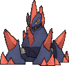

<!-- This file is generated by tools/generate_site.py. Edit the generator, not this file. -->

# #526 Gigalith

{ .sprite-lg loading=lazy }

**Compressed Pokémon**

Rock

[:material-arrow-left: #525 Boldore](525.md) · [Pokédex](index.md) · [#527 Woobat :material-arrow-right:](527.md)

!!! info "Changes in Rising Ruby / Sinking Sapphire"

    - **Ability 2:** **Sand Force** 

## Location

Evolve { .icon loading=lazy } [Boldore](../pokemon/525.md) (Happiness / Lv. 36)

## Type defenses

| Damage taken | Attacking types |
| --- | --- |
| Resistant (×½) | Normal Flying Poison Fire |
| Neutral (×1) | Rock Bug Ghost Electric Psychic Ice Dragon Dark Fairy |
| Weak (×2) | Fighting Ground Steel Water Grass |

## Abilities

| Slot | Ability | Effect | Note |
| --- | --- | --- | --- |
| Ability 1 | **Sturdy** | Prevents being KOed from full HP, leaving 1 HP instead.  Protects against the one-hit KO moves regardless of HP. |  |
| Ability 2 | **Sand Force** | Strengthens Rock, Ground, and Steel moves to 1.3× their power during a sandstorm.  Protects against sandstorm damage. | changed  |
| Hidden | **Sand Force** | Strengthens Rock, Ground, and Steel moves to 1.3× their power during a sandstorm.  Protects against sandstorm damage. |  |

## Base stats

| Form | HP | Atk | Def | SpA | SpD | Spe | BST |
| --- | --- | --- | --- | --- | --- | --- | --- |
| { .sprite-sm loading=lazy } Normal | 85 | 135 | 130 | 60 | 80 | 25 | **515** |

## Training & breeding

| Property | Value |
| --- | --- |
| EV yield | 3 Atk |
| Catch rate | 45 |
| Base friendship | 70 |
| Base experience | 232 |
| Growth rate | medium slow |
| Egg groups | Mineral |
| Hatch counter | 15 |
| Gender ratio | 50% ♂ / 50% ♀ |
| Height / weight | 1.7 m / 260 kg |

## Evolution

- { .icon loading=lazy } [Roggenrola](../pokemon/524.md) → { .icon loading=lazy } [Boldore](../pokemon/525.md): Lv. 25
- { .icon loading=lazy } [Boldore](../pokemon/525.md) → { .icon loading=lazy } **[Gigalith](../pokemon/526.md)**: Happiness / Lv. 36 changed <small>(vanilla: Trade)</small>

## Wild held items

| Item | Chance | Note |
| --- | --- | --- |
| { .item loading=lazy } Everstone | 50% |  |
| { .item loading=lazy } Hard Stone | 5% |  |

## Level-up moves { data-search-exclude }

Moves marked &#42; are not normally learned by level up (they come from egg moves, TMs/HMs or tutors in the official games); moves marked &#42;&#42; cannot normally be learned by this Pokémon at all and are omitted from the legal-moves version of the hack.

| Lv. | Move | Type | Cat. | Power | Acc. | PP | Effect | Note |
| --- | --- | --- | --- | --- | --- | --- | --- | --- |
| 1 | Tackle | Normal | Physical | 50 | 100% | 35 | Inflicts regular damage with no additional effect. |  |
| 4 | Harden | Normal | Status | — | — | 30 | Raises the user’s Defense by one stage. |  |
| 7 | Sand Attack | Ground | Status | — | 100% | 15 | Lowers the target’s accuracy by one stage. |  |
| 10 | Headbutt | Normal | Physical | 70 | 100% | 15 | Has a chance to make the target flinch. |  |
| 13 | Smack Down | Rock | Physical | 50 | 100% | 15 | Removes any immunity to Ground damage. |  |
| 16 | Mud-Slap | Ground | Special | 20 | 100% | 10 | Has a chance to lower the target’s accuracy by one stage. |  |
| 19 | Iron Defense | Steel | Status | — | — | 15 | Raises the user’s Defense by two stages. |  |
| 22 | Rock Blast | Rock | Physical | 25 | 90% | 10 | Hits 2-5 times in one turn. |  |
| 25 | [Power Gem](../changes/moves.md#power-gem) changed | Rock | Special | 90 | 100% | 10 | Inflicts regular damage with no additional effect. |  |
| 26 | Magnitude | Ground | Physical | — | 100% | 30 | Power varies randomly from 10 to 150. | &#42; |
| 30 | Rock Slide | Rock | Physical | 75 | 90% | 10 | Has a chance to make the target flinch. |  |
| 34 | Stealth Rock | Rock | Status | — | — | 20 | Causes damage when opposing Pokémon switch in. |  |
| 38 | Sandstorm | Rock | Status | — | — | 10 | Changes the weather to a sandstorm for five turns. |  |
| 42 | Autotomize | Steel | Status | — | — | 15 | Raises the user’s Speed by two stages and halves the user’s weight. | &#42; |
| 46 | Stone Edge | Rock | Physical | 100 | 80% | 5 | Has an increased chance for a critical hit. |  |
| 50 | Explosion | Normal | Physical | 250 | 100% | 5 | User faints. |  |
| 54 | Heavy Slam | Steel | Physical | — | 100% | 10 | Power is higher when the user weighs more than the target, up to a maximum of 120. | &#42; |

## TM & HM moves { data-search-exclude }

| Machine | Move | Type | Cat. | Power | Acc. | PP | Effect |
| --- | --- | --- | --- | --- | --- | --- | --- |
| HM04 | [Strength](../changes/moves.md#strength) changed | Normal | Physical | 100 | 100% | 10 | Inflicts regular damage with no additional effect. |
| HM06 | [Rock Smash](../changes/moves.md#rock-smash) changed | Fighting | Physical | 65 | 100% | 15 | Has a chance to lower the target’s Defense by one stage. |
| TM06 | Toxic | Poison | Status | — | 90% | 10 | Badly poisons the target, inflicting more damage every turn. |
| TM10 | Hidden Power | Normal | Special | 60 | 100% | 15 | Power and type depend upon user’s IVs.  Power can range from 30 to 70. |
| TM100 | Confide | Normal | Status | — | — | 20 | Lowers the target’s Special Attack by one stage. |
| TM15 | Hyper Beam | Normal | Special | 150 | 90% | 5 | User foregoes its next turn to recharge. |
| TM17 | Protect | Normal | Status | — | — | 10 | Prevents any moves from hitting the user this turn. |
| TM21 | Frustration | Normal | Physical | — | 100% | 20 | Power increases as happiness decreases, up to a maximum of 102. |
| TM22 | Solar Beam | Grass | Special | 120 | 100% | 10 | Requires a turn to charge before attacking. |
| TM23 | Smack Down | Rock | Physical | 50 | 100% | 15 | Removes any immunity to Ground damage. |
| TM26 | Earthquake | Ground | Physical | 100 | 100% | 10 | Inflicts regular damage and can hit Dig users. |
| TM27 | Return | Normal | Physical | — | 100% | 20 | Power increases with happiness, up to a maximum of 102. |
| TM32 | Double Team | Normal | Status | — | — | 15 | Raises the user’s evasion by one stage. |
| TM37 | Sandstorm | Rock | Status | — | — | 10 | Changes the weather to a sandstorm for five turns. |
| TM39 | Rock Tomb | Rock | Physical | 60 | 95% | 15 | Has a chance to lower the target’s Speed by one stage. |
| TM42 | Facade | Normal | Physical | 70 | 100% | 20 | Power doubles if user is burned, paralyzed, or poisoned. |
| TM44 | Rest | Psychic | Status | — | — | 5 | User sleeps for two turns, completely healing itself. |
| TM45 | Attract | Normal | Status | — | 100% | 15 | Target falls in love if it has the opposite gender, and has a 50% chance to refuse attacking the user. |
| TM48 | Round | Normal | Special | 60 | 100% | 15 | Has double power if it’s used more than once per turn. |
| TM64 | Explosion | Normal | Physical | 250 | 100% | 5 | User faints. |
| TM68 | Giga Impact | Normal | Physical | 150 | 90% | 5 | User foregoes its next turn to recharge. |
| TM69 | Rock Polish | Rock | Status | — | — | 20 | Raises the user’s Speed by two stages. |
| TM71 | Stone Edge | Rock | Physical | 100 | 80% | 5 | Has an increased chance for a critical hit. |
| TM78 | Bulldoze | Ground | Physical | 60 | 100% | 20 | Has a chance to lower the target’s Speed by one stage. |
| TM80 | Rock Slide | Rock | Physical | 75 | 90% | 10 | Has a chance to make the target flinch. |
| TM87 | Swagger | Normal | Status | — | 90% | 15 | Raises the target’s Attack by two stages and confuses the target. |
| TM88 | Sleep Talk | Normal | Status | — | — | 10 | Randomly uses one of the user’s other three moves.  Only works if the user is sleeping. |
| TM90 | Substitute | Normal | Status | — | — | 10 | Transfers 1/4 of the user’s max HP into a doll, protecting the user from further damage or status changes until it breaks. |
| TM91 | Flash Cannon | Steel | Special | 80 | 100% | 10 | Has a chance to lower the target’s Special Defense by one stage. |
| TM94 | Secret Power | Normal | Physical | 70 | 100% | 20 | Has a chance to inflict a status effect which depends upon the terrain. |
| TM96 | Nature Power | Normal | Status | — | — | 20 | Uses a move which depends upon the terrain. |

## Move tutor moves { data-search-exclude }

| Move | Type | Cat. | Power | Acc. | PP | Effect |
| --- | --- | --- | --- | --- | --- | --- |
| Block | Normal | Status | — | — | 5 | Prevents the target from leaving battle. |
| Earth Power | Ground | Special | 90 | 100% | 10 | Has a chance to lower the target’s Special Defense by one stage. |
| Gravity | Psychic | Status | — | — | 5 | Disables moves and immunities that involve flying or levitating for five turns. |
| Iron Defense | Steel | Status | — | — | 15 | Raises the user’s Defense by two stages. |
| Iron Head | Steel | Physical | 80 | 100% | 15 | Has a chance to make the target flinch. |
| Snore | Normal | Special | 50 | 100% | 15 | Has a chance to make the target flinch.  Only works if the user is sleeping. |
| Stealth Rock | Rock | Status | — | — | 20 | Causes damage when opposing Pokémon switch in. |
| Superpower | Fighting | Physical | 120 | 100% | 5 | Lowers the user’s Attack and Defense by one stage after inflicting damage. |

## Egg moves { data-search-exclude }

No egg moves.

??? note "Trainers using Gigalith (6)"

    | Area | Trainer | Level |
    | --- | --- | --- |
    | [Route 112 South](../trainers/route_112_south.md#rematches) | Hiker Trent (6) | Lv. 47 |
    | [Route 112 South](../trainers/route_112_south.md#rematches) | Hiker Trent (8) | Lv. 64 |
    | [Route 112 South](../trainers/route_112_south.md#rematches) | Hiker Trent (C) | Lv. 75 |
    | [Weather Institute](../trainers/weather_institute.md#trainers) | Magma Admin Tabitha | Lv. 46 |
    | [Route 129](../trainers/route_129.md#trainers) | Ace Trainer Honor | Lv. 55 |
    | [Seafloor Cavern Front Rooms](../trainers/seafloor_cavern_front_rooms.md#trainers) | Team Magma Grunt | Lv. 60 |

---

[:material-arrow-left: #525 Boldore](525.md) · [#527 Woobat :material-arrow-right:](527.md)
