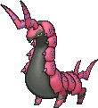
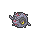

<!-- This file is generated by tools/generate_site.py. Edit the generator, not this file. -->

# #545 Scolipede

{ .sprite-lg loading=lazy }

**Megapede Pokémon**

Bug Poison

[:material-arrow-left: #544 Whirlipede](544.md) · [Pokédex](index.md) · [#546 Cottonee :material-arrow-right:](546.md)

!!! note "No documented changes"

    Drayano's documentation lists no stat, type, ability, evolution or held item changes for this Pokémon. Its level-up moves are listed below as they appear in the hack.

## Location

Evolve { .icon loading=lazy } [Whirlipede](../pokemon/544.md) (Lv. 30)

## Type defenses

| Damage taken | Attacking types |
| --- | --- |
| Very resistant (×¼) | Fighting Grass |
| Resistant (×½) | Poison Bug Fairy |
| Neutral (×1) | Normal Ground Ghost Steel Water Electric Ice Dragon Dark |
| Weak (×2) | Flying Rock Fire Psychic |

## Abilities

| Slot | Ability | Effect | Note |
| --- | --- | --- | --- |
| Ability 1 | **Poison Point** | Has a 30% chance of poisoning attacking Pokémon on contact. |  |
| Ability 2 | **Swarm** | Strengthens Bug moves to inflict 1.5× damage at 1/3 max HP or less. |  |
| Hidden | **Speed Boost** | Raises Speed one stage after each turn. |  |

## Base stats

| Form | HP | Atk | Def | SpA | SpD | Spe | BST |
| --- | --- | --- | --- | --- | --- | --- | --- |
| { .sprite-sm loading=lazy } Normal | 60 | 100 | 89 | 55 | 69 | 112 | **485** |

## Training & breeding

| Property | Value |
| --- | --- |
| EV yield | 3 Spe |
| Catch rate | 45 |
| Base friendship | 70 |
| Base experience | 218 |
| Growth rate | medium slow |
| Egg groups | Bug |
| Hatch counter | 20 |
| Gender ratio | 50% ♂ / 50% ♀ |
| Height / weight | 2.5 m / 200.5 kg |

## Evolution

- { .icon loading=lazy } [Venipede](../pokemon/543.md) → { .icon loading=lazy } [Whirlipede](../pokemon/544.md): Lv. 22
- { .icon loading=lazy } [Whirlipede](../pokemon/544.md) → { .icon loading=lazy } **[Scolipede](../pokemon/545.md)**: Lv. 30

## Wild held items

| Item | Chance | Note |
| --- | --- | --- |
| { .item loading=lazy } Poison Barb | 5% |  |

## Level-up moves { data-search-exclude }

Moves marked &#42; are not normally learned by level up (they come from egg moves, TMs/HMs or tutors in the official games); moves marked &#42;&#42; cannot normally be learned by this Pokémon at all and are omitted from the legal-moves version of the hack.

| Lv. | Move | Type | Cat. | Power | Acc. | PP | Effect | Note |
| --- | --- | --- | --- | --- | --- | --- | --- | --- |
| 1 | Megahorn | Bug | Physical | 120 | 85% | 10 | Inflicts regular damage with no additional effect. |  |
| 1 | Aqua Tail | Water | Physical | 90 | 90% | 10 | Inflicts regular damage with no additional effect. | &#42; |
| 1 | Twineedle | Bug | Physical | 25 | 100% | 20 | Hits twice in the same turn.  Has a chance to poison the target. | &#42; |
| 1 | Defense Curl | Normal | Status | — | — | 40 | Raises user’s Defense by one stage. |  |
| 1 | Rollout | Rock | Physical | 30 | 90% | 20 | Power doubles every turn this move is used in succession after the first, resetting after five turns. |  |
| 5 | Poison Sting | Poison | Physical | 15 | 100% | 35 | Has a chance to poison the target. |  |
| 8 | Screech | Normal | Status | — | 85% | 40 | Lowers the target’s Defense by two stages. |  |
| 11 | Pursuit | Dark | Physical | 40 | 100% | 20 | Has double power against, and can hit, Pokémon attempting to switch out. |  |
| 14 | Poison Tail | Poison | Physical | 50 | 100% | 25 | Has an increased chance for a critical hit and a chance to poison the target. |  |
| 17 | Protect | Normal | Status | — | — | 10 | Prevents any moves from hitting the user this turn. |  |
| 20 | Bug Bite | Bug | Physical | 60 | 100% | 20 | If target has a berry, inflicts double damage and uses the berry. |  |
| 22 | Iron Defense | Steel | Status | — | — | 15 | Raises the user’s Defense by two stages. |  |
| 23 | Venoshock | Poison | Special | 65 | 100% | 10 | Inflicts double damage if the target is Poisoned. |  |
| 27 | Agility | Psychic | Status | — | — | 30 | Raises the user’s Speed by two stages. |  |
| 30 | Baton Pass | Normal | Status | — | — | 40 | Allows the trainer to switch out the user and pass effects along to its replacement. |  |
| 32 | [Steamroller](../changes/moves.md#steamroller) changed | Bug | Physical | 85 | 90% | 10 | Has a chance to make the target flinch. |  |
| 37 | Poison Jab | Poison | Physical | 80 | 100% | 20 | Has a chance to poison the target. | &#42; |
| 42 | Toxic | Poison | Status | — | 90% | 10 | Badly poisons the target, inflicting more damage every turn. |  |
| 47 | Venom Drench | Poison | Status | — | 100% | 20 | Lowers the target’s Attack, Special Attack, and Speed by one stage if it is poisoned. |  |
| 52 | Rock Climb | Normal | Physical | 90 | 85% | 20 | Has a chance to confuse the target. |  |
| 57 | Double-Edge | Normal | Physical | 120 | 100% | 15 | User receives 1/3 the damage inflicted in recoil. |  |
| 62 | Megahorn | Bug | Physical | 120 | 85% | 10 | Inflicts regular damage with no additional effect. |  |

## TM & HM moves { data-search-exclude }

| Machine | Move | Type | Cat. | Power | Acc. | PP | Effect |
| --- | --- | --- | --- | --- | --- | --- | --- |
| HM01 | [Cut](../changes/moves.md#cut) changed | Grass | Physical | 70 | 100% | 15 | High Critical Rate. High Critical Rate |
| HM04 | [Strength](../changes/moves.md#strength) changed | Normal | Physical | 100 | 100% | 10 | Inflicts regular damage with no additional effect. |
| HM06 | [Rock Smash](../changes/moves.md#rock-smash) changed | Fighting | Physical | 65 | 100% | 15 | Has a chance to lower the target’s Defense by one stage. |
| TM06 | Toxic | Poison | Status | — | 90% | 10 | Badly poisons the target, inflicting more damage every turn. |
| TM09 | Venoshock | Poison | Special | 65 | 100% | 10 | Inflicts double damage if the target is Poisoned. |
| TM10 | Hidden Power | Normal | Special | 60 | 100% | 15 | Power and type depend upon user’s IVs.  Power can range from 30 to 70. |
| TM100 | Confide | Normal | Status | — | — | 20 | Lowers the target’s Special Attack by one stage. |
| TM11 | Sunny Day | Fire | Status | — | — | 5 | Changes the weather to sunny for five turns. |
| TM15 | Hyper Beam | Normal | Special | 150 | 90% | 5 | User foregoes its next turn to recharge. |
| TM17 | Protect | Normal | Status | — | — | 10 | Prevents any moves from hitting the user this turn. |
| TM21 | Frustration | Normal | Physical | — | 100% | 20 | Power increases as happiness decreases, up to a maximum of 102. |
| TM22 | Solar Beam | Grass | Special | 120 | 100% | 10 | Requires a turn to charge before attacking. |
| TM26 | Earthquake | Ground | Physical | 100 | 100% | 10 | Inflicts regular damage and can hit Dig users. |
| TM27 | Return | Normal | Physical | — | 100% | 20 | Power increases with happiness, up to a maximum of 102. |
| TM28 | Dig | Ground | Physical | 80 | 100% | 10 | User digs underground, dodging all attacks, and hits next turn. |
| TM32 | Double Team | Normal | Status | — | — | 15 | Raises the user’s evasion by one stage. |
| TM36 | Sludge Bomb | Poison | Special | 90 | 100% | 10 | Has a chance to poison the target. |
| TM39 | Rock Tomb | Rock | Physical | 60 | 95% | 15 | Has a chance to lower the target’s Speed by one stage. |
| TM42 | Facade | Normal | Physical | 70 | 100% | 20 | Power doubles if user is burned, paralyzed, or poisoned. |
| TM44 | Rest | Psychic | Status | — | — | 5 | User sleeps for two turns, completely healing itself. |
| TM45 | Attract | Normal | Status | — | 100% | 15 | Target falls in love if it has the opposite gender, and has a 50% chance to refuse attacking the user. |
| TM48 | Round | Normal | Special | 60 | 100% | 15 | Has double power if it’s used more than once per turn. |
| TM66 | Payback | Dark | Physical | 50 | 100% | 10 | Power is doubled if the target has already moved this turn. |
| TM68 | Giga Impact | Normal | Physical | 150 | 90% | 5 | User foregoes its next turn to recharge. |
| TM74 | Gyro Ball | Steel | Physical | — | 100% | 5 | Power raises when the user has lower Speed, up to a maximum of 150. |
| TM75 | Swords Dance | Normal | Status | — | — | 20 | Raises the user’s Attack by two stages. |
| TM76 | Struggle Bug | Bug | Special | 50 | 100% | 20 | Has a chance to lower the target’s Special Attack by one stage. |
| TM78 | Bulldoze | Ground | Physical | 60 | 100% | 20 | Has a chance to lower the target’s Speed by one stage. |
| TM80 | Rock Slide | Rock | Physical | 75 | 90% | 10 | Has a chance to make the target flinch. |
| TM81 | X-Scissor | Bug | Physical | 80 | 100% | 15 | Inflicts regular damage with no additional effect. |
| TM83 | Infestation | Bug | Special | 20 | 100% | 20 | Prevents the target from fleeing and inflicts damage for 2-5 turns. |
| TM84 | Poison Jab | Poison | Physical | 80 | 100% | 20 | Has a chance to poison the target. |
| TM87 | Swagger | Normal | Status | — | 90% | 15 | Raises the target’s Attack by two stages and confuses the target. |
| TM88 | Sleep Talk | Normal | Status | — | — | 10 | Randomly uses one of the user’s other three moves.  Only works if the user is sleeping. |
| TM90 | Substitute | Normal | Status | — | — | 10 | Transfers 1/4 of the user’s max HP into a doll, protecting the user from further damage or status changes until it breaks. |
| TM94 | Secret Power | Normal | Physical | 70 | 100% | 20 | Has a chance to inflict a status effect which depends upon the terrain. |

## Move tutor moves { data-search-exclude }

| Move | Type | Cat. | Power | Acc. | PP | Effect |
| --- | --- | --- | --- | --- | --- | --- |
| Aqua Tail | Water | Physical | 90 | 90% | 10 | Inflicts regular damage with no additional effect. |
| Bug Bite | Bug | Physical | 60 | 100% | 20 | If target has a berry, inflicts double damage and uses the berry. |
| Endeavor | Normal | Physical | — | 100% | 5 | Lowers the target’s HP to equal the user’s. |
| Iron Defense | Steel | Status | — | — | 15 | Raises the user’s Defense by two stages. |
| Iron Tail | Steel | Physical | 100 | 75% | 15 | Has a chance to lower the target’s Defense by one stage. |
| Signal Beam | Bug | Special | 75 | 100% | 15 | Has a chance to confuse the target. |
| Snatch | Dark | Status | — | — | 10 | Steals the target’s move, if it’s self-targeted. |
| Snore | Normal | Special | 50 | 100% | 15 | Has a chance to make the target flinch.  Only works if the user is sleeping. |
| Superpower | Fighting | Physical | 120 | 100% | 5 | Lowers the user’s Attack and Defense by one stage after inflicting damage. |

## Egg moves { data-search-exclude }

No egg moves.

??? note "Trainers using Scolipede (13)"

    | Area | Trainer | Level |
    | --- | --- | --- |
    | [Route 113](../trainers/route_113.md#rematches) | Ninja Boy Lao (4) | Lv. 35 |
    | [Route 113](../trainers/route_113.md#rematches) | Ninja Boy Lao (6) | Lv. 47 |
    | [Route 113](../trainers/route_113.md#rematches) | Ninja Boy Lao (8) | Lv. 64 |
    | [Route 113](../trainers/route_113.md#rematches) | Ninja Boy Lao (C) | Lv. 75 |
    | [Sea Mauville Inside](../trainers/sea_mauville_inside.md#trainers) | Young Couple Lois & Hal | Lv. 38 |
    | [Sea Mauville Inside](../trainers/sea_mauville_inside.md#rematches) | Young Couple Lois & Hal (6) | Lv. 47 |
    | [Sea Mauville Inside](../trainers/sea_mauville_inside.md#rematches) | Young Couple Lois & Hal (7) | Lv. 59 |
    | [Sea Mauville Inside](../trainers/sea_mauville_inside.md#rematches) | Young Couple Lois & Hal (8) | Lv. 64 |
    | [Sea Mauville Inside](../trainers/sea_mauville_inside.md#rematches) | Young Couple Lois & Hal (C) | Lv. 75 |
    | [Route 118](../trainers/route_118.md#rematches) | Guitarist Dalton (4) | Lv. 35 |
    | [Route 118](../trainers/route_118.md#rematches) | Guitarist Dalton (6) | Lv. 47 |
    | [Route 118](../trainers/route_118.md#rematches) | Guitarist Dalton (8) | Lv. 64 |
    | [Route 118](../trainers/route_118.md#rematches) | Guitarist Dalton (C) | Lv. 75 |

---

[:material-arrow-left: #544 Whirlipede](544.md) · [#546 Cottonee :material-arrow-right:](546.md)
