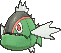
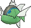

<!-- This file is generated by tools/generate_site.py. Edit the generator, not this file. -->

# #550 Basculin

{ .sprite-lg loading=lazy }

**Hostile Pokémon**

Water

[:material-arrow-left: #549 Lilligant](549.md) · [Pokédex](index.md) · [#551 Sandile :material-arrow-right:](551.md)

!!! note "No documented changes"

    Drayano's documentation lists no stat, type, ability, evolution or held item changes for this Pokémon. Its level-up moves are listed below as they appear in the hack.

## Location

[Route 104 North](../wild/route_104_north.md), [Route 111](../wild/route_111.md), [Victory Road](../wild/victory_road_1f.md)

### Wild encounters

| Area | Method | Level | Note |
| --- | --- | --- | --- |
| [Route 104 North](../wild/route_104_north.md) | Surfing | 25 - 35 |  |
| [Route 104 North](../wild/route_104_north.md) | Old Rod | 15 |  |
| [Route 104 North](../wild/route_104_north.md) | Good Rod | 35 |  |
| [Route 104 North](../wild/route_104_north.md) | Super Rod | 55 |  |
| [Route 111](../wild/route_111.md) | Surfing | 25 - 35 |  |
| [Victory Road 1F](../wild/victory_road_1f.md) | Old Rod | 15 |  |
| [Victory Road 1F](../wild/victory_road_1f.md) | Good Rod | 35 |  |
| [Victory Road 1F](../wild/victory_road_1f.md) | Super Rod | 55 |  |
| [Victory Road B1F](../wild/victory_road_b1f.md) | Old Rod | 15 |  |
| [Victory Road B1F](../wild/victory_road_b1f.md) | Good Rod | 35 |  |
| [Victory Road B1F](../wild/victory_road_b1f.md) | Super Rod | 55 |  |
| [Victory Road 2F](../wild/victory_road_2f.md) | Old Rod | 15 |  |
| [Victory Road 2F](../wild/victory_road_2f.md) | Good Rod | 35 |  |
| [Victory Road 2F](../wild/victory_road_2f.md) | Super Rod | 55 |  |

## Type defenses

| Damage taken | Attacking types |
| --- | --- |
| Resistant (×½) | Steel Fire Water Ice |
| Neutral (×1) | Normal Fighting Flying Poison Ground Rock Bug Ghost Psychic Dragon Dark Fairy |
| Weak (×2) | Grass Electric |

## Abilities

| Slot | Ability | Effect | Note |
| --- | --- | --- | --- |
| Ability 1 | **Reckless** | Strengthens recoil moves to 1.2× their power. |  |
| Ability 2 | **Adaptability** | Increases the same-type attack bonus from 1.5× to 2×. |  |
| Hidden | **Mold Breaker** | Bypasses targets' abilities if they could hinder or prevent a move. |  |

## Base stats

| Form | HP | Atk | Def | SpA | SpD | Spe | BST |
| --- | --- | --- | --- | --- | --- | --- | --- |
| { .sprite-sm loading=lazy } Normal | 70 | 92 | 65 | 80 | 55 | 98 | **460** |
| { .sprite-sm loading=lazy } Blue-Striped Basculin | 70 | 92 | 65 | 80 | 55 | 98 | **460** |

## Training & breeding

| Property | Value |
| --- | --- |
| EV yield | 2 Spe |
| Catch rate | 25 |
| Base friendship | 70 |
| Base experience | 161 |
| Growth rate | medium |
| Egg groups | Water 2 |
| Hatch counter | 40 |
| Gender ratio | 50% ♂ / 50% ♀ |
| Height / weight | 1 m / 18 kg |

## Evolution

This Pokémon does not evolve.

## Wild held items

| Item | Chance | Note |
| --- | --- | --- |
| { .item loading=lazy } Deep Sea Tooth | 5% |  |

## Level-up moves { data-search-exclude }

Moves marked &#42; are not normally learned by level up (they come from egg moves, TMs/HMs or tutors in the official games); moves marked &#42;&#42; cannot normally be learned by this Pokémon at all and are omitted from the legal-moves version of the hack.

| Lv. | Move | Type | Cat. | Power | Acc. | PP | Effect | Note |
| --- | --- | --- | --- | --- | --- | --- | --- | --- |
| 1 | Thrash | Normal | Physical | 120 | 100% | 10 | Hits every turn for 2-3 turns, then confuses the user. |  |
| 1 | Flail | Normal | Physical | — | 100% | 15 | Inflicts more damage when the user has less HP remaining, with a maximum of 200 power. |  |
| 1 | Tail Whip | Normal | Status | — | 100% | 30 | Lowers the target’s Defense by one stage. |  |
| 1 | Tackle | Normal | Physical | 50 | 100% | 35 | Inflicts regular damage with no additional effect. |  |
| 1 | Water Gun | Water | Special | 40 | 100% | 25 | Inflicts regular damage with no additional effect. |  |
| 4 | Uproar | Normal | Special | 90 | 100% | 10 | Forced to use this move for several turns.  Pokémon cannot fall asleep in that time. |  |
| 7 | Headbutt | Normal | Physical | 70 | 100% | 15 | Has a chance to make the target flinch. |  |
| 10 | Bite | Dark | Physical | 60 | 100% | 25 | Has a chance to make the target flinch. |  |
| 13 | Aqua Jet | Water | Physical | 40 | 100% | 20 | Inflicts regular damage with no additional effect. |  |
| 16 | Chip Away | Normal | Physical | 70 | 100% | 20 | Ignores the target’s stat modifiers. |  |
| 19 | Take Down | Normal | Physical | 90 | 85% | 20 | User receives 1/4 the damage it inflicts in recoil. |  |
| 22 | Crunch | Dark | Physical | 80 | 100% | 15 | Has a chance to lower the target’s Defense by one stage. |  |
| 25 | Aqua Tail | Water | Physical | 90 | 90% | 10 | Inflicts regular damage with no additional effect. |  |
| 28 | Revenge | Fighting | Physical | 60 | 100% | 10 | Inflicts double damage if the user takes damage before attacking this turn. | &#42; |
| 31 | Soak | Water | Status | — | 100% | 20 | Changes the target’s type to Water. |  |
| 34 | Zen Headbutt | Psychic | Physical | 80 | 90% | 15 | Has a chance to make the target flinch. | &#42; |
| 37 | Double-Edge | Normal | Physical | 120 | 100% | 15 | User receives 1/3 the damage inflicted in recoil. |  |
| 40 | Scary Face | Normal | Status | — | 100% | 10 | Lowers the target’s Speed by two stages. |  |
| 43 | Flail | Normal | Physical | — | 100% | 15 | Inflicts more damage when the user has less HP remaining, with a maximum of 200 power. |  |
| 46 | Final Gambit | Fighting | Special | — | 100% | 5 | Inflicts damage equal to the user’s remaining HP.  User faints. |  |
| 49 | Thrash | Normal | Physical | 120 | 100% | 10 | Hits every turn for 2-3 turns, then confuses the user. |  |
| 52 | Superpower | Fighting | Physical | 120 | 100% | 5 | Lowers the user’s Attack and Defense by one stage after inflicting damage. | &#42; |

## TM & HM moves { data-search-exclude }

| Machine | Move | Type | Cat. | Power | Acc. | PP | Effect |
| --- | --- | --- | --- | --- | --- | --- | --- |
| HM01 | [Cut](../changes/moves.md#cut) changed | Grass | Physical | 70 | 100% | 15 | High Critical Rate. High Critical Rate |
| HM03 | Surf | Water | Special | 90 | 100% | 15 | Inflicts regular damage and can hit Dive users. |
| HM05 | Waterfall | Water | Physical | 80 | 100% | 15 | Has a chance to make the target flinch. |
| HM07 | Dive | Water | Physical | 80 | 100% | 10 | User dives underwater, dodging all attacks, and hits next turn. |
| TM06 | Toxic | Poison | Status | — | 90% | 10 | Badly poisons the target, inflicting more damage every turn. |
| TM07 | Hail | Ice | Status | — | — | 10 | Changes the weather to a hailstorm for five turns. |
| TM10 | Hidden Power | Normal | Special | 60 | 100% | 15 | Power and type depend upon user’s IVs.  Power can range from 30 to 70. |
| TM100 | Confide | Normal | Status | — | — | 20 | Lowers the target’s Special Attack by one stage. |
| TM12 | Taunt | Dark | Status | — | 100% | 20 | For the next few turns, the target can only use damaging moves. |
| TM13 | Ice Beam | Ice | Special | 90 | 100% | 10 | Has a chance to freeze the target. |
| TM17 | Protect | Normal | Status | — | — | 10 | Prevents any moves from hitting the user this turn. |
| TM18 | Rain Dance | Water | Status | — | — | 5 | Changes the weather to rain for five turns. |
| TM21 | Frustration | Normal | Physical | — | 100% | 20 | Power increases as happiness decreases, up to a maximum of 102. |
| TM27 | Return | Normal | Physical | — | 100% | 20 | Power increases with happiness, up to a maximum of 102. |
| TM32 | Double Team | Normal | Status | — | — | 15 | Raises the user’s evasion by one stage. |
| TM42 | Facade | Normal | Physical | 70 | 100% | 20 | Power doubles if user is burned, paralyzed, or poisoned. |
| TM44 | Rest | Psychic | Status | — | — | 5 | User sleeps for two turns, completely healing itself. |
| TM45 | Attract | Normal | Status | — | 100% | 15 | Target falls in love if it has the opposite gender, and has a 50% chance to refuse attacking the user. |
| TM48 | Round | Normal | Special | 60 | 100% | 15 | Has double power if it’s used more than once per turn. |
| TM55 | Scald | Water | Special | 80 | 100% | 15 | Has a chance to burn the target. |
| TM87 | Swagger | Normal | Status | — | 90% | 15 | Raises the target’s Attack by two stages and confuses the target. |
| TM88 | Sleep Talk | Normal | Status | — | — | 10 | Randomly uses one of the user’s other three moves.  Only works if the user is sleeping. |
| TM90 | Substitute | Normal | Status | — | — | 10 | Transfers 1/4 of the user’s max HP into a doll, protecting the user from further damage or status changes until it breaks. |
| TM94 | Secret Power | Normal | Physical | 70 | 100% | 20 | Has a chance to inflict a status effect which depends upon the terrain. |

## Move tutor moves { data-search-exclude }

| Move | Type | Cat. | Power | Acc. | PP | Effect |
| --- | --- | --- | --- | --- | --- | --- |
| Aqua Tail | Water | Physical | 90 | 90% | 10 | Inflicts regular damage with no additional effect. |
| Bounce | Flying | Physical | 85 | 85% | 5 | User bounces high into the air, dodging all attacks, and hits next turn. |
| Endeavor | Normal | Physical | — | 100% | 5 | Lowers the target’s HP to equal the user’s. |
| Icy Wind | Ice | Special | 55 | 95% | 15 | Has a chance to lower the target’s Speed by one stage. |
| Snore | Normal | Special | 50 | 100% | 15 | Has a chance to make the target flinch.  Only works if the user is sleeping. |
| Superpower | Fighting | Physical | 120 | 100% | 5 | Lowers the user’s Attack and Defense by one stage after inflicting damage. |
| Uproar | Normal | Special | 90 | 100% | 10 | Forced to use this move for several turns.  Pokémon cannot fall asleep in that time. |
| Zen Headbutt | Psychic | Physical | 80 | 90% | 15 | Has a chance to make the target flinch. |

## Egg moves { data-search-exclude }

| Move | Type | Cat. | Power | Acc. | PP | Effect |
| --- | --- | --- | --- | --- | --- | --- |
| Agility | Psychic | Status | — | — | 30 | Raises the user’s Speed by two stages. |
| Brine | Water | Special | 65 | 100% | 10 | Has double power against Pokémon that have less than half their max HP remaining. |
| Bubble Beam | Water | Special | 65 | 100% | 20 | Has a chance to lower the target’s Speed by one stage. |
| Mud Shot | Ground | Special | 55 | 95% | 15 | Has a chance to lower the target’s Speed by one stage. |
| Muddy Water | Water | Special | 90 | 85% | 10 | Has a chance to lower the target’s accuracy by one stage. |
| Rage | Normal | Physical | 20 | 100% | 20 | If the user is hit after using this move, its Attack rises by one stage. |
| Revenge | Fighting | Physical | 60 | 100% | 10 | Inflicts double damage if the user takes damage before attacking this turn. |
| Swift | Normal | Special | 60 | — | 20 | Never misses. |
| Whirlpool | Water | Special | 35 | 85% | 15 | Prevents the target from leaving battle and inflicts 1/16 its max HP in damage for 2-5 turns. |

??? note "Trainers using Basculin (4)"

    | Area | Trainer | Level |
    | --- | --- | --- |
    | [Route 104 North](../trainers/route_104_north.md#trainers) | Fisherman Ivan | Lv. 12 |
    | [Route 104 North](../trainers/route_104_north.md#trainers) | Fisherman Ivan | Lv. 12 |
    | [Route 132](../trainers/route_132.md#trainers) | Fisherman Ronald | Lv. 58 |
    | [Route 132](../trainers/route_132.md#trainers) | Fisherman Ronald | Lv. 58 |

---

[:material-arrow-left: #549 Lilligant](549.md) · [#551 Sandile :material-arrow-right:](551.md)
