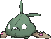

<!-- This file is generated by tools/generate_site.py. Edit the generator, not this file. -->

# #568 Trubbish

{ .sprite-lg loading=lazy }

**Trash Bag Pokémon**

Poison

[:material-arrow-left: #567 Archeops](567.md) · [Pokédex](index.md) · [#569 Garbodor :material-arrow-right:](569.md)

!!! info "Changes in Rising Ruby / Sinking Sapphire"

    - **Evolution level:** 36 → **34**

## Location

[Route 110](../wild/route_110.md)

### Wild encounters

| Area | Method | Level | Note |
| --- | --- | --- | --- |
| [Route 110](../wild/route_110.md) | Grass | 17 |  |

## Type defenses

| Damage taken | Attacking types |
| --- | --- |
| Resistant (×½) | Fighting Poison Bug Grass Fairy |
| Neutral (×1) | Normal Flying Rock Ghost Steel Fire Water Electric Ice Dragon Dark |
| Weak (×2) | Ground Psychic |

## Abilities

| Slot | Ability | Effect | Note |
| --- | --- | --- | --- |
| Ability 1 | **Stench** | Has a 10% chance of making target Pokémon flinch with each hit. |  |
| Ability 2 | **Sticky Hold** | Prevents a held item from being removed by other Pokémon. |  |
| Hidden | **Aftermath** | Damages the attacker for 1/4 its max HP when knocked out by a contact move. |  |

## Base stats

| Form | HP | Atk | Def | SpA | SpD | Spe | BST |
| --- | --- | --- | --- | --- | --- | --- | --- |
| { .sprite-sm loading=lazy } Normal | 50 | 50 | 62 | 40 | 62 | 65 | **329** |

## Training & breeding

| Property | Value |
| --- | --- |
| EV yield | 1 Spe |
| Catch rate | 190 |
| Base friendship | 70 |
| Base experience | 66 |
| Growth rate | medium |
| Egg groups | Mineral |
| Hatch counter | 20 |
| Gender ratio | 50% ♂ / 50% ♀ |
| Height / weight | 0.6 m / 31 kg |

## Evolution

- { .icon loading=lazy } **[Trubbish](../pokemon/568.md)** → { .icon loading=lazy } [Garbodor](../pokemon/569.md): Lv. 34 changed <small>(vanilla: Lv. 36)</small>

## Wild held items

| Item | Chance | Note |
| --- | --- | --- |
| { .item loading=lazy } Black Sludge | 5% |  |

## Level-up moves { data-search-exclude }

Moves marked &#42; are not normally learned by level up (they come from egg moves, TMs/HMs or tutors in the official games); moves marked &#42;&#42; cannot normally be learned by this Pokémon at all and are omitted from the legal-moves version of the hack.

| Lv. | Move | Type | Cat. | Power | Acc. | PP | Effect | Note |
| --- | --- | --- | --- | --- | --- | --- | --- | --- |
| 1 | [Pound](../changes/moves.md#pound) changed | Normal | Physical | 50 | 100% | 35 | Inflicts regular damage with no additional effect. |  |
| 1 | Poison Gas | Poison | Status | — | 90% | 40 | Poisons the target. |  |
| 3 | Recycle | Normal | Status | — | — | 10 | User recovers the item it last used up. |  |
| 6 | Toxic Spikes | Poison | Status | — | — | 20 | Scatters poisoned spikes, poisoning opposing Pokémon that switch in. |  |
| 9 | Acid Spray | Poison | Special | 40 | 100% | 20 | Lowers the target’s Special Defense by two stages. |  |
| 12 | Double Slap | Normal | Physical | 15 | 85% | 10 | Hits 2-5 times in one turn. |  |
| 15 | Sludge | Poison | Special | 65 | 100% | 20 | Has a chance to poison the target. |  |
| 18 | Stockpile | Normal | Status | — | — | 20 | Stores energy up to three times for use with Spit Up and Swallow. |  |
| 18 | Swallow | Normal | Status | — | — | 10 | Recovers 1/4 HP after one Stockpile, 1/2 HP after two Stockpiles, or full HP after three Stockpiles. |  |
| 21 | Take Down | Normal | Physical | 90 | 85% | 20 | User receives 1/4 the damage it inflicts in recoil. |  |
| 24 | Rock Blast | Rock | Physical | 25 | 90% | 10 | Hits 2-5 times in one turn. | &#42; |
| 27 | Sludge Bomb | Poison | Special | 90 | 100% | 10 | Has a chance to poison the target. |  |
| 30 | Clear Smog | Poison | Special | 50 | — | 15 | Removes all of the target’s stat modifiers. |  |
| 33 | Toxic | Poison | Status | — | 90% | 10 | Badly poisons the target, inflicting more damage every turn. |  |
| 36 | Seed Bomb | Grass | Physical | 80 | 100% | 15 | Inflicts regular damage with no additional effect. | &#42; |
| 39 | Amnesia | Psychic | Status | — | — | 20 | Raises the user’s Special Defense by two stages. |  |
| 42 | Belch | Poison | Special | 120 | 90% | 10 | Can only be used after the user has eaten a berry. |  |
| 45 | Gunk Shot | Poison | Physical | 120 | 80% | 5 | Has a chance to poison the target. |  |
| 48 | Explosion | Normal | Physical | 250 | 100% | 5 | User faints. |  |

## TM & HM moves { data-search-exclude }

| Machine | Move | Type | Cat. | Power | Acc. | PP | Effect |
| --- | --- | --- | --- | --- | --- | --- | --- |
| TM06 | Toxic | Poison | Status | — | 90% | 10 | Badly poisons the target, inflicting more damage every turn. |
| TM09 | Venoshock | Poison | Special | 65 | 100% | 10 | Inflicts double damage if the target is Poisoned. |
| TM10 | Hidden Power | Normal | Special | 60 | 100% | 15 | Power and type depend upon user’s IVs.  Power can range from 30 to 70. |
| TM100 | Confide | Normal | Status | — | — | 20 | Lowers the target’s Special Attack by one stage. |
| TM11 | Sunny Day | Fire | Status | — | — | 5 | Changes the weather to sunny for five turns. |
| TM17 | Protect | Normal | Status | — | — | 10 | Prevents any moves from hitting the user this turn. |
| TM18 | Rain Dance | Water | Status | — | — | 5 | Changes the weather to rain for five turns. |
| TM21 | Frustration | Normal | Physical | — | 100% | 20 | Power increases as happiness decreases, up to a maximum of 102. |
| TM27 | Return | Normal | Physical | — | 100% | 20 | Power increases with happiness, up to a maximum of 102. |
| TM32 | Double Team | Normal | Status | — | — | 15 | Raises the user’s evasion by one stage. |
| TM34 | Sludge Wave | Poison | Special | 95 | 100% | 10 | Has a chance to poison the target. |
| TM36 | Sludge Bomb | Poison | Special | 90 | 100% | 10 | Has a chance to poison the target. |
| TM42 | Facade | Normal | Physical | 70 | 100% | 20 | Power doubles if user is burned, paralyzed, or poisoned. |
| TM44 | Rest | Psychic | Status | — | — | 5 | User sleeps for two turns, completely healing itself. |
| TM45 | Attract | Normal | Status | — | 100% | 15 | Target falls in love if it has the opposite gender, and has a 50% chance to refuse attacking the user. |
| TM46 | Thief | Dark | Physical | 60 | 100% | 25 | Takes the target’s item. |
| TM48 | Round | Normal | Special | 60 | 100% | 15 | Has double power if it’s used more than once per turn. |
| TM64 | Explosion | Normal | Physical | 250 | 100% | 5 | User faints. |
| TM66 | Payback | Dark | Physical | 50 | 100% | 10 | Power is doubled if the target has already moved this turn. |
| TM83 | Infestation | Bug | Special | 20 | 100% | 20 | Prevents the target from fleeing and inflicts damage for 2-5 turns. |
| TM87 | Swagger | Normal | Status | — | 90% | 15 | Raises the target’s Attack by two stages and confuses the target. |
| TM88 | Sleep Talk | Normal | Status | — | — | 10 | Randomly uses one of the user’s other three moves.  Only works if the user is sleeping. |
| TM90 | Substitute | Normal | Status | — | — | 10 | Transfers 1/4 of the user’s max HP into a doll, protecting the user from further damage or status changes until it breaks. |
| TM94 | Secret Power | Normal | Physical | 70 | 100% | 20 | Has a chance to inflict a status effect which depends upon the terrain. |
| TM97 | Dark Pulse | Dark | Special | 80 | 100% | 15 | Has a chance to make the target flinch. |

## Move tutor moves { data-search-exclude }

| Move | Type | Cat. | Power | Acc. | PP | Effect |
| --- | --- | --- | --- | --- | --- | --- |
| Drain Punch | Fighting | Physical | 75 | 100% | 10 | Drains half the damage inflicted to heal the user. |
| Giga Drain | Grass | Special | 75 | 100% | 10 | Drains half the damage inflicted to heal the user. |
| Gunk Shot | Poison | Physical | 120 | 80% | 5 | Has a chance to poison the target. |
| Pain Split | Normal | Status | — | — | 20 | Sets the user’s and targets’s HP to the average of their current HP. |
| Recycle | Normal | Status | — | — | 10 | User recovers the item it last used up. |
| Seed Bomb | Grass | Physical | 80 | 100% | 15 | Inflicts regular damage with no additional effect. |
| Snore | Normal | Special | 50 | 100% | 15 | Has a chance to make the target flinch.  Only works if the user is sleeping. |
| Spite | Ghost | Status | — | 100% | 10 | Lowers the PP of the target’s last used move by 4. |

## Egg moves { data-search-exclude }

| Move | Type | Cat. | Power | Acc. | PP | Effect |
| --- | --- | --- | --- | --- | --- | --- |
| Curse | Ghost | Status | — | — | 10 | Ghosts pay half their max HP to hurt the target every turn.  Others decrease Speed but raise Attack and Defense. |
| Haze | Ice | Status | — | — | 30 | Resets all Pokémon’s stats, accuracy, and evasion. |
| Mud Sport | Ground | Status | — | — | 15 | Halves all Electric-type damage. |
| Rock Blast | Rock | Physical | 25 | 90% | 10 | Hits 2-5 times in one turn. |
| Rollout | Rock | Physical | 30 | 90% | 20 | Power doubles every turn this move is used in succession after the first, resetting after five turns. |
| Sand Attack | Ground | Status | — | 100% | 15 | Lowers the target’s accuracy by one stage. |
| Self-Destruct | Normal | Physical | 200 | 100% | 5 | User faints. |
| Spikes | Ground | Status | — | — | 20 | Scatters Spikes, hurting opposing Pokémon that switch in. |

??? note "Trainers using Trubbish (1)"

    | Area | Trainer | Level |
    | --- | --- | --- |
    | [Route 110](../trainers/route_110.md#trainers-main-area) | Youngster Timmy | Lv. 20 |

---

[:material-arrow-left: #567 Archeops](567.md) · [#569 Garbodor :material-arrow-right:](569.md)
