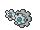

<!-- This file is generated by tools/generate_site.py. Edit the generator, not this file. -->

# #600 Klang

{ .sprite-lg loading=lazy }

**Gear Pokémon**

Steel

[:material-arrow-left: #599 Klink](599.md) · [Pokédex](index.md) · [#601 Klinklang :material-arrow-right:](601.md)

!!! info "Changes in Rising Ruby / Sinking Sapphire"

    - **Evolution level:** 49 → **44**
    - **New TM/HM compatibility:** Rock Slide

## Location

[New Mauville](../wild/new_mauville.md)

### Wild encounters

| Area | Method | Level | Note |
| --- | --- | --- | --- |
| [New Mauville](../wild/new_mauville.md) | Grass | 35 |  |

## Type defenses

| Damage taken | Attacking types |
| --- | --- |
| Immune (×0) | Poison |
| Resistant (×½) | Normal Flying Rock Bug Steel Grass Psychic Ice Dragon Fairy |
| Neutral (×1) | Ghost Water Electric Dark |
| Weak (×2) | Fighting Ground Fire |

## Abilities

| Slot | Ability | Effect | Note |
| --- | --- | --- | --- |
| Ability 1 | **Plus** | Increases Special Attack to 1.5× when a friendly Pokémon has Plus or Minus. |  |
| Ability 2 | **Minus** | Increases Special Attack to 1.5× when a friendly Pokémon has Plus or Minus. |  |
| Hidden | **Clear Body** | Prevents stats from being lowered by other Pokémon. |  |

## Base stats

| Form | HP | Atk | Def | SpA | SpD | Spe | BST |
| --- | --- | --- | --- | --- | --- | --- | --- |
| { .sprite-sm loading=lazy } Normal | 60 | 80 | 95 | 70 | 85 | 50 | **440** |

## Training & breeding

| Property | Value |
| --- | --- |
| EV yield | 2 Def |
| Catch rate | 60 |
| Base friendship | 70 |
| Base experience | 154 |
| Growth rate | medium slow |
| Egg groups | Mineral |
| Hatch counter | 20 |
| Gender ratio | Genderless |
| Height / weight | 0.6 m / 51 kg |

## Evolution

- { .icon loading=lazy } [Klink](../pokemon/599.md) → { .icon loading=lazy } **[Klang](../pokemon/600.md)**: Lv. 33 changed <small>(vanilla: Lv. 38)</small>
- { .icon loading=lazy } **[Klang](../pokemon/600.md)** → { .icon loading=lazy } [Klinklang](../pokemon/601.md): Lv. 44 changed <small>(vanilla: Lv. 49)</small>

## Wild held items

None.

## Level-up moves { data-search-exclude }

Moves marked &#42; are not normally learned by level up (they come from egg moves, TMs/HMs or tutors in the official games); moves marked &#42;&#42; cannot normally be learned by this Pokémon at all and are omitted from the legal-moves version of the hack.

| Lv. | Move | Type | Cat. | Power | Acc. | PP | Effect | Note |
| --- | --- | --- | --- | --- | --- | --- | --- | --- |
| 1 | Vise Grip | Normal | Physical | 55 | 100% | 30 | Inflicts regular damage with no additional effect. |  |
| 5 | Charge | Electric | Status | — | — | 20 | Raises the user’s Special Defense by one stage.  User’s Electric moves have doubled power next turn. |  |
| 9 | Thunder Shock | Electric | Special | 40 | 100% | 30 | Has a chance to paralyze the target. |  |
| 13 | Bind | Normal | Physical | 15 | 85% | 20 | Prevents the target from fleeing and inflicts damage for 2-5 turns. |  |
| 17 | Charge Beam | Electric | Special | 50 | 90% | 10 | Has a chance to raise the user’s Special Attack by one stage. |  |
| 21 | Gear Grind | Steel | Physical | 50 | 85% | 15 | Hits twice in one turn. |  |
| 25 | Autotomize | Steel | Status | — | — | 15 | Raises the user’s Speed by two stages and halves the user’s weight. |  |
| 29 | Mirror Shot | Steel | Special | 65 | 85% | 10 | Has a chance to lower the target’s accuracy by one stage. |  |
| 34 | Discharge | Electric | Special | 80 | 100% | 15 | Has a chance to paralyze the target. |  |
| 38 | Screech | Normal | Status | — | 85% | 40 | Lowers the target’s Defense by two stages. |  |
| 43 | Wild Charge | Electric | Physical | 90 | 100% | 15 | User receives 1/4 the damage it inflicts in recoil. | &#42; |
| 47 | Shift Gear | Steel | Status | — | — | 10 | Raises the user’s Attack by one stage and its Speed by two stages. |  |
| 51 | Metal Sound | Steel | Status | — | 85% | 40 | Lowers the target’s Special Defense by two stages. |  |
| 55 | Lock-On | Normal | Status | — | — | 5 | Ensures that the user’s next move will hit the target. |  |
| 59 | Zap Cannon | Electric | Special | 120 | 50% | 5 | Has a chance to paralyze the target. |  |
| 63 | Hyper Beam | Normal | Special | 150 | 90% | 5 | User foregoes its next turn to recharge. |  |

## TM & HM moves { data-search-exclude }

| Machine | Move | Type | Cat. | Power | Acc. | PP | Effect |
| --- | --- | --- | --- | --- | --- | --- | --- |
| HM06 | [Rock Smash](../changes/moves.md#rock-smash) changed | Fighting | Physical | 65 | 100% | 15 | Has a chance to lower the target’s Defense by one stage. |
| TM06 | Toxic | Poison | Status | — | 90% | 10 | Badly poisons the target, inflicting more damage every turn. |
| TM10 | Hidden Power | Normal | Special | 60 | 100% | 15 | Power and type depend upon user’s IVs.  Power can range from 30 to 70. |
| TM100 | Confide | Normal | Status | — | — | 20 | Lowers the target’s Special Attack by one stage. |
| TM15 | Hyper Beam | Normal | Special | 150 | 90% | 5 | User foregoes its next turn to recharge. |
| TM17 | Protect | Normal | Status | — | — | 10 | Prevents any moves from hitting the user this turn. |
| TM21 | Frustration | Normal | Physical | — | 100% | 20 | Power increases as happiness decreases, up to a maximum of 102. |
| TM24 | Thunderbolt | Electric | Special | 90 | 100% | 15 | Has a chance to paralyze the target. |
| TM27 | Return | Normal | Physical | — | 100% | 20 | Power increases with happiness, up to a maximum of 102. |
| TM32 | Double Team | Normal | Status | — | — | 15 | Raises the user’s evasion by one stage. |
| TM37 | Sandstorm | Rock | Status | — | — | 10 | Changes the weather to a sandstorm for five turns. |
| TM42 | Facade | Normal | Physical | 70 | 100% | 20 | Power doubles if user is burned, paralyzed, or poisoned. |
| TM44 | Rest | Psychic | Status | — | — | 5 | User sleeps for two turns, completely healing itself. |
| TM48 | Round | Normal | Special | 60 | 100% | 15 | Has double power if it’s used more than once per turn. |
| TM57 | Charge Beam | Electric | Special | 50 | 90% | 10 | Has a chance to raise the user’s Special Attack by one stage. |
| TM69 | Rock Polish | Rock | Status | — | — | 20 | Raises the user’s Speed by two stages. |
| TM72 | Volt Switch | Electric | Special | 70 | 100% | 20 | User must switch out after attacking. |
| TM73 | Thunder Wave | Electric | Status | — | 100% | 20 | Paralyzes the target. |
| TM80 new | Rock Slide | Rock | Physical | 75 | 90% | 10 | Has a chance to make the target flinch. |
| TM87 | Swagger | Normal | Status | — | 90% | 15 | Raises the target’s Attack by two stages and confuses the target. |
| TM88 | Sleep Talk | Normal | Status | — | — | 10 | Randomly uses one of the user’s other three moves.  Only works if the user is sleeping. |
| TM90 | Substitute | Normal | Status | — | — | 10 | Transfers 1/4 of the user’s max HP into a doll, protecting the user from further damage or status changes until it breaks. |
| TM91 | Flash Cannon | Steel | Special | 80 | 100% | 10 | Has a chance to lower the target’s Special Defense by one stage. |
| TM93 | Wild Charge | Electric | Physical | 90 | 100% | 15 | User receives 1/4 the damage it inflicts in recoil. |
| TM94 | Secret Power | Normal | Physical | 70 | 100% | 20 | Has a chance to inflict a status effect which depends upon the terrain. |

## Move tutor moves { data-search-exclude }

| Move | Type | Cat. | Power | Acc. | PP | Effect |
| --- | --- | --- | --- | --- | --- | --- |
| Bind | Normal | Physical | 15 | 85% | 20 | Prevents the target from fleeing and inflicts damage for 2-5 turns. |
| Gravity | Psychic | Status | — | — | 5 | Disables moves and immunities that involve flying or levitating for five turns. |
| Iron Defense | Steel | Status | — | — | 15 | Raises the user’s Defense by two stages. |
| Magic Coat | Psychic | Status | — | — | 15 | Reflects back the first effect move used on the user this turn. |
| Magnet Rise | Electric | Status | — | — | 10 | User is immune to Ground moves and effects for five turns. |
| Recycle | Normal | Status | — | — | 10 | User recovers the item it last used up. |
| Shock Wave | Electric | Special | 60 | — | 20 | Never misses. |
| Signal Beam | Bug | Special | 75 | 100% | 15 | Has a chance to confuse the target. |
| Snore | Normal | Special | 50 | 100% | 15 | Has a chance to make the target flinch.  Only works if the user is sleeping. |
| Uproar | Normal | Special | 90 | 100% | 10 | Forced to use this move for several turns.  Pokémon cannot fall asleep in that time. |

## Egg moves { data-search-exclude }

No egg moves.

??? note "Trainers using Klang (2)"

    | Area | Trainer | Level |
    | --- | --- | --- |
    | [Route 110](../trainers/route_110.md#rematches) | Triathlete Benjamin (4) | Lv. 35 |
    | [Route 110](../trainers/route_110.md#rematches) | Triathlete Benjamin (6) | Lv. 47 |

---

[:material-arrow-left: #599 Klink](599.md) · [#601 Klinklang :material-arrow-right:](601.md)
