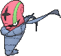

<!-- This file is generated by tools/generate_site.py. Edit the generator, not this file. -->

# #617 Accelgor

{ .sprite-lg loading=lazy }

**Shell Out Pokémon**

Bug

[:material-arrow-left: #616 Shelmet](616.md) · [Pokédex](index.md) · [#618 Stunfisk :material-arrow-right:](618.md)

!!! note "No documented changes"

    Drayano's documentation lists no stat, type, ability, evolution or held item changes for this Pokémon. Its level-up moves are listed below as they appear in the hack.

## Location

Evolve { .icon loading=lazy } [Shelmet](../pokemon/616.md) (Lvl with Karrablast in Party)

## Type defenses

| Damage taken | Attacking types |
| --- | --- |
| Resistant (×½) | Fighting Ground Grass |
| Neutral (×1) | Normal Poison Bug Ghost Steel Water Electric Psychic Ice Dragon Dark Fairy |
| Weak (×2) | Flying Rock Fire |

## Abilities

| Slot | Ability | Effect | Note |
| --- | --- | --- | --- |
| Ability 1 | **Hydration** | Cures any major status ailment after each turn during rain. |  |
| Ability 2 | **Sticky Hold** | Prevents a held item from being removed by other Pokémon. |  |
| Hidden | **Unburden** | Doubles Speed upon using or losing a held item. |  |

## Base stats

| Form | HP | Atk | Def | SpA | SpD | Spe | BST |
| --- | --- | --- | --- | --- | --- | --- | --- |
| { .sprite-sm loading=lazy } Normal | 80 | 70 | 40 | 100 | 60 | 145 | **495** |

## Training & breeding

| Property | Value |
| --- | --- |
| EV yield | 2 Spe |
| Catch rate | 75 |
| Base friendship | 70 |
| Base experience | 173 |
| Growth rate | medium |
| Egg groups | Bug |
| Hatch counter | 15 |
| Gender ratio | 50% ♂ / 50% ♀ |
| Height / weight | 0.8 m / 25.3 kg |

## Evolution

- { .icon loading=lazy } [Shelmet](../pokemon/616.md) → { .icon loading=lazy } **[Accelgor](../pokemon/617.md)**: Lvl with Karrablast in Party changed <small>(vanilla: Trade for Karrablast)</small>

## Wild held items

None.

## Level-up moves { data-search-exclude }

Moves marked &#42; are not normally learned by level up (they come from egg moves, TMs/HMs or tutors in the official games); moves marked &#42;&#42; cannot normally be learned by this Pokémon at all and are omitted from the legal-moves version of the hack.

| Lv. | Move | Type | Cat. | Power | Acc. | PP | Effect | Note |
| --- | --- | --- | --- | --- | --- | --- | --- | --- |
| 1 | Water Shuriken | Water | Special | 15 | 100% | 20 | Hits 2–5 times. |  |
| 1 | Final Gambit | Fighting | Special | — | 100% | 5 | Inflicts damage equal to the user’s remaining HP.  User faints. |  |
| 1 | Power Swap | Psychic | Status | — | — | 10 | User swaps Attack and Special Attack changes with the target. |  |
| 1 | Leech Life | Bug | Physical | 20 | 100% | 15 | Drains half the damage inflicted to heal the user. |  |
| 4 | Acid Spray | Poison | Special | 40 | 100% | 20 | Lowers the target’s Special Defense by two stages. |  |
| 7 | Double Team | Normal | Status | — | — | 15 | Raises the user’s evasion by one stage. |  |
| 10 | Quick Attack | Normal | Physical | 40 | 100% | 30 | Inflicts regular damage with no additional effect. |  |
| 13 | Struggle Bug | Bug | Special | 50 | 100% | 20 | Has a chance to lower the target’s Special Attack by one stage. |  |
| 16 | Mega Drain | Grass | Special | 40 | 100% | 15 | Drains half the damage inflicted to heal the user. |  |
| 19 | Swift | Normal | Special | 60 | — | 20 | Never misses. |  |
| 22 | Signal Beam | Bug | Special | 75 | 100% | 15 | Has a chance to confuse the target. | &#42; |
| 25 | Me First | Normal | Status | — | — | 20 | Uses the target’s move against it before it attacks, with power increased by half. |  |
| 28 | Agility | Psychic | Status | — | — | 30 | Raises the user’s Speed by two stages. |  |
| 31 | Giga Drain | Grass | Special | 75 | 100% | 10 | Drains half the damage inflicted to heal the user. |  |
| 34 | U-turn | Bug | Physical | 70 | 100% | 20 | User must switch out after attacking. |  |
| 37 | Bug Buzz | Bug | Special | 90 | 100% | 10 | Has a chance to lower the target’s Special Defense by one stage. |  |
| 40 | Recover | Normal | Status | — | — | 5 | Heals the user by half its max HP. |  |
| 43 | Sludge Bomb | Poison | Special | 90 | 100% | 10 | Has a chance to poison the target. | &#42; |
| 46 | Power Swap | Psychic | Status | — | — | 10 | User swaps Attack and Special Attack changes with the target. |  |
| 49 | Final Gambit | Fighting | Special | — | 100% | 5 | Inflicts damage equal to the user’s remaining HP.  User faints. |  |
| 52 | Extreme Speed | Normal | Physical | 80 | 100% | 5 | Inflicts regular damage with no additional effect. | &#42;&#42; |

## TM & HM moves { data-search-exclude }

| Machine | Move | Type | Cat. | Power | Acc. | PP | Effect |
| --- | --- | --- | --- | --- | --- | --- | --- |
| TM06 | Toxic | Poison | Status | — | 90% | 10 | Badly poisons the target, inflicting more damage every turn. |
| TM09 | Venoshock | Poison | Special | 65 | 100% | 10 | Inflicts double damage if the target is Poisoned. |
| TM10 | Hidden Power | Normal | Special | 60 | 100% | 15 | Power and type depend upon user’s IVs.  Power can range from 30 to 70. |
| TM100 | Confide | Normal | Status | — | — | 20 | Lowers the target’s Special Attack by one stage. |
| TM15 | Hyper Beam | Normal | Special | 150 | 90% | 5 | User foregoes its next turn to recharge. |
| TM17 | Protect | Normal | Status | — | — | 10 | Prevents any moves from hitting the user this turn. |
| TM18 | Rain Dance | Water | Status | — | — | 5 | Changes the weather to rain for five turns. |
| TM21 | Frustration | Normal | Physical | — | 100% | 20 | Power increases as happiness decreases, up to a maximum of 102. |
| TM27 | Return | Normal | Physical | — | 100% | 20 | Power increases with happiness, up to a maximum of 102. |
| TM32 | Double Team | Normal | Status | — | — | 15 | Raises the user’s evasion by one stage. |
| TM36 | Sludge Bomb | Poison | Special | 90 | 100% | 10 | Has a chance to poison the target. |
| TM37 | Sandstorm | Rock | Status | — | — | 10 | Changes the weather to a sandstorm for five turns. |
| TM42 | Facade | Normal | Physical | 70 | 100% | 20 | Power doubles if user is burned, paralyzed, or poisoned. |
| TM44 | Rest | Psychic | Status | — | — | 5 | User sleeps for two turns, completely healing itself. |
| TM45 | Attract | Normal | Status | — | 100% | 15 | Target falls in love if it has the opposite gender, and has a 50% chance to refuse attacking the user. |
| TM48 | Round | Normal | Special | 60 | 100% | 15 | Has double power if it’s used more than once per turn. |
| TM52 | Focus Blast | Fighting | Special | 120 | 70% | 5 | Has a chance to lower the target’s Special Defense by one stage. |
| TM53 | Energy Ball | Grass | Special | 90 | 100% | 10 | Has a chance to lower the target’s Special Defense by one stage. |
| TM68 | Giga Impact | Normal | Physical | 150 | 90% | 5 | User foregoes its next turn to recharge. |
| TM76 | Struggle Bug | Bug | Special | 50 | 100% | 20 | Has a chance to lower the target’s Special Attack by one stage. |
| TM83 | Infestation | Bug | Special | 20 | 100% | 20 | Prevents the target from fleeing and inflicts damage for 2-5 turns. |
| TM87 | Swagger | Normal | Status | — | 90% | 15 | Raises the target’s Attack by two stages and confuses the target. |
| TM88 | Sleep Talk | Normal | Status | — | — | 10 | Randomly uses one of the user’s other three moves.  Only works if the user is sleeping. |
| TM89 | U-turn | Bug | Physical | 70 | 100% | 20 | User must switch out after attacking. |
| TM90 | Substitute | Normal | Status | — | — | 10 | Transfers 1/4 of the user’s max HP into a doll, protecting the user from further damage or status changes until it breaks. |
| TM94 | Secret Power | Normal | Physical | 70 | 100% | 20 | Has a chance to inflict a status effect which depends upon the terrain. |

## Move tutor moves { data-search-exclude }

| Move | Type | Cat. | Power | Acc. | PP | Effect |
| --- | --- | --- | --- | --- | --- | --- |
| Bug Bite | Bug | Physical | 60 | 100% | 20 | If target has a berry, inflicts double damage and uses the berry. |
| Gastro Acid | Poison | Status | — | 100% | 10 | Nullifies target’s ability until it leaves battle. |
| Giga Drain | Grass | Special | 75 | 100% | 10 | Drains half the damage inflicted to heal the user. |
| Knock Off | Dark | Physical | 65 | 100% | 20 | Target drops its held item. |
| Signal Beam | Bug | Special | 75 | 100% | 15 | Has a chance to confuse the target. |
| Snore | Normal | Special | 50 | 100% | 15 | Has a chance to make the target flinch.  Only works if the user is sleeping. |

## Egg moves { data-search-exclude }

No egg moves.

??? note "Trainers using Accelgor (5)"

    | Area | Trainer | Level |
    | --- | --- | --- |
    | [Route 113](../trainers/route_113.md#rematches) | Ninja Boy Lao (4) | Lv. 35 |
    | [Route 113](../trainers/route_113.md#rematches) | Ninja Boy Lao (6) | Lv. 47 |
    | [Route 113](../trainers/route_113.md#rematches) | Ninja Boy Lao (8) | Lv. 64 |
    | [Route 113](../trainers/route_113.md#rematches) | Ninja Boy Lao (C) | Lv. 75 |
    | [Route 119 (Mauville)](../trainers/route_119_mauville.md#trainers) | Ninja Boy Takashi | Lv. 42 |

---

[:material-arrow-left: #616 Shelmet](616.md) · [#618 Stunfisk :material-arrow-right:](618.md)
