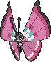

<!-- This file is generated by tools/generate_site.py. Edit the generator, not this file. -->

# #666 Vivillon

{ .sprite-lg loading=lazy }

**Scale Pokémon**

Bug Flying

[:material-arrow-left: #665 Spewpa](665.md) · [Pokédex](index.md) · [#667 Litleo :material-arrow-right:](667.md)

!!! info "Changes in Rising Ruby / Sinking Sapphire"

    - **Base stats:** Atk 52 → **50**, Def 50 → **55**, SpA 90 → **115**, SpD 50 → **55**, Spe 89 → **100** (BST 411 → **455**)
    - **EV yield:** 1 SAtk, 1 Spd → **2 SAtk**
    - **New TM/HM compatibility:** [Fly](../changes/moves.md#fly) changed

## Location

Evolve { .icon loading=lazy } [Spewpa](../pokemon/665.md) (Lv. 12)

### Wild encounters

| Area | Method | Level | Note |
| --- | --- | --- | --- |
| [Safari Zone (1)](../wild/safari_zone_1.md) | Tall Grass | 45 |  |
| [Safari Zone (1)](../wild/safari_zone_1.md) | Horde | 25 |  |

## Type defenses

| Damage taken | Attacking types |
| --- | --- |
| Immune (×0) | Ground |
| Very resistant (×¼) | Fighting Grass |
| Resistant (×½) | Bug |
| Neutral (×1) | Normal Poison Ghost Steel Water Psychic Dragon Dark Fairy |
| Weak (×2) | Flying Fire Electric Ice |
| Very weak (×4) | Rock |

## Abilities

| Slot | Ability | Effect | Note |
| --- | --- | --- | --- |
| Ability 1 | **Shield Dust** | Protects against incoming moves' extra effects. |  |
| Ability 2 | **Compound Eyes** | Increases moves' accuracy to 1.3×. |  |
| Hidden | **Friend Guard** | Decreases all direct damage taken by friendly Pokémon to 0.75×. |  |

## Base stats

| Form | HP | Atk | Def | SpA | SpD | Spe | BST |
| --- | --- | --- | --- | --- | --- | --- | --- |
| { .sprite-sm loading=lazy } Normal | 80 | 50<small class="was">was 52</small> | 55<small class="was">was 50</small> | 115<small class="was">was 90</small> | 55<small class="was">was 50</small> | 100<small class="was">was 89</small> | 455<small class="was">was 411</small> |

## Training & breeding

| Property | Value |
| --- | --- |
| EV yield | 2 SAtk changed (was 1 SAtk, 1 Spd) |
| Catch rate | 45 |
| Base friendship | 70 |
| Base experience | 185 |
| Growth rate | medium |
| Egg groups | Bug |
| Hatch counter | 15 |
| Gender ratio | 50% ♂ / 50% ♀ |
| Height / weight | 1.2 m / 17 kg |

## Evolution

- { .icon loading=lazy } [Scatterbug](../pokemon/664.md) → { .icon loading=lazy } [Spewpa](../pokemon/665.md): Lv. 9
- { .icon loading=lazy } [Spewpa](../pokemon/665.md) → { .icon loading=lazy } **[Vivillon](../pokemon/666.md)**: Lv. 12

## Wild held items

None.

## Level-up moves { data-search-exclude }

Moves marked &#42; are not normally learned by level up (they come from egg moves, TMs/HMs or tutors in the official games); moves marked &#42;&#42; cannot normally be learned by this Pokémon at all and are omitted from the legal-moves version of the hack.

| Lv. | Move | Type | Cat. | Power | Acc. | PP | Effect | Note |
| --- | --- | --- | --- | --- | --- | --- | --- | --- |
| 1 | Gust | Flying | Special | 40 | 100% | 35 | Inflicts regular damage and can hit Pokémon in the air. |  |
| 12 | Struggle Bug | Bug | Special | 50 | 100% | 20 | Has a chance to lower the target’s Special Attack by one stage. |  |
| 14 | Gust | Flying | Special | 40 | 100% | 35 | Inflicts regular damage and can hit Pokémon in the air. |  |
| 16 | Stun Spore | Grass | Status | — | 75% | 30 | Paralyzes the target. |  |
| 16 | Poison Powder | Poison | Status | — | 75% | 35 | Poisons the target. |  |
| 16 | Sleep Powder | Grass | Status | — | 75% | 15 | Puts the target to sleep. |  |
| 18 | Psybeam | Psychic | Special | 65 | 100% | 20 | Has a chance to confuse the target. |  |
| 20 | Supersonic | Normal | Status | — | 55% | 20 | Confuses the target. |  |
| 22 | [Draining Kiss](../changes/moves.md#draining-kiss) changed | Fairy | Special | 75 | 100% | 10 | Drains 75% of the damage inflicted to heal the user. (Absorb %: 75 → 50) |  |
| 24 | Aromatherapy | Grass | Status | — | — | 5 | Cures the entire party of major status effects. |  |
| 26 | Bug Buzz | Bug | Special | 90 | 100% | 10 | Has a chance to lower the target’s Special Defense by one stage. |  |
| 28 | Safeguard | Normal | Status | — | — | 25 | Protects the user’s field from major status ailments and confusion for five turns. |  |
| 30 | Hurricane | Flying | Special | 110 | 70% | 10 | Has a chance to confuse the target. |  |
| 32 | Powder | Bug | Status | — | 100% | 20 | Explodes if the target uses a Fire move this turn, damaging it for 1/4 its max HP and preventing the move. |  |
| 34 | Psychic | Psychic | Special | 90 | 100% | 10 | Has a chance to lower the target’s Special Defense by one stage. | &#42; |
| 36 | Tailwind | Flying | Status | — | — | 15 | For three turns, friendly Pokémon have doubled Speed. | &#42; |
| 38 | Energy Ball | Grass | Special | 90 | 100% | 10 | Has a chance to lower the target’s Special Defense by one stage. | &#42; |
| 40 | Light Screen | Psychic | Status | — | — | 30 | Reduces damage from special attacks by 50% for five turns. |  |
| 42 | Quiver Dance | Bug | Status | — | — | 20 | Raises the user’s Special Attack, Special Defense, and Speed by one stage each. |  |

## TM & HM moves { data-search-exclude }

| Machine | Move | Type | Cat. | Power | Acc. | PP | Effect |
| --- | --- | --- | --- | --- | --- | --- | --- |
| HM02 new | [Fly](../changes/moves.md#fly) changed | Flying | Physical | 100 | 100% | 10 | User flies high into the air, dodging all attacks, and hits next turn. |
| TM04 | Calm Mind | Psychic | Status | — | — | 20 | Raises the user’s Special Attack and Special Defense by one stage. |
| TM06 | Toxic | Poison | Status | — | 90% | 10 | Badly poisons the target, inflicting more damage every turn. |
| TM10 | Hidden Power | Normal | Special | 60 | 100% | 15 | Power and type depend upon user’s IVs.  Power can range from 30 to 70. |
| TM100 | Confide | Normal | Status | — | — | 20 | Lowers the target’s Special Attack by one stage. |
| TM11 | Sunny Day | Fire | Status | — | — | 5 | Changes the weather to sunny for five turns. |
| TM15 | Hyper Beam | Normal | Special | 150 | 90% | 5 | User foregoes its next turn to recharge. |
| TM16 | Light Screen | Psychic | Status | — | — | 30 | Reduces damage from special attacks by 50% for five turns. |
| TM17 | Protect | Normal | Status | — | — | 10 | Prevents any moves from hitting the user this turn. |
| TM18 | Rain Dance | Water | Status | — | — | 5 | Changes the weather to rain for five turns. |
| TM19 | Roost | Flying | Status | — | — | 5 | Heals the user by half its max HP. |
| TM20 | Safeguard | Normal | Status | — | — | 25 | Protects the user’s field from major status ailments and confusion for five turns. |
| TM21 | Frustration | Normal | Physical | — | 100% | 20 | Power increases as happiness decreases, up to a maximum of 102. |
| TM22 | Solar Beam | Grass | Special | 120 | 100% | 10 | Requires a turn to charge before attacking. |
| TM27 | Return | Normal | Physical | — | 100% | 20 | Power increases with happiness, up to a maximum of 102. |
| TM29 | Psychic | Psychic | Special | 90 | 100% | 10 | Has a chance to lower the target’s Special Defense by one stage. |
| TM32 | Double Team | Normal | Status | — | — | 15 | Raises the user’s evasion by one stage. |
| TM40 | Aerial Ace | Flying | Physical | 60 | — | 20 | Never misses. |
| TM42 | Facade | Normal | Physical | 70 | 100% | 20 | Power doubles if user is burned, paralyzed, or poisoned. |
| TM44 | Rest | Psychic | Status | — | — | 5 | User sleeps for two turns, completely healing itself. |
| TM45 | Attract | Normal | Status | — | 100% | 15 | Target falls in love if it has the opposite gender, and has a 50% chance to refuse attacking the user. |
| TM46 | Thief | Dark | Physical | 60 | 100% | 25 | Takes the target’s item. |
| TM48 | Round | Normal | Special | 60 | 100% | 15 | Has double power if it’s used more than once per turn. |
| TM53 | Energy Ball | Grass | Special | 90 | 100% | 10 | Has a chance to lower the target’s Special Defense by one stage. |
| TM62 | Acrobatics | Flying | Physical | 55 | 100% | 15 | Has double power if the user has no held item. |
| TM68 | Giga Impact | Normal | Physical | 150 | 90% | 5 | User foregoes its next turn to recharge. |
| TM70 | Flash | Normal | Status | — | 100% | 20 | Lowers the target’s accuracy by one stage. |
| TM76 | Struggle Bug | Bug | Special | 50 | 100% | 20 | Has a chance to lower the target’s Special Attack by one stage. |
| TM77 | Psych Up | Normal | Status | — | — | 10 | Discards the user’s stat changes and copies the target’s. |
| TM83 | Infestation | Bug | Special | 20 | 100% | 20 | Prevents the target from fleeing and inflicts damage for 2-5 turns. |
| TM85 | Dream Eater | Psychic | Special | 100 | 100% | 15 | Only works on sleeping Pokémon.  Drains half the damage inflicted to heal the user. |
| TM87 | Swagger | Normal | Status | — | 90% | 15 | Raises the target’s Attack by two stages and confuses the target. |
| TM88 | Sleep Talk | Normal | Status | — | — | 10 | Randomly uses one of the user’s other three moves.  Only works if the user is sleeping. |
| TM89 | U-turn | Bug | Physical | 70 | 100% | 20 | User must switch out after attacking. |
| TM90 | Substitute | Normal | Status | — | — | 10 | Transfers 1/4 of the user’s max HP into a doll, protecting the user from further damage or status changes until it breaks. |
| TM94 | Secret Power | Normal | Physical | 70 | 100% | 20 | Has a chance to inflict a status effect which depends upon the terrain. |

## Move tutor moves { data-search-exclude }

| Move | Type | Cat. | Power | Acc. | PP | Effect |
| --- | --- | --- | --- | --- | --- | --- |
| Bug Bite | Bug | Physical | 60 | 100% | 20 | If target has a berry, inflicts double damage and uses the berry. |
| Electroweb | Electric | Special | 55 | 95% | 15 | Lowers the target’s Speed by one stage. |
| Endeavor | Normal | Physical | — | 100% | 5 | Lowers the target’s HP to equal the user’s. |
| Giga Drain | Grass | Special | 75 | 100% | 10 | Drains half the damage inflicted to heal the user. |
| Signal Beam | Bug | Special | 75 | 100% | 15 | Has a chance to confuse the target. |
| Snore | Normal | Special | 50 | 100% | 15 | Has a chance to make the target flinch.  Only works if the user is sleeping. |
| Tailwind | Flying | Status | — | — | 15 | For three turns, friendly Pokémon have doubled Speed. |

## Egg moves { data-search-exclude }

No egg moves.

??? note "Trainers using Vivillon (2)"

    | Area | Trainer | Level |
    | --- | --- | --- |
    | [Route 119 (Mauville)](../trainers/route_119_mauville.md#trainers) | Bug Catcher Greg | Lv. 39 |
    | [Battle Resort](../trainers/battle_resort.md#trainers) | Leader Felix [Viola] | Lv. 79 |

---

[:material-arrow-left: #665 Spewpa](665.md) · [#667 Litleo :material-arrow-right:](667.md)
