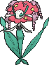

<!-- This file is generated by tools/generate_site.py. Edit the generator, not this file. -->

# #671 Florges

{ .sprite-lg loading=lazy }

**Garden Pokémon**

Fairy

[:material-arrow-left: #670 Floette](670.md) · [Pokédex](index.md) · [#672 Skiddo :material-arrow-right:](672.md)

!!! info "Changes in Rising Ruby / Sinking Sapphire"

    - **Ability 2:** **Symbiosis** 

## Location

Evolve { .icon loading=lazy } [Floette](../pokemon/670.md) (Shiny Stone)

## Type defenses

| Damage taken | Attacking types |
| --- | --- |
| Immune (×0) | Dragon |
| Resistant (×½) | Fighting Bug Dark |
| Neutral (×1) | Normal Flying Ground Rock Ghost Fire Water Grass Electric Psychic Ice Fairy |
| Weak (×2) | Poison Steel |

## Abilities

| Slot | Ability | Effect | Note |
| --- | --- | --- | --- |
| Ability 1 | **Flower Veil** | Protects friendly Grass Pokémon from having their stats lowered by other Pokémon. |  |
| Ability 2 | **Symbiosis** | Passes the bearer's held item to an ally when the ally uses up its item. | changed  |
| Hidden | **Symbiosis** | Passes the bearer's held item to an ally when the ally uses up its item. |  |

## Base stats

| Form | HP | Atk | Def | SpA | SpD | Spe | BST |
| --- | --- | --- | --- | --- | --- | --- | --- |
| { .sprite-sm loading=lazy } Normal | 78 | 65 | 68 | 112 | 154 | 75 | **552** |

## Training & breeding

| Property | Value |
| --- | --- |
| EV yield | 3 SpD |
| Catch rate | 45 |
| Base friendship | 70 |
| Base experience | 248 |
| Growth rate | medium |
| Egg groups | Fairy |
| Hatch counter | 20 |
| Gender ratio | 0% ♂ / 100% ♀ |
| Height / weight | 1.1 m / 10 kg |

## Evolution

- { .icon loading=lazy } [Flabébé](../pokemon/669.md) → { .icon loading=lazy } [Floette](../pokemon/670.md): Lv. 19
- { .icon loading=lazy } [Floette](../pokemon/670.md) → { .icon loading=lazy } **[Florges](../pokemon/671.md)**: Shiny Stone

## Wild held items

None.

## Level-up moves { data-search-exclude }

Moves marked &#42; are not normally learned by level up (they come from egg moves, TMs/HMs or tutors in the official games); moves marked &#42;&#42; cannot normally be learned by this Pokémon at all and are omitted from the legal-moves version of the hack.

| Lv. | Move | Type | Cat. | Power | Acc. | PP | Effect | Note |
| --- | --- | --- | --- | --- | --- | --- | --- | --- |
| 1 | [Disarming Voice](../changes/moves.md#disarming-voice) changed | Fairy | Special | 60 | — | 20 | Never misses. |  |
| 1 | Lucky Chant | Normal | Status | — | — | 30 | Prevents the target from scoring critical hits for five turns. |  |
| 1 | Wish | Normal | Status | — | — | 10 | User will recover half its max HP at the end of the next turn. |  |
| 1 | Magical Leaf | Grass | Special | 60 | — | 20 | Never misses. |  |
| 1 | Flower Shield | Fairy | Status | — | — | 10 | Raises the Defense of all Grass Pokémon in battle. |  |
| 1 | Grass Knot | Grass | Special | — | 100% | 20 | Inflicts more damage to heavier targets, with a maximum of 120 power. |  |
| 1 | Grassy Terrain | Grass | Status | — | — | 10 | For five turns, heals all Pokémon on the ground for 1/16 max HP each turn and strengthens their Grass moves to 1.5× their power. |  |
| 1 | Petal Blizzard | Grass | Physical | 90 | 100% | 15 | Inflicts regular damage. |  |
| 1 | Misty Terrain | Fairy | Status | — | — | 10 | For five turns, protects all Pokémon on the ground from major status ailments and confusion, and halves the power of incoming Dragon moves. |  |
| 1 | Moonblast | Fairy | Special | 95 | 100% | 15 | Has a chance to lower the target’s Special Attack by one stage. |  |
| 1 | Petal Dance | Grass | Special | 120 | 100% | 10 | Hits every turn for 2-3 turns, then confuses the user. |  |
| 1 | Aromatherapy | Grass | Status | — | — | 5 | Cures the entire party of major status effects. |  |

## TM & HM moves { data-search-exclude }

| Machine | Move | Type | Cat. | Power | Acc. | PP | Effect |
| --- | --- | --- | --- | --- | --- | --- | --- |
| TM04 | Calm Mind | Psychic | Status | — | — | 20 | Raises the user’s Special Attack and Special Defense by one stage. |
| TM06 | Toxic | Poison | Status | — | 90% | 10 | Badly poisons the target, inflicting more damage every turn. |
| TM10 | Hidden Power | Normal | Special | 60 | 100% | 15 | Power and type depend upon user’s IVs.  Power can range from 30 to 70. |
| TM100 | Confide | Normal | Status | — | — | 20 | Lowers the target’s Special Attack by one stage. |
| TM11 | Sunny Day | Fire | Status | — | — | 5 | Changes the weather to sunny for five turns. |
| TM15 | Hyper Beam | Normal | Special | 150 | 90% | 5 | User foregoes its next turn to recharge. |
| TM16 | Light Screen | Psychic | Status | — | — | 30 | Reduces damage from special attacks by 50% for five turns. |
| TM17 | Protect | Normal | Status | — | — | 10 | Prevents any moves from hitting the user this turn. |
| TM18 | Rain Dance | Water | Status | — | — | 5 | Changes the weather to rain for five turns. |
| TM20 | Safeguard | Normal | Status | — | — | 25 | Protects the user’s field from major status ailments and confusion for five turns. |
| TM21 | Frustration | Normal | Physical | — | 100% | 20 | Power increases as happiness decreases, up to a maximum of 102. |
| TM22 | Solar Beam | Grass | Special | 120 | 100% | 10 | Requires a turn to charge before attacking. |
| TM27 | Return | Normal | Physical | — | 100% | 20 | Power increases with happiness, up to a maximum of 102. |
| TM29 | Psychic | Psychic | Special | 90 | 100% | 10 | Has a chance to lower the target’s Special Defense by one stage. |
| TM32 | Double Team | Normal | Status | — | — | 15 | Raises the user’s evasion by one stage. |
| TM42 | Facade | Normal | Physical | 70 | 100% | 20 | Power doubles if user is burned, paralyzed, or poisoned. |
| TM44 | Rest | Psychic | Status | — | — | 5 | User sleeps for two turns, completely healing itself. |
| TM45 | Attract | Normal | Status | — | 100% | 15 | Target falls in love if it has the opposite gender, and has a 50% chance to refuse attacking the user. |
| TM48 | Round | Normal | Special | 60 | 100% | 15 | Has double power if it’s used more than once per turn. |
| TM49 | Echoed Voice | Normal | Special | 40 | 100% | 15 | Power increases by 100% for each consecutive use by any friendly Pokémon, to a maximum of 200. |
| TM53 | Energy Ball | Grass | Special | 90 | 100% | 10 | Has a chance to lower the target’s Special Defense by one stage. |
| TM68 | Giga Impact | Normal | Physical | 150 | 90% | 5 | User foregoes its next turn to recharge. |
| TM70 | Flash | Normal | Status | — | 100% | 20 | Lowers the target’s accuracy by one stage. |
| TM86 | Grass Knot | Grass | Special | — | 100% | 20 | Inflicts more damage to heavier targets, with a maximum of 120 power. |
| TM87 | Swagger | Normal | Status | — | 90% | 15 | Raises the target’s Attack by two stages and confuses the target. |
| TM88 | Sleep Talk | Normal | Status | — | — | 10 | Randomly uses one of the user’s other three moves.  Only works if the user is sleeping. |
| TM90 | Substitute | Normal | Status | — | — | 10 | Transfers 1/4 of the user’s max HP into a doll, protecting the user from further damage or status changes until it breaks. |
| TM94 | Secret Power | Normal | Physical | 70 | 100% | 20 | Has a chance to inflict a status effect which depends upon the terrain. |
| TM96 | Nature Power | Normal | Status | — | — | 20 | Uses a move which depends upon the terrain. |
| TM99 | Dazzling Gleam | Fairy | Special | 80 | 100% | 10 | Inflicts regular damage with no additional effect. |

## Move tutor moves { data-search-exclude }

| Move | Type | Cat. | Power | Acc. | PP | Effect |
| --- | --- | --- | --- | --- | --- | --- |
| After You | Normal | Status | — | — | 15 | Makes the target act next this turn. |
| Covet | Normal | Physical | 60 | 100% | 25 | Takes the target’s item. |
| Endeavor | Normal | Physical | — | 100% | 5 | Lowers the target’s HP to equal the user’s. |
| Giga Drain | Grass | Special | 75 | 100% | 10 | Drains half the damage inflicted to heal the user. |
| Heal Bell | Normal | Status | — | — | 5 | Cures the entire party of major status effects. |
| Helping Hand | Normal | Status | — | — | 20 | Ally’s next move inflicts half more damage. |
| Magic Coat | Psychic | Status | — | — | 15 | Reflects back the first effect move used on the user this turn. |
| Seed Bomb | Grass | Physical | 80 | 100% | 15 | Inflicts regular damage with no additional effect. |
| Snore | Normal | Special | 50 | 100% | 15 | Has a chance to make the target flinch.  Only works if the user is sleeping. |
| Synthesis | Grass | Status | — | — | 5 | Heals the user by half its max HP.  Affected by weather. |
| Worry Seed | Grass | Status | — | 100% | 10 | Changes the target’s ability to Insomnia. |

## Egg moves { data-search-exclude }

No egg moves.

??? note "Trainers using Florges (3)"

    | Area | Trainer | Level |
    | --- | --- | --- |
    | [Mt. Pyre 1F / 2F](../trainers/mt_pyre_1f_2f.md#trainers) | Fairy Tale Girl Momo | Lv. 49 |
    | [Mt. Pyre 3F / 4F](../trainers/mt_pyre_3f_4f.md#trainers) | Mysterious Sisters Elle & Aya | Lv. 51 |
    | [Battle Resort](../trainers/battle_resort.md#trainers) | Leader Felix [Valerie] | Lv. 77 |

---

[:material-arrow-left: #670 Floette](670.md) · [#672 Skiddo :material-arrow-right:](672.md)
