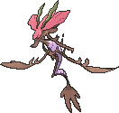

<!-- This file is generated by tools/generate_site.py. Edit the generator, not this file. -->

# #691 Dragalge

{ .sprite-lg loading=lazy }

**Mock Kelp Pokémon**

Poison Dragon

[:material-arrow-left: #690 Skrelp](690.md) · [Pokédex](index.md) · [#692 Clauncher :material-arrow-right:](692.md)

!!! note "No documented changes"

    Drayano's documentation lists no stat, type, ability, evolution or held item changes for this Pokémon. Its level-up moves are listed below as they appear in the hack.

## Location

[Route 107](../wild/route_107.md), [Route 127](../wild/route_127.md), [Route 130](../wild/route_130.md), [Underwater](../wild/underwater_107.md)

### Wild encounters

| Area | Method | Level | Note |
| --- | --- | --- | --- |
| [Route 107](../wild/route_107.md) | Super Rod | 55 |  |
| [Route 127](../wild/route_127.md) | Super Rod | 55 |  |
| [Route 130](../wild/route_130.md) | Super Rod | 55 |  |
| [Underwater 107](../wild/underwater_107.md) | Grass | 55 |  |
| [Underwater 124](../wild/underwater_124.md) | Grass | 55 |  |
| [Underwater 126](../wild/underwater_126.md) | Grass | 55 |  |
| [Underwater 128](../wild/underwater_128.md) | Grass | 55 |  |
| [Underwater 129](../wild/underwater_129.md) | Grass | 55 |  |
| [Underwater 130](../wild/underwater_130.md) | Grass | 55 |  |

## Type defenses

| Damage taken | Attacking types |
| --- | --- |
| Very resistant (×¼) | Grass |
| Resistant (×½) | Fighting Poison Bug Fire Water Electric |
| Neutral (×1) | Normal Flying Rock Ghost Steel Dark Fairy |
| Weak (×2) | Ground Psychic Ice Dragon |

## Abilities

| Slot | Ability | Effect | Note |
| --- | --- | --- | --- |
| Ability 1 | **Poison Point** | Has a 30% chance of poisoning attacking Pokémon on contact. |  |
| Ability 2 | **Poison Touch** | Has a 30% chance of poisoning target Pokémon upon contact. |  |
| Hidden | **Adaptability** | Increases the same-type attack bonus from 1.5× to 2×. |  |

## Base stats

| Form | HP | Atk | Def | SpA | SpD | Spe | BST |
| --- | --- | --- | --- | --- | --- | --- | --- |
| { .sprite-sm loading=lazy } Normal | 65 | 75 | 90 | 97 | 123 | 44 | **494** |

## Training & breeding

| Property | Value |
| --- | --- |
| EV yield | 2 SpD |
| Catch rate | 55 |
| Base friendship | 70 |
| Base experience | 173 |
| Growth rate | medium |
| Egg groups | Water 1, Dragon |
| Hatch counter | 20 |
| Gender ratio | 50% ♂ / 50% ♀ |
| Height / weight | 1.8 m / 81.5 kg |

## Evolution

- { .icon loading=lazy } [Skrelp](../pokemon/690.md) → { .icon loading=lazy } **[Dragalge](../pokemon/691.md)**: Lv. 35 changed <small>(vanilla: Lv. 48)</small>

## Wild held items

None.

## Level-up moves { data-search-exclude }

Moves marked &#42; are not normally learned by level up (they come from egg moves, TMs/HMs or tutors in the official games); moves marked &#42;&#42; cannot normally be learned by this Pokémon at all and are omitted from the legal-moves version of the hack.

| Lv. | Move | Type | Cat. | Power | Acc. | PP | Effect | Note |
| --- | --- | --- | --- | --- | --- | --- | --- | --- |
| 1 | Dragon Tail | Dragon | Physical | 60 | 90% | 10 | Ends wild battles.  Forces trainers to switch Pokémon. |  |
| 1 | Tackle | Normal | Physical | 50 | 100% | 35 | Inflicts regular damage with no additional effect. |  |
| 1 | Smokescreen | Normal | Status | — | 100% | 20 | Lowers the target’s accuracy by one stage. |  |
| 1 | Water Gun | Water | Special | 40 | 100% | 25 | Inflicts regular damage with no additional effect. |  |
| 5 | Feint Attack | Dark | Physical | 60 | — | 20 | Never misses. |  |
| 8 | Tail Whip | Normal | Status | — | 100% | 30 | Lowers the target’s Defense by one stage. |  |
| 11 | Bubble | Water | Special | 40 | 100% | 30 | Has a chance to lower the target’s Speed by one stage. |  |
| 14 | Acid | Poison | Special | 40 | 100% | 30 | Has a chance to lower the target’s Special Defense by one stage. |  |
| 17 | Camouflage | Normal | Status | — | — | 20 | User’s type changes to match the terrain. |  |
| 20 | Water Pulse | Water | Special | 60 | 100% | 20 | Has a chance to confuse the target. |  |
| 23 | Poison Tail | Poison | Physical | 50 | 100% | 25 | Has an increased chance for a critical hit and a chance to poison the target. |  |
| 26 | Double Team | Normal | Status | — | — | 15 | Raises the user’s evasion by one stage. |  |
| 29 | Sludge Bomb | Poison | Special | 90 | 100% | 10 | Has a chance to poison the target. |  |
| 32 | Toxic | Poison | Status | — | 90% | 10 | Badly poisons the target, inflicting more damage every turn. |  |
| 35 | Twister | Dragon | Special | 40 | 100% | 20 | Has a chance to make the target flinch. |  |
| 36 | Aqua Tail | Water | Physical | 90 | 90% | 10 | Inflicts regular damage with no additional effect. |  |
| 40 | Sludge Wave | Poison | Special | 95 | 100% | 10 | Has a chance to poison the target. | &#42; |
| 44 | Dragon Pulse | Dragon | Special | 85 | 100% | 10 | Inflicts regular damage with no additional effect. |  |
| 48 | Hydro Pump | Water | Special | 110 | 80% | 5 | Inflicts regular damage with no additional effect. |  |
| 52 | Dragon Tail | Dragon | Physical | 60 | 90% | 10 | Ends wild battles.  Forces trainers to switch Pokémon. |  |

## TM & HM moves { data-search-exclude }

| Machine | Move | Type | Cat. | Power | Acc. | PP | Effect |
| --- | --- | --- | --- | --- | --- | --- | --- |
| HM03 | Surf | Water | Special | 90 | 100% | 15 | Inflicts regular damage and can hit Dive users. |
| HM05 | Waterfall | Water | Physical | 80 | 100% | 15 | Has a chance to make the target flinch. |
| HM07 | Dive | Water | Physical | 80 | 100% | 10 | User dives underwater, dodging all attacks, and hits next turn. |
| TM06 | Toxic | Poison | Status | — | 90% | 10 | Badly poisons the target, inflicting more damage every turn. |
| TM07 | Hail | Ice | Status | — | — | 10 | Changes the weather to a hailstorm for five turns. |
| TM09 | Venoshock | Poison | Special | 65 | 100% | 10 | Inflicts double damage if the target is Poisoned. |
| TM10 | Hidden Power | Normal | Special | 60 | 100% | 15 | Power and type depend upon user’s IVs.  Power can range from 30 to 70. |
| TM100 | Confide | Normal | Status | — | — | 20 | Lowers the target’s Special Attack by one stage. |
| TM15 | Hyper Beam | Normal | Special | 150 | 90% | 5 | User foregoes its next turn to recharge. |
| TM17 | Protect | Normal | Status | — | — | 10 | Prevents any moves from hitting the user this turn. |
| TM18 | Rain Dance | Water | Status | — | — | 5 | Changes the weather to rain for five turns. |
| TM21 | Frustration | Normal | Physical | — | 100% | 20 | Power increases as happiness decreases, up to a maximum of 102. |
| TM24 | Thunderbolt | Electric | Special | 90 | 100% | 15 | Has a chance to paralyze the target. |
| TM25 | Thunder | Electric | Special | 110 | 70% | 10 | Has a chance to paralyze the target. |
| TM27 | Return | Normal | Physical | — | 100% | 20 | Power increases with happiness, up to a maximum of 102. |
| TM30 | Shadow Ball | Ghost | Special | 80 | 100% | 15 | Has a chance to lower the target’s Special Defense by one stage. |
| TM32 | Double Team | Normal | Status | — | — | 15 | Raises the user’s evasion by one stage. |
| TM34 | Sludge Wave | Poison | Special | 95 | 100% | 10 | Has a chance to poison the target. |
| TM36 | Sludge Bomb | Poison | Special | 90 | 100% | 10 | Has a chance to poison the target. |
| TM42 | Facade | Normal | Physical | 70 | 100% | 20 | Power doubles if user is burned, paralyzed, or poisoned. |
| TM44 | Rest | Psychic | Status | — | — | 5 | User sleeps for two turns, completely healing itself. |
| TM45 | Attract | Normal | Status | — | 100% | 15 | Target falls in love if it has the opposite gender, and has a 50% chance to refuse attacking the user. |
| TM48 | Round | Normal | Special | 60 | 100% | 15 | Has double power if it’s used more than once per turn. |
| TM52 | Focus Blast | Fighting | Special | 120 | 70% | 5 | Has a chance to lower the target’s Special Defense by one stage. |
| TM55 | Scald | Water | Special | 80 | 100% | 15 | Has a chance to burn the target. |
| TM68 | Giga Impact | Normal | Physical | 150 | 90% | 5 | User foregoes its next turn to recharge. |
| TM82 | Dragon Tail | Dragon | Physical | 60 | 90% | 10 | Ends wild battles.  Forces trainers to switch Pokémon. |
| TM87 | Swagger | Normal | Status | — | 90% | 15 | Raises the target’s Attack by two stages and confuses the target. |
| TM88 | Sleep Talk | Normal | Status | — | — | 10 | Randomly uses one of the user’s other three moves.  Only works if the user is sleeping. |
| TM90 | Substitute | Normal | Status | — | — | 10 | Transfers 1/4 of the user’s max HP into a doll, protecting the user from further damage or status changes until it breaks. |
| TM94 | Secret Power | Normal | Physical | 70 | 100% | 20 | Has a chance to inflict a status effect which depends upon the terrain. |

## Move tutor moves { data-search-exclude }

| Move | Type | Cat. | Power | Acc. | PP | Effect |
| --- | --- | --- | --- | --- | --- | --- |
| Aqua Tail | Water | Physical | 90 | 90% | 10 | Inflicts regular damage with no additional effect. |
| Bounce | Flying | Physical | 85 | 85% | 5 | User bounces high into the air, dodging all attacks, and hits next turn. |
| Draco Meteor | Dragon | Special | 130 | 90% | 5 | Lowers the user’s Special Attack by two stages after inflicting damage. |
| Dragon Pulse | Dragon | Special | 85 | 100% | 10 | Inflicts regular damage with no additional effect. |
| Gunk Shot | Poison | Physical | 120 | 80% | 5 | Has a chance to poison the target. |
| Icy Wind | Ice | Special | 55 | 95% | 15 | Has a chance to lower the target’s Speed by one stage. |
| Iron Tail | Steel | Physical | 100 | 75% | 15 | Has a chance to lower the target’s Defense by one stage. |
| Outrage | Dragon | Physical | 120 | 100% | 10 | Hits every turn for 2-3 turns, then confuses the user. |
| Shock Wave | Electric | Special | 60 | — | 20 | Never misses. |
| Snore | Normal | Special | 50 | 100% | 15 | Has a chance to make the target flinch.  Only works if the user is sleeping. |
| Water Pulse | Water | Special | 60 | 100% | 20 | Has a chance to confuse the target. |

## Egg moves { data-search-exclude }

No egg moves.

??? note "Trainers using Dragalge (6)"

    | Area | Trainer | Level |
    | --- | --- | --- |
    | [Route 121](../trainers/route_121.md#rematches) | Beauty Jessica (7) | Lv. 59 |
    | [Route 121](../trainers/route_121.md#rematches) | Beauty Jessica (8) | Lv. 64 |
    | [Route 121](../trainers/route_121.md#rematches) | Beauty Jessica (C) | Lv. 75 |
    | [Route 129](../trainers/route_129.md#trainers) | Fisherman Fisk | Lv. 56 |
    | [Pokémon League](../trainers/pokemon_league.md#trainers) | Elite Four Drake | Lv. 73 |
    | [Battle Resort](../trainers/battle_resort.md#trainers) | Leader Felix [Drasna] | Lv. 82 |

---

[:material-arrow-left: #690 Skrelp](690.md) · [#692 Clauncher :material-arrow-right:](692.md)
