<!-- This file is generated by tools/generate_site.py. Edit the generator, not this file. -->

# Pokédex

All 721 Pokémon are obtainable in Rising Ruby / Sinking Sapphire. This table shows each Pokémon's types, abilities and base stats **as they are in the hack**; values that differ from Omega Ruby / Alpha Sapphire are highlighted. Click a column header to sort, or type in the filter box to search.

Looking for what changed? See the [overview of changes](../changes/index.md).

| # |  | Pokémon | Type | Abilities | HP | Atk | Def | SpA | SpD | Spe | BST |
| --- | --- | --- | --- | --- | --- | --- | --- | --- | --- | --- | --- |
| 001 | { .sprite-sm loading=lazy } | [Bulbasaur](001.md) | Grass Poison | Overgrow / Effect Spore / <em>Chlorophyll</em> | 45 | 49 | 49 | 65 | 65 | 45 | **318** |
| 002 | 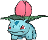{ .sprite-sm loading=lazy } | [Ivysaur](002.md) | Grass Poison | Overgrow / Effect Spore / <em>Chlorophyll</em> | 60 | 62 | 63 | 80 | 80 | 60 | **405** |
| 003 | 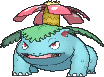{ .sprite-sm loading=lazy } | [Venusaur](003.md) | Grass Poison | Overgrow / Thick Fat / <em>Chlorophyll</em> | 80 | 82 | 83 | 100 | 100 | 80 | **525** |
| 004 | 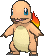{ .sprite-sm loading=lazy } | [Charmander](004.md) | Fire | Blaze / Tough Claws / <em>Solar Power</em> | 39 | 52 | 43 | 60 | 50 | 65 | **309** |
| 005 | { .sprite-sm loading=lazy } | [Charmeleon](005.md) | Fire | Blaze / Tough Claws / <em>Solar Power</em> | 58 | 64 | 58 | 80 | 65 | 80 | **405** |
| 006 | { .sprite-sm loading=lazy } | [Charizard](006.md) | Fire Flying | Blaze / Tough Claws / <em>Solar Power</em> | 78 | 84 | 78 | 109 | 85 | 100 | **534** |
| 007 | 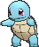{ .sprite-sm loading=lazy } | [Squirtle](007.md) | Water | Torrent / Shell Armor / <em>Rain Dish</em> | 44 | 48 | 65 | 50 | 64 | 43 | **314** |
| 008 | { .sprite-sm loading=lazy } | [Wartortle](008.md) | Water | Torrent / Shell Armor / <em>Rain Dish</em> | 59 | 63 | 80 | 65 | 80 | 58 | **405** |
| 009 | 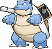{ .sprite-sm loading=lazy } | [Blastoise](009.md) | Water | Torrent / Mega Launcher / <em>Rain Dish</em> | 79 | 83 | 100 | 85 | 105 | 78 | **530** |
| 010 | 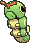{ .sprite-sm loading=lazy } | [Caterpie](010.md) | Bug | Shield Dust / Run Away / <em>Run Away</em> | 45 | 30 | 35 | 20 | 20 | 45 | **195** |
| 011 | { .sprite-sm loading=lazy } | [Metapod](011.md) | Bug | Shed Skin | 50 | 20 | 55 | 25 | 25 | 30 | **205** |
| 012 | 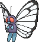{ .sprite-sm loading=lazy } | [Butterfree](012.md) | Bug Flying | Compound Eyes / Tinted Lens / <em>Tinted Lens</em> | 60 | 25 | 50 | 115 | 105 | 95 | **450** |
| 013 | 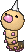{ .sprite-sm loading=lazy } | [Weedle](013.md) | Bug Poison | Shield Dust / Run Away / <em>Run Away</em> | 40 | 35 | 30 | 20 | 20 | 50 | **195** |
| 014 | { .sprite-sm loading=lazy } | [Kakuna](014.md) | Bug Poison | Shed Skin | 45 | 25 | 50 | 25 | 25 | 35 | **205** |
| 015 | { .sprite-sm loading=lazy } | [Beedrill](015.md) | Bug Poison | Swarm / Sniper / <em>Sniper</em> | 65 | 115 | 40 | 25 | 105 | 100 | **450** |
| 016 | 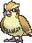{ .sprite-sm loading=lazy } | [Pidgey](016.md) | Normal Flying | Keen Eye / Tangled Feet / <em>Big Pecks</em> | 40 | 45 | 40 | 35 | 35 | 56 | **251** |
| 017 | 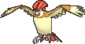{ .sprite-sm loading=lazy } | [Pidgeotto](017.md) | Normal Flying | Keen Eye / Tangled Feet / <em>Big Pecks</em> | 63 | 60 | 55 | 50 | 50 | 71 | **349** |
| 018 | { .sprite-sm loading=lazy } | [Pidgeot](018.md) | Normal Flying | Keen Eye / Tangled Feet / <em>Big Pecks</em> | 83 | 80 | 75 | 70 | 70 | 101 | **479** |
| 019 | { .sprite-sm loading=lazy } | [Rattata](019.md) | Normal | Run Away / Guts / <em>Hustle</em> | 30 | 56 | 35 | 25 | 35 | 72 | **253** |
| 020 | 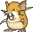{ .sprite-sm loading=lazy } | [Raticate](020.md) | Normal | Run Away / Guts / <em>Hustle</em> | 60 | 100 | 60 | 35 | 70 | 115 | **440** |
| 021 | 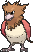{ .sprite-sm loading=lazy } | [Spearow](021.md) | Normal Flying | Keen Eye / Sniper / <em>Sniper</em> | 40 | 60 | 30 | 31 | 31 | 70 | **262** |
| 022 | { .sprite-sm loading=lazy } | [Fearow](022.md) | Normal Flying | Keen Eye / Sniper / <em>Sniper</em> | 65 | 100 | 65 | 60 | 60 | 100 | **450** |
| 023 | 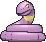{ .sprite-sm loading=lazy } | [Ekans](023.md) | Poison | Intimidate / Shed Skin / <em>Unnerve</em> | 35 | 60 | 44 | 40 | 54 | 55 | **288** |
| 024 | { .sprite-sm loading=lazy } | [Arbok](024.md) | Poison | Intimidate / Shed Skin / <em>Unnerve</em> | 60 | 95 | 70 | 55 | 85 | 85 | **450** |
| 025 | { .sprite-sm loading=lazy } | [Pikachu](025.md) | Electric | Static / Lightning Rod / <em>Lightning Rod</em> | 35 | 55 | 40 | 50 | 50 | 90 | **320** |
| 026 | { .sprite-sm loading=lazy } | [Raichu](026.md) | Electric | Static / Lightning Rod / <em>Lightning Rod</em> | 60 | 100 | 55 | 100 | 80 | 110 | **505** |
| 027 | { .sprite-sm loading=lazy } | [Sandshrew](027.md) | Ground | Sand Veil / Sand Rush / <em>Sand Rush</em> | 50 | 75 | 85 | 20 | 30 | 40 | **300** |
| 028 | 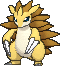{ .sprite-sm loading=lazy } | [Sandslash](028.md) | Ground | Sand Veil / Sand Rush / <em>Sand Rush</em> | 75 | 100 | 110 | 45 | 55 | 65 | **450** |
| 029 | { .sprite-sm loading=lazy } | [Nidoran♀](029.md) | Poison | Poison Point / Rivalry / <em>Hustle</em> | 55 | 47 | 52 | 40 | 40 | 41 | **275** |
| 030 | 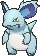{ .sprite-sm loading=lazy } | [Nidorina](030.md) | Poison | Poison Point / Rivalry / <em>Hustle</em> | 70 | 62 | 67 | 55 | 55 | 56 | **365** |
| 031 | 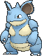{ .sprite-sm loading=lazy } | [Nidoqueen](031.md) | Poison Ground | Poison Point / Rivalry / <em>Sheer Force</em> | 90 | 92 | 87 | 75 | 85 | 76 | **505** |
| 032 | 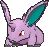{ .sprite-sm loading=lazy } | [Nidoran♂](032.md) | Poison | Poison Point / Rivalry / <em>Hustle</em> | 46 | 57 | 40 | 40 | 40 | 50 | **273** |
| 033 | 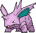{ .sprite-sm loading=lazy } | [Nidorino](033.md) | Poison | Poison Point / Rivalry / <em>Hustle</em> | 61 | 72 | 57 | 55 | 55 | 65 | **365** |
| 034 | { .sprite-sm loading=lazy } | [Nidoking](034.md) | Poison Ground | Poison Point / Rivalry / <em>Sheer Force</em> | 81 | 102 | 77 | 85 | 75 | 85 | **505** |
| 035 | { .sprite-sm loading=lazy } | [Clefairy](035.md) | Fairy | Cute Charm / Magic Guard / <em>Friend Guard</em> | 70 | 45 | 48 | 60 | 65 | 35 | **323** |
| 036 | { .sprite-sm loading=lazy } | [Clefable](036.md) | Fairy | Cute Charm / Magic Guard / <em>Unaware</em> | 95 | 70 | 73 | 95 | 90 | 60 | **483** |
| 037 | { .sprite-sm loading=lazy } | [Vulpix](037.md) | Fire | Flash Fire / Drought / <em>Drought</em> | 38 | 41 | 40 | 50 | 65 | 65 | **299** |
| 038 | 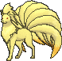{ .sprite-sm loading=lazy } | [Ninetales](038.md) | Fire | Flash Fire / Drought / <em>Drought</em> | 73 | 76 | 75 | 81 | 100 | 100 | **505** |
| 039 | { .sprite-sm loading=lazy } | [Jigglypuff](039.md) | Normal Fairy | Cute Charm / Competitive / <em>Friend Guard</em> | 115 | 45 | 40 | 60 | 40 | 20 | **320** |
| 040 | { .sprite-sm loading=lazy } | [Wigglytuff](040.md) | Normal Fairy | Cute Charm / Competitive / <em>Frisk</em> | 150 | 80 | 55 | 95 | 60 | 45 | **485** |
| 041 | { .sprite-sm loading=lazy } | [Zubat](041.md) | Poison Flying | Inner Focus / Infiltrator / <em>Infiltrator</em> | 40 | 45 | 35 | 30 | 40 | 55 | **245** |
| 042 | 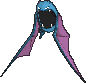{ .sprite-sm loading=lazy } | [Golbat](042.md) | Poison Flying | Inner Focus / Infiltrator / <em>Infiltrator</em> | 75 | 80 | 70 | 65 | 75 | 90 | **455** |
| 043 | { .sprite-sm loading=lazy } | [Oddish](043.md) | Grass Poison | Chlorophyll / Run Away / <em>Run Away</em> | 45 | 50 | 55 | 75 | 65 | 30 | **320** |
| 044 | 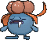{ .sprite-sm loading=lazy } | [Gloom](044.md) | Grass Poison | Chlorophyll / Stench / <em>Stench</em> | 60 | 65 | 70 | 85 | 75 | 40 | **395** |
| 045 | { .sprite-sm loading=lazy } | [Vileplume](045.md) | Grass Poison | Chlorophyll / Effect Spore / <em>Effect Spore</em> | 75 | 80 | 85 | 110 | 90 | 50 | **490** |
| 046 | { .sprite-sm loading=lazy } | [Paras](046.md) | Bug Grass | Effect Spore / Dry Skin / <em>Damp</em> | 35 | 80 | 55 | 45 | 55 | 25 | **295** |
| 047 | { .sprite-sm loading=lazy } | [Parasect](047.md) | Bug Grass | Effect Spore / Dry Skin / <em>Damp</em> | 80 | 115 | 90 | 45 | 90 | 30 | **450** |
| 048 | { .sprite-sm loading=lazy } | [Venonat](048.md) | Bug Poison | Compound Eyes / Tinted Lens / <em>Run Away</em> | 60 | 55 | 50 | 40 | 55 | 45 | **305** |
| 049 | 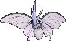{ .sprite-sm loading=lazy } | [Venomoth](049.md) | Bug Poison | Shield Dust / Tinted Lens / <em>Wonder Skin</em> | 70 | 55 | 60 | 100 | 75 | 100 | **460** |
| 050 | { .sprite-sm loading=lazy } | [Diglett](050.md) | Ground | Sand Veil / Arena Trap / <em>Sand Force</em> | 10 | 55 | 25 | 35 | 45 | 95 | **265** |
| 051 | { .sprite-sm loading=lazy } | [Dugtrio](051.md) | Ground | Sand Veil / Arena Trap / <em>Sand Force</em> | 45 | 100 | 60 | 50 | 80 | 120 | **455** |
| 052 | 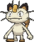{ .sprite-sm loading=lazy } | [Meowth](052.md) | Normal | Pickup / Technician / <em>Unnerve</em> | 40 | 45 | 35 | 40 | 40 | 90 | **290** |
| 053 | 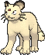{ .sprite-sm loading=lazy } | [Persian](053.md) | Normal | Limber / Technician / <em>Unnerve</em> | 65 | 85 | 60 | 75 | 65 | 115 | **465** |
| 054 | { .sprite-sm loading=lazy } | [Psyduck](054.md) | Water | Damp / Cloud Nine / <em>Swift Swim</em> | 50 | 52 | 48 | 65 | 50 | 55 | **320** |
| 055 | { .sprite-sm loading=lazy } | [Golduck](055.md) | Water | Damp / Cloud Nine / <em>Swift Swim</em> | 80 | 82 | 78 | 95 | 80 | 85 | **500** |
| 056 | { .sprite-sm loading=lazy } | [Mankey](056.md) | Fighting | Vital Spirit / Anger Point / <em>Defiant</em> | 40 | 80 | 35 | 35 | 45 | 70 | **305** |
| 057 | { .sprite-sm loading=lazy } | [Primeape](057.md) | Fighting | Vital Spirit / Anger Point / <em>Defiant</em> | 65 | 105 | 60 | 60 | 70 | 95 | **455** |
| 058 | { .sprite-sm loading=lazy } | [Growlithe](058.md) | Fire | Intimidate / Flash Fire / <em>Justified</em> | 55 | 70 | 45 | 70 | 50 | 60 | **350** |
| 059 | 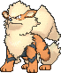{ .sprite-sm loading=lazy } | [Arcanine](059.md) | Fire | Intimidate / Flash Fire / <em>Justified</em> | 90 | 110 | 80 | 100 | 80 | 95 | **555** |
| 060 | { .sprite-sm loading=lazy } | [Poliwag](060.md) | Water | Water Absorb / Damp / <em>Swift Swim</em> | 40 | 50 | 40 | 40 | 40 | 90 | **300** |
| 061 | { .sprite-sm loading=lazy } | [Poliwhirl](061.md) | Water | Water Absorb / Damp / <em>Swift Swim</em> | 65 | 65 | 65 | 50 | 50 | 90 | **385** |
| 062 | { .sprite-sm loading=lazy } | [Poliwrath](062.md) | Water Fighting | Water Absorb / Damp / <em>Swift Swim</em> | 90 | 95 | 95 | 70 | 90 | 70 | **510** |
| 063 | { .sprite-sm loading=lazy } | [Abra](063.md) | Psychic | Synchronize / Inner Focus / <em>Magic Guard</em> | 25 | 20 | 15 | 105 | 55 | 90 | **310** |
| 064 | 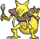{ .sprite-sm loading=lazy } | [Kadabra](064.md) | Psychic | Synchronize / Inner Focus / <em>Magic Guard</em> | 40 | 35 | 30 | 120 | 70 | 105 | **400** |
| 065 | 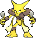{ .sprite-sm loading=lazy } | [Alakazam](065.md) | Psychic | Synchronize / Inner Focus / <em>Magic Guard</em> | 55 | 50 | 45 | 135 | 95 | 120 | **500** |
| 066 | { .sprite-sm loading=lazy } | [Machop](066.md) | Fighting | Guts / No Guard / <em>Steadfast</em> | 70 | 80 | 50 | 35 | 35 | 35 | **305** |
| 067 | 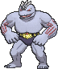{ .sprite-sm loading=lazy } | [Machoke](067.md) | Fighting | Guts / No Guard / <em>Steadfast</em> | 80 | 100 | 70 | 50 | 60 | 45 | **405** |
| 068 | 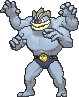{ .sprite-sm loading=lazy } | [Machamp](068.md) | Fighting | Guts / No Guard / <em>Steadfast</em> | 90 | 130 | 80 | 65 | 85 | 55 | **505** |
| 069 | { .sprite-sm loading=lazy } | [Bellsprout](069.md) | Grass Poison | Chlorophyll / Gluttony / <em>Gluttony</em> | 50 | 75 | 35 | 70 | 30 | 40 | **300** |
| 070 | 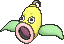{ .sprite-sm loading=lazy } | [Weepinbell](070.md) | Grass Poison | Chlorophyll / Gluttony / <em>Gluttony</em> | 65 | 90 | 50 | 85 | 45 | 55 | **390** |
| 071 | 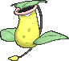{ .sprite-sm loading=lazy } | [Victreebel](071.md) | Grass Poison | Chlorophyll / Gluttony / <em>Gluttony</em> | 80 | 105 | 65 | 100 | 70 | 70 | **490** |
| 072 | { .sprite-sm loading=lazy } | [Tentacool](072.md) | Water Poison | Clear Body / Liquid Ooze / <em>Rain Dish</em> | 40 | 40 | 35 | 50 | 100 | 70 | **335** |
| 073 | { .sprite-sm loading=lazy } | [Tentacruel](073.md) | Water Poison | Clear Body / Liquid Ooze / <em>Rain Dish</em> | 80 | 70 | 65 | 80 | 120 | 100 | **515** |
| 074 | { .sprite-sm loading=lazy } | [Geodude](074.md) | Rock Ground | Rock Head / Sturdy / <em>Sand Veil</em> | 40 | 80 | 100 | 30 | 30 | 20 | **300** |
| 075 | 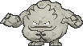{ .sprite-sm loading=lazy } | [Graveler](075.md) | Rock Ground | Rock Head / Sturdy / <em>Sand Veil</em> | 55 | 95 | 115 | 45 | 45 | 35 | **390** |
| 076 | 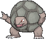{ .sprite-sm loading=lazy } | [Golem](076.md) | Rock Ground | Rock Head / Sturdy / <em>Sand Veil</em> | 80 | 120 | 130 | 55 | 65 | 45 | **495** |
| 077 | { .sprite-sm loading=lazy } | [Ponyta](077.md) | Fire | Run Away / Flash Fire / <em>Flame Body</em> | 50 | 85 | 55 | 65 | 65 | 90 | **410** |
| 078 | 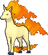{ .sprite-sm loading=lazy } | [Rapidash](078.md) | Fire | Run Away / Flash Fire / <em>Flame Body</em> | 65 | 100 | 70 | 80 | 80 | 105 | **500** |
| 079 | { .sprite-sm loading=lazy } | [Slowpoke](079.md) | Water Psychic | Oblivious / Own Tempo / <em>Regenerator</em> | 90 | 65 | 65 | 40 | 40 | 15 | **315** |
| 080 | 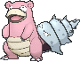{ .sprite-sm loading=lazy } | [Slowbro](080.md) | Water Psychic | Oblivious / Own Tempo / <em>Regenerator</em> | 95 | 75 | 110 | 100 | 80 | 30 | **490** |
| 081 | { .sprite-sm loading=lazy } | [Magnemite](081.md) | Electric Steel | Magnet Pull / Sturdy / <em>Analytic</em> | 25 | 35 | 70 | 95 | 55 | 45 | **325** |
| 082 | 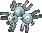{ .sprite-sm loading=lazy } | [Magneton](082.md) | Electric Steel | Magnet Pull / Sturdy / <em>Analytic</em> | 50 | 60 | 95 | 120 | 70 | 70 | **465** |
| 083 | { .sprite-sm loading=lazy } | [Farfetch’d](083.md) | Fighting Flying | Keen Eye / Inner Focus / <em>Defiant</em> | 65 | 130 | 65 | 30 | 65 | 120 | **475** |
| 084 | { .sprite-sm loading=lazy } | [Doduo](084.md) | Normal Flying | Run Away / Early Bird / <em>Tangled Feet</em> | 35 | 85 | 45 | 35 | 35 | 75 | **310** |
| 085 | 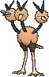{ .sprite-sm loading=lazy } | [Dodrio](085.md) | Normal Flying | Run Away / Early Bird / <em>Tangled Feet</em> | 60 | 110 | 70 | 60 | 60 | 100 | **460** |
| 086 | { .sprite-sm loading=lazy } | [Seel](086.md) | Water | Thick Fat / Hydration / <em>Ice Body</em> | 65 | 45 | 55 | 45 | 70 | 45 | **325** |
| 087 | { .sprite-sm loading=lazy } | [Dewgong](087.md) | Water Ice | Thick Fat / Hydration / <em>Ice Body</em> | 90 | 80 | 80 | 80 | 95 | 60 | **485** |
| 088 | 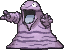{ .sprite-sm loading=lazy } | [Grimer](088.md) | Poison | Stench / Sticky Hold / <em>Poison Touch</em> | 80 | 80 | 50 | 40 | 50 | 25 | **325** |
| 089 | 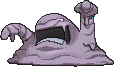{ .sprite-sm loading=lazy } | [Muk](089.md) | Poison | Stench / Sticky Hold / <em>Poison Touch</em> | 105 | 105 | 75 | 65 | 100 | 50 | **500** |
| 090 | { .sprite-sm loading=lazy } | [Shellder](090.md) | Water | Shell Armor / Skill Link / <em>Overcoat</em> | 30 | 65 | 100 | 45 | 25 | 40 | **305** |
| 091 | { .sprite-sm loading=lazy } | [Cloyster](091.md) | Water Ice | Shell Armor / Skill Link / <em>Overcoat</em> | 50 | 95 | 180 | 85 | 45 | 70 | **525** |
| 092 | 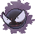{ .sprite-sm loading=lazy } | [Gastly](092.md) | Ghost Poison | Levitate | 30 | 35 | 30 | 100 | 35 | 80 | **310** |
| 093 | 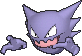{ .sprite-sm loading=lazy } | [Haunter](093.md) | Ghost Poison | Levitate | 45 | 50 | 45 | 115 | 55 | 95 | **405** |
| 094 | { .sprite-sm loading=lazy } | [Gengar](094.md) | Ghost Poison | Levitate | 60 | 65 | 60 | 130 | 75 | 110 | **500** |
| 095 | { .sprite-sm loading=lazy } | [Onix](095.md) | Rock Ground | Rock Head / Sturdy / <em>Weak Armor</em> | 65 | 75 | 160 | 30 | 45 | 100 | **475** |
| 096 | 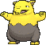{ .sprite-sm loading=lazy } | [Drowzee](096.md) | Psychic | Insomnia / Forewarn / <em>Inner Focus</em> | 60 | 48 | 45 | 43 | 90 | 42 | **328** |
| 097 | { .sprite-sm loading=lazy } | [Hypno](097.md) | Psychic | Insomnia / Forewarn / <em>Inner Focus</em> | 85 | 73 | 70 | 73 | 115 | 67 | **483** |
| 098 | { .sprite-sm loading=lazy } | [Krabby](098.md) | Water | Hyper Cutter / Shell Armor / <em>Sheer Force</em> | 30 | 105 | 90 | 25 | 25 | 50 | **325** |
| 099 | { .sprite-sm loading=lazy } | [Kingler](099.md) | Water | Hyper Cutter / Shell Armor / <em>Sheer Force</em> | 55 | 130 | 115 | 50 | 50 | 75 | **475** |
| 100 | { .sprite-sm loading=lazy } | [Voltorb](100.md) | Electric | Soundproof / Static / <em>Aftermath</em> | 40 | 30 | 50 | 55 | 55 | 100 | **330** |
| 101 | { .sprite-sm loading=lazy } | [Electrode](101.md) | Electric | Soundproof / Static / <em>Aftermath</em> | 60 | 50 | 70 | 80 | 80 | 140 | **480** |
| 102 | { .sprite-sm loading=lazy } | [Exeggcute](102.md) | Grass Psychic | Chlorophyll / Harvest / <em>Harvest</em> | 60 | 40 | 80 | 60 | 45 | 40 | **325** |
| 103 | { .sprite-sm loading=lazy } | [Exeggutor](103.md) | Grass Psychic | Chlorophyll / Harvest / <em>Harvest</em> | 95 | 95 | 85 | 125 | 65 | 55 | **520** |
| 104 | { .sprite-sm loading=lazy } | [Cubone](104.md) | Ground | Rock Head / Lightning Rod / <em>Battle Armor</em> | 50 | 50 | 95 | 40 | 50 | 35 | **320** |
| 105 | { .sprite-sm loading=lazy } | [Marowak](105.md) | Ground | Rock Head / Lightning Rod / <em>Battle Armor</em> | 70 | 80 | 110 | 50 | 80 | 60 | **450** |
| 106 | 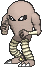{ .sprite-sm loading=lazy } | [Hitmonlee](106.md) | Fighting | Limber / Reckless / <em>Unburden</em> | 50 | 120 | 53 | 35 | 110 | 87 | **455** |
| 107 | 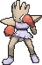{ .sprite-sm loading=lazy } | [Hitmonchan](107.md) | Fighting | Keen Eye / Iron Fist / <em>Inner Focus</em> | 50 | 105 | 79 | 35 | 110 | 76 | **455** |
| 108 | { .sprite-sm loading=lazy } | [Lickitung](108.md) | Normal | Own Tempo / Oblivious / <em>Cloud Nine</em> | 90 | 55 | 75 | 60 | 75 | 30 | **385** |
| 109 | { .sprite-sm loading=lazy } | [Koffing](109.md) | Poison | Levitate / <em>Stench</em> | 40 | 65 | 95 | 60 | 45 | 35 | **340** |
| 110 | { .sprite-sm loading=lazy } | [Weezing](110.md) | Poison | Levitate / <em>Stench</em> | 65 | 90 | 120 | 85 | 70 | 60 | **490** |
| 111 | { .sprite-sm loading=lazy } | [Rhyhorn](111.md) | Ground Rock | Lightning Rod / Rock Head / <em>Reckless</em> | 80 | 85 | 95 | 30 | 30 | 25 | **345** |
| 112 | { .sprite-sm loading=lazy } | [Rhydon](112.md) | Ground Rock | Lightning Rod / Rock Head / <em>Reckless</em> | 105 | 130 | 120 | 45 | 45 | 40 | **485** |
| 113 | { .sprite-sm loading=lazy } | [Chansey](113.md) | Normal | Natural Cure / Serene Grace / <em>Healer</em> | 250 | 5 | 5 | 35 | 105 | 50 | **450** |
| 114 | { .sprite-sm loading=lazy } | [Tangela](114.md) | Grass | Chlorophyll / Leaf Guard / <em>Regenerator</em> | 65 | 55 | 115 | 100 | 40 | 60 | **435** |
| 115 | { .sprite-sm loading=lazy } | [Kangaskhan](115.md) | Normal | Early Bird / Scrappy / <em>Inner Focus</em> | 105 | 95 | 80 | 40 | 80 | 90 | **490** |
| 116 | 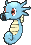{ .sprite-sm loading=lazy } | [Horsea](116.md) | Water | Swift Swim / Sniper / <em>Damp</em> | 30 | 40 | 70 | 70 | 25 | 60 | **295** |
| 117 | { .sprite-sm loading=lazy } | [Seadra](117.md) | Water | Poison Point / Sniper / <em>Damp</em> | 55 | 65 | 95 | 95 | 45 | 85 | **440** |
| 118 | 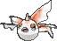{ .sprite-sm loading=lazy } | [Goldeen](118.md) | Water | Swift Swim / Water Veil / <em>Lightning Rod</em> | 45 | 67 | 60 | 35 | 50 | 63 | **320** |
| 119 | { .sprite-sm loading=lazy } | [Seaking](119.md) | Water | Swift Swim / Water Veil / <em>Lightning Rod</em> | 80 | 100 | 80 | 40 | 80 | 80 | **460** |
| 120 | { .sprite-sm loading=lazy } | [Staryu](120.md) | Water | Illuminate / Natural Cure / <em>Analytic</em> | 30 | 45 | 55 | 70 | 55 | 85 | **340** |
| 121 | { .sprite-sm loading=lazy } | [Starmie](121.md) | Water Psychic | Illuminate / Natural Cure / <em>Analytic</em> | 60 | 75 | 85 | 100 | 85 | 115 | **520** |
| 122 | { .sprite-sm loading=lazy } | [Mr. Mime](122.md) | Psychic Fairy | Soundproof / Filter / <em>Technician</em> | 40 | 45 | 65 | 100 | 120 | 90 | **460** |
| 123 | 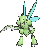{ .sprite-sm loading=lazy } | [Scyther](123.md) | Bug Flying | Swarm / Technician / <em>Steadfast</em> | 70 | 110 | 80 | 55 | 80 | 105 | **500** |
| 124 | 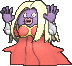{ .sprite-sm loading=lazy } | [Jynx](124.md) | Ice Psychic | Oblivious / Forewarn / <em>Dry Skin</em> | 65 | 50 | 35 | 115 | 95 | 95 | **455** |
| 125 | 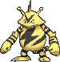{ .sprite-sm loading=lazy } | [Electabuzz](125.md) | Electric | Static / Vital Spirit / <em>Vital Spirit</em> | 65 | 83 | 57 | 95 | 85 | 105 | **490** |
| 126 | 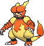{ .sprite-sm loading=lazy } | [Magmar](126.md) | Fire | Flame Body / Vital Spirit / <em>Vital Spirit</em> | 65 | 95 | 57 | 100 | 85 | 93 | **495** |
| 127 | { .sprite-sm loading=lazy } | [Pinsir](127.md) | Bug | Hyper Cutter / Mold Breaker / <em>Moxie</em> | 65 | 125 | 100 | 55 | 70 | 85 | **500** |
| 128 | { .sprite-sm loading=lazy } | [Tauros](128.md) | Normal | Intimidate / Anger Point / <em>Sheer Force</em> | 75 | 100 | 95 | 40 | 70 | 110 | **490** |
| 129 | { .sprite-sm loading=lazy } | [Magikarp](129.md) | Water | Swift Swim / Rattled / <em>Rattled</em> | 20 | 10 | 55 | 15 | 20 | 80 | **200** |
| 130 | { .sprite-sm loading=lazy } | [Gyarados](130.md) | Water Flying | Intimidate / Moxie / <em>Moxie</em> | 95 | 125 | 79 | 60 | 100 | 81 | **540** |
| 131 | { .sprite-sm loading=lazy } | [Lapras](131.md) | Water Ice | Water Absorb / Shell Armor / <em>Hydration</em> | 130 | 85 | 80 | 85 | 95 | 60 | **535** |
| 132 | { .sprite-sm loading=lazy } | [Ditto](132.md) | Normal | Limber / Imposter / <em>Imposter</em> | 48 | 48 | 48 | 48 | 48 | 48 | **288** |
| 133 | { .sprite-sm loading=lazy } | [Eevee](133.md) | Normal | Run Away / Adaptability / <em>Anticipation</em> | 55 | 55 | 50 | 45 | 65 | 55 | **325** |
| 134 | { .sprite-sm loading=lazy } | [Vaporeon](134.md) | Water | Water Absorb / Hydration / <em>Hydration</em> | 130 | 65 | 60 | 110 | 95 | 65 | **525** |
| 135 | { .sprite-sm loading=lazy } | [Jolteon](135.md) | Electric | Volt Absorb / Quick Feet / <em>Quick Feet</em> | 65 | 65 | 60 | 110 | 95 | 130 | **525** |
| 136 | { .sprite-sm loading=lazy } | [Flareon](136.md) | Fire | Flash Fire / Guts / <em>Guts</em> | 65 | 130 | 60 | 65 | 110 | 95 | **525** |
| 137 | { .sprite-sm loading=lazy } | [Porygon](137.md) | Normal | Trace / Download / <em>Analytic</em> | 65 | 60 | 70 | 85 | 75 | 40 | **395** |
| 138 | { .sprite-sm loading=lazy } | [Omanyte](138.md) | Rock Water | Swift Swim / Shell Armor / <em>Weak Armor</em> | 35 | 40 | 100 | 90 | 55 | 35 | **355** |
| 139 | { .sprite-sm loading=lazy } | [Omastar](139.md) | Rock Water | Swift Swim / Shell Armor / <em>Weak Armor</em> | 70 | 60 | 125 | 115 | 70 | 55 | **495** |
| 140 | { .sprite-sm loading=lazy } | [Kabuto](140.md) | Rock Water | Swift Swim / Battle Armor / <em>Weak Armor</em> | 30 | 80 | 90 | 55 | 45 | 55 | **355** |
| 141 | { .sprite-sm loading=lazy } | [Kabutops](141.md) | Rock Water | Swift Swim / Battle Armor / <em>Weak Armor</em> | 60 | 115 | 105 | 65 | 70 | 80 | **495** |
| 142 | { .sprite-sm loading=lazy } | [Aerodactyl](142.md) | Rock Flying | Rock Head / Pressure / <em>Unnerve</em> | 80 | 105 | 65 | 60 | 75 | 130 | **515** |
| 143 | { .sprite-sm loading=lazy } | [Snorlax](143.md) | Normal | Immunity / Thick Fat / <em>Gluttony</em> | 160 | 110 | 65 | 65 | 110 | 30 | **540** |
| 144 | { .sprite-sm loading=lazy } | [Articuno](144.md) | Ice Flying | Pressure / Snow Cloak / <em>Snow Cloak</em> | 90 | 85 | 100 | 95 | 125 | 85 | **580** |
| 145 | { .sprite-sm loading=lazy } | [Zapdos](145.md) | Electric Flying | Pressure / Static / <em>Static</em> | 90 | 90 | 85 | 125 | 90 | 100 | **580** |
| 146 | { .sprite-sm loading=lazy } | [Moltres](146.md) | Fire Flying | Pressure / Flame Body / <em>Flame Body</em> | 90 | 100 | 90 | 125 | 85 | 90 | **580** |
| 147 | { .sprite-sm loading=lazy } | [Dratini](147.md) | Dragon | Shed Skin / Marvel Scale / <em>Marvel Scale</em> | 41 | 64 | 45 | 50 | 50 | 50 | **300** |
| 148 | { .sprite-sm loading=lazy } | [Dragonair](148.md) | Dragon | Shed Skin / Marvel Scale / <em>Marvel Scale</em> | 61 | 84 | 65 | 70 | 70 | 70 | **420** |
| 149 | { .sprite-sm loading=lazy } | [Dragonite](149.md) | Dragon Flying | Inner Focus / Multiscale / <em>Multiscale</em> | 91 | 134 | 95 | 100 | 100 | 80 | **600** |
| 150 | { .sprite-sm loading=lazy } | [Mewtwo](150.md) | Psychic | Pressure / Unnerve / <em>Unnerve</em> | 106 | 110 | 90 | 154 | 90 | 130 | **680** |
| 151 | { .sprite-sm loading=lazy } | [Mew](151.md) | Psychic | Synchronize | 100 | 100 | 100 | 100 | 100 | 100 | **600** |
| 152 | { .sprite-sm loading=lazy } | [Chikorita](152.md) | Grass | Overgrow / Natural Cure / <em>Leaf Guard</em> | 45 | 49 | 65 | 49 | 65 | 45 | **318** |
| 153 | { .sprite-sm loading=lazy } | [Bayleef](153.md) | Grass | Overgrow / Natural Cure / <em>Leaf Guard</em> | 60 | 62 | 80 | 63 | 80 | 60 | **405** |
| 154 | { .sprite-sm loading=lazy } | [Meganium](154.md) | Grass | Overgrow / Natural Cure / <em>Leaf Guard</em> | 80 | 82 | 100 | 83 | 100 | 80 | **525** |
| 155 | { .sprite-sm loading=lazy } | [Cyndaquil](155.md) | Fire | Blaze / Flash Fire / <em>Flash Fire</em> | 39 | 52 | 43 | 60 | 50 | 65 | **309** |
| 156 | { .sprite-sm loading=lazy } | [Quilava](156.md) | Fire | Blaze / Flash Fire / <em>Flash Fire</em> | 58 | 64 | 58 | 80 | 65 | 80 | **405** |
| 157 | { .sprite-sm loading=lazy } | [Typhlosion](157.md) | Fire | Blaze / Flash Fire / <em>Flash Fire</em> | 78 | 84 | 78 | 109 | 85 | 100 | **534** |
| 158 | { .sprite-sm loading=lazy } | [Totodile](158.md) | Water | Torrent / Sheer Force / <em>Sheer Force</em> | 50 | 65 | 64 | 44 | 48 | 43 | **314** |
| 159 | { .sprite-sm loading=lazy } | [Croconaw](159.md) | Water | Torrent / Sheer Force / <em>Sheer Force</em> | 65 | 80 | 80 | 59 | 63 | 58 | **405** |
| 160 | { .sprite-sm loading=lazy } | [Feraligatr](160.md) | Water | Torrent / Sheer Force / <em>Sheer Force</em> | 85 | 105 | 100 | 79 | 83 | 78 | **530** |
| 161 | { .sprite-sm loading=lazy } | [Sentret](161.md) | Normal | Run Away / Keen Eye / <em>Frisk</em> | 35 | 46 | 34 | 35 | 45 | 20 | **215** |
| 162 | { .sprite-sm loading=lazy } | [Furret](162.md) | Normal | Limber / Keen Eye / <em>Frisk</em> | 95 | 85 | 65 | 40 | 55 | 100 | **440** |
| 163 | { .sprite-sm loading=lazy } | [Hoothoot](163.md) | Normal Flying | Insomnia / Keen Eye / <em>Tinted Lens</em> | 60 | 25 | 25 | 45 | 65 | 50 | **270** |
| 164 | { .sprite-sm loading=lazy } | [Noctowl](164.md) | Psychic Flying | Insomnia / Analytic / <em>Tinted Lens</em> | 100 | 30 | 60 | 90 | 110 | 75 | **465** |
| 165 | { .sprite-sm loading=lazy } | [Ledyba](165.md) | Bug Flying | Swarm / Early Bird / <em>Rattled</em> | 40 | 50 | 30 | 20 | 80 | 55 | **275** |
| 166 | { .sprite-sm loading=lazy } | [Ledian](166.md) | Bug Flying | Swarm / Early Bird / <em>Iron Fist</em> | 55 | 110 | 50 | 40 | 110 | 85 | **450** |
| 167 | { .sprite-sm loading=lazy } | [Spinarak](167.md) | Bug Poison | Swarm / Insomnia / <em>Sniper</em> | 40 | 70 | 40 | 40 | 40 | 40 | **270** |
| 168 | { .sprite-sm loading=lazy } | [Ariados](168.md) | Bug Poison | Swarm / Insomnia / <em>Sniper</em> | 70 | 120 | 70 | 50 | 60 | 80 | **450** |
| 169 | { .sprite-sm loading=lazy } | [Crobat](169.md) | Poison Flying | Inner Focus / Infiltrator / <em>Infiltrator</em> | 85 | 90 | 80 | 70 | 80 | 130 | **535** |
| 170 | { .sprite-sm loading=lazy } | [Chinchou](170.md) | Water Electric | Volt Absorb / Illuminate / <em>Water Absorb</em> | 75 | 38 | 38 | 56 | 56 | 67 | **330** |
| 171 | { .sprite-sm loading=lazy } | [Lanturn](171.md) | Water Electric | Volt Absorb / Illuminate / <em>Water Absorb</em> | 125 | 58 | 58 | 76 | 76 | 67 | **460** |
| 172 | { .sprite-sm loading=lazy } | [Pichu](172.md) | Electric | Static / Lightning Rod / <em>Lightning Rod</em> | 20 | 40 | 15 | 35 | 35 | 60 | **205** |
| 173 | { .sprite-sm loading=lazy } | [Cleffa](173.md) | Fairy | Cute Charm / Magic Guard / <em>Friend Guard</em> | 50 | 25 | 28 | 45 | 55 | 15 | **218** |
| 174 | { .sprite-sm loading=lazy } | [Igglybuff](174.md) | Normal Fairy | Cute Charm / Competitive / <em>Friend Guard</em> | 90 | 30 | 15 | 40 | 20 | 15 | **210** |
| 175 | { .sprite-sm loading=lazy } | [Togepi](175.md) | Fairy | Hustle / Serene Grace / <em>Super Luck</em> | 35 | 20 | 65 | 40 | 65 | 20 | **245** |
| 176 | { .sprite-sm loading=lazy } | [Togetic](176.md) | Fairy Flying | Hustle / Serene Grace / <em>Super Luck</em> | 55 | 40 | 85 | 80 | 105 | 40 | **405** |
| 177 | { .sprite-sm loading=lazy } | [Natu](177.md) | Psychic Flying | Synchronize / Early Bird / <em>Magic Bounce</em> | 40 | 50 | 45 | 70 | 45 | 70 | **320** |
| 178 | { .sprite-sm loading=lazy } | [Xatu](178.md) | Psychic Flying | Synchronize / Early Bird / <em>Magic Bounce</em> | 65 | 75 | 70 | 95 | 70 | 95 | **470** |
| 179 | { .sprite-sm loading=lazy } | [Mareep](179.md) | Electric | Static / <em>Plus</em> | 55 | 40 | 40 | 65 | 45 | 35 | **280** |
| 180 | { .sprite-sm loading=lazy } | [Flaaffy](180.md) | Electric | Static / <em>Plus</em> | 70 | 55 | 55 | 80 | 60 | 45 | **365** |
| 181 | { .sprite-sm loading=lazy } | [Ampharos](181.md) | Electric | Static / <em>Plus</em> | 90 | 75 | 85 | 115 | 90 | 55 | **510** |
| 182 | { .sprite-sm loading=lazy } | [Bellossom](182.md) | Grass | Chlorophyll / Healer / <em>Healer</em> | 75 | 80 | 95 | 90 | 100 | 50 | **490** |
| 183 | { .sprite-sm loading=lazy } | [Marill](183.md) | Water Fairy | Thick Fat / Huge Power / <em>Sap Sipper</em> | 70 | 20 | 50 | 20 | 50 | 40 | **250** |
| 184 | { .sprite-sm loading=lazy } | [Azumarill](184.md) | Water Fairy | Thick Fat / Huge Power / <em>Sap Sipper</em> | 100 | 50 | 80 | 80 | 80 | 50 | **440** |
| 185 | { .sprite-sm loading=lazy } | [Sudowoodo](185.md) | Rock | Sturdy / Rock Head / <em>Rattled</em> | 80 | 110 | 125 | 40 | 75 | 30 | **460** |
| 186 | { .sprite-sm loading=lazy } | [Politoed](186.md) | Water | Water Absorb / Damp / <em>Drizzle</em> | 90 | 75 | 75 | 90 | 100 | 70 | **500** |
| 187 | { .sprite-sm loading=lazy } | [Hoppip](187.md) | Grass Flying | Chlorophyll / Leaf Guard / <em>Infiltrator</em> | 35 | 50 | 40 | 50 | 60 | 55 | **290** |
| 188 | { .sprite-sm loading=lazy } | [Skiploom](188.md) | Grass Flying | Chlorophyll / Leaf Guard / <em>Infiltrator</em> | 55 | 65 | 50 | 65 | 75 | 80 | **390** |
| 189 | { .sprite-sm loading=lazy } | [Jumpluff](189.md) | Grass Flying | Chlorophyll / Leaf Guard / <em>Infiltrator</em> | 75 | 75 | 70 | 75 | 95 | 110 | **500** |
| 190 | { .sprite-sm loading=lazy } | [Aipom](190.md) | Normal | Run Away / Pickup / <em>Skill Link</em> | 55 | 70 | 55 | 40 | 55 | 85 | **360** |
| 191 | { .sprite-sm loading=lazy } | [Sunkern](191.md) | Grass | Chlorophyll / Solar Power / <em>Early Bird</em> | 30 | 30 | 30 | 30 | 30 | 30 | **180** |
| 192 | { .sprite-sm loading=lazy } | [Sunflora](192.md) | Grass | Chlorophyll / Solar Power / <em>Early Bird</em> | 95 | 55 | 95 | 125 | 105 | 30 | **505** |
| 193 | { .sprite-sm loading=lazy } | [Yanma](193.md) | Bug Flying | Speed Boost / Compound Eyes / <em>Frisk</em> | 65 | 65 | 45 | 75 | 45 | 95 | **390** |
| 194 | { .sprite-sm loading=lazy } | [Wooper](194.md) | Water Ground | Damp / Water Absorb / <em>Unaware</em> | 55 | 55 | 55 | 25 | 25 | 15 | **230** |
| 195 | { .sprite-sm loading=lazy } | [Quagsire](195.md) | Water Ground | Damp / Water Absorb / <em>Unaware</em> | 95 | 95 | 95 | 65 | 65 | 35 | **450** |
| 196 | { .sprite-sm loading=lazy } | [Espeon](196.md) | Psychic | Synchronize / Magic Bounce / <em>Magic Bounce</em> | 65 | 65 | 60 | 130 | 95 | 110 | **525** |
| 197 | { .sprite-sm loading=lazy } | [Umbreon](197.md) | Dark | Synchronize / Poison Touch / <em>Inner Focus</em> | 95 | 65 | 110 | 60 | 130 | 65 | **525** |
| 198 | { .sprite-sm loading=lazy } | [Murkrow](198.md) | Dark Flying | Insomnia / Super Luck / <em>Prankster</em> | 60 | 85 | 42 | 85 | 42 | 91 | **405** |
| 199 | { .sprite-sm loading=lazy } | [Slowking](199.md) | Water Psychic | Oblivious / Own Tempo / <em>Regenerator</em> | 95 | 75 | 80 | 100 | 110 | 30 | **490** |
| 200 | { .sprite-sm loading=lazy } | [Misdreavus](200.md) | Ghost Fairy | Levitate | 60 | 60 | 60 | 85 | 85 | 85 | **435** |
| 201 | { .sprite-sm loading=lazy } | [Unown](201.md) | Psychic | Levitate | 50 | 150 | 50 | 150 | 50 | 50 | **500** |
| 202 | { .sprite-sm loading=lazy } | [Wobbuffet](202.md) | Psychic | Shadow Tag / <em>Telepathy</em> | 240 | 30 | 60 | 30 | 60 | 30 | **450** |
| 203 | { .sprite-sm loading=lazy } | [Girafarig](203.md) | Normal Psychic | Inner Focus / Early Bird / <em>Sap Sipper</em> | 70 | 80 | 65 | 90 | 65 | 85 | **455** |
| 204 | { .sprite-sm loading=lazy } | [Pineco](204.md) | Bug | Sturdy / Overcoat / <em>Overcoat</em> | 50 | 65 | 90 | 35 | 35 | 15 | **290** |
| 205 | { .sprite-sm loading=lazy } | [Forretress](205.md) | Bug Steel | Sturdy / Overcoat / <em>Overcoat</em> | 75 | 90 | 140 | 60 | 60 | 40 | **465** |
| 206 | { .sprite-sm loading=lazy } | [Dunsparce](206.md) | Normal Fairy | Serene Grace / Pixilate / <em>Rattled</em> | 110 | 80 | 80 | 65 | 65 | 55 | **455** |
| 207 | { .sprite-sm loading=lazy } | [Gligar](207.md) | Ground Flying | Hyper Cutter / Sand Veil / <em>Immunity</em> | 65 | 75 | 105 | 35 | 65 | 85 | **430** |
| 208 | { .sprite-sm loading=lazy } | [Steelix](208.md) | Steel Ground | Rock Head / Sturdy / <em>Sheer Force</em> | 75 | 85 | 200 | 55 | 65 | 30 | **510** |
| 209 | { .sprite-sm loading=lazy } | [Snubbull](209.md) | Fairy | Intimidate / Run Away / <em>Rattled</em> | 60 | 80 | 50 | 40 | 40 | 30 | **300** |
| 210 | { .sprite-sm loading=lazy } | [Granbull](210.md) | Fairy | Intimidate / Quick Feet / <em>Rattled</em> | 90 | 120 | 75 | 60 | 60 | 45 | **450** |
| 211 | { .sprite-sm loading=lazy } | [Qwilfish](211.md) | Water Poison | Poison Point / Swift Swim / <em>Intimidate</em> | 65 | 100 | 75 | 55 | 55 | 90 | **440** |
| 212 | { .sprite-sm loading=lazy } | [Scizor](212.md) | Bug Steel | Swarm / Technician / <em>Light Metal</em> | 70 | 130 | 100 | 55 | 80 | 65 | **500** |
| 213 | { .sprite-sm loading=lazy } | [Shuckle](213.md) | Bug Rock | Sturdy / Gluttony / <em>Contrary</em> | 20 | 10 | 230 | 10 | 230 | 5 | **505** |
| 214 | { .sprite-sm loading=lazy } | [Heracross](214.md) | Bug Fighting | Swarm / Guts / <em>Moxie</em> | 80 | 125 | 75 | 40 | 95 | 85 | **500** |
| 215 | { .sprite-sm loading=lazy } | [Sneasel](215.md) | Dark Ice | Inner Focus / Technician / <em>Pickpocket</em> | 55 | 95 | 55 | 35 | 75 | 115 | **430** |
| 216 | { .sprite-sm loading=lazy } | [Teddiursa](216.md) | Normal | Pickup / Quick Feet / <em>Honey Gather</em> | 60 | 80 | 50 | 50 | 50 | 40 | **330** |
| 217 | { .sprite-sm loading=lazy } | [Ursaring](217.md) | Normal | Guts / Quick Feet / <em>Unnerve</em> | 90 | 130 | 75 | 75 | 75 | 55 | **500** |
| 218 | { .sprite-sm loading=lazy } | [Slugma](218.md) | Fire | Magma Armor / Flame Body / <em>Weak Armor</em> | 50 | 50 | 50 | 80 | 50 | 20 | **300** |
| 219 | { .sprite-sm loading=lazy } | [Magcargo](219.md) | Fire Rock | Solid Rock / Flame Body / <em>Weak Armor</em> | 80 | 50 | 120 | 115 | 110 | 30 | **505** |
| 220 | { .sprite-sm loading=lazy } | [Swinub](220.md) | Ice Ground | Oblivious / Snow Cloak / <em>Thick Fat</em> | 50 | 50 | 40 | 30 | 30 | 50 | **250** |
| 221 | { .sprite-sm loading=lazy } | [Piloswine](221.md) | Ice Ground | Oblivious / Snow Cloak / <em>Thick Fat</em> | 100 | 100 | 80 | 60 | 60 | 50 | **450** |
| 222 | { .sprite-sm loading=lazy } | [Corsola](222.md) | Water Rock | Regenerator / Natural Cure / <em>Hustle</em> | 75 | 55 | 105 | 85 | 105 | 35 | **460** |
| 223 | { .sprite-sm loading=lazy } | [Remoraid](223.md) | Water | Hustle / Sniper / <em>Moody</em> | 35 | 65 | 35 | 65 | 35 | 65 | **300** |
| 224 | { .sprite-sm loading=lazy } | [Octillery](224.md) | Water | Suction Cups / Sniper / <em>Moody</em> | 75 | 105 | 75 | 105 | 75 | 45 | **480** |
| 225 | { .sprite-sm loading=lazy } | [Delibird](225.md) | Ice Flying | Vital Spirit / Aerilate / <em>Hustle</em> | 65 | 80 | 65 | 110 | 65 | 120 | **505** |
| 226 | { .sprite-sm loading=lazy } | [Mantine](226.md) | Water Flying | Swift Swim / Water Absorb / <em>Water Veil</em> | 65 | 40 | 70 | 80 | 140 | 70 | **465** |
| 227 | { .sprite-sm loading=lazy } | [Skarmory](227.md) | Steel Flying | Keen Eye / Sturdy / <em>Weak Armor</em> | 65 | 80 | 140 | 40 | 70 | 70 | **465** |
| 228 | { .sprite-sm loading=lazy } | [Houndour](228.md) | Dark Fire | Early Bird / Flash Fire / <em>Unnerve</em> | 45 | 60 | 30 | 80 | 50 | 65 | **330** |
| 229 | { .sprite-sm loading=lazy } | [Houndoom](229.md) | Dark Fire | Early Bird / Flash Fire / <em>Unnerve</em> | 75 | 90 | 50 | 110 | 80 | 95 | **500** |
| 230 | { .sprite-sm loading=lazy } | [Kingdra](230.md) | Water Dragon | Swift Swim / Sniper / <em>Damp</em> | 75 | 95 | 95 | 95 | 95 | 85 | **540** |
| 231 | { .sprite-sm loading=lazy } | [Phanpy](231.md) | Ground | Pickup / Sand Veil / <em>Sand Veil</em> | 90 | 60 | 60 | 40 | 40 | 40 | **330** |
| 232 | { .sprite-sm loading=lazy } | [Donphan](232.md) | Ground | Sturdy / Sand Veil / <em>Sand Veil</em> | 90 | 120 | 120 | 60 | 60 | 50 | **500** |
| 233 | { .sprite-sm loading=lazy } | [Porygon2](233.md) | Normal | Trace / Download / <em>Analytic</em> | 85 | 80 | 90 | 105 | 95 | 60 | **515** |
| 234 | { .sprite-sm loading=lazy } | [Stantler](234.md) | Normal | Intimidate / Frisk / <em>Sap Sipper</em> | 73 | 95 | 62 | 85 | 65 | 85 | **465** |
| 235 | { .sprite-sm loading=lazy } | [Smeargle](235.md) | Normal | Own Tempo / Technician / <em>Moody</em> | 55 | 20 | 35 | 20 | 45 | 75 | **250** |
| 236 | { .sprite-sm loading=lazy } | [Tyrogue](236.md) | Fighting | Guts / Steadfast / <em>Vital Spirit</em> | 35 | 35 | 35 | 35 | 35 | 35 | **210** |
| 237 | { .sprite-sm loading=lazy } | [Hitmontop](237.md) | Fighting | Intimidate / Technician / <em>Steadfast</em> | 50 | 95 | 95 | 35 | 110 | 70 | **455** |
| 238 | { .sprite-sm loading=lazy } | [Smoochum](238.md) | Ice Psychic | Oblivious / Forewarn / <em>Hydration</em> | 45 | 30 | 15 | 85 | 65 | 65 | **305** |
| 239 | { .sprite-sm loading=lazy } | [Elekid](239.md) | Electric | Static / Vital Spirit / <em>Vital Spirit</em> | 45 | 63 | 37 | 65 | 55 | 95 | **360** |
| 240 | { .sprite-sm loading=lazy } | [Magby](240.md) | Fire | Flame Body / Vital Spirit / <em>Vital Spirit</em> | 45 | 75 | 37 | 70 | 55 | 83 | **365** |
| 241 | { .sprite-sm loading=lazy } | [Miltank](241.md) | Normal | Thick Fat / Scrappy / <em>Sap Sipper</em> | 95 | 80 | 105 | 40 | 70 | 100 | **490** |
| 242 | { .sprite-sm loading=lazy } | [Blissey](242.md) | Normal | Natural Cure / Serene Grace / <em>Healer</em> | 255 | 10 | 10 | 75 | 135 | 55 | **540** |
| 243 | { .sprite-sm loading=lazy } | [Raikou](243.md) | Electric | Pressure / Volt Absorb / <em>Volt Absorb</em> | 90 | 85 | 75 | 115 | 100 | 115 | **580** |
| 244 | { .sprite-sm loading=lazy } | [Entei](244.md) | Fire | Pressure / Flash Fire / <em>Flash Fire</em> | 115 | 115 | 85 | 90 | 75 | 100 | **580** |
| 245 | { .sprite-sm loading=lazy } | [Suicune](245.md) | Water | Pressure / Water Absorb / <em>Water Absorb</em> | 100 | 75 | 115 | 90 | 115 | 85 | **580** |
| 246 | { .sprite-sm loading=lazy } | [Larvitar](246.md) | Rock Ground | Guts / Sand Veil / <em>Sand Veil</em> | 50 | 64 | 50 | 45 | 50 | 41 | **300** |
| 247 | { .sprite-sm loading=lazy } | [Pupitar](247.md) | Rock Ground | Shed Skin | 70 | 84 | 70 | 65 | 70 | 51 | **410** |
| 248 | { .sprite-sm loading=lazy } | [Tyranitar](248.md) | Rock Dark | Sand Stream / Unnerve / <em>Unnerve</em> | 100 | 134 | 110 | 95 | 100 | 61 | **600** |
| 249 | { .sprite-sm loading=lazy } | [Lugia](249.md) | Psychic Flying | Pressure / Multiscale / <em>Multiscale</em> | 106 | 90 | 130 | 90 | 154 | 110 | **680** |
| 250 | { .sprite-sm loading=lazy } | [Ho-Oh](250.md) | Fire Flying | Pressure / Regenerator / <em>Regenerator</em> | 106 | 130 | 90 | 110 | 154 | 90 | **680** |
| 251 | { .sprite-sm loading=lazy } | [Celebi](251.md) | Psychic Grass | Natural Cure | 100 | 100 | 100 | 100 | 100 | 100 | **600** |
| 252 | { .sprite-sm loading=lazy } | [Treecko](252.md) | Grass | Overgrow / Unburden / <em>Unburden</em> | 40 | 45 | 35 | 65 | 55 | 70 | **310** |
| 253 | { .sprite-sm loading=lazy } | [Grovyle](253.md) | Grass | Overgrow / Unburden / <em>Unburden</em> | 50 | 65 | 45 | 85 | 65 | 95 | **405** |
| 254 | { .sprite-sm loading=lazy } | [Sceptile](254.md) | Grass | Overgrow / Unburden / <em>Unburden</em> | 70 | 85 | 65 | 105 | 85 | 120 | **530** |
| 255 | { .sprite-sm loading=lazy } | [Torchic](255.md) | Fire | Blaze / Speed Boost / <em>Speed Boost</em> | 45 | 60 | 40 | 70 | 50 | 45 | **310** |
| 256 | { .sprite-sm loading=lazy } | [Combusken](256.md) | Fire Fighting | Blaze / Speed Boost / <em>Speed Boost</em> | 60 | 85 | 60 | 85 | 60 | 55 | **405** |
| 257 | { .sprite-sm loading=lazy } | [Blaziken](257.md) | Fire Fighting | Blaze / Speed Boost / <em>Speed Boost</em> | 80 | 120 | 70 | 110 | 70 | 80 | **530** |
| 258 | { .sprite-sm loading=lazy } | [Mudkip](258.md) | Water | Torrent / Damp / <em>Damp</em> | 50 | 70 | 50 | 50 | 50 | 40 | **310** |
| 259 | { .sprite-sm loading=lazy } | [Marshtomp](259.md) | Water Ground | Torrent / Damp / <em>Damp</em> | 70 | 85 | 70 | 60 | 70 | 50 | **405** |
| 260 | { .sprite-sm loading=lazy } | [Swampert](260.md) | Water Ground | Torrent / Damp / <em>Damp</em> | 100 | 110 | 90 | 85 | 90 | 60 | **535** |
| 261 | { .sprite-sm loading=lazy } | [Poochyena](261.md) | Dark | Run Away / Quick Feet / <em>Rattled</em> | 35 | 55 | 35 | 30 | 30 | 35 | **220** |
| 262 | { .sprite-sm loading=lazy } | [Mightyena](262.md) | Dark | Intimidate / Quick Feet / <em>Moxie</em> | 70 | 110 | 70 | 60 | 60 | 80 | **450** |
| 263 | { .sprite-sm loading=lazy } | [Zigzagoon](263.md) | Normal | Pickup / Gluttony / <em>Quick Feet</em> | 38 | 40 | 41 | 20 | 41 | 60 | **240** |
| 264 | { .sprite-sm loading=lazy } | [Linoone](264.md) | Normal | Pickup / Gluttony / <em>Quick Feet</em> | 80 | 90 | 60 | 40 | 60 | 110 | **440** |
| 265 | { .sprite-sm loading=lazy } | [Wurmple](265.md) | Bug | Shield Dust / Run Away / <em>Run Away</em> | 45 | 45 | 35 | 20 | 30 | 20 | **195** |
| 266 | { .sprite-sm loading=lazy } | [Silcoon](266.md) | Bug | Shed Skin | 50 | 35 | 55 | 25 | 25 | 15 | **205** |
| 267 | { .sprite-sm loading=lazy } | [Beautifly](267.md) | Bug Flying | Swarm / Rivalry / <em>Rivalry</em> | 65 | 70 | 55 | 120 | 55 | 85 | **450** |
| 268 | { .sprite-sm loading=lazy } | [Cascoon](268.md) | Bug | Shed Skin | 50 | 35 | 55 | 25 | 25 | 15 | **205** |
| 269 | { .sprite-sm loading=lazy } | [Dustox](269.md) | Bug Poison | Shield Dust / Compound Eyes / <em>Compound Eyes</em> | 60 | 50 | 70 | 85 | 120 | 65 | **450** |
| 270 | { .sprite-sm loading=lazy } | [Lotad](270.md) | Water Grass | Swift Swim / Rain Dish / <em>Own Tempo</em> | 40 | 30 | 30 | 40 | 50 | 30 | **220** |
| 271 | { .sprite-sm loading=lazy } | [Lombre](271.md) | Water Grass | Swift Swim / Rain Dish / <em>Own Tempo</em> | 60 | 50 | 50 | 60 | 70 | 50 | **340** |
| 272 | { .sprite-sm loading=lazy } | [Ludicolo](272.md) | Water Grass | Swift Swim / Rain Dish / <em>Own Tempo</em> | 80 | 70 | 70 | 90 | 100 | 70 | **480** |
| 273 | { .sprite-sm loading=lazy } | [Seedot](273.md) | Grass | Chlorophyll / Early Bird / <em>Pickpocket</em> | 40 | 40 | 50 | 30 | 30 | 30 | **220** |
| 274 | { .sprite-sm loading=lazy } | [Nuzleaf](274.md) | Grass Dark | Chlorophyll / Early Bird / <em>Pickpocket</em> | 70 | 70 | 40 | 60 | 40 | 60 | **340** |
| 275 | { .sprite-sm loading=lazy } | [Shiftry](275.md) | Grass Dark | Chlorophyll / Early Bird / <em>Pickpocket</em> | 90 | 100 | 60 | 90 | 60 | 80 | **480** |
| 276 | { .sprite-sm loading=lazy } | [Taillow](276.md) | Normal Flying | Guts / Scrappy / <em>Scrappy</em> | 40 | 55 | 30 | 30 | 30 | 85 | **270** |
| 277 | { .sprite-sm loading=lazy } | [Swellow](277.md) | Normal Flying | Guts / Scrappy / <em>Scrappy</em> | 60 | 95 | 60 | 50 | 60 | 125 | **450** |
| 278 | { .sprite-sm loading=lazy } | [Wingull](278.md) | Water Flying | Keen Eye / Rain Dish / <em>Rain Dish</em> | 40 | 30 | 30 | 55 | 30 | 85 | **270** |
| 279 | { .sprite-sm loading=lazy } | [Pelipper](279.md) | Water Flying | Keen Eye / Rain Dish / <em>Rain Dish</em> | 80 | 50 | 100 | 85 | 70 | 65 | **450** |
| 280 | { .sprite-sm loading=lazy } | [Ralts](280.md) | Psychic Fairy | Synchronize / Trace / <em>Telepathy</em> | 28 | 25 | 25 | 65 | 55 | 40 | **238** |
| 281 | { .sprite-sm loading=lazy } | [Kirlia](281.md) | Psychic Fairy | Synchronize / Trace / <em>Telepathy</em> | 38 | 35 | 35 | 85 | 75 | 50 | **318** |
| 282 | { .sprite-sm loading=lazy } | [Gardevoir](282.md) | Psychic Fairy | Synchronize / Trace / <em>Telepathy</em> | 68 | 65 | 65 | 125 | 115 | 80 | **518** |
| 283 | { .sprite-sm loading=lazy } | [Surskit](283.md) | Bug Water | Swift Swim / Speed Boost / <em>Rain Dish</em> | 40 | 60 | 32 | 62 | 52 | 65 | **311** |
| 284 | { .sprite-sm loading=lazy } | [Masquerain](284.md) | Bug Water | Intimidate / Levitate / <em>Unnerve</em> | 70 | 50 | 65 | 105 | 105 | 85 | **480** |
| 285 | { .sprite-sm loading=lazy } | [Shroomish](285.md) | Grass | Effect Spore / Poison Heal / <em>Quick Feet</em> | 60 | 40 | 60 | 40 | 60 | 35 | **295** |
| 286 | { .sprite-sm loading=lazy } | [Breloom](286.md) | Grass Fighting | Effect Spore / Poison Heal / <em>Technician</em> | 60 | 130 | 80 | 60 | 60 | 70 | **460** |
| 287 | { .sprite-sm loading=lazy } | [Slakoth](287.md) | Normal | Truant | 60 | 60 | 60 | 35 | 35 | 30 | **280** |
| 288 | { .sprite-sm loading=lazy } | [Vigoroth](288.md) | Normal | Vital Spirit | 80 | 80 | 80 | 55 | 55 | 90 | **440** |
| 289 | { .sprite-sm loading=lazy } | [Slaking](289.md) | Normal | Truant | 150 | 160 | 100 | 95 | 65 | 100 | **670** |
| 290 | { .sprite-sm loading=lazy } | [Nincada](290.md) | Bug Ground | Compound Eyes / Run Away / <em>Run Away</em> | 31 | 45 | 90 | 30 | 30 | 40 | **266** |
| 291 | { .sprite-sm loading=lazy } | [Ninjask](291.md) | Bug Flying | Speed Boost / Infiltrator / <em>Infiltrator</em> | 61 | 90 | 45 | 50 | 50 | 160 | **456** |
| 292 | { .sprite-sm loading=lazy } | [Shedinja](292.md) | Bug Ghost | Wonder Guard | 1 | 90 | 45 | 30 | 30 | 40 | **236** |
| 293 | { .sprite-sm loading=lazy } | [Whismur](293.md) | Normal | Soundproof / Rattled / <em>Rattled</em> | 64 | 51 | 23 | 51 | 23 | 28 | **240** |
| 294 | { .sprite-sm loading=lazy } | [Loudred](294.md) | Normal | Soundproof / Scrappy / <em>Scrappy</em> | 84 | 71 | 43 | 71 | 43 | 48 | **360** |
| 295 | { .sprite-sm loading=lazy } | [Exploud](295.md) | Normal | Soundproof / Scrappy / <em>Scrappy</em> | 104 | 91 | 63 | 91 | 73 | 68 | **490** |
| 296 | { .sprite-sm loading=lazy } | [Makuhita](296.md) | Fighting | Thick Fat / Guts / <em>Sheer Force</em> | 72 | 60 | 30 | 20 | 30 | 25 | **237** |
| 297 | { .sprite-sm loading=lazy } | [Hariyama](297.md) | Fighting | Thick Fat / Guts / <em>Sheer Force</em> | 144 | 120 | 60 | 40 | 60 | 50 | **474** |
| 298 | { .sprite-sm loading=lazy } | [Azurill](298.md) | Normal Fairy | Thick Fat / Huge Power / <em>Sap Sipper</em> | 50 | 20 | 40 | 20 | 40 | 20 | **190** |
| 299 | { .sprite-sm loading=lazy } | [Nosepass](299.md) | Rock | Sturdy / Magnet Pull / <em>Sand Force</em> | 30 | 45 | 135 | 45 | 90 | 30 | **375** |
| 300 | { .sprite-sm loading=lazy } | [Skitty](300.md) | Normal | Cute Charm / Normalize / <em>Wonder Skin</em> | 50 | 45 | 45 | 45 | 45 | 50 | **280** |
| 301 | { .sprite-sm loading=lazy } | [Delcatty](301.md) | Normal | Cute Charm / Normalize / <em>Wonder Skin</em> | 80 | 65 | 65 | 100 | 65 | 80 | **455** |
| 302 | { .sprite-sm loading=lazy } | [Sableye](302.md) | Dark Ghost | Keen Eye / Stall / <em>Prankster</em> | 55 | 80 | 80 | 70 | 70 | 55 | **410** |
| 303 | { .sprite-sm loading=lazy } | [Mawile](303.md) | Steel Fairy | Hyper Cutter / Intimidate / <em>Sheer Force</em> | 55 | 90 | 90 | 60 | 60 | 55 | **410** |
| 304 | { .sprite-sm loading=lazy } | [Aron](304.md) | Steel Rock | Sturdy / Rock Head / <em>Heavy Metal</em> | 50 | 70 | 100 | 40 | 40 | 30 | **330** |
| 305 | { .sprite-sm loading=lazy } | [Lairon](305.md) | Steel Rock | Sturdy / Rock Head / <em>Heavy Metal</em> | 60 | 90 | 140 | 50 | 50 | 40 | **430** |
| 306 | { .sprite-sm loading=lazy } | [Aggron](306.md) | Steel Rock | Sturdy / Rock Head / <em>Heavy Metal</em> | 70 | 110 | 180 | 60 | 60 | 50 | **530** |
| 307 | { .sprite-sm loading=lazy } | [Meditite](307.md) | Fighting Psychic | Pure Power / <em>Telepathy</em> | 30 | 40 | 55 | 40 | 55 | 60 | **280** |
| 308 | { .sprite-sm loading=lazy } | [Medicham](308.md) | Fighting Psychic | Pure Power / <em>Telepathy</em> | 60 | 60 | 75 | 60 | 75 | 80 | **410** |
| 309 | { .sprite-sm loading=lazy } | [Electrike](309.md) | Electric | Static / Lightning Rod / <em>Minus</em> | 40 | 45 | 40 | 65 | 40 | 65 | **295** |
| 310 | { .sprite-sm loading=lazy } | [Manectric](310.md) | Electric | Static / Lightning Rod / <em>Minus</em> | 70 | 75 | 60 | 105 | 60 | 105 | **475** |
| 311 | { .sprite-sm loading=lazy } | [Plusle](311.md) | Electric | Plus / Victory Star / <em>Lightning Rod</em> | 70 | 60 | 50 | 95 | 85 | 105 | **465** |
| 312 | { .sprite-sm loading=lazy } | [Minun](312.md) | Electric | Minus / Victory Star / <em>Volt Absorb</em> | 70 | 50 | 60 | 85 | 95 | 105 | **465** |
| 313 | { .sprite-sm loading=lazy } | [Volbeat](313.md) | Bug Fairy | Illuminate / Swarm / <em>Prankster</em> | 65 | 105 | 60 | 45 | 80 | 95 | **450** |
| 314 | { .sprite-sm loading=lazy } | [Illumise](314.md) | Bug Fairy | Oblivious / Tinted Lens / <em>Prankster</em> | 65 | 45 | 60 | 105 | 80 | 95 | **450** |
| 315 | { .sprite-sm loading=lazy } | [Roselia](315.md) | Grass Poison | Natural Cure / Poison Point / <em>Leaf Guard</em> | 50 | 60 | 45 | 100 | 80 | 65 | **400** |
| 316 | { .sprite-sm loading=lazy } | [Gulpin](316.md) | Poison | Liquid Ooze / Sticky Hold / <em>Gluttony</em> | 70 | 43 | 53 | 43 | 53 | 40 | **302** |
| 317 | { .sprite-sm loading=lazy } | [Swalot](317.md) | Poison | Liquid Ooze / Sticky Hold / <em>Gluttony</em> | 100 | 73 | 83 | 73 | 83 | 55 | **467** |
| 318 | { .sprite-sm loading=lazy } | [Carvanha](318.md) | Water Dark | Rough Skin / Speed Boost / <em>Speed Boost</em> | 45 | 90 | 20 | 65 | 20 | 65 | **305** |
| 319 | { .sprite-sm loading=lazy } | [Sharpedo](319.md) | Water Dark | Rough Skin / Speed Boost / <em>Speed Boost</em> | 70 | 120 | 40 | 95 | 40 | 95 | **460** |
| 320 | { .sprite-sm loading=lazy } | [Wailmer](320.md) | Water | Water Veil / Oblivious / <em>Pressure</em> | 130 | 70 | 35 | 70 | 35 | 60 | **400** |
| 321 | { .sprite-sm loading=lazy } | [Wailord](321.md) | Water | Water Veil / Oblivious / <em>Pressure</em> | 170 | 90 | 45 | 90 | 45 | 60 | **500** |
| 322 | { .sprite-sm loading=lazy } | [Numel](322.md) | Fire Ground | Oblivious / Simple / <em>Own Tempo</em> | 60 | 60 | 40 | 65 | 45 | 35 | **305** |
| 323 | { .sprite-sm loading=lazy } | [Camerupt](323.md) | Fire Ground | Magma Armor / Solid Rock / <em>Anger Point</em> | 70 | 100 | 70 | 105 | 75 | 40 | **460** |
| 324 | { .sprite-sm loading=lazy } | [Torkoal](324.md) | Fire | White Smoke / Shell Armor / <em>Shell Armor</em> | 70 | 85 | 140 | 85 | 70 | 20 | **470** |
| 325 | { .sprite-sm loading=lazy } | [Spoink](325.md) | Psychic | Thick Fat / Own Tempo / <em>Gluttony</em> | 60 | 25 | 35 | 70 | 80 | 60 | **330** |
| 326 | { .sprite-sm loading=lazy } | [Grumpig](326.md) | Psychic | Thick Fat / Own Tempo / <em>Gluttony</em> | 80 | 45 | 65 | 90 | 110 | 80 | **470** |
| 327 | { .sprite-sm loading=lazy } | [Spinda](327.md) | Normal | Own Tempo / Tangled Feet / <em>Contrary</em> | 80 | 80 | 80 | 80 | 80 | 80 | **480** |
| 328 | { .sprite-sm loading=lazy } | [Trapinch](328.md) | Ground | Hyper Cutter / Arena Trap / <em>Sheer Force</em> | 45 | 100 | 45 | 45 | 45 | 10 | **290** |
| 329 | { .sprite-sm loading=lazy } | [Vibrava](329.md) | Ground Dragon | Levitate | 50 | 70 | 50 | 50 | 50 | 70 | **340** |
| 330 | { .sprite-sm loading=lazy } | [Flygon](330.md) | Ground Dragon | Levitate | 80 | 110 | 80 | 90 | 80 | 110 | **550** |
| 331 | { .sprite-sm loading=lazy } | [Cacnea](331.md) | Grass | Sand Veil / Water Absorb / <em>Water Absorb</em> | 50 | 85 | 40 | 85 | 40 | 35 | **335** |
| 332 | { .sprite-sm loading=lazy } | [Cacturne](332.md) | Grass Dark | Sand Veil / Water Absorb / <em>Water Absorb</em> | 70 | 115 | 60 | 115 | 60 | 55 | **475** |
| 333 | { .sprite-sm loading=lazy } | [Swablu](333.md) | Normal Flying | Natural Cure / Cloud Nine / <em>Cloud Nine</em> | 45 | 40 | 60 | 40 | 75 | 50 | **310** |
| 334 | { .sprite-sm loading=lazy } | [Altaria](334.md) | Dragon Flying | Natural Cure / Cloud Nine / <em>Cloud Nine</em> | 75 | 70 | 90 | 70 | 105 | 80 | **490** |
| 335 | { .sprite-sm loading=lazy } | [Zangoose](335.md) | Normal | Immunity / Toxic Boost / <em>Toxic Boost</em> | 73 | 115 | 60 | 60 | 60 | 90 | **458** |
| 336 | { .sprite-sm loading=lazy } | [Seviper](336.md) | Poison | Shed Skin / Infiltrator / <em>Infiltrator</em> | 73 | 100 | 60 | 100 | 60 | 65 | **458** |
| 337 | { .sprite-sm loading=lazy } | [Lunatone](337.md) | Rock Psychic | Levitate | 80 | 55 | 80 | 110 | 100 | 70 | **495** |
| 338 | { .sprite-sm loading=lazy } | [Solrock](338.md) | Rock Psychic | Levitate | 80 | 110 | 100 | 55 | 80 | 70 | **495** |
| 339 | { .sprite-sm loading=lazy } | [Barboach](339.md) | Water Ground | Oblivious / Anticipation / <em>Hydration</em> | 50 | 48 | 43 | 46 | 41 | 60 | **288** |
| 340 | { .sprite-sm loading=lazy } | [Whiscash](340.md) | Water Ground | Oblivious / Anticipation / <em>Hydration</em> | 110 | 78 | 73 | 76 | 71 | 60 | **468** |
| 341 | { .sprite-sm loading=lazy } | [Corphish](341.md) | Water | Hyper Cutter / Shell Armor / <em>Adaptability</em> | 43 | 80 | 65 | 50 | 35 | 35 | **308** |
| 342 | { .sprite-sm loading=lazy } | [Crawdaunt](342.md) | Water Dark | Hyper Cutter / Shell Armor / <em>Adaptability</em> | 63 | 120 | 85 | 90 | 55 | 55 | **468** |
| 343 | { .sprite-sm loading=lazy } | [Baltoy](343.md) | Ground Psychic | Levitate | 40 | 40 | 55 | 40 | 70 | 55 | **300** |
| 344 | { .sprite-sm loading=lazy } | [Claydol](344.md) | Ground Psychic | Levitate | 60 | 70 | 105 | 70 | 120 | 75 | **500** |
| 345 | { .sprite-sm loading=lazy } | [Lileep](345.md) | Rock Grass | Suction Cups / Storm Drain / <em>Storm Drain</em> | 66 | 41 | 77 | 61 | 87 | 23 | **355** |
| 346 | { .sprite-sm loading=lazy } | [Cradily](346.md) | Rock Grass | Suction Cups / Storm Drain / <em>Storm Drain</em> | 86 | 81 | 97 | 81 | 107 | 43 | **495** |
| 347 | { .sprite-sm loading=lazy } | [Anorith](347.md) | Rock Bug | Battle Armor / Swift Swim / <em>Swift Swim</em> | 45 | 95 | 50 | 40 | 50 | 75 | **355** |
| 348 | { .sprite-sm loading=lazy } | [Armaldo](348.md) | Rock Bug | Battle Armor / Swift Swim / <em>Swift Swim</em> | 75 | 125 | 100 | 70 | 80 | 45 | **495** |
| 349 | { .sprite-sm loading=lazy } | [Feebas](349.md) | Water | Swift Swim / Oblivious / <em>Adaptability</em> | 20 | 15 | 20 | 10 | 55 | 80 | **200** |
| 350 | { .sprite-sm loading=lazy } | [Milotic](350.md) | Water | Marvel Scale / Competitive / <em>Cute Charm</em> | 95 | 60 | 79 | 100 | 125 | 81 | **540** |
| 351 | { .sprite-sm loading=lazy } | [Castform](351.md) | Normal | Forecast | 60 | 60 | 60 | 100 | 100 | 100 | **480** |
| 352 | { .sprite-sm loading=lazy } | [Kecleon](352.md) | Normal | Color Change / Protean / <em>Protean</em> | 80 | 100 | 80 | 60 | 120 | 40 | **480** |
| 353 | { .sprite-sm loading=lazy } | [Shuppet](353.md) | Ghost | Insomnia / Frisk / <em>Cursed Body</em> | 44 | 75 | 35 | 63 | 33 | 45 | **295** |
| 354 | { .sprite-sm loading=lazy } | [Banette](354.md) | Ghost | Insomnia / Frisk / <em>Cursed Body</em> | 64 | 115 | 65 | 83 | 63 | 65 | **455** |
| 355 | { .sprite-sm loading=lazy } | [Duskull](355.md) | Ghost | Levitate / Frisk / <em>Frisk</em> | 20 | 40 | 90 | 30 | 90 | 25 | **295** |
| 356 | { .sprite-sm loading=lazy } | [Dusclops](356.md) | Ghost | Pressure / Frisk / <em>Frisk</em> | 40 | 70 | 130 | 60 | 130 | 25 | **455** |
| 357 | { .sprite-sm loading=lazy } | [Tropius](357.md) | Grass Flying | Chlorophyll / Solar Power / <em>Harvest</em> | 105 | 75 | 105 | 85 | 105 | 60 | **535** |
| 358 | { .sprite-sm loading=lazy } | [Chimecho](358.md) | Psychic | Levitate | 80 | 35 | 85 | 110 | 95 | 80 | **485** |
| 359 | { .sprite-sm loading=lazy } | [Absol](359.md) | Dark | Pressure / Super Luck / <em>Justified</em> | 65 | 130 | 60 | 75 | 60 | 75 | **465** |
| 360 | { .sprite-sm loading=lazy } | [Wynaut](360.md) | Psychic | Shadow Tag / <em>Telepathy</em> | 95 | 23 | 48 | 23 | 48 | 23 | **260** |
| 361 | { .sprite-sm loading=lazy } | [Snorunt](361.md) | Ice | Inner Focus / Ice Body / <em>Moody</em> | 50 | 50 | 50 | 50 | 50 | 50 | **300** |
| 362 | { .sprite-sm loading=lazy } | [Glalie](362.md) | Ice | Inner Focus / Ice Body / <em>Moody</em> | 80 | 80 | 80 | 80 | 80 | 80 | **480** |
| 363 | { .sprite-sm loading=lazy } | [Spheal](363.md) | Ice Water | Thick Fat / Ice Body / <em>Oblivious</em> | 70 | 40 | 50 | 55 | 50 | 25 | **290** |
| 364 | { .sprite-sm loading=lazy } | [Sealeo](364.md) | Ice Water | Thick Fat / Ice Body / <em>Oblivious</em> | 90 | 60 | 70 | 75 | 70 | 45 | **410** |
| 365 | { .sprite-sm loading=lazy } | [Walrein](365.md) | Ice Water | Thick Fat / Ice Body / <em>Oblivious</em> | 110 | 80 | 90 | 95 | 90 | 65 | **530** |
| 366 | { .sprite-sm loading=lazy } | [Clamperl](366.md) | Water | Shell Armor / Rattled / <em>Rattled</em> | 35 | 64 | 85 | 74 | 55 | 32 | **345** |
| 367 | { .sprite-sm loading=lazy } | [Huntail](367.md) | Water | Swift Swim / Water Veil / <em>Water Veil</em> | 55 | 104 | 105 | 94 | 75 | 52 | **485** |
| 368 | { .sprite-sm loading=lazy } | [Gorebyss](368.md) | Water | Swift Swim / Hydration / <em>Hydration</em> | 55 | 84 | 105 | 114 | 75 | 52 | **485** |
| 369 | { .sprite-sm loading=lazy } | [Relicanth](369.md) | Water Rock | Swift Swim / Rock Head / <em>Sturdy</em> | 100 | 90 | 130 | 45 | 65 | 55 | **485** |
| 370 | { .sprite-sm loading=lazy } | [Luvdisc](370.md) | Water Fairy | Swift Swim / Cute Charm / <em>Hydration</em> | 45 | 30 | 55 | 100 | 90 | 145 | **465** |
| 371 | { .sprite-sm loading=lazy } | [Bagon](371.md) | Dragon | Rock Head / Sheer Force / <em>Sheer Force</em> | 45 | 75 | 60 | 40 | 30 | 50 | **300** |
| 372 | { .sprite-sm loading=lazy } | [Shelgon](372.md) | Dragon | Rock Head / Overcoat / <em>Overcoat</em> | 65 | 95 | 100 | 60 | 50 | 50 | **420** |
| 373 | { .sprite-sm loading=lazy } | [Salamence](373.md) | Dragon Flying | Intimidate / Moxie / <em>Moxie</em> | 95 | 135 | 80 | 110 | 80 | 100 | **600** |
| 374 | { .sprite-sm loading=lazy } | [Beldum](374.md) | Steel Psychic | Clear Body / Light Metal / <em>Light Metal</em> | 40 | 55 | 80 | 35 | 60 | 30 | **300** |
| 375 | { .sprite-sm loading=lazy } | [Metang](375.md) | Steel Psychic | Clear Body / Light Metal / <em>Light Metal</em> | 60 | 75 | 100 | 55 | 80 | 50 | **420** |
| 376 | { .sprite-sm loading=lazy } | [Metagross](376.md) | Steel Psychic | Clear Body / Light Metal / <em>Light Metal</em> | 80 | 135 | 130 | 95 | 90 | 70 | **600** |
| 377 | { .sprite-sm loading=lazy } | [Regirock](377.md) | Rock | Clear Body / Sturdy / <em>Sturdy</em> | 80 | 100 | 200 | 50 | 100 | 50 | **580** |
| 378 | { .sprite-sm loading=lazy } | [Regice](378.md) | Ice | Clear Body / Ice Body / <em>Ice Body</em> | 80 | 50 | 100 | 100 | 200 | 50 | **580** |
| 379 | { .sprite-sm loading=lazy } | [Registeel](379.md) | Steel | Clear Body / Light Metal / <em>Light Metal</em> | 80 | 75 | 150 | 75 | 150 | 50 | **580** |
| 380 | { .sprite-sm loading=lazy } | [Latias](380.md) | Dragon Psychic | Levitate | 80 | 80 | 90 | 110 | 130 | 110 | **600** |
| 381 | { .sprite-sm loading=lazy } | [Latios](381.md) | Dragon Psychic | Levitate | 80 | 90 | 80 | 130 | 110 | 110 | **600** |
| 382 | { .sprite-sm loading=lazy } | [Kyogre](382.md) | Water | Drizzle | 100 | 100 | 90 | 150 | 140 | 90 | **670** |
| 383 | { .sprite-sm loading=lazy } | [Groudon](383.md) | Ground | Drought | 100 | 150 | 140 | 100 | 90 | 90 | **670** |
| 384 | { .sprite-sm loading=lazy } | [Rayquaza](384.md) | Dragon Flying | Air Lock | 105 | 150 | 90 | 150 | 90 | 95 | **680** |
| 385 | { .sprite-sm loading=lazy } | [Jirachi](385.md) | Steel Psychic | Serene Grace | 100 | 100 | 100 | 100 | 100 | 100 | **600** |
| 386 | { .sprite-sm loading=lazy } | [Deoxys](386.md) | Psychic | Pressure | 50 | 150 | 50 | 150 | 50 | 150 | **600** |
| 387 | { .sprite-sm loading=lazy } | [Turtwig](387.md) | Grass | Overgrow / Shell Armor / <em>Shell Armor</em> | 55 | 68 | 64 | 45 | 55 | 31 | **318** |
| 388 | { .sprite-sm loading=lazy } | [Grotle](388.md) | Grass | Overgrow / Shell Armor / <em>Shell Armor</em> | 75 | 89 | 85 | 55 | 65 | 36 | **405** |
| 389 | { .sprite-sm loading=lazy } | [Torterra](389.md) | Grass Ground | Overgrow / Shell Armor / <em>Shell Armor</em> | 95 | 109 | 105 | 75 | 85 | 56 | **525** |
| 390 | { .sprite-sm loading=lazy } | [Chimchar](390.md) | Fire | Blaze / Iron Fist / <em>Iron Fist</em> | 44 | 58 | 44 | 58 | 44 | 61 | **309** |
| 391 | { .sprite-sm loading=lazy } | [Monferno](391.md) | Fire Fighting | Blaze / Iron Fist / <em>Iron Fist</em> | 64 | 78 | 52 | 78 | 52 | 81 | **405** |
| 392 | { .sprite-sm loading=lazy } | [Infernape](392.md) | Fire Fighting | Blaze / Iron Fist / <em>Iron Fist</em> | 76 | 104 | 71 | 104 | 71 | 108 | **534** |
| 393 | { .sprite-sm loading=lazy } | [Piplup](393.md) | Water | Torrent / Defiant / <em>Defiant</em> | 53 | 51 | 53 | 61 | 56 | 40 | **314** |
| 394 | { .sprite-sm loading=lazy } | [Prinplup](394.md) | Water | Torrent / Defiant / <em>Defiant</em> | 64 | 66 | 68 | 81 | 76 | 50 | **405** |
| 395 | { .sprite-sm loading=lazy } | [Empoleon](395.md) | Water Steel | Torrent / Defiant / <em>Defiant</em> | 84 | 86 | 88 | 111 | 101 | 60 | **530** |
| 396 | { .sprite-sm loading=lazy } | [Starly](396.md) | Normal Flying | Keen Eye / Reckless / <em>Reckless</em> | 40 | 55 | 30 | 30 | 30 | 60 | **245** |
| 397 | { .sprite-sm loading=lazy } | [Staravia](397.md) | Normal Flying | Intimidate / Reckless / <em>Reckless</em> | 55 | 75 | 50 | 40 | 40 | 80 | **340** |
| 398 | { .sprite-sm loading=lazy } | [Staraptor](398.md) | Normal Flying | Intimidate / Reckless / <em>Reckless</em> | 85 | 120 | 70 | 50 | 60 | 100 | **485** |
| 399 | { .sprite-sm loading=lazy } | [Bidoof](399.md) | Normal | Simple / Unaware / <em>Moody</em> | 59 | 45 | 40 | 35 | 40 | 31 | **250** |
| 400 | { .sprite-sm loading=lazy } | [Bibarel](400.md) | Normal Water | Simple / Unaware / <em>Moody</em> | 90 | 95 | 65 | 55 | 60 | 75 | **440** |
| 401 | { .sprite-sm loading=lazy } | [Kricketot](401.md) | Bug | Shed Skin / Run Away / <em>Run Away</em> | 37 | 25 | 41 | 25 | 41 | 25 | **194** |
| 402 | { .sprite-sm loading=lazy } | [Kricketune](402.md) | Bug | Swarm / Technician / <em>Technician</em> | 80 | 110 | 65 | 55 | 65 | 65 | **440** |
| 403 | { .sprite-sm loading=lazy } | [Shinx](403.md) | Electric | Rivalry / Intimidate / <em>Guts</em> | 45 | 65 | 34 | 40 | 34 | 45 | **263** |
| 404 | { .sprite-sm loading=lazy } | [Luxio](404.md) | Electric | Rivalry / Intimidate / <em>Guts</em> | 60 | 85 | 49 | 60 | 49 | 60 | **363** |
| 405 | { .sprite-sm loading=lazy } | [Luxray](405.md) | Electric Dark | Rivalry / Intimidate / <em>Guts</em> | 80 | 120 | 79 | 95 | 79 | 70 | **523** |
| 406 | { .sprite-sm loading=lazy } | [Budew](406.md) | Grass Poison | Natural Cure / Poison Point / <em>Leaf Guard</em> | 40 | 30 | 35 | 50 | 70 | 55 | **280** |
| 407 | { .sprite-sm loading=lazy } | [Roserade](407.md) | Grass Poison | Natural Cure / Poison Point / <em>Technician</em> | 60 | 70 | 65 | 125 | 105 | 90 | **515** |
| 408 | { .sprite-sm loading=lazy } | [Cranidos](408.md) | Rock | Mold Breaker / Sheer Force / <em>Sheer Force</em> | 67 | 125 | 40 | 30 | 30 | 58 | **350** |
| 409 | { .sprite-sm loading=lazy } | [Rampardos](409.md) | Rock | Mold Breaker / Sheer Force / <em>Sheer Force</em> | 97 | 165 | 60 | 65 | 50 | 58 | **495** |
| 410 | { .sprite-sm loading=lazy } | [Shieldon](410.md) | Rock Steel | Sturdy / Soundproof / <em>Soundproof</em> | 30 | 42 | 118 | 42 | 88 | 30 | **350** |
| 411 | { .sprite-sm loading=lazy } | [Bastiodon](411.md) | Rock Steel | Sturdy / Soundproof / <em>Soundproof</em> | 60 | 52 | 168 | 47 | 138 | 30 | **495** |
| 412 | { .sprite-sm loading=lazy } | [Burmy](412.md) | Bug | Shed Skin / Overcoat / <em>Overcoat</em> | 40 | 29 | 45 | 29 | 45 | 36 | **224** |
| 413 | { .sprite-sm loading=lazy } | [Wormadam](413.md) | Bug Grass | Anticipation / Overcoat / <em>Overcoat</em> | 80 | 50 | 100 | 90 | 110 | 30 | **460** |
| 414 | { .sprite-sm loading=lazy } | [Mothim](414.md) | Bug Flying | Swarm / Tinted Lens / <em>Tinted Lens</em> | 80 | 100 | 50 | 100 | 50 | 80 | **460** |
| 415 | { .sprite-sm loading=lazy } | [Combee](415.md) | Bug Flying | Honey Gather / Hustle / <em>Hustle</em> | 30 | 30 | 42 | 30 | 42 | 70 | **244** |
| 416 | { .sprite-sm loading=lazy } | [Vespiquen](416.md) | Bug Flying | Pressure / Unnerve / <em>Unnerve</em> | 70 | 80 | 102 | 80 | 102 | 40 | **474** |
| 417 | { .sprite-sm loading=lazy } | [Pachirisu](417.md) | Electric | Adaptability / Pickup / <em>Volt Absorb</em> | 70 | 60 | 90 | 60 | 90 | 95 | **465** |
| 418 | { .sprite-sm loading=lazy } | [Buizel](418.md) | Water | Swift Swim / Water Veil / <em>Water Veil</em> | 55 | 65 | 35 | 60 | 30 | 85 | **330** |
| 419 | { .sprite-sm loading=lazy } | [Floatzel](419.md) | Water | Swift Swim / Water Veil / <em>Water Veil</em> | 85 | 105 | 55 | 85 | 50 | 115 | **495** |
| 420 | { .sprite-sm loading=lazy } | [Cherubi](420.md) | Grass | Chlorophyll | 45 | 35 | 45 | 62 | 53 | 35 | **275** |
| 421 | { .sprite-sm loading=lazy } | [Cherrim](421.md) | Grass | Flower Gift | 70 | 60 | 70 | 90 | 80 | 85 | **455** |
| 422 | { .sprite-sm loading=lazy } | [Shellos](422.md) | Water | Sticky Hold / Storm Drain / <em>Sand Force</em> | 76 | 48 | 48 | 57 | 62 | 34 | **325** |
| 423 | { .sprite-sm loading=lazy } | [Gastrodon](423.md) | Water Ground | Sticky Hold / Storm Drain / <em>Sand Force</em> | 111 | 83 | 68 | 92 | 82 | 39 | **475** |
| 424 | { .sprite-sm loading=lazy } | [Ambipom](424.md) | Normal | Technician / Pickup / <em>Skill Link</em> | 75 | 100 | 66 | 60 | 66 | 115 | **482** |
| 425 | { .sprite-sm loading=lazy } | [Drifloon](425.md) | Ghost Flying | Aftermath / Unburden / <em>Flare Boost</em> | 90 | 50 | 34 | 60 | 44 | 70 | **348** |
| 426 | { .sprite-sm loading=lazy } | [Drifblim](426.md) | Ghost Flying | Aftermath / Unburden / <em>Flare Boost</em> | 150 | 80 | 44 | 90 | 54 | 80 | **498** |
| 427 | { .sprite-sm loading=lazy } | [Buneary](427.md) | Normal | Run Away / Klutz / <em>Limber</em> | 55 | 66 | 44 | 44 | 56 | 85 | **350** |
| 428 | { .sprite-sm loading=lazy } | [Lopunny](428.md) | Normal | Cute Charm / Klutz / <em>Limber</em> | 65 | 76 | 84 | 54 | 96 | 105 | **480** |
| 429 | { .sprite-sm loading=lazy } | [Mismagius](429.md) | Ghost Fairy | Levitate | 60 | 60 | 60 | 105 | 105 | 105 | **495** |
| 430 | { .sprite-sm loading=lazy } | [Honchkrow](430.md) | Dark Flying | Insomnia / Super Luck / <em>Moxie</em> | 100 | 125 | 52 | 105 | 52 | 71 | **505** |
| 431 | { .sprite-sm loading=lazy } | [Glameow](431.md) | Normal | Limber / Own Tempo / <em>Keen Eye</em> | 49 | 55 | 42 | 42 | 37 | 85 | **310** |
| 432 | { .sprite-sm loading=lazy } | [Purugly](432.md) | Normal | Thick Fat / Own Tempo / <em>Defiant</em> | 71 | 82 | 64 | 64 | 59 | 112 | **452** |
| 433 | { .sprite-sm loading=lazy } | [Chingling](433.md) | Psychic | Levitate | 45 | 30 | 50 | 65 | 50 | 45 | **285** |
| 434 | { .sprite-sm loading=lazy } | [Stunky](434.md) | Poison Dark | Stench / Aftermath / <em>Keen Eye</em> | 63 | 63 | 47 | 41 | 41 | 74 | **329** |
| 435 | { .sprite-sm loading=lazy } | [Skuntank](435.md) | Poison Dark | Stench / Aftermath / <em>Keen Eye</em> | 103 | 93 | 67 | 71 | 61 | 84 | **479** |
| 436 | { .sprite-sm loading=lazy } | [Bronzor](436.md) | Steel Psychic | Levitate / Heatproof / <em>Heavy Metal</em> | 57 | 24 | 86 | 24 | 86 | 23 | **300** |
| 437 | { .sprite-sm loading=lazy } | [Bronzong](437.md) | Steel Psychic | Levitate / Heatproof / <em>Heavy Metal</em> | 67 | 89 | 116 | 79 | 116 | 33 | **500** |
| 438 | { .sprite-sm loading=lazy } | [Bonsly](438.md) | Rock | Sturdy / Rock Head / <em>Rattled</em> | 50 | 80 | 95 | 10 | 45 | 10 | **290** |
| 439 | { .sprite-sm loading=lazy } | [Mime Jr.](439.md) | Psychic Fairy | Soundproof / Filter / <em>Technician</em> | 20 | 25 | 45 | 70 | 90 | 60 | **310** |
| 440 | { .sprite-sm loading=lazy } | [Happiny](440.md) | Normal | Natural Cure / Serene Grace / <em>Friend Guard</em> | 100 | 5 | 5 | 15 | 65 | 30 | **220** |
| 441 | { .sprite-sm loading=lazy } | [Chatot](441.md) | Normal Flying | Gale Wings / Tangled Feet / <em>Big Pecks</em> | 80 | 65 | 55 | 110 | 55 | 110 | **475** |
| 442 | { .sprite-sm loading=lazy } | [Spiritomb](442.md) | Ghost Dark | Pressure / Infiltrator / <em>Infiltrator</em> | 50 | 92 | 108 | 92 | 108 | 35 | **485** |
| 443 | { .sprite-sm loading=lazy } | [Gible](443.md) | Dragon Ground | Sand Veil / Rough Skin / <em>Rough Skin</em> | 58 | 70 | 45 | 40 | 45 | 42 | **300** |
| 444 | { .sprite-sm loading=lazy } | [Gabite](444.md) | Dragon Ground | Sand Veil / Rough Skin / <em>Rough Skin</em> | 68 | 90 | 65 | 50 | 55 | 82 | **410** |
| 445 | { .sprite-sm loading=lazy } | [Garchomp](445.md) | Dragon Ground | Sand Veil / Rough Skin / <em>Rough Skin</em> | 108 | 130 | 95 | 80 | 85 | 102 | **600** |
| 446 | { .sprite-sm loading=lazy } | [Munchlax](446.md) | Normal | Pickup / Thick Fat / <em>Gluttony</em> | 135 | 85 | 40 | 40 | 85 | 5 | **390** |
| 447 | { .sprite-sm loading=lazy } | [Riolu](447.md) | Fighting | Steadfast / Inner Focus / <em>Prankster</em> | 40 | 70 | 40 | 35 | 40 | 60 | **285** |
| 448 | { .sprite-sm loading=lazy } | [Lucario](448.md) | Fighting Steel | Steadfast / Inner Focus / <em>Justified</em> | 70 | 110 | 70 | 115 | 70 | 90 | **525** |
| 449 | { .sprite-sm loading=lazy } | [Hippopotas](449.md) | Ground | Sand Stream / Sand Force / <em>Sand Force</em> | 68 | 72 | 78 | 38 | 42 | 32 | **330** |
| 450 | { .sprite-sm loading=lazy } | [Hippowdon](450.md) | Ground | Sand Stream / Sand Force / <em>Sand Force</em> | 108 | 112 | 118 | 68 | 72 | 47 | **525** |
| 451 | { .sprite-sm loading=lazy } | [Skorupi](451.md) | Poison Bug | Battle Armor / Sniper / <em>Keen Eye</em> | 40 | 50 | 90 | 30 | 55 | 65 | **330** |
| 452 | { .sprite-sm loading=lazy } | [Drapion](452.md) | Poison Dark | Battle Armor / Sniper / <em>Keen Eye</em> | 70 | 90 | 110 | 60 | 75 | 95 | **500** |
| 453 | { .sprite-sm loading=lazy } | [Croagunk](453.md) | Poison Fighting | Anticipation / Dry Skin / <em>Poison Touch</em> | 48 | 61 | 40 | 61 | 40 | 50 | **300** |
| 454 | { .sprite-sm loading=lazy } | [Toxicroak](454.md) | Poison Fighting | Anticipation / Dry Skin / <em>Poison Touch</em> | 83 | 106 | 65 | 86 | 65 | 85 | **490** |
| 455 | { .sprite-sm loading=lazy } | [Carnivine](455.md) | Grass | Levitate | 74 | 100 | 72 | 90 | 72 | 46 | **454** |
| 456 | { .sprite-sm loading=lazy } | [Finneon](456.md) | Water | Swift Swim / Storm Drain / <em>Water Veil</em> | 49 | 49 | 56 | 49 | 61 | 66 | **330** |
| 457 | { .sprite-sm loading=lazy } | [Lumineon](457.md) | Water | Swift Swim / Storm Drain / <em>Water Veil</em> | 75 | 80 | 85 | 80 | 90 | 95 | **505** |
| 458 | { .sprite-sm loading=lazy } | [Mantyke](458.md) | Water Flying | Swift Swim / Water Absorb / <em>Water Veil</em> | 45 | 20 | 50 | 60 | 120 | 50 | **345** |
| 459 | { .sprite-sm loading=lazy } | [Snover](459.md) | Grass Ice | Snow Warning / Soundproof / <em>Soundproof</em> | 60 | 62 | 50 | 62 | 60 | 40 | **334** |
| 460 | { .sprite-sm loading=lazy } | [Abomasnow](460.md) | Grass Ice | Snow Warning / Soundproof / <em>Soundproof</em> | 90 | 92 | 75 | 92 | 85 | 60 | **494** |
| 461 | { .sprite-sm loading=lazy } | [Weavile](461.md) | Dark Ice | Pressure / Technician / <em>Pickpocket</em> | 70 | 120 | 65 | 45 | 85 | 125 | **510** |
| 462 | { .sprite-sm loading=lazy } | [Magnezone](462.md) | Electric Steel | Magnet Pull / Sturdy / <em>Analytic</em> | 70 | 70 | 115 | 130 | 90 | 60 | **535** |
| 463 | { .sprite-sm loading=lazy } | [Lickilicky](463.md) | Normal | Own Tempo / Oblivious / <em>Cloud Nine</em> | 110 | 85 | 95 | 80 | 95 | 50 | **515** |
| 464 | { .sprite-sm loading=lazy } | [Rhyperior](464.md) | Ground Rock | Lightning Rod / Solid Rock / <em>Reckless</em> | 115 | 140 | 130 | 55 | 55 | 40 | **535** |
| 465 | { .sprite-sm loading=lazy } | [Tangrowth](465.md) | Grass | Chlorophyll / Leaf Guard / <em>Regenerator</em> | 100 | 100 | 125 | 110 | 50 | 50 | **535** |
| 466 | { .sprite-sm loading=lazy } | [Electivire](466.md) | Electric Fighting | Motor Drive / Vital Spirit / <em>Vital Spirit</em> | 75 | 123 | 67 | 95 | 85 | 95 | **540** |
| 467 | { .sprite-sm loading=lazy } | [Magmortar](467.md) | Fire | Flame Body / Vital Spirit / <em>Vital Spirit</em> | 75 | 95 | 67 | 125 | 95 | 83 | **540** |
| 468 | { .sprite-sm loading=lazy } | [Togekiss](468.md) | Fairy Flying | Hustle / Serene Grace / <em>Super Luck</em> | 85 | 50 | 95 | 120 | 115 | 80 | **545** |
| 469 | { .sprite-sm loading=lazy } | [Yanmega](469.md) | Bug Flying | Speed Boost / Tinted Lens / <em>Frisk</em> | 86 | 76 | 86 | 116 | 56 | 95 | **515** |
| 470 | { .sprite-sm loading=lazy } | [Leafeon](470.md) | Grass | Leaf Guard / Chlorophyll / <em>Chlorophyll</em> | 65 | 110 | 130 | 60 | 65 | 95 | **525** |
| 471 | { .sprite-sm loading=lazy } | [Glaceon](471.md) | Ice | Snow Cloak / Ice Body / <em>Ice Body</em> | 65 | 60 | 110 | 130 | 95 | 65 | **525** |
| 472 | { .sprite-sm loading=lazy } | [Gliscor](472.md) | Ground Flying | Hyper Cutter / Sand Veil / <em>Poison Heal</em> | 75 | 95 | 125 | 45 | 75 | 95 | **510** |
| 473 | { .sprite-sm loading=lazy } | [Mamoswine](473.md) | Ice Ground | Oblivious / Snow Cloak / <em>Thick Fat</em> | 110 | 130 | 80 | 70 | 60 | 80 | **530** |
| 474 | { .sprite-sm loading=lazy } | [Porygon-Z](474.md) | Normal | Adaptability / Download / <em>Analytic</em> | 85 | 80 | 70 | 135 | 75 | 90 | **535** |
| 475 | { .sprite-sm loading=lazy } | [Gallade](475.md) | Psychic Fighting | Steadfast / Justified / <em>Justified</em> | 68 | 125 | 65 | 65 | 115 | 80 | **518** |
| 476 | { .sprite-sm loading=lazy } | [Probopass](476.md) | Rock Steel | Sturdy / Magnet Pull / <em>Sand Force</em> | 60 | 55 | 145 | 75 | 150 | 40 | **525** |
| 477 | { .sprite-sm loading=lazy } | [Dusknoir](477.md) | Ghost | Pressure / Frisk / <em>Frisk</em> | 45 | 100 | 135 | 65 | 135 | 45 | **525** |
| 478 | { .sprite-sm loading=lazy } | [Froslass](478.md) | Ice Ghost | Snow Cloak / Cursed Body / <em>Cursed Body</em> | 70 | 80 | 70 | 80 | 70 | 110 | **480** |
| 479 | { .sprite-sm loading=lazy } | [Rotom](479.md) | Electric Ghost | Levitate | 50 | 50 | 77 | 95 | 77 | 91 | **440** |
| 480 | { .sprite-sm loading=lazy } | [Uxie](480.md) | Psychic Fairy | Levitate | 75 | 75 | 130 | 75 | 130 | 95 | **580** |
| 481 | { .sprite-sm loading=lazy } | [Mesprit](481.md) | Psychic Fairy | Levitate | 80 | 105 | 105 | 105 | 105 | 80 | **580** |
| 482 | { .sprite-sm loading=lazy } | [Azelf](482.md) | Psychic Fairy | Levitate | 75 | 125 | 70 | 125 | 70 | 115 | **580** |
| 483 | { .sprite-sm loading=lazy } | [Dialga](483.md) | Steel Dragon | Pressure / Telepathy / <em>Telepathy</em> | 100 | 120 | 120 | 150 | 100 | 90 | **680** |
| 484 | { .sprite-sm loading=lazy } | [Palkia](484.md) | Water Dragon | Pressure / Telepathy / <em>Telepathy</em> | 90 | 120 | 100 | 150 | 120 | 100 | **680** |
| 485 | { .sprite-sm loading=lazy } | [Heatran](485.md) | Fire Steel | Flash Fire / Flame Body / <em>Flame Body</em> | 91 | 90 | 106 | 130 | 106 | 77 | **600** |
| 486 | { .sprite-sm loading=lazy } | [Regigigas](486.md) | Normal | Slow Start | 110 | 160 | 110 | 80 | 110 | 100 | **670** |
| 487 | { .sprite-sm loading=lazy } | [Giratina](487.md) | Ghost Dragon | Pressure / Telepathy / <em>Telepathy</em> | 150 | 100 | 120 | 100 | 120 | 90 | **680** |
| 488 | { .sprite-sm loading=lazy } | [Cresselia](488.md) | Psychic | Levitate | 120 | 70 | 120 | 75 | 130 | 85 | **600** |
| 489 | { .sprite-sm loading=lazy } | [Phione](489.md) | Water | Hydration | 80 | 80 | 80 | 80 | 80 | 80 | **480** |
| 490 | { .sprite-sm loading=lazy } | [Manaphy](490.md) | Water | Hydration | 100 | 100 | 100 | 100 | 100 | 100 | **600** |
| 491 | { .sprite-sm loading=lazy } | [Darkrai](491.md) | Dark | Bad Dreams | 70 | 90 | 90 | 135 | 90 | 125 | **600** |
| 492 | { .sprite-sm loading=lazy } | [Shaymin](492.md) | Grass | Natural Cure | 100 | 100 | 100 | 100 | 100 | 100 | **600** |
| 493 | { .sprite-sm loading=lazy } | [Arceus](493.md) | Normal | Multitype | 120 | 120 | 120 | 120 | 120 | 120 | **720** |
| 494 | { .sprite-sm loading=lazy } | [Victini](494.md) | Psychic Fire | Victory Star | 100 | 100 | 100 | 100 | 100 | 100 | **600** |
| 495 | { .sprite-sm loading=lazy } | [Snivy](495.md) | Grass | Overgrow / Contrary / <em>Contrary</em> | 45 | 45 | 55 | 45 | 55 | 63 | **308** |
| 496 | { .sprite-sm loading=lazy } | [Servine](496.md) | Grass | Overgrow / Contrary / <em>Contrary</em> | 60 | 60 | 75 | 60 | 75 | 83 | **413** |
| 497 | { .sprite-sm loading=lazy } | [Serperior](497.md) | Grass Dragon | Overgrow / Contrary / <em>Contrary</em> | 75 | 80 | 95 | 80 | 95 | 113 | **538** |
| 498 | { .sprite-sm loading=lazy } | [Tepig](498.md) | Fire | Blaze / Thick Fat / <em>Thick Fat</em> | 65 | 63 | 45 | 45 | 45 | 45 | **308** |
| 499 | { .sprite-sm loading=lazy } | [Pignite](499.md) | Fire Fighting | Blaze / Thick Fat / <em>Thick Fat</em> | 90 | 93 | 55 | 70 | 55 | 55 | **418** |
| 500 | { .sprite-sm loading=lazy } | [Emboar](500.md) | Fire Fighting | Blaze / Reckless / <em>Reckless</em> | 110 | 128 | 65 | 100 | 65 | 65 | **533** |
| 501 | { .sprite-sm loading=lazy } | [Oshawott](501.md) | Water | Torrent / Shell Armor / <em>Shell Armor</em> | 55 | 55 | 45 | 63 | 45 | 45 | **308** |
| 502 | { .sprite-sm loading=lazy } | [Dewott](502.md) | Water Fighting | Torrent / Shell Armor / <em>Shell Armor</em> | 75 | 75 | 60 | 83 | 60 | 60 | **413** |
| 503 | { .sprite-sm loading=lazy } | [Samurott](503.md) | Water Fighting | Torrent / Shell Armor / <em>Shell Armor</em> | 95 | 100 | 85 | 113 | 70 | 70 | **533** |
| 504 | { .sprite-sm loading=lazy } | [Patrat](504.md) | Normal | Run Away / Keen Eye / <em>Analytic</em> | 45 | 55 | 39 | 35 | 39 | 42 | **255** |
| 505 | { .sprite-sm loading=lazy } | [Watchog](505.md) | Normal | Illuminate / Keen Eye / <em>Analytic</em> | 65 | 95 | 70 | 60 | 70 | 80 | **440** |
| 506 | { .sprite-sm loading=lazy } | [Lillipup](506.md) | Normal | Vital Spirit / Pickup / <em>Run Away</em> | 45 | 60 | 45 | 25 | 45 | 55 | **275** |
| 507 | { .sprite-sm loading=lazy } | [Herdier](507.md) | Normal | Intimidate / Sand Rush / <em>Scrappy</em> | 65 | 80 | 65 | 35 | 65 | 60 | **370** |
| 508 | { .sprite-sm loading=lazy } | [Stoutland](508.md) | Normal | Intimidate / Sand Rush / <em>Scrappy</em> | 85 | 110 | 90 | 45 | 90 | 80 | **500** |
| 509 | { .sprite-sm loading=lazy } | [Purrloin](509.md) | Dark | Limber / Unburden / <em>Prankster</em> | 41 | 50 | 37 | 50 | 37 | 66 | **281** |
| 510 | { .sprite-sm loading=lazy } | [Liepard](510.md) | Dark | Limber / Unburden / <em>Prankster</em> | 65 | 90 | 50 | 90 | 50 | 115 | **460** |
| 511 | { .sprite-sm loading=lazy } | [Pansage](511.md) | Grass | Gluttony / Overgrow / <em>Overgrow</em> | 50 | 53 | 48 | 53 | 48 | 64 | **316** |
| 512 | { .sprite-sm loading=lazy } | [Simisage](512.md) | Grass | Gluttony / Overgrow / <em>Overgrow</em> | 75 | 98 | 63 | 98 | 63 | 101 | **498** |
| 513 | { .sprite-sm loading=lazy } | [Pansear](513.md) | Fire | Gluttony / Blaze / <em>Blaze</em> | 50 | 53 | 48 | 53 | 48 | 64 | **316** |
| 514 | { .sprite-sm loading=lazy } | [Simisear](514.md) | Fire | Gluttony / Blaze / <em>Blaze</em> | 75 | 98 | 63 | 98 | 63 | 101 | **498** |
| 515 | { .sprite-sm loading=lazy } | [Panpour](515.md) | Water | Gluttony / Torrent / <em>Torrent</em> | 50 | 53 | 48 | 53 | 48 | 64 | **316** |
| 516 | { .sprite-sm loading=lazy } | [Simipour](516.md) | Water | Gluttony / Torrent / <em>Torrent</em> | 75 | 98 | 63 | 98 | 63 | 101 | **498** |
| 517 | { .sprite-sm loading=lazy } | [Munna](517.md) | Psychic | Forewarn / Synchronize / <em>Telepathy</em> | 76 | 25 | 45 | 67 | 55 | 24 | **292** |
| 518 | { .sprite-sm loading=lazy } | [Musharna](518.md) | Psychic | Forewarn / Synchronize / <em>Telepathy</em> | 116 | 55 | 85 | 107 | 95 | 29 | **487** |
| 519 | { .sprite-sm loading=lazy } | [Pidove](519.md) | Normal Flying | Big Pecks / Super Luck / <em>Rivalry</em> | 50 | 55 | 50 | 36 | 30 | 43 | **264** |
| 520 | { .sprite-sm loading=lazy } | [Tranquill](520.md) | Normal Flying | Big Pecks / Super Luck / <em>Rivalry</em> | 62 | 77 | 62 | 50 | 42 | 65 | **358** |
| 521 | { .sprite-sm loading=lazy } | [Unfezant](521.md) | Normal Flying | Big Pecks / Super Luck / <em>Rivalry</em> | 80 | 115 | 80 | 65 | 55 | 93 | **488** |
| 522 | { .sprite-sm loading=lazy } | [Blitzle](522.md) | Electric | Lightning Rod / Motor Drive / <em>Sap Sipper</em> | 45 | 60 | 32 | 50 | 32 | 76 | **295** |
| 523 | { .sprite-sm loading=lazy } | [Zebstrika](523.md) | Electric | Lightning Rod / Motor Drive / <em>Sap Sipper</em> | 75 | 100 | 63 | 80 | 63 | 116 | **497** |
| 524 | { .sprite-sm loading=lazy } | [Roggenrola](524.md) | Rock | Sturdy / Sand Force / <em>Sand Force</em> | 55 | 75 | 85 | 25 | 25 | 15 | **280** |
| 525 | { .sprite-sm loading=lazy } | [Boldore](525.md) | Rock | Sturdy / Sand Force / <em>Sand Force</em> | 70 | 105 | 105 | 50 | 40 | 20 | **390** |
| 526 | { .sprite-sm loading=lazy } | [Gigalith](526.md) | Rock | Sturdy / Sand Force / <em>Sand Force</em> | 85 | 135 | 130 | 60 | 80 | 25 | **515** |
| 527 | { .sprite-sm loading=lazy } | [Woobat](527.md) | Psychic Flying | Unaware / Klutz / <em>Simple</em> | 55 | 45 | 43 | 55 | 43 | 72 | **313** |
| 528 | { .sprite-sm loading=lazy } | [Swoobat](528.md) | Psychic Flying | Unaware / Klutz / <em>Simple</em> | 75 | 60 | 60 | 95 | 60 | 115 | **465** |
| 529 | { .sprite-sm loading=lazy } | [Drilbur](529.md) | Ground | Sand Rush / Sand Force / <em>Mold Breaker</em> | 60 | 85 | 40 | 30 | 45 | 68 | **328** |
| 530 | { .sprite-sm loading=lazy } | [Excadrill](530.md) | Ground Steel | Sand Rush / Sand Force / <em>Mold Breaker</em> | 110 | 135 | 60 | 50 | 65 | 88 | **508** |
| 531 | { .sprite-sm loading=lazy } | [Audino](531.md) | Normal | Healer / Regenerator / <em>Klutz</em> | 103 | 60 | 86 | 60 | 86 | 50 | **445** |
| 532 | { .sprite-sm loading=lazy } | [Timburr](532.md) | Fighting | Guts / Sheer Force / <em>Iron Fist</em> | 75 | 80 | 55 | 25 | 35 | 35 | **305** |
| 533 | { .sprite-sm loading=lazy } | [Gurdurr](533.md) | Fighting | Guts / Sheer Force / <em>Iron Fist</em> | 85 | 105 | 85 | 40 | 50 | 40 | **405** |
| 534 | { .sprite-sm loading=lazy } | [Conkeldurr](534.md) | Fighting | Guts / Sheer Force / <em>Iron Fist</em> | 105 | 140 | 95 | 55 | 65 | 45 | **505** |
| 535 | { .sprite-sm loading=lazy } | [Tympole](535.md) | Water | Swift Swim / Hydration / <em>Water Absorb</em> | 50 | 50 | 40 | 50 | 40 | 64 | **294** |
| 536 | { .sprite-sm loading=lazy } | [Palpitoad](536.md) | Water Ground | Swift Swim / Hydration / <em>Water Absorb</em> | 75 | 65 | 55 | 65 | 55 | 69 | **384** |
| 537 | { .sprite-sm loading=lazy } | [Seismitoad](537.md) | Water Ground | Swift Swim / Poison Touch / <em>Water Absorb</em> | 105 | 95 | 75 | 85 | 75 | 74 | **509** |
| 538 | { .sprite-sm loading=lazy } | [Throh](538.md) | Fighting | Guts / Inner Focus / <em>Mold Breaker</em> | 120 | 100 | 85 | 30 | 85 | 45 | **465** |
| 539 | { .sprite-sm loading=lazy } | [Sawk](539.md) | Fighting | Sturdy / Inner Focus / <em>Mold Breaker</em> | 75 | 125 | 75 | 30 | 75 | 85 | **465** |
| 540 | { .sprite-sm loading=lazy } | [Sewaddle](540.md) | Bug Grass | Swarm / Chlorophyll / <em>Overcoat</em> | 45 | 53 | 70 | 40 | 60 | 42 | **310** |
| 541 | { .sprite-sm loading=lazy } | [Swadloon](541.md) | Bug Grass | Leaf Guard / Chlorophyll / <em>Overcoat</em> | 55 | 63 | 90 | 50 | 80 | 42 | **380** |
| 542 | { .sprite-sm loading=lazy } | [Leavanny](542.md) | Bug Grass | Swarm / Chlorophyll / <em>Overcoat</em> | 75 | 103 | 80 | 70 | 80 | 92 | **500** |
| 543 | { .sprite-sm loading=lazy } | [Venipede](543.md) | Bug Poison | Poison Point / Swarm / <em>Speed Boost</em> | 30 | 45 | 59 | 30 | 39 | 57 | **260** |
| 544 | { .sprite-sm loading=lazy } | [Whirlipede](544.md) | Bug Poison | Poison Point / Swarm / <em>Speed Boost</em> | 40 | 55 | 99 | 40 | 79 | 47 | **360** |
| 545 | { .sprite-sm loading=lazy } | [Scolipede](545.md) | Bug Poison | Poison Point / Swarm / <em>Speed Boost</em> | 60 | 100 | 89 | 55 | 69 | 112 | **485** |
| 546 | { .sprite-sm loading=lazy } | [Cottonee](546.md) | Grass Fairy | Prankster / Infiltrator / <em>Chlorophyll</em> | 40 | 27 | 60 | 37 | 50 | 66 | **280** |
| 547 | { .sprite-sm loading=lazy } | [Whimsicott](547.md) | Grass Fairy | Prankster / Infiltrator / <em>Chlorophyll</em> | 60 | 67 | 85 | 77 | 75 | 116 | **480** |
| 548 | { .sprite-sm loading=lazy } | [Petilil](548.md) | Grass | Chlorophyll / Own Tempo / <em>Leaf Guard</em> | 45 | 35 | 50 | 70 | 50 | 30 | **280** |
| 549 | { .sprite-sm loading=lazy } | [Lilligant](549.md) | Grass | Chlorophyll / Own Tempo / <em>Leaf Guard</em> | 70 | 60 | 75 | 110 | 75 | 90 | **480** |
| 550 | { .sprite-sm loading=lazy } | [Basculin](550.md) | Water | Reckless / Adaptability / <em>Mold Breaker</em> | 70 | 92 | 65 | 80 | 55 | 98 | **460** |
| 551 | { .sprite-sm loading=lazy } | [Sandile](551.md) | Ground Dark | Intimidate / Moxie / <em>Anger Point</em> | 50 | 72 | 35 | 35 | 35 | 65 | **292** |
| 552 | { .sprite-sm loading=lazy } | [Krokorok](552.md) | Ground Dark | Intimidate / Moxie / <em>Anger Point</em> | 60 | 82 | 45 | 45 | 45 | 74 | **351** |
| 553 | { .sprite-sm loading=lazy } | [Krookodile](553.md) | Ground Dark | Intimidate / Moxie / <em>Anger Point</em> | 95 | 117 | 80 | 65 | 70 | 92 | **519** |
| 554 | { .sprite-sm loading=lazy } | [Darumaka](554.md) | Fire | Hustle / Inner Focus / <em>Inner Focus</em> | 70 | 90 | 45 | 15 | 45 | 50 | **315** |
| 555 | { .sprite-sm loading=lazy } | [Darmanitan](555.md) | Fire | Sheer Force / Zen Mode / <em>Zen Mode</em> | 105 | 140 | 55 | 30 | 55 | 95 | **480** |
| 556 | { .sprite-sm loading=lazy } | [Maractus](556.md) | Grass | Water Absorb / Chlorophyll / <em>Storm Drain</em> | 75 | 86 | 67 | 106 | 67 | 60 | **461** |
| 557 | { .sprite-sm loading=lazy } | [Dwebble](557.md) | Bug Rock | Sturdy / Shell Armor / <em>Weak Armor</em> | 50 | 65 | 85 | 35 | 35 | 55 | **325** |
| 558 | { .sprite-sm loading=lazy } | [Crustle](558.md) | Bug Rock | Sturdy / Shell Armor / <em>Weak Armor</em> | 70 | 95 | 125 | 65 | 75 | 45 | **475** |
| 559 | { .sprite-sm loading=lazy } | [Scraggy](559.md) | Dark Fighting | Shed Skin / Moxie / <em>Intimidate</em> | 50 | 75 | 70 | 35 | 70 | 48 | **348** |
| 560 | { .sprite-sm loading=lazy } | [Scrafty](560.md) | Dark Fighting | Shed Skin / Moxie / <em>Intimidate</em> | 65 | 90 | 115 | 45 | 115 | 58 | **488** |
| 561 | { .sprite-sm loading=lazy } | [Sigilyph](561.md) | Psychic Flying | Wonder Skin / Magic Guard / <em>Tinted Lens</em> | 72 | 58 | 80 | 103 | 80 | 97 | **490** |
| 562 | { .sprite-sm loading=lazy } | [Yamask](562.md) | Ghost | Mummy | 38 | 30 | 85 | 55 | 65 | 30 | **303** |
| 563 | { .sprite-sm loading=lazy } | [Cofagrigus](563.md) | Ghost | Mummy | 58 | 50 | 145 | 95 | 105 | 30 | **483** |
| 564 | { .sprite-sm loading=lazy } | [Tirtouga](564.md) | Water Rock | Solid Rock / Sturdy / <em>Swift Swim</em> | 54 | 78 | 103 | 53 | 45 | 22 | **355** |
| 565 | { .sprite-sm loading=lazy } | [Carracosta](565.md) | Water Rock | Solid Rock / Sturdy / <em>Swift Swim</em> | 74 | 108 | 133 | 83 | 65 | 32 | **495** |
| 566 | { .sprite-sm loading=lazy } | [Archen](566.md) | Rock Flying | Defeatist | 55 | 112 | 45 | 74 | 45 | 70 | **401** |
| 567 | { .sprite-sm loading=lazy } | [Archeops](567.md) | Rock Flying | Defeatist | 75 | 140 | 65 | 112 | 65 | 110 | **567** |
| 568 | { .sprite-sm loading=lazy } | [Trubbish](568.md) | Poison | Stench / Sticky Hold / <em>Aftermath</em> | 50 | 50 | 62 | 40 | 62 | 65 | **329** |
| 569 | { .sprite-sm loading=lazy } | [Garbodor](569.md) | Poison | Stench / Weak Armor / <em>Aftermath</em> | 80 | 95 | 82 | 60 | 82 | 75 | **474** |
| 570 | { .sprite-sm loading=lazy } | [Zorua](570.md) | Dark | Illusion | 40 | 65 | 40 | 80 | 40 | 65 | **330** |
| 571 | { .sprite-sm loading=lazy } | [Zoroark](571.md) | Dark | Illusion | 60 | 105 | 60 | 120 | 60 | 105 | **510** |
| 572 | { .sprite-sm loading=lazy } | [Minccino](572.md) | Normal | Cute Charm / Technician / <em>Skill Link</em> | 55 | 50 | 40 | 40 | 40 | 75 | **300** |
| 573 | { .sprite-sm loading=lazy } | [Cinccino](573.md) | Normal | Cute Charm / Technician / <em>Skill Link</em> | 75 | 95 | 60 | 65 | 60 | 115 | **470** |
| 574 | { .sprite-sm loading=lazy } | [Gothita](574.md) | Psychic | Frisk / Competitive / <em>Shadow Tag</em> | 45 | 30 | 50 | 55 | 65 | 45 | **290** |
| 575 | { .sprite-sm loading=lazy } | [Gothorita](575.md) | Psychic | Frisk / Competitive / <em>Shadow Tag</em> | 60 | 45 | 70 | 75 | 85 | 55 | **390** |
| 576 | { .sprite-sm loading=lazy } | [Gothitelle](576.md) | Psychic | Frisk / Competitive / <em>Shadow Tag</em> | 70 | 55 | 95 | 95 | 110 | 65 | **490** |
| 577 | { .sprite-sm loading=lazy } | [Solosis](577.md) | Psychic | Overcoat / Magic Guard / <em>Regenerator</em> | 45 | 30 | 40 | 105 | 50 | 20 | **290** |
| 578 | { .sprite-sm loading=lazy } | [Duosion](578.md) | Psychic | Overcoat / Magic Guard / <em>Regenerator</em> | 65 | 40 | 50 | 125 | 60 | 30 | **370** |
| 579 | { .sprite-sm loading=lazy } | [Reuniclus](579.md) | Psychic | Overcoat / Magic Guard / <em>Regenerator</em> | 110 | 65 | 75 | 125 | 85 | 30 | **490** |
| 580 | { .sprite-sm loading=lazy } | [Ducklett](580.md) | Water Flying | Keen Eye / Big Pecks / <em>Hydration</em> | 62 | 44 | 50 | 44 | 50 | 55 | **305** |
| 581 | { .sprite-sm loading=lazy } | [Swanna](581.md) | Water Flying | Keen Eye / Big Pecks / <em>Hydration</em> | 75 | 87 | 63 | 87 | 63 | 98 | **473** |
| 582 | { .sprite-sm loading=lazy } | [Vanillite](582.md) | Ice | Ice Body / Weak Armor / <em>Weak Armor</em> | 36 | 50 | 50 | 65 | 60 | 44 | **305** |
| 583 | { .sprite-sm loading=lazy } | [Vanillish](583.md) | Ice | Ice Body / Weak Armor / <em>Weak Armor</em> | 51 | 65 | 65 | 80 | 75 | 59 | **395** |
| 584 | { .sprite-sm loading=lazy } | [Vanilluxe](584.md) | Ice | Ice Body / Weak Armor / <em>Weak Armor</em> | 71 | 95 | 85 | 110 | 95 | 79 | **535** |
| 585 | { .sprite-sm loading=lazy } | [Deerling](585.md) | Normal Grass | Chlorophyll / Sap Sipper / <em>Serene Grace</em> | 60 | 60 | 50 | 40 | 50 | 75 | **335** |
| 586 | { .sprite-sm loading=lazy } | [Sawsbuck](586.md) | Normal Grass | Chlorophyll / Sap Sipper / <em>Serene Grace</em> | 80 | 100 | 70 | 60 | 70 | 95 | **475** |
| 587 | { .sprite-sm loading=lazy } | [Emolga](587.md) | Electric Flying | Static / Motor Drive / <em>Motor Drive</em> | 60 | 85 | 65 | 85 | 65 | 105 | **465** |
| 588 | { .sprite-sm loading=lazy } | [Karrablast](588.md) | Bug | Swarm / Shed Skin / <em>No Guard</em> | 50 | 75 | 45 | 40 | 45 | 60 | **315** |
| 589 | { .sprite-sm loading=lazy } | [Escavalier](589.md) | Bug Steel | Swarm / Shell Armor / <em>Overcoat</em> | 70 | 135 | 105 | 60 | 105 | 20 | **495** |
| 590 | { .sprite-sm loading=lazy } | [Foongus](590.md) | Grass Poison | Effect Spore / Regenerator / <em>Regenerator</em> | 69 | 55 | 45 | 55 | 55 | 15 | **294** |
| 591 | { .sprite-sm loading=lazy } | [Amoonguss](591.md) | Grass Poison | Effect Spore / Regenerator / <em>Regenerator</em> | 114 | 85 | 70 | 85 | 80 | 30 | **464** |
| 592 | { .sprite-sm loading=lazy } | [Frillish](592.md) | Water Ghost | Water Absorb / Cursed Body / <em>Damp</em> | 55 | 40 | 50 | 65 | 85 | 40 | **335** |
| 593 | { .sprite-sm loading=lazy } | [Jellicent](593.md) | Water Ghost | Water Absorb / Cursed Body / <em>Damp</em> | 100 | 60 | 70 | 85 | 105 | 60 | **480** |
| 594 | { .sprite-sm loading=lazy } | [Alomomola](594.md) | Water | Healer / Hydration / <em>Regenerator</em> | 165 | 75 | 80 | 40 | 45 | 65 | **470** |
| 595 | { .sprite-sm loading=lazy } | [Joltik](595.md) | Bug Electric | Compound Eyes / Unnerve / <em>Swarm</em> | 50 | 47 | 50 | 57 | 50 | 65 | **319** |
| 596 | { .sprite-sm loading=lazy } | [Galvantula](596.md) | Bug Electric | Compound Eyes / Unnerve / <em>Swarm</em> | 70 | 77 | 60 | 97 | 60 | 108 | **472** |
| 597 | { .sprite-sm loading=lazy } | [Ferroseed](597.md) | Grass Steel | Iron Barbs | 44 | 50 | 91 | 24 | 86 | 10 | **305** |
| 598 | { .sprite-sm loading=lazy } | [Ferrothorn](598.md) | Grass Steel | Iron Barbs / <em>Anticipation</em> | 74 | 94 | 131 | 54 | 116 | 20 | **489** |
| 599 | { .sprite-sm loading=lazy } | [Klink](599.md) | Steel | Plus / Minus / <em>Clear Body</em> | 40 | 55 | 70 | 45 | 60 | 30 | **300** |
| 600 | { .sprite-sm loading=lazy } | [Klang](600.md) | Steel | Plus / Minus / <em>Clear Body</em> | 60 | 80 | 95 | 70 | 85 | 50 | **440** |
| 601 | { .sprite-sm loading=lazy } | [Klinklang](601.md) | Steel | Plus / Minus / <em>Clear Body</em> | 60 | 100 | 115 | 70 | 85 | 90 | **520** |
| 602 | { .sprite-sm loading=lazy } | [Tynamo](602.md) | Electric | Levitate | 35 | 55 | 40 | 45 | 40 | 60 | **275** |
| 603 | { .sprite-sm loading=lazy } | [Eelektrik](603.md) | Electric | Levitate | 65 | 85 | 70 | 75 | 70 | 40 | **405** |
| 604 | { .sprite-sm loading=lazy } | [Eelektross](604.md) | Electric | Levitate | 85 | 115 | 80 | 105 | 80 | 50 | **515** |
| 605 | { .sprite-sm loading=lazy } | [Elgyem](605.md) | Psychic | Telepathy / Synchronize / <em>Analytic</em> | 55 | 55 | 55 | 85 | 55 | 30 | **335** |
| 606 | { .sprite-sm loading=lazy } | [Beheeyem](606.md) | Psychic | Telepathy / Synchronize / <em>Analytic</em> | 75 | 75 | 75 | 125 | 95 | 40 | **485** |
| 607 | { .sprite-sm loading=lazy } | [Litwick](607.md) | Ghost Fire | Flash Fire / Flame Body / <em>Infiltrator</em> | 50 | 30 | 55 | 65 | 55 | 20 | **275** |
| 608 | { .sprite-sm loading=lazy } | [Lampent](608.md) | Ghost Fire | Flash Fire / Flame Body / <em>Infiltrator</em> | 60 | 40 | 60 | 95 | 60 | 55 | **370** |
| 609 | { .sprite-sm loading=lazy } | [Chandelure](609.md) | Ghost Fire | Flash Fire / Flame Body / <em>Infiltrator</em> | 60 | 55 | 90 | 145 | 90 | 80 | **520** |
| 610 | { .sprite-sm loading=lazy } | [Axew](610.md) | Dragon | Rivalry / Mold Breaker / <em>Unnerve</em> | 46 | 87 | 60 | 30 | 40 | 57 | **320** |
| 611 | { .sprite-sm loading=lazy } | [Fraxure](611.md) | Dragon | Rivalry / Mold Breaker / <em>Unnerve</em> | 66 | 117 | 70 | 40 | 50 | 67 | **410** |
| 612 | { .sprite-sm loading=lazy } | [Haxorus](612.md) | Dragon | Rivalry / Mold Breaker / <em>Unnerve</em> | 76 | 147 | 90 | 60 | 70 | 97 | **540** |
| 613 | { .sprite-sm loading=lazy } | [Cubchoo](613.md) | Ice | Snow Cloak / Rattled / <em>Rattled</em> | 55 | 70 | 40 | 60 | 40 | 40 | **305** |
| 614 | { .sprite-sm loading=lazy } | [Beartic](614.md) | Ice Fighting | Snow Cloak / Tough Claws / <em>Swift Swim</em> | 95 | 110 | 80 | 70 | 80 | 50 | **485** |
| 615 | { .sprite-sm loading=lazy } | [Cryogonal](615.md) | Ice | Levitate | 70 | 30 | 50 | 95 | 135 | 105 | **485** |
| 616 | { .sprite-sm loading=lazy } | [Shelmet](616.md) | Bug | Hydration / Shell Armor / <em>Overcoat</em> | 50 | 40 | 85 | 40 | 65 | 25 | **305** |
| 617 | { .sprite-sm loading=lazy } | [Accelgor](617.md) | Bug | Hydration / Sticky Hold / <em>Unburden</em> | 80 | 70 | 40 | 100 | 60 | 145 | **495** |
| 618 | { .sprite-sm loading=lazy } | [Stunfisk](618.md) | Ground Electric | Static / Limber / <em>Sand Veil</em> | 109 | 66 | 84 | 81 | 99 | 32 | **471** |
| 619 | { .sprite-sm loading=lazy } | [Mienfoo](619.md) | Fighting | Inner Focus / Regenerator / <em>Reckless</em> | 45 | 85 | 50 | 55 | 50 | 65 | **350** |
| 620 | { .sprite-sm loading=lazy } | [Mienshao](620.md) | Fighting | Inner Focus / Regenerator / <em>Reckless</em> | 65 | 125 | 60 | 95 | 60 | 105 | **510** |
| 621 | { .sprite-sm loading=lazy } | [Druddigon](621.md) | Dragon | Rough Skin / Sheer Force / <em>Mold Breaker</em> | 77 | 120 | 90 | 60 | 90 | 48 | **485** |
| 622 | { .sprite-sm loading=lazy } | [Golett](622.md) | Ground Ghost | Iron Fist / Klutz / <em>No Guard</em> | 59 | 74 | 50 | 35 | 50 | 35 | **303** |
| 623 | { .sprite-sm loading=lazy } | [Golurk](623.md) | Ground Ghost | Iron Fist / Klutz / <em>No Guard</em> | 89 | 124 | 80 | 55 | 80 | 55 | **483** |
| 624 | { .sprite-sm loading=lazy } | [Pawniard](624.md) | Dark Steel | Defiant / Inner Focus / <em>Pressure</em> | 45 | 85 | 70 | 40 | 40 | 60 | **340** |
| 625 | { .sprite-sm loading=lazy } | [Bisharp](625.md) | Dark Steel | Defiant / Inner Focus / <em>Pressure</em> | 65 | 125 | 100 | 60 | 70 | 70 | **490** |
| 626 | { .sprite-sm loading=lazy } | [Bouffalant](626.md) | Normal | Reckless / Sap Sipper / <em>Soundproof</em> | 95 | 110 | 95 | 40 | 95 | 55 | **490** |
| 627 | { .sprite-sm loading=lazy } | [Rufflet](627.md) | Normal Flying | Keen Eye / Sheer Force / <em>Hustle</em> | 70 | 83 | 50 | 37 | 50 | 60 | **350** |
| 628 | { .sprite-sm loading=lazy } | [Braviary](628.md) | Normal Flying | Keen Eye / Sheer Force / <em>Defiant</em> | 100 | 123 | 75 | 57 | 75 | 80 | **510** |
| 629 | { .sprite-sm loading=lazy } | [Vullaby](629.md) | Dark Flying | Big Pecks / Overcoat / <em>Weak Armor</em> | 70 | 55 | 75 | 45 | 65 | 60 | **370** |
| 630 | { .sprite-sm loading=lazy } | [Mandibuzz](630.md) | Dark Flying | Big Pecks / Overcoat / <em>Weak Armor</em> | 110 | 65 | 105 | 55 | 95 | 80 | **510** |
| 631 | { .sprite-sm loading=lazy } | [Heatmor](631.md) | Fire | Gluttony / Flash Fire / <em>White Smoke</em> | 85 | 97 | 66 | 105 | 66 | 65 | **484** |
| 632 | { .sprite-sm loading=lazy } | [Durant](632.md) | Bug Steel | Swarm / Hustle / <em>Truant</em> | 58 | 109 | 112 | 48 | 48 | 109 | **484** |
| 633 | { .sprite-sm loading=lazy } | [Deino](633.md) | Dark Dragon | Hustle | 52 | 65 | 50 | 45 | 50 | 38 | **300** |
| 634 | { .sprite-sm loading=lazy } | [Zweilous](634.md) | Dark Dragon | Hustle | 72 | 85 | 70 | 65 | 70 | 58 | **420** |
| 635 | { .sprite-sm loading=lazy } | [Hydreigon](635.md) | Dark Dragon | Levitate | 92 | 105 | 90 | 125 | 90 | 98 | **600** |
| 636 | { .sprite-sm loading=lazy } | [Larvesta](636.md) | Bug Fire | Flame Body / Swarm / <em>Swarm</em> | 55 | 85 | 55 | 50 | 55 | 60 | **360** |
| 637 | { .sprite-sm loading=lazy } | [Volcarona](637.md) | Bug Fire | Flame Body / Swarm / <em>Swarm</em> | 85 | 60 | 65 | 135 | 105 | 100 | **550** |
| 638 | { .sprite-sm loading=lazy } | [Cobalion](638.md) | Steel Fighting | Justified | 91 | 90 | 129 | 90 | 72 | 108 | **580** |
| 639 | { .sprite-sm loading=lazy } | [Terrakion](639.md) | Rock Fighting | Justified | 91 | 129 | 90 | 72 | 90 | 108 | **580** |
| 640 | { .sprite-sm loading=lazy } | [Virizion](640.md) | Grass Fighting | Justified | 91 | 90 | 72 | 90 | 129 | 108 | **580** |
| 641 | { .sprite-sm loading=lazy } | [Tornadus](641.md) | Flying | Prankster / Defiant / <em>Defiant</em> | 79 | 115 | 70 | 125 | 80 | 111 | **580** |
| 642 | { .sprite-sm loading=lazy } | [Thundurus](642.md) | Electric Flying | Prankster / Defiant / <em>Defiant</em> | 79 | 115 | 70 | 125 | 80 | 111 | **580** |
| 643 | { .sprite-sm loading=lazy } | [Reshiram](643.md) | Dragon Fire | Turboblaze | 100 | 120 | 100 | 150 | 120 | 90 | **680** |
| 644 | { .sprite-sm loading=lazy } | [Zekrom](644.md) | Dragon Electric | Teravolt | 100 | 150 | 120 | 120 | 100 | 90 | **680** |
| 645 | { .sprite-sm loading=lazy } | [Landorus](645.md) | Ground Flying | Sand Force / Sheer Force / <em>Sheer Force</em> | 89 | 125 | 90 | 115 | 80 | 101 | **600** |
| 646 | { .sprite-sm loading=lazy } | [Kyurem](646.md) | Dragon Ice | Pressure | 125 | 130 | 90 | 130 | 90 | 95 | **660** |
| 647 | { .sprite-sm loading=lazy } | [Keldeo](647.md) | Water Fighting | Justified | 91 | 72 | 90 | 129 | 90 | 108 | **580** |
| 648 | { .sprite-sm loading=lazy } | [Meloetta](648.md) | Normal Psychic | Serene Grace | 100 | 77 | 77 | 128 | 128 | 90 | **600** |
| 649 | { .sprite-sm loading=lazy } | [Genesect](649.md) | Bug Steel | Download | 71 | 120 | 95 | 120 | 95 | 99 | **600** |
| 650 | { .sprite-sm loading=lazy } | [Chespin](650.md) | Grass | Overgrow / Bulletproof / <em>Bulletproof</em> | 56 | 61 | 65 | 48 | 45 | 38 | **313** |
| 651 | { .sprite-sm loading=lazy } | [Quilladin](651.md) | Grass | Overgrow / Bulletproof / <em>Bulletproof</em> | 61 | 78 | 95 | 56 | 58 | 57 | **405** |
| 652 | { .sprite-sm loading=lazy } | [Chesnaught](652.md) | Grass Fighting | Overgrow / Bulletproof / <em>Bulletproof</em> | 88 | 107 | 122 | 74 | 75 | 64 | **530** |
| 653 | { .sprite-sm loading=lazy } | [Fennekin](653.md) | Fire | Blaze / Magician / <em>Magician</em> | 40 | 45 | 40 | 62 | 60 | 60 | **307** |
| 654 | { .sprite-sm loading=lazy } | [Braixen](654.md) | Fire | Blaze / Magician / <em>Magician</em> | 59 | 59 | 58 | 90 | 70 | 73 | **409** |
| 655 | { .sprite-sm loading=lazy } | [Delphox](655.md) | Fire Psychic | Blaze / Magician / <em>Magician</em> | 75 | 69 | 72 | 114 | 100 | 104 | **534** |
| 656 | { .sprite-sm loading=lazy } | [Froakie](656.md) | Water | Torrent / Protean / <em>Protean</em> | 41 | 56 | 40 | 62 | 44 | 71 | **314** |
| 657 | { .sprite-sm loading=lazy } | [Frogadier](657.md) | Water | Torrent / Protean / <em>Protean</em> | 54 | 63 | 52 | 83 | 56 | 97 | **405** |
| 658 | { .sprite-sm loading=lazy } | [Greninja](658.md) | Water Dark | Torrent / Protean / <em>Protean</em> | 72 | 95 | 67 | 103 | 71 | 122 | **530** |
| 659 | { .sprite-sm loading=lazy } | [Bunnelby](659.md) | Normal | Pickup / Cheek Pouch / <em>Huge Power</em> | 38 | 36 | 38 | 32 | 36 | 57 | **237** |
| 660 | { .sprite-sm loading=lazy } | [Diggersby](660.md) | Normal Ground | Pickup / Cheek Pouch / <em>Huge Power</em> | 96 | 56 | 80 | 50 | 80 | 78 | **440** |
| 661 | { .sprite-sm loading=lazy } | [Fletchling](661.md) | Normal Flying | Big Pecks / Gale Wings / <em>Gale Wings</em> | 45 | 50 | 43 | 40 | 38 | 62 | **278** |
| 662 | { .sprite-sm loading=lazy } | [Fletchinder](662.md) | Fire Flying | Flame Body / Gale Wings / <em>Gale Wings</em> | 62 | 73 | 55 | 56 | 52 | 84 | **382** |
| 663 | { .sprite-sm loading=lazy } | [Talonflame](663.md) | Fire Flying | Flame Body / Gale Wings / <em>Gale Wings</em> | 78 | 81 | 71 | 74 | 69 | 126 | **499** |
| 664 | { .sprite-sm loading=lazy } | [Scatterbug](664.md) | Bug | Shield Dust / Compound Eyes / <em>Friend Guard</em> | 38 | 35 | 40 | 27 | 25 | 35 | **200** |
| 665 | { .sprite-sm loading=lazy } | [Spewpa](665.md) | Bug | Shed Skin / <em>Friend Guard</em> | 45 | 22 | 60 | 27 | 30 | 29 | **213** |
| 666 | { .sprite-sm loading=lazy } | [Vivillon](666.md) | Bug Flying | Shield Dust / Compound Eyes / <em>Friend Guard</em> | 80 | 50 | 55 | 115 | 55 | 100 | **455** |
| 667 | { .sprite-sm loading=lazy } | [Litleo](667.md) | Fire Normal | Rivalry / Unnerve / <em>Moxie</em> | 62 | 50 | 58 | 73 | 54 | 72 | **369** |
| 668 | { .sprite-sm loading=lazy } | [Pyroar](668.md) | Fire Normal | Rivalry / Unnerve / <em>Moxie</em> | 86 | 68 | 72 | 109 | 66 | 106 | **507** |
| 669 | { .sprite-sm loading=lazy } | [Flabébé](669.md) | Fairy | Flower Veil / Symbiosis / <em>Symbiosis</em> | 44 | 38 | 39 | 61 | 79 | 42 | **303** |
| 670 | { .sprite-sm loading=lazy } | [Floette](670.md) | Fairy | Flower Veil / Symbiosis / <em>Symbiosis</em> | 54 | 45 | 47 | 75 | 98 | 52 | **371** |
| 671 | { .sprite-sm loading=lazy } | [Florges](671.md) | Fairy | Flower Veil / Symbiosis / <em>Symbiosis</em> | 78 | 65 | 68 | 112 | 154 | 75 | **552** |
| 672 | { .sprite-sm loading=lazy } | [Skiddo](672.md) | Grass | Sap Sipper / Grass Pelt / <em>Grass Pelt</em> | 66 | 65 | 48 | 62 | 57 | 52 | **350** |
| 673 | { .sprite-sm loading=lazy } | [Gogoat](673.md) | Grass | Sap Sipper / Grass Pelt / <em>Grass Pelt</em> | 123 | 100 | 62 | 97 | 81 | 68 | **531** |
| 674 | { .sprite-sm loading=lazy } | [Pancham](674.md) | Fighting | Iron Fist / Mold Breaker / <em>Scrappy</em> | 67 | 82 | 62 | 46 | 48 | 43 | **348** |
| 675 | { .sprite-sm loading=lazy } | [Pangoro](675.md) | Fighting Dark | Iron Fist / Mold Breaker / <em>Scrappy</em> | 95 | 124 | 78 | 69 | 71 | 58 | **495** |
| 676 | { .sprite-sm loading=lazy } | [Furfrou](676.md) | Normal | Fur Coat | 75 | 80 | 60 | 65 | 90 | 102 | **472** |
| 677 | { .sprite-sm loading=lazy } | [Espurr](677.md) | Psychic | Keen Eye / Infiltrator / <em>Own Tempo</em> | 62 | 48 | 54 | 63 | 60 | 68 | **355** |
| 678 | { .sprite-sm loading=lazy } | [Meowstic](678.md) | Psychic | Keen Eye / Infiltrator / <em>Prankster</em> | 74 | 48 | 76 | 83 | 81 | 104 | **466** |
| 679 | { .sprite-sm loading=lazy } | [Honedge](679.md) | Steel Ghost | No Guard | 45 | 80 | 100 | 35 | 37 | 28 | **325** |
| 680 | { .sprite-sm loading=lazy } | [Doublade](680.md) | Steel Ghost | No Guard | 59 | 110 | 150 | 45 | 49 | 35 | **448** |
| 681 | { .sprite-sm loading=lazy } | [Aegislash](681.md) | Steel Ghost | Stance Change | 60 | 50 | 150 | 50 | 150 | 60 | **520** |
| 682 | { .sprite-sm loading=lazy } | [Spritzee](682.md) | Fairy | Healer / Aroma Veil / <em>Aroma Veil</em> | 78 | 52 | 60 | 63 | 65 | 23 | **341** |
| 683 | { .sprite-sm loading=lazy } | [Aromatisse](683.md) | Fairy | Healer / Aroma Veil / <em>Aroma Veil</em> | 101 | 72 | 72 | 99 | 89 | 29 | **462** |
| 684 | { .sprite-sm loading=lazy } | [Swirlix](684.md) | Fairy | Sweet Veil / Unburden / <em>Unburden</em> | 62 | 48 | 66 | 59 | 57 | 49 | **341** |
| 685 | { .sprite-sm loading=lazy } | [Slurpuff](685.md) | Fairy | Sweet Veil / Unburden / <em>Unburden</em> | 82 | 80 | 86 | 85 | 75 | 72 | **480** |
| 686 | { .sprite-sm loading=lazy } | [Inkay](686.md) | Dark Psychic | Contrary / Suction Cups / <em>Infiltrator</em> | 53 | 54 | 53 | 37 | 46 | 45 | **288** |
| 687 | { .sprite-sm loading=lazy } | [Malamar](687.md) | Dark Psychic | Contrary / Suction Cups / <em>Infiltrator</em> | 86 | 92 | 88 | 68 | 75 | 73 | **482** |
| 688 | { .sprite-sm loading=lazy } | [Binacle](688.md) | Rock Water | Tough Claws / Sniper / <em>Pickpocket</em> | 42 | 52 | 67 | 39 | 56 | 50 | **306** |
| 689 | { .sprite-sm loading=lazy } | [Barbaracle](689.md) | Rock Water | Tough Claws / Sniper / <em>Pickpocket</em> | 72 | 105 | 115 | 54 | 86 | 68 | **500** |
| 690 | { .sprite-sm loading=lazy } | [Skrelp](690.md) | Poison Water | Poison Point / Poison Touch / <em>Adaptability</em> | 50 | 60 | 60 | 60 | 60 | 30 | **320** |
| 691 | { .sprite-sm loading=lazy } | [Dragalge](691.md) | Poison Dragon | Poison Point / Poison Touch / <em>Adaptability</em> | 65 | 75 | 90 | 97 | 123 | 44 | **494** |
| 692 | { .sprite-sm loading=lazy } | [Clauncher](692.md) | Water | Mega Launcher | 50 | 53 | 62 | 58 | 63 | 44 | **330** |
| 693 | { .sprite-sm loading=lazy } | [Clawitzer](693.md) | Water | Mega Launcher | 71 | 73 | 88 | 120 | 89 | 59 | **500** |
| 694 | { .sprite-sm loading=lazy } | [Helioptile](694.md) | Electric Normal | Dry Skin / Sand Veil / <em>Solar Power</em> | 44 | 38 | 33 | 61 | 43 | 70 | **289** |
| 695 | { .sprite-sm loading=lazy } | [Heliolisk](695.md) | Electric Normal | Dry Skin / Sand Veil / <em>Solar Power</em> | 62 | 55 | 52 | 109 | 94 | 109 | **481** |
| 696 | { .sprite-sm loading=lazy } | [Tyrunt](696.md) | Rock Dragon | Strong Jaw / Sturdy / <em>Sturdy</em> | 58 | 89 | 77 | 45 | 45 | 48 | **362** |
| 697 | { .sprite-sm loading=lazy } | [Tyrantrum](697.md) | Rock Dragon | Strong Jaw / Rock Head / <em>Rock Head</em> | 82 | 121 | 119 | 69 | 59 | 71 | **521** |
| 698 | { .sprite-sm loading=lazy } | [Amaura](698.md) | Rock Ice | Refrigerate / Snow Warning / <em>Snow Warning</em> | 77 | 59 | 50 | 67 | 63 | 46 | **362** |
| 699 | { .sprite-sm loading=lazy } | [Aurorus](699.md) | Rock Ice | Refrigerate / Snow Warning / <em>Snow Warning</em> | 123 | 77 | 72 | 99 | 92 | 58 | **521** |
| 700 | { .sprite-sm loading=lazy } | [Sylveon](700.md) | Fairy | Cute Charm / Pixilate / <em>Pixilate</em> | 95 | 65 | 65 | 110 | 130 | 60 | **525** |
| 701 | { .sprite-sm loading=lazy } | [Hawlucha](701.md) | Fighting Flying | Limber / Unburden / <em>Mold Breaker</em> | 78 | 92 | 75 | 74 | 63 | 118 | **500** |
| 702 | { .sprite-sm loading=lazy } | [Dedenne](702.md) | Electric Fairy | Cheek Pouch / Pickup / <em>Plus</em> | 75 | 60 | 60 | 90 | 70 | 110 | **465** |
| 703 | { .sprite-sm loading=lazy } | [Carbink](703.md) | Rock Fairy | Clear Body / Sturdy / <em>Sturdy</em> | 50 | 50 | 150 | 50 | 150 | 50 | **500** |
| 704 | { .sprite-sm loading=lazy } | [Goomy](704.md) | Dragon | Sap Sipper / Hydration / <em>Gooey</em> | 45 | 50 | 35 | 55 | 75 | 40 | **300** |
| 705 | { .sprite-sm loading=lazy } | [Sliggoo](705.md) | Dragon | Sap Sipper / Hydration / <em>Gooey</em> | 68 | 75 | 53 | 83 | 113 | 60 | **452** |
| 706 | { .sprite-sm loading=lazy } | [Goodra](706.md) | Dragon | Sap Sipper / Hydration / <em>Gooey</em> | 90 | 100 | 70 | 110 | 150 | 80 | **600** |
| 707 | { .sprite-sm loading=lazy } | [Klefki](707.md) | Steel Fairy | Prankster / Magician / <em>Magician</em> | 57 | 80 | 91 | 80 | 87 | 75 | **470** |
| 708 | { .sprite-sm loading=lazy } | [Phantump](708.md) | Ghost Grass | Natural Cure / Frisk / <em>Harvest</em> | 43 | 70 | 48 | 50 | 60 | 38 | **309** |
| 709 | { .sprite-sm loading=lazy } | [Trevenant](709.md) | Ghost Grass | Natural Cure / Frisk / <em>Harvest</em> | 85 | 110 | 76 | 65 | 82 | 56 | **474** |
| 710 | { .sprite-sm loading=lazy } | [Pumpkaboo](710.md) | Ghost Grass | Pickup / Frisk / <em>Insomnia</em> | 49 | 66 | 70 | 44 | 55 | 51 | **335** |
| 711 | { .sprite-sm loading=lazy } | [Gourgeist](711.md) | Ghost Grass | Pickup / Frisk / <em>Insomnia</em> | 65 | 90 | 122 | 58 | 75 | 84 | **494** |
| 712 | { .sprite-sm loading=lazy } | [Bergmite](712.md) | Ice | Own Tempo / Ice Body / <em>Sturdy</em> | 55 | 69 | 85 | 32 | 35 | 28 | **304** |
| 713 | { .sprite-sm loading=lazy } | [Avalugg](713.md) | Ice | Own Tempo / Ice Body / <em>Sturdy</em> | 95 | 117 | 184 | 44 | 46 | 28 | **514** |
| 714 | { .sprite-sm loading=lazy } | [Noibat](714.md) | Flying Dragon | Frisk / Infiltrator / <em>Telepathy</em> | 40 | 30 | 35 | 45 | 40 | 55 | **245** |
| 715 | { .sprite-sm loading=lazy } | [Noivern](715.md) | Flying Dragon | Frisk / Infiltrator / <em>Telepathy</em> | 85 | 70 | 80 | 97 | 80 | 123 | **535** |
| 716 | { .sprite-sm loading=lazy } | [Xerneas](716.md) | Fairy | Fairy Aura | 126 | 131 | 95 | 131 | 98 | 99 | **680** |
| 717 | { .sprite-sm loading=lazy } | [Yveltal](717.md) | Dark Flying | Dark Aura | 126 | 131 | 95 | 131 | 98 | 99 | **680** |
| 718 | { .sprite-sm loading=lazy } | [Zygarde](718.md) | Dragon Ground | Aura Break | 108 | 100 | 121 | 81 | 95 | 95 | **600** |
| 719 | { .sprite-sm loading=lazy } | [Diancie](719.md) | Rock Fairy | Clear Body | 50 | 100 | 150 | 100 | 150 | 50 | **600** |
| 720 | { .sprite-sm loading=lazy } | [Hoopa](720.md) | Psychic Ghost | Magician | 80 | 110 | 60 | 150 | 130 | 70 | **600** |
| 721 | { .sprite-sm loading=lazy } | [Volcanion](721.md) | Fire Water | Water Absorb | 80 | 110 | 120 | 130 | 90 | 70 | **600** |
