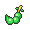

<!-- This file is generated by tools/generate_site.py. Edit the generator, not this file. -->

# Aqua Hideout

!!! tip "Wild Pokémon"

    See the [wild Pokémon of Aqua Hideout](../wild/aqua_hideout.md).

## Trainers

| ID | Trainer | Pokémon |
| --- | --- | --- |
| 181 | **Team Aqua Grunt** | { .icon loading=lazy } [Mightyena](../pokemon/262.md) Lv. 54 |
| 335 | **Team Aqua Grunt** | { .icon loading=lazy } [Muk](../pokemon/089.md) Lv. 52, { .icon loading=lazy } [Golbat](../pokemon/042.md) Lv. 52, { .icon loading=lazy } [Jellicent](../pokemon/593.md) Lv. 52 |
| 179 | **Team Aqua Grunt** | { .icon loading=lazy } [Vileplume](../pokemon/045.md) Lv. 54 |
| 180 | **Team Aqua Grunt** | { .icon loading=lazy } [Lumineon](../pokemon/457.md) Lv. 52, { .icon loading=lazy } [Sharpedo](../pokemon/319.md) Lv. 52, { .icon loading=lazy } [Ferrothorn](../pokemon/598.md) Lv. 52 |
| 334 | **Team Aqua Grunt** | { .icon loading=lazy } [Seviper](../pokemon/336.md) Lv. 54 |
| 182 | **Team Aqua Grunt** | { .icon loading=lazy } [Victreebel](../pokemon/071.md) Lv. 54 |
| 672 | **Team Aqua Grunts** | { .icon loading=lazy } [Vaporeon](../pokemon/134.md) Lv. 39, { .icon loading=lazy } [Vaporeon](../pokemon/134.md) Lv. 39, { .icon loading=lazy } [Vaporeon](../pokemon/134.md) Lv. 39, { .icon loading=lazy } [Vaporeon](../pokemon/134.md) Lv. 39, { .icon loading=lazy } [Vaporeon](../pokemon/134.md) Lv. 39 |
| 685 | **Aqua Admin Matt** | { .icon loading=lazy } [Golduck](../pokemon/055.md) Lv. 55, { .icon loading=lazy } [Barbaracle](../pokemon/689.md) Lv. 55, { .icon loading=lazy } [Ferrothorn](../pokemon/598.md) Lv. 55, { .icon loading=lazy } [Sharpedo](../pokemon/319.md) Lv. 55, { .icon loading=lazy } [Nidoqueen](../pokemon/031.md) Lv. 55, { .icon loading=lazy } [Blastoise](../pokemon/009.md) Lv. 57 |

## Special Battle - Matt

| Pokémon | Lv. | Item | Ability | Moves |
| --- | --- | --- | --- | --- |
| { .icon loading=lazy } [Golduck](../pokemon/055.md) | 55 | { .item loading=lazy } Wide Lens | <abbr title="Prevents Self-Destruct, Explosion, and Aftermath from working while the Pokémon is in battle.">Damp</abbr> | Hydro Pump, Blizzard, Focus Blast, Hypnosis |
| { .icon loading=lazy } [Barbaracle](../pokemon/689.md) | 55 | { .item loading=lazy } Rindo Berry | <abbr title="Strengthens moves that make contact to 1.33× their power.">Tough Claws</abbr> | Razor Shell, X-Scissor, Cross Chop, Stone Edge |
| { .icon loading=lazy } [Ferrothorn](../pokemon/598.md) | 55 | { .item loading=lazy } Rocky Helmet | <abbr title="Damages attacking Pokémon for 1/8 their max HP on contact.">Iron Barbs</abbr> | Thunder Wave, Power Whip, Poison Jab, Gyro Ball |
| { .icon loading=lazy } [Sharpedo](../pokemon/319.md) | 55 | { .item loading=lazy } Focus Sash | <abbr title="Raises Speed one stage after each turn.">Speed Boost</abbr> | Hydro Pump, Crunch, Blizzard, Earthquake |
| { .icon loading=lazy } [Nidoqueen](../pokemon/031.md) | 55 | { .item loading=lazy } Life Orb |  | Sludge Wave, Thunder, Blizzard, Earth Power |
| { .icon loading=lazy } [Blastoise](../pokemon/009.md) | 57 | { .item loading=lazy } Blastoisinite | <abbr title="Strengthens Water moves to inflict 1.5× damage at 1/3 max HP or less.">Torrent</abbr> | Hydro Pump, Dark Pulse, Blizzard, Aura Sphere |

---

[:material-arrow-left: Magma Hideout](magma_hideout.md) · [All areas](index.md) · [Route 124 :material-arrow-right:](route_124.md)
