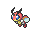

<!-- This file is generated by tools/generate_site.py. Edit the generator, not this file. -->

# Aqua Hideout (Post Game)

Post Game

## Trainers

| ID | Trainer | Pokémon |
| --- | --- | --- |
| 021 | **Team Aqua Grunt** | { .icon loading=lazy } [Liepard](../pokemon/510.md) Lv. 75, { .icon loading=lazy } [Cradily](../pokemon/346.md) Lv. 75, { .icon loading=lazy } [Lumineon](../pokemon/457.md) Lv. 75 |
| 861 | **Team Aqua Grunt** | { .icon loading=lazy } [Ledian](../pokemon/166.md) Lv. 75, { .icon loading=lazy } [Sharpedo](../pokemon/319.md) Lv. 75, { .icon loading=lazy } [Exploud](../pokemon/295.md) Lv. 75 |
| 948 | **Team Aqua Grunt** | { .icon loading=lazy } [Ursaring](../pokemon/217.md) Lv. 75, { .icon loading=lazy } [Seviper](../pokemon/336.md) Lv. 75, { .icon loading=lazy } [Simipour](../pokemon/516.md) Lv. 75 |
| 206 | **Team Aqua Grunt** | { .icon loading=lazy } [Jumpluff](../pokemon/189.md) Lv. 75, { .icon loading=lazy } [Alomomola](../pokemon/594.md) Lv. 75, { .icon loading=lazy } [Octillery](../pokemon/224.md) Lv. 75 |
| 207 | **Team Aqua Grunt** | { .icon loading=lazy } [Cloyster](../pokemon/091.md) Lv. 75, { .icon loading=lazy } [Crobat](../pokemon/169.md) Lv. 75, { .icon loading=lazy } [Muk](../pokemon/089.md) Lv. 75 |
| 234 | **Team Aqua Grunt** | { .icon loading=lazy } [Jellicent](../pokemon/593.md) Lv. 75, { .icon loading=lazy } [Lapras](../pokemon/131.md) Lv. 75, { .icon loading=lazy } [Golduck](../pokemon/055.md) Lv. 75 |

---

[:material-arrow-left: Magma Hideout (Post Game)](magma_hideout_post_game.md) · [All areas](index.md) · [Route 131 (Post Game) :material-arrow-right:](route_131_post_game.md)
