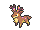

<!-- This file is generated by tools/generate_site.py. Edit the generator, not this file. -->

# Battle Resort

Post Game

!!! tip "Wild Pokémon"

    See the [wild Pokémon of Battle Resort](../wild/battle_resort.md).

## Trainers

| ID | Trainer (mimicking) | Pokémon |
| --- | --- | --- |
| 711 | **Ace Trainer Carnation** <small>mimicking Cynthia</small> | { .icon loading=lazy } [Spiritomb](../pokemon/442.md) Lv. 86, { .icon loading=lazy } [Roserade](../pokemon/407.md) Lv. 86, { .icon loading=lazy } [Togekiss](../pokemon/468.md) Lv. 86, { .icon loading=lazy } [Lucario](../pokemon/448.md) Lv. 86, { .icon loading=lazy } [Milotic](../pokemon/350.md) Lv. 86, { .icon loading=lazy } [Garchomp](../pokemon/445.md) Lv. 88 |
| 924 | **Leader Carnation** <small>mimicking Roxanne</small> | { .icon loading=lazy } [Probopass](../pokemon/476.md) Lv. 79, { .icon loading=lazy } [Omastar](../pokemon/139.md) Lv. 77, { .icon loading=lazy } [Tyrantrum](../pokemon/697.md) Lv. 77, { .icon loading=lazy } [Armaldo](../pokemon/348.md) Lv. 77, { .icon loading=lazy } [Cradily](../pokemon/346.md) Lv. 77, { .icon loading=lazy } [Aerodactyl](../pokemon/142.md) Lv. 79 |
| 925 | **Leader Carnation** <small>mimicking Roxanne</small> | { .icon loading=lazy } [Probopass](../pokemon/476.md) Lv. 79, { .icon loading=lazy } [Omastar](../pokemon/139.md) Lv. 77, { .icon loading=lazy } [Tyrantrum](../pokemon/697.md) Lv. 77, { .icon loading=lazy } [Armaldo](../pokemon/348.md) Lv. 77, { .icon loading=lazy } [Cradily](../pokemon/346.md) Lv. 77, { .icon loading=lazy } [Aerodactyl](../pokemon/142.md) Lv. 79 |
| 926 | **Leader Carnation** <small>mimicking Flannery</small> | { .icon loading=lazy } [Ninetales](../pokemon/038.md) Lv. 77, { .icon loading=lazy } [Houndoom](../pokemon/229.md) Lv. 77, { .icon loading=lazy } [Delphox](../pokemon/655.md) Lv. 77, { .icon loading=lazy } [Magmortar](../pokemon/467.md) Lv. 77, { .icon loading=lazy } [Torkoal](../pokemon/324.md) Lv. 79, { .icon loading=lazy } [Camerupt](../pokemon/323.md) Lv. 79 |
| 927 | **Leader Carnation** <small>mimicking Flannery</small> | { .icon loading=lazy } [Ninetales](../pokemon/038.md) Lv. 77, { .icon loading=lazy } [Houndoom](../pokemon/229.md) Lv. 77, { .icon loading=lazy } [Delphox](../pokemon/655.md) Lv. 77, { .icon loading=lazy } [Magmortar](../pokemon/467.md) Lv. 77, { .icon loading=lazy } [Torkoal](../pokemon/324.md) Lv. 79, { .icon loading=lazy } [Camerupt](../pokemon/323.md) Lv. 79 |
| 928 | **Leader Carnation** <small>mimicking Winona</small> | { .icon loading=lazy } [Skarmory](../pokemon/227.md) Lv. 77, { .icon loading=lazy } [Honchkrow](../pokemon/430.md) Lv. 77, { .icon loading=lazy } [Sigilyph](../pokemon/561.md) Lv. 77, { .icon loading=lazy } [Dragonite](../pokemon/149.md) Lv. 77, { .icon loading=lazy } [Talonflame](../pokemon/663.md) Lv. 77, { .icon loading=lazy } [Altaria](../pokemon/334.md) Lv. 79 |
| 929 | **Leader Carnation** <small>mimicking Winona</small> | { .icon loading=lazy } [Skarmory](../pokemon/227.md) Lv. 77, { .icon loading=lazy } [Honchkrow](../pokemon/430.md) Lv. 77, { .icon loading=lazy } [Sigilyph](../pokemon/561.md) Lv. 77, { .icon loading=lazy } [Dragonite](../pokemon/149.md) Lv. 77, { .icon loading=lazy } [Talonflame](../pokemon/663.md) Lv. 77, { .icon loading=lazy } [Altaria](../pokemon/334.md) Lv. 79 |
| 702 | **Dragon Tamer Antonin** <small>mimicking Lance</small> | { .icon loading=lazy } [Salamence](../pokemon/373.md) Lv. 86, { .icon loading=lazy } [Gyarados](../pokemon/130.md) Lv. 86, { .icon loading=lazy } [Garchomp](../pokemon/445.md) Lv. 86, { .icon loading=lazy } [Altaria](../pokemon/334.md) Lv. 86, { .icon loading=lazy } [Charizard](../pokemon/006.md) Lv. 86, { .icon loading=lazy } [Dragonite](../pokemon/149.md) Lv. 88 |
| 703 | **Leader Antonin** <small>mimicking Brawly</small> | { .icon loading=lazy } [Machamp](../pokemon/068.md) Lv. 77, { .icon loading=lazy } [Heracross](../pokemon/214.md) Lv. 77, { .icon loading=lazy } [Scrafty](../pokemon/560.md) Lv. 77, { .icon loading=lazy } [Conkeldurr](../pokemon/534.md) Lv. 77, { .icon loading=lazy } [Hariyama](../pokemon/297.md) Lv. 79, { .icon loading=lazy } [Medicham](../pokemon/308.md) Lv. 79 |
| 704 | **Leader Antonin** <small>mimicking Brawly</small> | { .icon loading=lazy } [Machamp](../pokemon/068.md) Lv. 77, { .icon loading=lazy } [Heracross](../pokemon/214.md) Lv. 77, { .icon loading=lazy } [Scrafty](../pokemon/560.md) Lv. 77, { .icon loading=lazy } [Conkeldurr](../pokemon/534.md) Lv. 77, { .icon loading=lazy } [Hariyama](../pokemon/297.md) Lv. 79, { .icon loading=lazy } [Medicham](../pokemon/308.md) Lv. 79 |
| 705 | **Leader Antonin** <small>mimicking Wattson</small> | { .icon loading=lazy } [Heliolisk](../pokemon/695.md) Lv. 77, { .icon loading=lazy } [Ampharos](../pokemon/181.md) Lv. 77, { .icon loading=lazy } [Rotom](../pokemon/479.md) Lv. 77, { .icon loading=lazy } [Magnezone](../pokemon/462.md) Lv. 77, { .icon loading=lazy } [Raichu](../pokemon/026.md) Lv. 77, { .icon loading=lazy } [Manectric](../pokemon/310.md) Lv. 79 |
| 706 | **Leader Antonin** <small>mimicking Wattson</small> | { .icon loading=lazy } [Heliolisk](../pokemon/695.md) Lv. 77, { .icon loading=lazy } [Ampharos](../pokemon/181.md) Lv. 77, { .icon loading=lazy } [Rotom](../pokemon/479.md) Lv. 77, { .icon loading=lazy } [Magnezone](../pokemon/462.md) Lv. 77, { .icon loading=lazy } [Raichu](../pokemon/026.md) Lv. 77, { .icon loading=lazy } [Manectric](../pokemon/310.md) Lv. 79 |
| 707 | **Leader Antonin** <small>mimicking Norman</small> | { .icon loading=lazy } [Bouffalant](../pokemon/626.md) Lv. 77, { .icon loading=lazy } [Exploud](../pokemon/295.md) Lv. 77, { .icon loading=lazy } [Sawsbuck](../pokemon/586.md) Lv. 77, { .icon loading=lazy } [Zangoose](../pokemon/335.md) Lv. 77, { .icon loading=lazy } [Slaking](../pokemon/289.md) Lv. 79, { .icon loading=lazy } [Kangaskhan](../pokemon/115.md) Lv. 79 |
| 708 | **Leader Antonin** <small>mimicking Norman</small> | { .icon loading=lazy } [Bouffalant](../pokemon/626.md) Lv. 77, { .icon loading=lazy } [Exploud](../pokemon/295.md) Lv. 77, { .icon loading=lazy } [Sawsbuck](../pokemon/586.md) Lv. 77, { .icon loading=lazy } [Zangoose](../pokemon/335.md) Lv. 77, { .icon loading=lazy } [Slaking](../pokemon/289.md) Lv. 79, { .icon loading=lazy } [Kangaskhan](../pokemon/115.md) Lv. 79 |
| 712 | **Champion Josephine** <small>mimicking Diantha</small> | { .icon loading=lazy } [Aerodactyl](../pokemon/142.md) Lv. 86, { .icon loading=lazy } [Roserade](../pokemon/407.md) Lv. 86, { .icon loading=lazy } [Azumarill](../pokemon/184.md) Lv. 86, { .icon loading=lazy } [Delphox](../pokemon/655.md) Lv. 86, { .icon loading=lazy } [Goodra](../pokemon/706.md) Lv. 86, { .icon loading=lazy } [Gardevoir](../pokemon/282.md) Lv. 88 |
| 930 | **Leader Josephine** <small>mimicking Liza</small> | { .icon loading=lazy } [Slowking](../pokemon/199.md) Lv. 77, { .icon loading=lazy } [Gothitelle](../pokemon/576.md) Lv. 77, { .icon loading=lazy } [Claydol](../pokemon/344.md) Lv. 77, { .icon loading=lazy } [Grumpig](../pokemon/326.md) Lv. 77, { .icon loading=lazy } [Lunatone](../pokemon/337.md) Lv. 79, { .icon loading=lazy } [Gardevoir](../pokemon/282.md) Lv. 79 |
| 931 | **Leader Josephine** <small>mimicking Liza</small> | { .icon loading=lazy } [Slowking](../pokemon/199.md) Lv. 77, { .icon loading=lazy } [Gothitelle](../pokemon/576.md) Lv. 77, { .icon loading=lazy } [Claydol](../pokemon/344.md) Lv. 77, { .icon loading=lazy } [Grumpig](../pokemon/326.md) Lv. 77, { .icon loading=lazy } [Lunatone](../pokemon/337.md) Lv. 79, { .icon loading=lazy } [Gardevoir](../pokemon/282.md) Lv. 79 |
| 932 | **Leader Josephine** <small>mimicking Tate</small> | { .icon loading=lazy } [Bronzong](../pokemon/437.md) Lv. 77, { .icon loading=lazy } [Reuniclus](../pokemon/579.md) Lv. 77, { .icon loading=lazy } [Xatu](../pokemon/178.md) Lv. 77, { .icon loading=lazy } [Hypno](../pokemon/097.md) Lv. 77, { .icon loading=lazy } [Solrock](../pokemon/338.md) Lv. 79, { .icon loading=lazy } [Gallade](../pokemon/475.md) Lv. 79 |
| 933 | **Leader Josephine** <small>mimicking Tate</small> | { .icon loading=lazy } [Bronzong](../pokemon/437.md) Lv. 77, { .icon loading=lazy } [Reuniclus](../pokemon/579.md) Lv. 77, { .icon loading=lazy } [Xatu](../pokemon/178.md) Lv. 77, { .icon loading=lazy } [Hypno](../pokemon/097.md) Lv. 77, { .icon loading=lazy } [Solrock](../pokemon/338.md) Lv. 79, { .icon loading=lazy } [Gallade](../pokemon/475.md) Lv. 79 |
| 934 | **Leader Josephine** <small>mimicking Wallace</small> | { .icon loading=lazy } [Politoed](../pokemon/186.md) Lv. 77, { .icon loading=lazy } [Ludicolo](../pokemon/272.md) Lv. 77, { .icon loading=lazy } [Kingdra](../pokemon/230.md) Lv. 77, { .icon loading=lazy } [Milotic](../pokemon/350.md) Lv. 79, { .icon loading=lazy } [Gyarados](../pokemon/130.md) Lv. 77, { .icon loading=lazy } [Swampert](../pokemon/260.md) Lv. 79 |
| 935 | **Leader Josephine** <small>mimicking Wallace</small> | { .icon loading=lazy } [Politoed](../pokemon/186.md) Lv. 77, { .icon loading=lazy } [Ludicolo](../pokemon/272.md) Lv. 77, { .icon loading=lazy } [Kingdra](../pokemon/230.md) Lv. 77, { .icon loading=lazy } [Milotic](../pokemon/350.md) Lv. 79, { .icon loading=lazy } [Gyarados](../pokemon/130.md) Lv. 77, { .icon loading=lazy } [Swampert](../pokemon/260.md) Lv. 79 |
| 709 | **Ace Trainer Kelvin** <small>mimicking Blue</small> | { .icon loading=lazy } [Heracross](../pokemon/214.md) Lv. 86, { .icon loading=lazy } [Alakazam](../pokemon/065.md) Lv. 86, { .icon loading=lazy } [Arcanine](../pokemon/059.md) Lv. 86, { .icon loading=lazy } [Gyarados](../pokemon/130.md) Lv. 86, { .icon loading=lazy } [Exeggutor](../pokemon/103.md) Lv. 86, { .icon loading=lazy } [Tyranitar](../pokemon/248.md) Lv. 88 |
| 918 | **Leader Kelvin** <small>mimicking Grant</small> | { .icon loading=lazy } [Crustle](../pokemon/558.md) Lv. 77, { .icon loading=lazy } [Relicanth](../pokemon/369.md) Lv. 77, { .icon loading=lazy } [Carbink](../pokemon/703.md) Lv. 77, { .icon loading=lazy } [Tyrantrum](../pokemon/697.md) Lv. 77, { .icon loading=lazy } [Aurorus](../pokemon/699.md) Lv. 77, { .icon loading=lazy } [Aerodactyl](../pokemon/142.md) Lv. 79 |
| 919 | **Leader Kelvin** <small>mimicking Ramos</small> | { .icon loading=lazy } [Jumpluff](../pokemon/189.md) Lv. 77, { .icon loading=lazy } [Victreebel](../pokemon/071.md) Lv. 77, { .icon loading=lazy } [Exeggutor](../pokemon/103.md) Lv. 77, { .icon loading=lazy } [Roserade](../pokemon/407.md) Lv. 77, { .icon loading=lazy } [Gogoat](../pokemon/673.md) Lv. 79, { .icon loading=lazy } [Venusaur](../pokemon/003.md) Lv. 79 |
| 920 | **Leader Kelvin** <small>mimicking Clemont</small> | { .icon loading=lazy } [Emolga](../pokemon/587.md) Lv. 77, { .icon loading=lazy } [Magnezone](../pokemon/462.md) Lv. 77, { .icon loading=lazy } [Electivire](../pokemon/466.md) Lv. 77, { .icon loading=lazy } [Galvantula](../pokemon/596.md) Lv. 77, { .icon loading=lazy } [Heliolisk](../pokemon/695.md) Lv. 79, { .icon loading=lazy } [Ampharos](../pokemon/181.md) Lv. 79 |
| 921 | **Leader Kelvin** <small>mimicking Wulfric</small> | { .icon loading=lazy } [Glalie](../pokemon/362.md) Lv. 77, { .icon loading=lazy } [Mamoswine](../pokemon/473.md) Lv. 77, { .icon loading=lazy } [Beartic](../pokemon/614.md) Lv. 77, { .icon loading=lazy } [Cryogonal](../pokemon/615.md) Lv. 77, { .icon loading=lazy } [Avalugg](../pokemon/713.md) Lv. 79, { .icon loading=lazy } [Abomasnow](../pokemon/460.md) Lv. 79 |
| 922 | **Leader Kelvin** <small>mimicking Wikstrom</small> | { .icon loading=lazy } [Klefki](../pokemon/707.md) Lv. 82, { .icon loading=lazy } [Probopass](../pokemon/476.md) Lv. 82, { .icon loading=lazy } [Metagross](../pokemon/376.md) Lv. 82, { .icon loading=lazy } [Aegislash](../pokemon/681.md) Lv. 84, { .icon loading=lazy } [Empoleon](../pokemon/395.md) Lv. 82, { .icon loading=lazy } [Scizor](../pokemon/212.md) Lv. 84 |
| 923 | **Leader Kelvin** <small>mimicking Siebold</small> | { .icon loading=lazy } [Clawitzer](../pokemon/693.md) Lv. 82, { .icon loading=lazy } [Starmie](../pokemon/121.md) Lv. 82, { .icon loading=lazy } [Gyarados](../pokemon/130.md) Lv. 82, { .icon loading=lazy } [Milotic](../pokemon/350.md) Lv. 82, { .icon loading=lazy } [Barbaracle](../pokemon/689.md) Lv. 84, { .icon loading=lazy } [Blastoise](../pokemon/009.md) Lv. 84 |
| 710 | **Furisode Girl Felix** <small>mimicking Iris</small> | { .icon loading=lazy } [Hydreigon](../pokemon/635.md) Lv. 86, { .icon loading=lazy } [Druddigon](../pokemon/621.md) Lv. 86, { .icon loading=lazy } [Archeops](../pokemon/567.md) Lv. 86, { .icon loading=lazy } [Aggron](../pokemon/306.md) Lv. 88, { .icon loading=lazy } [Lapras](../pokemon/131.md) Lv. 86, { .icon loading=lazy } [Haxorus](../pokemon/612.md) Lv. 88 |
| 936 | **Leader Felix** <small>mimicking Viola</small> | { .icon loading=lazy } [Masquerain](../pokemon/284.md) Lv. 77, { .icon loading=lazy } [Yanmega](../pokemon/469.md) Lv. 77, { .icon loading=lazy } [Vespiquen](../pokemon/416.md) Lv. 77, { .icon loading=lazy } [Crustle](../pokemon/558.md) Lv. 77, { .icon loading=lazy } [Vivillon](../pokemon/666.md) Lv. 79, { .icon loading=lazy } [Pinsir](../pokemon/127.md) Lv. 79 |
| 937 | **Leader Felix** <small>mimicking Korrina</small> | { .icon loading=lazy } [Machamp](../pokemon/068.md) Lv. 77, { .icon loading=lazy } [Mienshao](../pokemon/620.md) Lv. 77, { .icon loading=lazy } [Chesnaught](../pokemon/652.md) Lv. 77, { .icon loading=lazy } [Pangoro](../pokemon/675.md) Lv. 77, { .icon loading=lazy } [Hawlucha](../pokemon/701.md) Lv. 79, { .icon loading=lazy } [Lucario](../pokemon/448.md) Lv. 79 |
| 938 | **Leader Felix** <small>mimicking Valerie</small> | { .icon loading=lazy } [Mr. Mime](../pokemon/122.md) Lv. 77, { .icon loading=lazy } [Florges](../pokemon/671.md) Lv. 77, { .icon loading=lazy } [Aromatisse](../pokemon/683.md) Lv. 77, { .icon loading=lazy } [Slurpuff](../pokemon/685.md) Lv. 77, { .icon loading=lazy } [Sylveon](../pokemon/700.md) Lv. 79, { .icon loading=lazy } [Mawile](../pokemon/303.md) Lv. 79 |
| 939 | **Leader Felix** <small>mimicking Olympia</small> | { .icon loading=lazy } [Sigilyph](../pokemon/561.md) Lv. 77, { .icon loading=lazy } [Slowking](../pokemon/199.md) Lv. 77, { .icon loading=lazy } [Gothitelle](../pokemon/576.md) Lv. 77, { .icon loading=lazy } [Espeon](../pokemon/196.md) Lv. 77, { .icon loading=lazy } [Meowstic](../pokemon/678.md) Lv. 79, { .icon loading=lazy } [Alakazam](../pokemon/065.md) Lv. 79 |
| 940 | **Leader Felix** <small>mimicking Malva</small> | { .icon loading=lazy } [Pyroar](../pokemon/668.md) Lv. 82, { .icon loading=lazy } [Chandelure](../pokemon/609.md) Lv. 82, { .icon loading=lazy } [Magmortar](../pokemon/467.md) Lv. 82, { .icon loading=lazy } [Torkoal](../pokemon/324.md) Lv. 82, { .icon loading=lazy } [Talonflame](../pokemon/663.md) Lv. 84, { .icon loading=lazy } [Houndoom](../pokemon/229.md) Lv. 84 |
| 941 | **Leader Felix** <small>mimicking Drasna</small> | { .icon loading=lazy } [Dragalge](../pokemon/691.md) Lv. 82, { .icon loading=lazy } [Druddigon](../pokemon/621.md) Lv. 82, { .icon loading=lazy } [Altaria](../pokemon/334.md) Lv. 82, { .icon loading=lazy } [Haxorus](../pokemon/612.md) Lv. 82, { .icon loading=lazy } [Noivern](../pokemon/715.md) Lv. 84, { .icon loading=lazy } [Garchomp](../pokemon/445.md) Lv. 84 |
| 944 | **PKMN Trainer Wally** | { .icon loading=lazy } [Talonflame](../pokemon/663.md) Lv. 81, { .icon loading=lazy } [Azumarill](../pokemon/184.md) Lv. 81, { .icon loading=lazy } [Roserade](../pokemon/407.md) Lv. 81, { .icon loading=lazy } [Magnezone](../pokemon/462.md) Lv. 81, { .icon loading=lazy } [Garchomp](../pokemon/445.md) Lv. 81, { .icon loading=lazy } [Gallade](../pokemon/475.md) Lv. 83 |
| 946 | **PKMN Trainer Wally** | { .icon loading=lazy } [Azumarill](../pokemon/184.md) Lv. 97, { .icon loading=lazy } [Talonflame](../pokemon/663.md) Lv. 97, { .icon loading=lazy } [Roserade](../pokemon/407.md) Lv. 97, { .icon loading=lazy } [Magnezone](../pokemon/462.md) Lv. 97, { .icon loading=lazy } [Garchomp](../pokemon/445.md) Lv. 97, { .icon loading=lazy } [Gallade](../pokemon/475.md) Lv. 99 |

---

[:material-arrow-left: S.S Tidal](s_s_tidal.md) · [All areas](index.md) · [Pokémon League (Post Game) :material-arrow-right:](pokemon_league_post_game.md)
