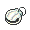

<!-- This file is generated by tools/generate_site.py. Edit the generator, not this file. -->

# Credits

## Trainers

| ID | Trainer | Pokémon |
| --- | --- | --- |
| 699 | **PKMN Trainer Brendan** | { .icon loading=lazy } [Swellow](../pokemon/277.md) Lv. 75, { .icon loading=lazy } [Raichu](../pokemon/026.md) Lv. 75, { .icon loading=lazy } [Sylveon](../pokemon/700.md) Lv. 75, { .icon loading=lazy } [Rapidash](../pokemon/078.md) Lv. 75, { .icon loading=lazy } [Wailord](../pokemon/321.md) Lv. 75, { .icon loading=lazy } [Sceptile](../pokemon/254.md) Lv. 77 |
| 700 | **PKMN Trainer Brendan** | { .icon loading=lazy } [Swellow](../pokemon/277.md) Lv. 75, { .icon loading=lazy } [Raichu](../pokemon/026.md) Lv. 75, { .icon loading=lazy } [Sylveon](../pokemon/700.md) Lv. 75, { .icon loading=lazy } [Wailord](../pokemon/321.md) Lv. 75, { .icon loading=lazy } [Breloom](../pokemon/286.md) Lv. 75, { .icon loading=lazy } [Blaziken](../pokemon/257.md) Lv. 77 |
| 701 | **PKMN Trainer Brendan** | { .icon loading=lazy } [Swellow](../pokemon/277.md) Lv. 75, { .icon loading=lazy } [Raichu](../pokemon/026.md) Lv. 75, { .icon loading=lazy } [Sylveon](../pokemon/700.md) Lv. 75, { .icon loading=lazy } [Breloom](../pokemon/286.md) Lv. 75, { .icon loading=lazy } [Rapidash](../pokemon/078.md) Lv. 75, { .icon loading=lazy } [Swampert](../pokemon/260.md) Lv. 77 |
| 906 | **PKMN Trainer May** | { .icon loading=lazy } [Swellow](../pokemon/277.md) Lv. 75, { .icon loading=lazy } [Raichu](../pokemon/026.md) Lv. 75, { .icon loading=lazy } [Sylveon](../pokemon/700.md) Lv. 75, { .icon loading=lazy } [Rapidash](../pokemon/078.md) Lv. 75, { .icon loading=lazy } [Wailord](../pokemon/321.md) Lv. 75, { .icon loading=lazy } [Sceptile](../pokemon/254.md) Lv. 77 |
| 907 | **PKMN Trainer May** | { .icon loading=lazy } [Swellow](../pokemon/277.md) Lv. 75, { .icon loading=lazy } [Raichu](../pokemon/026.md) Lv. 75, { .icon loading=lazy } [Sylveon](../pokemon/700.md) Lv. 75, { .icon loading=lazy } [Wailord](../pokemon/321.md) Lv. 75, { .icon loading=lazy } [Breloom](../pokemon/286.md) Lv. 75, { .icon loading=lazy } [Blaziken](../pokemon/257.md) Lv. 77 |
| 908 | **PKMN Trainer May** | { .icon loading=lazy } [Swellow](../pokemon/277.md) Lv. 75, { .icon loading=lazy } [Raichu](../pokemon/026.md) Lv. 75, { .icon loading=lazy } [Sylveon](../pokemon/700.md) Lv. 75, { .icon loading=lazy } [Breloom](../pokemon/286.md) Lv. 75, { .icon loading=lazy } [Rapidash](../pokemon/078.md) Lv. 75, { .icon loading=lazy } [Swampert](../pokemon/260.md) Lv. 77 |

## Special Battle - Rival

=== "Treecko"

    | Pokémon | Lv. | Item | Ability | Moves |
    | --- | --- | --- | --- | --- |
    | { .icon loading=lazy } [Swellow](../pokemon/277.md) | 75 | { .item loading=lazy } Flame Orb | <abbr title="Increases Attack to 1.5× with a major status ailment.">Guts</abbr> | Protect, Brave Bird, Facade, U-turn |
    | { .icon loading=lazy } [Raichu](../pokemon/026.md) | 75 | { .item loading=lazy } Expert Belt | <abbr title="Has a 30% chance of paralyzing attacking Pokémon on contact.">Static</abbr> | Thunder, Surf, Focus Blast, Light Screen |
    | { .icon loading=lazy } [Sylveon](../pokemon/700.md) | 75 | { .item loading=lazy } Pixie Plate | <abbr title="Turns the bearer's Normal moves into Fairy moves and strengthens them to 1.3× their power.">Pixilate</abbr> | Hyper Voice, Psyshock, Shadow Ball, Double Team |
    | { .icon loading=lazy } [Rapidash](../pokemon/078.md) | 75 | { .item loading=lazy } Shell Bell | <abbr title="Has a 30% chance of burning attacking Pokémon on contact.">Flame Body</abbr> | Flare Blitz, Drill Run, Megahorn, Poison Jab |
    | { .icon loading=lazy } [Wailord](../pokemon/321.md) | 75 | { .item loading=lazy } Leftovers | <abbr title="Prevents burns.">Water Veil</abbr> | Hydro Pump, Heavy Slam, Ice Beam, Earthquake |
    | { .icon loading=lazy } [Sceptile](../pokemon/254.md) | 77 | { .item loading=lazy } Sceptilite | <abbr title="Strengthens Grass moves to inflict 1.5× damage at 1/3 max HP or less.">Overgrow</abbr> | Leaf Storm, Dragon Pulse, Focus Blast, Protect |

=== "Torchic"

    | Pokémon | Lv. | Item | Ability | Moves |
    | --- | --- | --- | --- | --- |
    | { .icon loading=lazy } [Swellow](../pokemon/277.md) | 75 | { .item loading=lazy } Flame Orb | <abbr title="Increases Attack to 1.5× with a major status ailment.">Guts</abbr> | Protect, Brave Bird, Facade, U-turn |
    | { .icon loading=lazy } [Raichu](../pokemon/026.md) | 75 | { .item loading=lazy } Expert Belt | <abbr title="Has a 30% chance of paralyzing attacking Pokémon on contact.">Static</abbr> | Thunder, Surf, Focus Blast, Light Screen |
    | { .icon loading=lazy } [Sylveon](../pokemon/700.md) | 75 | { .item loading=lazy } Pixie Plate | <abbr title="Turns the bearer's Normal moves into Fairy moves and strengthens them to 1.3× their power.">Pixilate</abbr> | Hyper Voice, Psyshock, Shadow Ball, Double Team |
    | { .icon loading=lazy } [Wailord](../pokemon/321.md) | 75 | { .item loading=lazy } Leftovers | <abbr title="Prevents burns.">Water Veil</abbr> | Hydro Pump, Heavy Slam, Ice Beam, Earthquake |
    | { .icon loading=lazy } [Breloom](../pokemon/286.md) | 75 | { .item loading=lazy } Life Orb | <abbr title="Strengthens moves of 60 base power or less to 1.5× their power.">Technician</abbr> | Spore, Bullet Seed, Mach Punch, Rock Tomb |
    | { .icon loading=lazy } [Blaziken](../pokemon/257.md) | 77 | { .item loading=lazy } Blazikenite | <abbr title="Strengthens Fire moves to inflict 1.5× damage at 1/3 max HP or less.">Blaze</abbr> | Flare Blitz, High Jump Kick, Thunder Punch, Protect |

=== "Mudkip"

    | Pokémon | Lv. | Item | Ability | Moves |
    | --- | --- | --- | --- | --- |
    | { .icon loading=lazy } [Swellow](../pokemon/277.md) | 75 | { .item loading=lazy } Flame Orb | <abbr title="Increases Attack to 1.5× with a major status ailment.">Guts</abbr> | Protect, Brave Bird, Facade, U-turn |
    | { .icon loading=lazy } [Raichu](../pokemon/026.md) | 75 | { .item loading=lazy } Expert Belt | <abbr title="Has a 30% chance of paralyzing attacking Pokémon on contact.">Static</abbr> | Thunder, Surf, Focus Blast, Light Screen |
    | { .icon loading=lazy } [Sylveon](../pokemon/700.md) | 75 | { .item loading=lazy } Pixie Plate | <abbr title="Turns the bearer's Normal moves into Fairy moves and strengthens them to 1.3× their power.">Pixilate</abbr> | Hyper Voice, Psyshock, Shadow Ball, Double Team |
    | { .icon loading=lazy } [Breloom](../pokemon/286.md) | 75 | { .item loading=lazy } Life Orb | <abbr title="Strengthens moves of 60 base power or less to 1.5× their power.">Technician</abbr> | Spore, Bullet Seed, Mach Punch, Rock Tomb |
    | { .icon loading=lazy } [Rapidash](../pokemon/078.md) | 75 | { .item loading=lazy } Shell Bell | <abbr title="Has a 30% chance of burning attacking Pokémon on contact.">Flame Body</abbr> | Flare Blitz, Drill Run, Megahorn, Poison Jab |
    | { .icon loading=lazy } [Swampert](../pokemon/260.md) | 77 | { .item loading=lazy } Swampertite | <abbr title="Strengthens Water moves to inflict 1.5× damage at 1/3 max HP or less.">Torrent</abbr> | Aqua Tail, Earthquake, Stone Edge, Protect |

---

[:material-arrow-left: Pokémon League](pokemon_league.md) · [All areas](index.md) · [Petalburg City (Post Game) :material-arrow-right:](petalburg_city_post_game.md)
