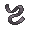

<!-- This file is generated by tools/generate_site.py. Edit the generator, not this file. -->

# Dewford Gym

## Trainers

| ID | Trainer | Pokémon |
| --- | --- | --- |
| 060 | **Battle Girl Laura** | { .icon loading=lazy } [Mankey](../pokemon/056.md) Lv. 17, { .icon loading=lazy } [Croagunk](../pokemon/453.md) Lv. 17 |
| 056 | **Black Belt Hideki** | { .icon loading=lazy } [Makuhita](../pokemon/296.md) Lv. 17, { .icon loading=lazy } [Tyrogue](../pokemon/236.md) Lv. 17 |
| 059 | **Battle Girl Tessa** | { .icon loading=lazy } [Timburr](../pokemon/532.md) Lv. 17, { .icon loading=lazy } [Riolu](../pokemon/447.md) Lv. 17 |
| 563 | **Leader Brawly** | { .icon loading=lazy } [Machop](../pokemon/066.md) Lv. 17, { .icon loading=lazy } [Meditite](../pokemon/307.md) Lv. 17, { .icon loading=lazy } [Pancham](../pokemon/674.md) Lv. 17, { .icon loading=lazy } [Scraggy](../pokemon/559.md) Lv. 17, { .icon loading=lazy } [Mienfoo](../pokemon/619.md) Lv. 17, { .icon loading=lazy } [Hariyama](../pokemon/297.md) Lv. 19 |

## Special Battle - Leader Brawly

| Pokémon | Lv. | Item | Ability | Moves |
| --- | --- | --- | --- | --- |
| { .icon loading=lazy } [Machop](../pokemon/066.md) | 17 | { .item loading=lazy } Berry Juice | <abbr title="Ensures all moves used by and against the Pokémon hit.">No Guard</abbr> | Bulk Up, Low Sweep, Bullet Punch, Rock Tomb |
| { .icon loading=lazy } [Meditite](../pokemon/307.md) | 17 | { .item loading=lazy } Black Belt | <abbr title="Doubles Attack in battle.">Pure Power</abbr> | Substitute, Focus Punch, Psyshock, Shadow Ball |
| { .icon loading=lazy } [Pancham](../pokemon/674.md) | 17 | { .item loading=lazy } Muscle Band | <abbr title="Strengthens punch-based moves to 1.2× their power.">Iron Fist</abbr> | Bulk Up, Power-Up Punch, Shadow Claw, Aerial Ace |
| { .icon loading=lazy } [Scraggy](../pokemon/559.md) | 17 | { .item loading=lazy } Assault Vest | <abbr title="Lowers opponents' Attack one stage upon entering battle.">Intimidate</abbr> | Headbutt, Drain Punch, Feint Attack, Fake Out |
| { .icon loading=lazy } [Mienfoo](../pokemon/619.md) | 17 | { .item loading=lazy } Wise Glasses | <abbr title="Prevents flinching.">Inner Focus</abbr> | Calm Mind, Fake Out, Aura Sphere, Hidden Power |
| { .icon loading=lazy } [Hariyama](../pokemon/297.md) | 19 | { .item loading=lazy } Sitrus Berry | <abbr title="Strengthens moves with extra effects to 1.3× their power, but prevents their extra effects.">Sheer Force</abbr> | Bulk Up, Arm Thrust, Bullet Punch, Smack Down |

---

[:material-arrow-left: Route 106](route_106.md) · [All areas](index.md) · [Route 107 :material-arrow-right:](route_107.md)
