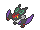
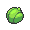
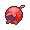
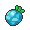

<!-- This file is generated by tools/generate_site.py. Edit the generator, not this file. -->

# Granite Cave 1F-2

Post Game

## Trainers

| ID | Trainer | Pokémon |
| --- | --- | --- |
| 898 | **Lorekeeper Zinnia** | { .icon loading=lazy } [Altaria](../pokemon/334.md) Lv. 76, { .icon loading=lazy } [Tyrantrum](../pokemon/697.md) Lv. 76, { .icon loading=lazy } [Noivern](../pokemon/715.md) Lv. 76, { .icon loading=lazy } [Salamence](../pokemon/373.md) Lv. 78 |

## Special Battle - Zinnia

| Pokémon | Lv. | Item | Ability | Moves |
| --- | --- | --- | --- | --- |
| { .icon loading=lazy } [Altaria](../pokemon/334.md) | 76 | { .item loading=lazy } Lum Berry | <abbr title="Cures any major status ailment upon switching out.">Natural Cure</abbr> | Draco Meteor, Flamethrower, Ice Beam, Moonblast |
| { .icon loading=lazy } [Tyrantrum](../pokemon/697.md) | 76 | { .item loading=lazy } Haban Berry | <abbr title="Strengthens biting moves to 1.5× their power.">Strong Jaw</abbr> | Head Smash, Crunch, Dragon Claw, Fire Fang |
| { .icon loading=lazy } [Noivern](../pokemon/715.md) | 76 | { .item loading=lazy } Yache Berry | <abbr title="Bypasses Light Screen, Reflect, and Safeguard.">Infiltrator</abbr> | Draco Meteor, Hurricane, Focus Blast, Flamethrower |
| { .icon loading=lazy } [Salamence](../pokemon/373.md) | 78 | { .item loading=lazy } Sitrus Berry | <abbr title="Lowers opponents' Attack one stage upon entering battle.">Intimidate</abbr> | Dragon Pulse, Fire Blast, Hydro Pump, Hyper Voice |

---

[:material-arrow-left: Petalburg City (Post Game)](petalburg_city_post_game.md) · [All areas](index.md) · [Rustboro City :material-arrow-right:](rustboro_city.md)
