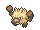
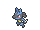
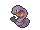
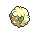
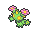
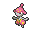
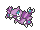

<!-- This file is generated by tools/generate_site.py. Edit the generator, not this file. -->

# Jagged Pass

!!! tip "Wild Pokémon"

    See the [wild Pokémon of Jagged Pass](../wild/jagged_pass.md).

## Trainers

| ID | Trainer | Pokémon |
| --- | --- | --- |
| 365 | **Expert Shelby** | { .icon loading=lazy } [Primeape](../pokemon/057.md) Lv. 35, { .icon loading=lazy } [Lucario](../pokemon/448.md) Lv. 35 |
| 279 | **Hiker Eric** | { .icon loading=lazy } [Pineco](../pokemon/204.md) Lv. 32, { .icon loading=lazy } [Pineco](../pokemon/204.md) Lv. 32, { .icon loading=lazy } [Forretress](../pokemon/205.md) Lv. 32 |
| 280 | **Camper Ethan** | { .icon loading=lazy } [Gligar](../pokemon/207.md) Lv. 32, { .icon loading=lazy } [Swalot](../pokemon/317.md) Lv. 32, { .icon loading=lazy } [Arbok](../pokemon/024.md) Lv. 32 |
| 769 | **Fairy Tale Girl Nellie** | { .icon loading=lazy } [Floette](../pokemon/670.md) Lv. 32, { .icon loading=lazy } [Whimsicott](../pokemon/547.md) Lv. 32, { .icon loading=lazy } [Klefki](../pokemon/707.md) Lv. 32 |
| 281 | **Picknicker Diana** | { .icon loading=lazy } [Skiploom](../pokemon/188.md) Lv. 32, { .icon loading=lazy } [Maractus](../pokemon/556.md) Lv. 32, { .icon loading=lazy } [Bayleef](../pokemon/153.md) Lv. 32 |

## Rematches

| ID | Trainer | Pokémon |
| --- | --- | --- |
| 457 | **Expert Shelby** 6 | { .icon loading=lazy } [Primeape](../pokemon/057.md) Lv. 47, { .icon loading=lazy } [Lucario](../pokemon/448.md) Lv. 47, { .icon loading=lazy } [Emboar](../pokemon/500.md) Lv. 47 |
| 458 | **Expert Shelby** 7 | { .icon loading=lazy } [Primeape](../pokemon/057.md) Lv. 59, { .icon loading=lazy } [Lucario](../pokemon/448.md) Lv. 59, { .icon loading=lazy } [Emboar](../pokemon/500.md) Lv. 59, { .icon loading=lazy } [Poliwrath](../pokemon/062.md) Lv. 59 |
| 459 | **Expert Shelby** 8 | { .icon loading=lazy } [Primeape](../pokemon/057.md) Lv. 64, { .icon loading=lazy } [Lucario](../pokemon/448.md) Lv. 64, { .icon loading=lazy } [Emboar](../pokemon/500.md) Lv. 64, { .icon loading=lazy } [Poliwrath](../pokemon/062.md) Lv. 64 |
| 460 | **Expert Shelby** C | { .icon loading=lazy } [Primeape](../pokemon/057.md) Lv. 75, { .icon loading=lazy } [Lucario](../pokemon/448.md) Lv. 75, { .icon loading=lazy } [Emboar](../pokemon/500.md) Lv. 75, { .icon loading=lazy } [Poliwrath](../pokemon/062.md) Lv. 75, { .icon loading=lazy } [Medicham](../pokemon/308.md) Lv. 75 |
| 469 | **Camper Ethan** 5 | { .icon loading=lazy } [Gliscor](../pokemon/472.md) Lv. 39, { .icon loading=lazy } [Swalot](../pokemon/317.md) Lv. 39, { .icon loading=lazy } [Arbok](../pokemon/024.md) Lv. 39 |
| 470 | **Camper Ethan** 6 | { .icon loading=lazy } [Gliscor](../pokemon/472.md) Lv. 47, { .icon loading=lazy } [Swalot](../pokemon/317.md) Lv. 47, { .icon loading=lazy } [Arbok](../pokemon/024.md) Lv. 47, { .icon loading=lazy } [Drapion](../pokemon/452.md) Lv. 47 |
| 471 | **Camper Ethan** 7 | { .icon loading=lazy } [Gliscor](../pokemon/472.md) Lv. 59, { .icon loading=lazy } [Swalot](../pokemon/317.md) Lv. 59, { .icon loading=lazy } [Arbok](../pokemon/024.md) Lv. 59, { .icon loading=lazy } [Drapion](../pokemon/452.md) Lv. 59 |
| 472 | **Camper Ethan** C | { .icon loading=lazy } [Gliscor](../pokemon/472.md) Lv. 75, { .icon loading=lazy } [Swalot](../pokemon/317.md) Lv. 75, { .icon loading=lazy } [Arbok](../pokemon/024.md) Lv. 75, { .icon loading=lazy } [Drapion](../pokemon/452.md) Lv. 75 |
| 473 | **Picnicker Diana** 5 | { .icon loading=lazy } [Jumpluff](../pokemon/189.md) Lv. 39, { .icon loading=lazy } [Maractus](../pokemon/556.md) Lv. 39, { .icon loading=lazy } [Meganium](../pokemon/154.md) Lv. 39 |
| 474 | **Picnicker Diana** 6 | { .icon loading=lazy } [Jumpluff](../pokemon/189.md) Lv. 47, { .icon loading=lazy } [Maractus](../pokemon/556.md) Lv. 47, { .icon loading=lazy } [Meganium](../pokemon/154.md) Lv. 47, { .icon loading=lazy } [Simisage](../pokemon/512.md) Lv. 47 |
| 475 | **Picknicker Diana** 7 | { .icon loading=lazy } [Jumpluff](../pokemon/189.md) Lv. 59, { .icon loading=lazy } [Maractus](../pokemon/556.md) Lv. 59, { .icon loading=lazy } [Meganium](../pokemon/154.md) Lv. 59, { .icon loading=lazy } [Simisage](../pokemon/512.md) Lv. 59 |
| 476 | **Picknicker Diana** C | { .icon loading=lazy } [Jumpluff](../pokemon/189.md) Lv. 75, { .icon loading=lazy } [Maractus](../pokemon/556.md) Lv. 75, { .icon loading=lazy } [Meganium](../pokemon/154.md) Lv. 75, { .icon loading=lazy } [Simisage](../pokemon/512.md) Lv. 75 |

---

[:material-arrow-left: Mt. Chimney](mt_chimney.md) · [All areas](index.md) · [Lavaridge Gym :material-arrow-right:](lavaridge_gym.md)
