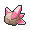

<!-- This file is generated by tools/generate_site.py. Edit the generator, not this file. -->

# Lavaridge Gym

## Trainers

| ID | Trainer | Pokémon |
| --- | --- | --- |
| 081 | **Kindler Cole** | { .icon loading=lazy } [Magmar](../pokemon/126.md) Lv. 34, { .icon loading=lazy } [Charmeleon](../pokemon/005.md) Lv. 34 |
| 083 | **Kindler Axle** | { .icon loading=lazy } [Ponyta](../pokemon/077.md) Lv. 33, { .icon loading=lazy } [Heatmor](../pokemon/631.md) Lv. 33, { .icon loading=lazy } [Simisear](../pokemon/514.md) Lv. 33 |
| 615 | **Battle Girl Sadie** | { .icon loading=lazy } [Monferno](../pokemon/391.md) Lv. 34, { .icon loading=lazy } [Pignite](../pokemon/499.md) Lv. 34, { .icon loading=lazy } [Combusken](../pokemon/256.md) Lv. 34 |
| 613 | **Ace Trainer Zane** | { .icon loading=lazy } [Kecleon](../pokemon/352.md) Lv. 35, { .icon loading=lazy } [Arcanine](../pokemon/059.md) Lv. 35, { .icon loading=lazy } [Darmanitan](../pokemon/555.md) Lv. 35 |
| 085 | **Kindler Andy** | { .icon loading=lazy } [Quilava](../pokemon/156.md) Lv. 33, { .icon loading=lazy } [Flareon](../pokemon/136.md) Lv. 33, { .icon loading=lazy } [Litwick](../pokemon/607.md) Lv. 33 |
| 823 | **Ninja Boy Shoji** | { .icon loading=lazy } [Larvesta](../pokemon/636.md) Lv. 33, { .icon loading=lazy } [Braixen](../pokemon/654.md) Lv. 33, { .icon loading=lazy } [Fletchinder](../pokemon/662.md) Lv. 33 |
| 824 | **Ninja Boy Hiromichi** | { .icon loading=lazy } [Skuntank](../pokemon/435.md) Lv. 35 |
| 569 | **Leader Flannery** | { .icon loading=lazy } [Ninetales](../pokemon/038.md) Lv. 36, { .icon loading=lazy } [Houndoom](../pokemon/229.md) Lv. 36, { .icon loading=lazy } [Delphox](../pokemon/655.md) Lv. 36, { .icon loading=lazy } [Magcargo](../pokemon/219.md) Lv. 36, { .icon loading=lazy } [Camerupt](../pokemon/323.md) Lv. 36, { .icon loading=lazy } [Torkoal](../pokemon/324.md) Lv. 38 |

## Special Battle - Flannery

| Pokémon | Lv. | Item | Ability | Moves |
| --- | --- | --- | --- | --- |
| { .icon loading=lazy } [Ninetales](../pokemon/038.md) | 36 | { .item loading=lazy } Heat Rock | <abbr title="Summons strong sunlight that lasts indefinitely upon entering battle.">Drought</abbr> | Overheat, Solar Beam, Extrasensory, Hypnosis |
| { .icon loading=lazy } [Houndoom](../pokemon/229.md) | 36 | { .item loading=lazy } White Herb | <abbr title="Protects against Fire moves.  Once one has been blocked, the Pokémon's own Fire moves inflict 1.5× damage until it leaves battle.">Flash Fire</abbr> | Overheat, Dark Pulse, Sludge Bomb, Solar Beam |
| { .icon loading=lazy } [Delphox](../pokemon/655.md) | 36 | { .item loading=lazy } White Herb | <abbr title="Strengthens Fire moves to inflict 1.5× damage at 1/3 max HP or less.">Blaze</abbr> | Overheat, Psyshock, Shadow Ball, Dazzling Gleam |
| { .icon loading=lazy } [Magcargo](../pokemon/219.md) | 36 | { .item loading=lazy } White Herb | <abbr title="Has a 30% chance of burning attacking Pokémon on contact.">Flame Body</abbr> | Overheat, Earth Power, Rock Slide, Sunny Day |
| { .icon loading=lazy } [Camerupt](../pokemon/323.md) | 36 | { .item loading=lazy } White Herb | <abbr title="Decreases damage taken from super-effective moves by 1/4.">Solid Rock</abbr> | Overheat, Earth Power, Flash Cannon, Rock Slide |
| { .icon loading=lazy } [Torkoal](../pokemon/324.md) | 38 | { .item loading=lazy } White Herb | <abbr title="Prevents stats from being lowered by other Pokémon.">White Smoke</abbr> | Overheat, Earthquake, Rock Slide, Shell Smash |

---

[:material-arrow-left: Jagged Pass](jagged_pass.md) · [All areas](index.md) · [Route 111 (Desert) :material-arrow-right:](route_111_desert.md)
