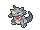
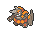

<!-- This file is generated by tools/generate_site.py. Edit the generator, not this file. -->

# Magma Hideout

!!! tip "Wild Pokémon"

    See the [wild Pokémon of Magma Hideout](../wild/magma_hideout.md).

## Trainers

| ID | Trainer | Pokémon |
| --- | --- | --- |
| 239 | **Team Magma Grunt** | { .icon loading=lazy } [Mightyena](../pokemon/262.md) Lv. 54 |
| 337 | **Team Magma Grunt** | { .icon loading=lazy } [Weezing](../pokemon/110.md) Lv. 52, { .icon loading=lazy } [Golbat](../pokemon/042.md) Lv. 52, { .icon loading=lazy } [Darmanitan](../pokemon/555.md) Lv. 52 |
| 237 | **Team Magma Grunt** | { .icon loading=lazy } [Golem](../pokemon/076.md) Lv. 54 |
| 238 | **Team Magma Grunt** | { .icon loading=lazy } [Magcargo](../pokemon/219.md) Lv. 52, { .icon loading=lazy } [Camerupt](../pokemon/323.md) Lv. 52, { .icon loading=lazy } [Rhydon](../pokemon/112.md) Lv. 52 |
| 336 | **Team Magma Grunt** | { .icon loading=lazy } [Zangoose](../pokemon/335.md) Lv. 54 |
| 240 | **Team Magma Grunt** | { .icon loading=lazy } [Aggron](../pokemon/306.md) Lv. 54 |
| 669 | **Team Magma Grunts** | { .icon loading=lazy } [Flareon](../pokemon/136.md) Lv. 39, { .icon loading=lazy } [Flareon](../pokemon/136.md) Lv. 39, { .icon loading=lazy } [Flareon](../pokemon/136.md) Lv. 39, { .icon loading=lazy } [Flareon](../pokemon/136.md) Lv. 39, { .icon loading=lazy } [Flareon](../pokemon/136.md) Lv. 39 |
| 696 | **Magma Admin Courtney** | { .icon loading=lazy } [Rapidash](../pokemon/078.md) Lv. 55, { .icon loading=lazy } [Pyroar](../pokemon/668.md) Lv. 55, { .icon loading=lazy } [Rhyperior](../pokemon/464.md) Lv. 55, { .icon loading=lazy } [Camerupt](../pokemon/323.md) Lv. 55, { .icon loading=lazy } [Nidoking](../pokemon/034.md) Lv. 55, { .icon loading=lazy } [Charizard](../pokemon/006.md) Lv. 57 |

## Special Battle - Courtney

| Pokémon | Lv. | Item | Ability | Moves |
| --- | --- | --- | --- | --- |
| { .icon loading=lazy } [Rapidash](../pokemon/078.md) | 55 | { .item loading=lazy } Power Herb | <abbr title="Has a 30% chance of burning attacking Pokémon on contact.">Flame Body</abbr> | Flare Blitz, Megahorn, Bounce, Wild Charge |
| { .icon loading=lazy } [Pyroar](../pokemon/668.md) | 55 | { .item loading=lazy } Wise Glasses | <abbr title="Increases damage inflicted to 1.25× against Pokémon of the same gender, but decreases damage to 0.75× against the opposite gender.">Rivalry</abbr> | Heat Wave, Hyper Voice, Dark Pulse, Will-O-Wisp |
| { .icon loading=lazy } [Rhyperior](../pokemon/464.md) | 55 | { .item loading=lazy } Muscle Band | <abbr title="Decreases damage taken from super-effective moves by 1/4.">Solid Rock</abbr> | Stone Edge, Earthquake, Megahorn, Hammer Arm |
| { .icon loading=lazy } [Camerupt](../pokemon/323.md) | 55 | { .item loading=lazy } Focus Sash |  | Earthquake, Fire Blast, Stone Edge, Body Slam |
| { .icon loading=lazy } [Nidoking](../pokemon/034.md) | 55 | { .item loading=lazy } Life Orb | <abbr title="Strengthens moves with extra effects to 1.3× their power, but prevents their extra effects.">Sheer Force</abbr> | Sludge Wave, Thunder, Fire Blast, Earth Power |
| { .icon loading=lazy } [Charizard](../pokemon/006.md) | 57 | { .item loading=lazy } Charizardite Y | <abbr title="Strengthens Fire moves to inflict 1.5× damage at 1/3 max HP or less.">Blaze</abbr> | Fire Blast, Air Slash, Solar Beam, Focus Blast |

---

[:material-arrow-left: Lilycove City](lilycove_city.md) · [All areas](index.md) · [Aqua Hideout :material-arrow-right:](aqua_hideout.md)
