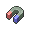

<!-- This file is generated by tools/generate_site.py. Edit the generator, not this file. -->

# Mauville Gym

## Trainers

| ID | Trainer | Pokémon |
| --- | --- | --- |
| 034 | **Guitarist Kirk** | { .icon loading=lazy } [Electrike](../pokemon/309.md) Lv. 23, { .icon loading=lazy } [Voltorb](../pokemon/100.md) Lv. 23, { .icon loading=lazy } [Helioptile](../pokemon/694.md) Lv. 23 |
| 568 | **Youngster Ben** | { .icon loading=lazy } [Joltik](../pokemon/595.md) Lv. 23, { .icon loading=lazy } [Tynamo](../pokemon/602.md) Lv. 23, { .icon loading=lazy } [Stunfisk](../pokemon/618.md) Lv. 23 |
| 614 | **Battle Girl Vivian** | { .icon loading=lazy } [Elekid](../pokemon/239.md) Lv. 25, { .icon loading=lazy } [Electabuzz](../pokemon/125.md) Lv. 25 |
| 035 | **Guitarist Shawn** | { .icon loading=lazy } [Blitzle](../pokemon/522.md) Lv. 23, { .icon loading=lazy } [Chinchou](../pokemon/170.md) Lv. 23, { .icon loading=lazy } [Jolteon](../pokemon/135.md) Lv. 23 |
| 567 | **Leader Wattson** | { .icon loading=lazy } [Electrode](../pokemon/101.md) Lv. 26, { .icon loading=lazy } [Magneton](../pokemon/082.md) Lv. 26, { .icon loading=lazy } [Flaaffy](../pokemon/180.md) Lv. 26, { .icon loading=lazy } [Rotom](../pokemon/479.md) Lv. 26, { .icon loading=lazy } [Luxio](../pokemon/404.md) Lv. 26, { .icon loading=lazy } [Manectric](../pokemon/310.md) Lv. 28 |

## Special Battle - Wattson

| Pokémon | Lv. | Item | Ability | Moves |
| --- | --- | --- | --- | --- |
| { .icon loading=lazy } [Electrode](../pokemon/101.md) | 26 | { .item loading=lazy } Magnet | <abbr title="Damages the attacker for 1/4 its max HP when knocked out by a contact move.">Aftermath</abbr> | Volt Switch, Electro Ball, Thunder Wave, Light Screen |
| { .icon loading=lazy } [Magneton](../pokemon/082.md) | 26 | { .item loading=lazy } Air Balloon | <abbr title="Prevents being KOed from full HP, leaving 1 HP instead.  Protects against the one-hit KO moves regardless of HP.">Sturdy</abbr> | Volt Switch, Mirror Shot, Electric Terrain, Supersonic |
| { .icon loading=lazy } [Flaaffy](../pokemon/180.md) | 26 | { .item loading=lazy } Leftovers | <abbr title="Has a 30% chance of paralyzing attacking Pokémon on contact.">Static</abbr> | Volt Switch, Thunder Wave, Fire Punch, Electric Terrain |
| { .icon loading=lazy } [Rotom](../pokemon/479.md) | 26 | { .item loading=lazy } Spell Tag | <abbr title="Evades Ground moves.">Levitate</abbr> | Volt Switch, Ominous Wind, Thunder Wave, Confuse Ray |
| { .icon loading=lazy } [Luxio](../pokemon/404.md) | 26 | { .item loading=lazy } Muscle Band | <abbr title="Lowers opponents' Attack one stage upon entering battle.">Intimidate</abbr> | Volt Switch, Night Slash, Ice Fang, Baby-Doll Eyes |
| { .icon loading=lazy } [Manectric](../pokemon/310.md) | 28 | { .item loading=lazy } Sitrus Berry | <abbr title="Has a 30% chance of paralyzing attacking Pokémon on contact.">Static</abbr> | Volt Switch, Flame Burst, Snarl, Electric Terrain |

---

[:material-arrow-left: Mauville City](mauville_city.md) · [All areas](index.md) · [Route 117 :material-arrow-right:](route_117.md)
