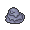

<!-- This file is generated by tools/generate_site.py. Edit the generator, not this file. -->

# Meteor Falls 1F

!!! tip "Wild Pokémon"

    See the [wild Pokémon of Meteor Falls 1F](../wild/meteor_falls_1f.md).

## Trainers

| ID | Trainer | Pokémon |
| --- | --- | --- |
| 902 | **Team Magma Grunt** | { .icon loading=lazy } [Golbat](../pokemon/042.md) Lv. 30, { .icon loading=lazy } [Numel](../pokemon/322.md) Lv. 30, { .icon loading=lazy } [Onix](../pokemon/095.md) Lv. 30 |
| 691 | **Magma Admin Tabitha** | { .icon loading=lazy } [Mightyena](../pokemon/262.md) Lv. 33, { .icon loading=lazy } [Weezing](../pokemon/110.md) Lv. 33, { .icon loading=lazy } [Darmanitan](../pokemon/555.md) Lv. 35 |
| 903 | **Team Aqua Grunt** | { .icon loading=lazy } [Golbat](../pokemon/042.md) Lv. 30, { .icon loading=lazy } [Carvanha](../pokemon/318.md) Lv. 30, { .icon loading=lazy } [Tangela](../pokemon/114.md) Lv. 30 |
| 688 | **Aqua Admin Shelly** | { .icon loading=lazy } [Liepard](../pokemon/510.md) Lv. 33, { .icon loading=lazy } [Muk](../pokemon/089.md) Lv. 33, { .icon loading=lazy } [Jellicent](../pokemon/593.md) Lv. 35 |

## Special Battle - Tabitha

| Pokémon | Lv. | Item | Ability | Moves |
| --- | --- | --- | --- | --- |
| { .icon loading=lazy } [Mightyena](../pokemon/262.md) | 33 | { .item loading=lazy } Muscle Band | <abbr title="Lowers opponents' Attack one stage upon entering battle.">Intimidate</abbr> | Crunch, Ice Fang, Thunder Fang, Swagger |
| { .icon loading=lazy } [Weezing](../pokemon/110.md) | 33 | { .item loading=lazy } Wise Glasses | <abbr title="Evades Ground moves.">Levitate</abbr> | Sludge Bomb, Flamethrower, Thunderbolt, Shadow Ball |
| { .icon loading=lazy } [Darmanitan](../pokemon/555.md) | 35 | { .item loading=lazy } Life Orb | <abbr title="Strengthens moves with extra effects to 1.3× their power, but prevents their extra effects.">Sheer Force</abbr> | Flare Blitz, Rock Slide, Zen Headbutt, Swagger |

## Special Battle - Shelly

| Pokémon | Lv. | Item | Ability | Moves |
| --- | --- | --- | --- | --- |
| { .icon loading=lazy } [Liepard](../pokemon/510.md) | 33 | { .item loading=lazy } Muscle Band | <abbr title="Raises non-damaging moves' priority by one stage.">Prankster</abbr> | Night Slash, Fake Out, Play Rough, Attract |
| { .icon loading=lazy } [Muk](../pokemon/089.md) | 33 | { .item loading=lazy } Black Sludge | <abbr title="Has a 30% chance of poisoning target Pokémon upon contact.">Poison Touch</abbr> | Poison Jab, Rock Slide, Payback, Protect |
| { .icon loading=lazy } [Jellicent](../pokemon/593.md) | 35 | { .item loading=lazy } Life Orb | <abbr title="Has a 30% chance of Disabling any move that hits the Pokémon.">Cursed Body</abbr> | Scald, Shadow Ball, Psychic, Recover |

---

[:material-arrow-left: Route 114](route_114.md) · [All areas](index.md) · [Mt. Chimney :material-arrow-right:](mt_chimney.md)
