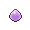

<!-- This file is generated by tools/generate_site.py. Edit the generator, not this file. -->

# Mt. Chimney

## Trainers

| ID | Trainer | Pokémon |
| --- | --- | --- |
| 252 | **Team Magma Grunt** | { .icon loading=lazy } [Golbat](../pokemon/042.md) Lv. 32, { .icon loading=lazy } [Lairon](../pokemon/305.md) Lv. 32 |
| 692 | **Magma Admin Tabitha** | { .icon loading=lazy } [Mightyena](../pokemon/262.md) Lv. 33, { .icon loading=lazy } [Weezing](../pokemon/110.md) Lv. 33, { .icon loading=lazy } [Snorlax](../pokemon/143.md) Lv. 33, { .icon loading=lazy } [Darmanitan](../pokemon/555.md) Lv. 35 |
| 236 | **Magma Leader Maxie** | { .icon loading=lazy } [Golbat](../pokemon/042.md) Lv. 34, { .icon loading=lazy } [Houndoom](../pokemon/229.md) Lv. 34, { .icon loading=lazy } [Pupitar](../pokemon/247.md) Lv. 34, { .icon loading=lazy } [Lampent](../pokemon/608.md) Lv. 34, { .icon loading=lazy } [Camerupt](../pokemon/323.md) Lv. 36 |
| 233 | **Team Aqua Grunt** | { .icon loading=lazy } [Golbat](../pokemon/042.md) Lv. 32, { .icon loading=lazy } [Lumineon](../pokemon/457.md) Lv. 32 |
| 689 | **Aqua Admin Shelly** | { .icon loading=lazy } [Liepard](../pokemon/510.md) Lv. 33, { .icon loading=lazy } [Muk](../pokemon/089.md) Lv. 33, { .icon loading=lazy } [Lapras](../pokemon/131.md) Lv. 33, { .icon loading=lazy } [Jellicent](../pokemon/593.md) Lv. 35 |
| 231 | **Aqua Leader Archie** | { .icon loading=lazy } [Golbat](../pokemon/042.md) Lv. 34, { .icon loading=lazy } [Tentacruel](../pokemon/073.md) Lv. 34, { .icon loading=lazy } [Dragonair](../pokemon/148.md) Lv. 34, { .icon loading=lazy } [Eelektrik](../pokemon/603.md) Lv. 34, { .icon loading=lazy } [Sharpedo](../pokemon/319.md) Lv. 36 |

## Special Battle - Tabitha

| Pokémon | Lv. | Item | Ability | Moves |
| --- | --- | --- | --- | --- |
| { .icon loading=lazy } [Mightyena](../pokemon/262.md) | 33 | { .item loading=lazy } Muscle Band | <abbr title="Lowers opponents' Attack one stage upon entering battle.">Intimidate</abbr> | Crunch, Play Rough, Fire Fang, Thunder Fang |
| { .icon loading=lazy } [Weezing](../pokemon/110.md) | 33 | { .item loading=lazy } Wise Glasses | <abbr title="Evades Ground moves.">Levitate</abbr> | Sludge Bomb, Flamethrower, Thunderbolt, Shadow Ball |
| { .icon loading=lazy } [Snorlax](../pokemon/143.md) | 33 | { .item loading=lazy } Sitrus Berry | <abbr title="Halves damage from Fire and Ice moves.">Thick Fat</abbr> | Body Slam, Rock Slide, Rest, Sleep Talk |
| { .icon loading=lazy } [Darmanitan](../pokemon/555.md) | 35 | { .item loading=lazy } Life Orb | <abbr title="Strengthens moves with extra effects to 1.3× their power, but prevents their extra effects.">Sheer Force</abbr> | Flare Blitz, Hammer Arm, Zen Headbutt, Swagger |

## Special Battle - Shelly

| Pokémon | Lv. | Item | Ability | Moves |
| --- | --- | --- | --- | --- |
| { .icon loading=lazy } [Liepard](../pokemon/510.md) | 33 | { .item loading=lazy } Muscle Band | <abbr title="Raises non-damaging moves' priority by one stage.">Prankster</abbr> | Night Slash, Fake Out, Play Rough, Attract |
| { .icon loading=lazy } [Muk](../pokemon/089.md) | 33 | { .item loading=lazy } Black Sludge | <abbr title="Has a 30% chance of poisoning target Pokémon upon contact.">Poison Touch</abbr> | Poison Jab, Rock Slide, Shadow Sneak, Minimize |
| { .icon loading=lazy } [Lapras](../pokemon/131.md) | 33 | { .item loading=lazy } Sitrus Berry | <abbr title="Absorbs Water moves, healing for 1/4 max HP.">Water Absorb</abbr> | Scald, Ice Beam, Rest, Sleep Talk |
| { .icon loading=lazy } [Jellicent](../pokemon/593.md) | 35 | { .item loading=lazy } Life Orb | <abbr title="Has a 30% chance of Disabling any move that hits the Pokémon.">Cursed Body</abbr> | Scald, Shadow Ball, Energy Ball, Recover |

## Special Battle - Maxie

| Pokémon | Lv. | Item | Ability | Moves |
| --- | --- | --- | --- | --- |
| { .icon loading=lazy } [Golbat](../pokemon/042.md) | 34 | { .item loading=lazy } Flying Gem | <abbr title="Bypasses Light Screen, Reflect, and Safeguard.">Infiltrator</abbr> | Acrobatics, Confuse Ray, Sludge Bomb, Torment |
| { .icon loading=lazy } [Houndoom](../pokemon/229.md) | 34 | { .item loading=lazy } Expert Belt | <abbr title="Protects against Fire moves.  Once one has been blocked, the Pokémon's own Fire moves inflict 1.5× damage until it leaves battle.">Flash Fire</abbr> | Dark Pulse, Flamethrower, Thunder Fang, Will-O-Wisp |
| { .icon loading=lazy } [Pupitar](../pokemon/247.md) | 34 | { .item loading=lazy } Eviolite | <abbr title="Has a 33% chance of curing any major status ailment after each turn.">Shed Skin</abbr> | Rock Slide, Dig, Dragon Dance, Iron Head |
| { .icon loading=lazy } [Lampent](../pokemon/608.md) | 34 | { .item loading=lazy } Focus Sash | <abbr title="Has a 30% chance of burning attacking Pokémon on contact.">Flame Body</abbr> | Heat Wave, Shadow Ball, Will-O-Wisp, Energy Ball |
| { .icon loading=lazy } [Camerupt](../pokemon/323.md) | 36 | { .item loading=lazy } Quick Claw | <abbr title="Decreases damage taken from super-effective moves by 1/4.">Solid Rock</abbr> | Earth Power, Lava Plume, Rock Slide, Flash Cannon |

## Special Battle - Archie

| Pokémon | Lv. | Item | Ability | Moves |
| --- | --- | --- | --- | --- |
| { .icon loading=lazy } [Golbat](../pokemon/042.md) | 34 | { .item loading=lazy } Flying Gem | <abbr title="Bypasses Light Screen, Reflect, and Safeguard.">Infiltrator</abbr> | Acrobatics, Confuse Ray, Sludge Bomb, Torment |
| { .icon loading=lazy } [Tentacruel](../pokemon/073.md) | 34 | { .item loading=lazy } Black Sludge | <abbr title="Heals for 1/16 max HP after each turn during rain.">Rain Dish</abbr> | Poison Jab, Scald, Rain Dance, Aurora Beam |
| { .icon loading=lazy } [Dragonair](../pokemon/148.md) | 34 | { .item loading=lazy } Eviolite | <abbr title="Increases Defense to 1.5× with a major status ailment.">Marvel Scale</abbr> | Dragon Rush, Aqua Tail, Thunder Wave, Thunder |
| { .icon loading=lazy } [Eelektrik](../pokemon/603.md) | 34 | { .item loading=lazy } Quick Claw | <abbr title="Evades Ground moves.">Levitate</abbr> | Thunderbolt, Aqua Tail, Thunder Wave, Protect |
| { .icon loading=lazy } [Sharpedo](../pokemon/319.md) | 36 | { .item loading=lazy } Focus Sash | <abbr title="Raises Speed one stage after each turn.">Speed Boost</abbr> | Night Slash, Ice Fang, Waterfall, Protect |

---

[:material-arrow-left: Meteor Falls 1F](meteor_falls_1f.md) · [All areas](index.md) · [Jagged Pass :material-arrow-right:](jagged_pass.md)
