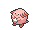
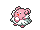
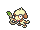
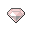

<!-- This file is generated by tools/generate_site.py. Edit the generator, not this file. -->

# Petalburg Gym

## Trainers

| ID | Trainer | Pokémon |
| --- | --- | --- |
| 063 | **Ace Trainer Randall** | { .icon loading=lazy } [Persian](../pokemon/053.md) Lv. 37, { .icon loading=lazy } [Raticate](../pokemon/020.md) Lv. 37, { .icon loading=lazy } [Lopunny](../pokemon/428.md) Lv. 37 |
| 067 | **Ace Trainer Mary** | { .icon loading=lazy } [Delcatty](../pokemon/301.md) Lv. 37, { .icon loading=lazy } [Audino](../pokemon/531.md) Lv. 37, { .icon loading=lazy } [Porygon2](../pokemon/233.md) Lv. 37 |
| 064 | **Ace Trainer Parker** | { .icon loading=lazy } [Girafarig](../pokemon/203.md) Lv. 37, { .icon loading=lazy } [Dunsparce](../pokemon/206.md) Lv. 37, { .icon loading=lazy } [Stantler](../pokemon/234.md) Lv. 37 |
| 068 | **Ace Trainer Lori** | { .icon loading=lazy } [Tauros](../pokemon/128.md) Lv. 37, { .icon loading=lazy } [Miltank](../pokemon/241.md) Lv. 37, { .icon loading=lazy } [Furfrou](../pokemon/676.md) Lv. 37 |
| 065 | **Ace Trainer George** | { .icon loading=lazy } [Chansey](../pokemon/113.md) Lv. 37, { .icon loading=lazy } [Snorlax](../pokemon/143.md) Lv. 37, { .icon loading=lazy } [Blissey](../pokemon/242.md) Lv. 37 |
| 069 | **Ace Trainer Jody** | { .icon loading=lazy } [Ursaring](../pokemon/217.md) Lv. 37, { .icon loading=lazy } [Stoutland](../pokemon/508.md) Lv. 37, { .icon loading=lazy } [Kangaskhan](../pokemon/115.md) Lv. 37 |
| 066 | **Ace Trainer Berke** | { .icon loading=lazy } [Purugly](../pokemon/432.md) Lv. 37, { .icon loading=lazy } [Smeargle](../pokemon/235.md) Lv. 37, { .icon loading=lazy } [Lickilicky](../pokemon/463.md) Lv. 37 |
| 570 | **Leader Norman** | { .icon loading=lazy } [Ambipom](../pokemon/424.md) Lv. 40, { .icon loading=lazy } [Exploud](../pokemon/295.md) Lv. 40, { .icon loading=lazy } [Staraptor](../pokemon/398.md) Lv. 40, { .icon loading=lazy } [Sawsbuck](../pokemon/586.md) Lv. 40, { .icon loading=lazy } [Bouffalant](../pokemon/626.md) Lv. 40, { .icon loading=lazy } [Slaking](../pokemon/289.md) Lv. 42 |

## Special Battle - Norman

| Pokémon | Lv. | Item | Ability | Moves |
| --- | --- | --- | --- | --- |
| { .icon loading=lazy } [Ambipom](../pokemon/424.md) | 40 | { .item loading=lazy } Normal Gem | <abbr title="Strengthens moves of 60 base power or less to 1.5× their power.">Technician</abbr> | Fake Out, Double Hit, Acrobatics, Knock Off |
| { .icon loading=lazy } [Exploud](../pokemon/295.md) | 40 | { .item loading=lazy } Wise Glasses | <abbr title="Lets the Pokémon's Normal and Fighting moves hit Ghost Pokémon.">Scrappy</abbr> | Boomburst, Flamethrower, Ice Beam, Thunderbolt |
| { .icon loading=lazy } [Staraptor](../pokemon/398.md) | 40 | { .item loading=lazy } Power Herb | <abbr title="Lowers opponents' Attack one stage upon entering battle.">Intimidate</abbr> | Retaliate, Close Combat, U-turn, Sky Attack |
| { .icon loading=lazy } [Sawsbuck](../pokemon/586.md) | 40 | { .item loading=lazy } Assault Vest | <abbr title="Absorbs Grass moves, raising Attack one stage.">Sap Sipper</abbr> | Retaliate, Horn Leech, Jump Kick, Megahorn |
| { .icon loading=lazy } [Bouffalant](../pokemon/626.md) | 40 | { .item loading=lazy } Silk Scarf | <abbr title="Absorbs Grass moves, raising Attack one stage.">Sap Sipper</abbr> | Head Charge, Zen Headbutt, Megahorn, Revenge |
| { .icon loading=lazy } [Slaking](../pokemon/289.md) | 42 | { .item loading=lazy } Sitrus Berry | <abbr title="Skips every second turn.">Truant</abbr> | Retaliate, Rock Slide, Play Rough, Slack Off |

---

[:material-arrow-left: Route 111 (Desert)](route_111_desert.md) · [All areas](index.md) · [Route 105 :material-arrow-right:](route_105.md)
