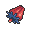
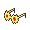
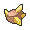

<!-- This file is generated by tools/generate_site.py. Edit the generator, not this file. -->

# Pokémon League

## Trainers

| ID | Trainer | Pokémon |
| --- | --- | --- |
| 553 | **Elite Four Sidney** | { .icon loading=lazy } [Weavile](../pokemon/461.md) Lv. 70, { .icon loading=lazy } [Scrafty](../pokemon/560.md) Lv. 70, { .icon loading=lazy } [Bisharp](../pokemon/625.md) Lv. 70, { .icon loading=lazy } [Tyranitar](../pokemon/248.md) Lv. 70, { .icon loading=lazy } [Greninja](../pokemon/658.md) Lv. 70, { .icon loading=lazy } [Absol](../pokemon/359.md) Lv. 72 |
| 554 | **Elite Four Phoebe** | { .icon loading=lazy } [Mismagius](../pokemon/429.md) Lv. 71, { .icon loading=lazy } [Gengar](../pokemon/094.md) Lv. 71, { .icon loading=lazy } [Aegislash](../pokemon/681.md) Lv. 71, { .icon loading=lazy } [Chandelure](../pokemon/609.md) Lv. 71, { .icon loading=lazy } [Dusknoir](../pokemon/477.md) Lv. 71, { .icon loading=lazy } [Sableye](../pokemon/302.md) Lv. 73 |
| 555 | **Elite Four Glacia** | { .icon loading=lazy } [Aurorus](../pokemon/699.md) Lv. 72, { .icon loading=lazy } [Froslass](../pokemon/478.md) Lv. 72, { .icon loading=lazy } [Jynx](../pokemon/124.md) Lv. 72, { .icon loading=lazy } [Mamoswine](../pokemon/473.md) Lv. 72, { .icon loading=lazy } [Walrein](../pokemon/365.md) Lv. 72, { .icon loading=lazy } [Glalie](../pokemon/362.md) Lv. 74 |
| 556 | **Elite Four Drake** | { .icon loading=lazy } [Hydreigon](../pokemon/635.md) Lv. 73, { .icon loading=lazy } [Flygon](../pokemon/330.md) Lv. 73, { .icon loading=lazy } [Haxorus](../pokemon/612.md) Lv. 73, { .icon loading=lazy } [Kingdra](../pokemon/230.md) Lv. 73, { .icon loading=lazy } [Dragalge](../pokemon/691.md) Lv. 73, { .icon loading=lazy } [Salamence](../pokemon/373.md) Lv. 75 |
| 557 | **Champion Steven** | { .icon loading=lazy } [Skarmory](../pokemon/227.md) Lv. 77, { .icon loading=lazy } [Aggron](../pokemon/306.md) Lv. 77, { .icon loading=lazy } [Claydol](../pokemon/344.md) Lv. 77, { .icon loading=lazy } [Aerodactyl](../pokemon/142.md) Lv. 77, { .icon loading=lazy } [Diancie](../pokemon/719.md) Lv. 77, { .icon loading=lazy } [Metagross](../pokemon/376.md) Lv. 79 |

## Special Battle - Sidney

| Pokémon | Lv. | Item | Ability | Moves |
| --- | --- | --- | --- | --- |
| { .icon loading=lazy } [Weavile](../pokemon/461.md) | 70 | { .item loading=lazy } Life Orb | <abbr title="Increases the PP cost of moves targetting the Pokémon by one.">Pressure</abbr> | Icicle Crash, Knock Off, Low Kick, Poison Jab |
| { .icon loading=lazy } [Scrafty](../pokemon/560.md) | 70 | { .item loading=lazy } Leftovers | <abbr title="Lowers opponents' Attack one stage upon entering battle.">Intimidate</abbr> | High Jump Kick, Knock Off, Iron Head, Head Smash |
| { .icon loading=lazy } [Bisharp](../pokemon/625.md) | 70 | { .item loading=lazy } Focus Sash | <abbr title="Raises Attack two stages upon having any stat lowered.">Defiant</abbr> | Sucker Punch, Iron Head, Stone Edge, Thunder Wave |
| { .icon loading=lazy } [Tyranitar](../pokemon/248.md) | 70 | { .item loading=lazy } Assault Vest | <abbr title="Summons a sandstorm that lasts indefinitely upon entering battle.">Sand Stream</abbr> | Stone Edge, Crunch, Ice Punch, Superpower |
| { .icon loading=lazy } [Greninja](../pokemon/658.md) | 70 | { .item loading=lazy } Expert Belt | <abbr title="Changes the bearer's type to match each move it uses.">Protean</abbr> | Dark Pulse, Hydro Pump, Ice Beam, Gunk Shot |
| { .icon loading=lazy } [Absol](../pokemon/359.md) | 72 | { .item loading=lazy } Absolite | <abbr title="Raises moves' critical hit rates one stage.">Super Luck</abbr> | Sucker Punch, Play Rough, Fire Blast, Iron Tail |

## Special Battle - Phoebe

| Pokémon | Lv. | Item | Ability | Moves |
| --- | --- | --- | --- | --- |
| { .icon loading=lazy } [Mismagius](../pokemon/429.md) | 71 | { .item loading=lazy } Wise Glasses | <abbr title="Evades Ground moves.">Levitate</abbr> | Shadow Ball, Moonblast, Thunderbolt, Thunder Wave |
| { .icon loading=lazy } [Gengar](../pokemon/094.md) | 71 | { .item loading=lazy } Expert Belt | <abbr title="Evades Ground moves.">Levitate</abbr> | Shadow Ball, Sludge Wave, Focus Blast, Hypnosis |
| { .icon loading=lazy } [Gourgeist](../pokemon/711.md) | 71 | { .item loading=lazy } Assault Vest | <abbr title="Prevents sleep.">Insomnia</abbr> | Petal Blizzard, Phantom Force, Rock Slide, Fire Blast |
| { .icon loading=lazy } [Chandelure](../pokemon/609.md) | 71 | { .item loading=lazy } Choice Scarf | <abbr title="Has a 30% chance of burning attacking Pokémon on contact.">Flame Body</abbr> | Fire Blast, Shadow Ball, Energy Ball, Trick |
| { .icon loading=lazy } [Dusknoir](../pokemon/477.md) | 71 | { .item loading=lazy } Life Orb | <abbr title="Increases the PP cost of moves targetting the Pokémon by one.">Pressure</abbr> | Phantom Force, Earthquake, Rock Slide, Ice Punch |
| { .icon loading=lazy } [Sableye](../pokemon/302.md) | 73 | { .item loading=lazy } Sablenite | <abbr title="Raises non-damaging moves' priority by one stage.">Prankster</abbr> | Knock Off, Recover, Will-O-Wisp, Metal Burst |

## Special Battle - Glacia

| Pokémon | Lv. | Item | Ability | Moves |
| --- | --- | --- | --- | --- |
| { .icon loading=lazy } [Aurorus](../pokemon/699.md) | 72 | { .item loading=lazy } Icy Rock | <abbr title="Summons hail that lasts indefinitely upon entering battle.">Snow Warning</abbr> | Blizzard, Earth Power, Freeze-Dry, Thunderbolt |
| { .icon loading=lazy } [Froslass](../pokemon/478.md) | 72 | { .item loading=lazy } Life Orb | <abbr title="Increases evasion to 1.25× during hail.  Protects against hail damage.">Snow Cloak</abbr> | Shadow Ball, Thunderbolt, Blizzard, Destiny Bond |
| { .icon loading=lazy } [Jynx](../pokemon/124.md) | 72 | { .item loading=lazy } Focus Sash | <abbr title="Causes 1/8 max HP in damage each turn during strong sunlight, but heals for 1/8 max HP during rain.  Increases damage from Fire moves to 1.25×, but absorbs Water moves, healing for 1/4 max HP.">Dry Skin</abbr> | Lovely Kiss, Blizzard, Psychic, Focus Blast |
| { .icon loading=lazy } [Mamoswine](../pokemon/473.md) | 72 | { .item loading=lazy } Choice Scarf | <abbr title="Halves damage from Fire and Ice moves.">Thick Fat</abbr> | Icicle Crash, Earthquake, Stone Edge, Superpower |
| { .icon loading=lazy } [Walrein](../pokemon/365.md) | 72 | { .item loading=lazy } Leftovers | <abbr title="Heals for 1/16 max HP after each turn during hail.  Protects against hail damage.">Ice Body</abbr> | Surf, Blizzard, Hail, Protect |
| { .icon loading=lazy } [Glalie](../pokemon/362.md) | 74 | { .item loading=lazy } Glalitite | <abbr title="Raises a random stat two stages and lowers another one stage after each turn.">Moody</abbr> | Double-Edge, Freeze-Dry, Earthquake, Ice Shard |

## Special Battle - Drake

| Pokémon | Lv. | Item | Ability | Moves |
| --- | --- | --- | --- | --- |
| { .icon loading=lazy } [Hydreigon](../pokemon/635.md) | 73 | { .item loading=lazy } Life Orb | <abbr title="Evades Ground moves.">Levitate</abbr> | Draco Meteor, Dark Pulse, Flash Cannon, Focus Blast |
| { .icon loading=lazy } [Flygon](../pokemon/330.md) | 73 | { .item loading=lazy } Choice Scarf | <abbr title="Evades Ground moves.">Levitate</abbr> | Outrage, Earthquake, U-turn, Iron Tail |
| { .icon loading=lazy } [Haxorus](../pokemon/612.md) | 73 | { .item loading=lazy } Roseli Berry | <abbr title="Bypasses targets' abilities if they could hinder or prevent a move.">Mold Breaker</abbr> | Dragon Dance, Outrage, Earthquake, Poison Jab |
| { .icon loading=lazy } [Kingdra](../pokemon/230.md) | 73 | { .item loading=lazy } Scope Lens | <abbr title="Strengthens critical hits to inflict 3× damage rather than 2×.">Sniper</abbr> | Hydro Pump, Ice Beam, Draco Meteor, Flash Cannon |
| { .icon loading=lazy } [Dragalge](../pokemon/691.md) | 73 | { .item loading=lazy } Choice Specs | <abbr title="Increases the same-type attack bonus from 1.5× to 2×.">Adaptability</abbr> | Sludge Wave, Draco Meteor, Focus Blast, Thunder |
| { .icon loading=lazy } [Salamence](../pokemon/373.md) | 75 | { .item loading=lazy } Salamencite | <abbr title="Lowers opponents' Attack one stage upon entering battle.">Intimidate</abbr> | Dragon Rush, Body Slam, Fire Blast, Earthquake |

## Special Battle - Steven

| Pokémon | Lv. | Item | Ability | Moves |
| --- | --- | --- | --- | --- |
| { .icon loading=lazy } [Skarmory](../pokemon/227.md) | 77 | { .item loading=lazy } Smooth Rock | <abbr title="Prevents being KOed from full HP, leaving 1 HP instead.  Protects against the one-hit KO moves regardless of HP.">Sturdy</abbr> | Sandstorm, Stealth Rock, Roost, Brave Bird |
| { .icon loading=lazy } [Aggron](../pokemon/306.md) | 77 | { .item loading=lazy } Focus Sash | <abbr title="Protects against recoil damage.">Rock Head</abbr> | Head Smash, Heavy Slam, Earthquake, Thunder Wave |
| { .icon loading=lazy } [Claydol](../pokemon/344.md) | 77 | { .item loading=lazy } Light Clay | <abbr title="Evades Ground moves.">Levitate</abbr> | Reflect, Light Screen, Earthquake, Psychic |
| { .icon loading=lazy } [Aerodactyl](../pokemon/142.md) | 77 | { .item loading=lazy } Life Orb | <abbr title="Protects against recoil damage.">Rock Head</abbr> | Stone Edge, Earthquake, Aqua Tail, Brave Bird |
| { .icon loading=lazy } [Diancie](../pokemon/719.md) | 77 | { .item loading=lazy } Assault Vest | <abbr title="Prevents stats from being lowered by other Pokémon.">Clear Body</abbr> | Diamond Storm, Moonblast, Earth Power, Reflect |
| { .icon loading=lazy } [Metagross](../pokemon/376.md) | 79 | { .item loading=lazy } Metagrossite | <abbr title="Prevents stats from being lowered by other Pokémon.">Clear Body</abbr> | Meteor Mash, Earthquake, Zen Headbutt, Hammer Arm |

---

[:material-arrow-left: Victory Road 2F](victory_road_2f.md) · [All areas](index.md) · [Credits :material-arrow-right:](credits.md)
