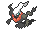
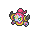
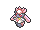
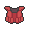
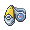
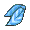
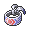
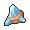
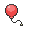

<!-- This file is generated by tools/generate_site.py. Edit the generator, not this file. -->

# Pokémon League (Post Game)

Post Game

## Trainers

| ID | Trainer | Pokémon |
| --- | --- | --- |
| 909 | **Elite Four Sidney** | { .icon loading=lazy } [Scrafty](../pokemon/560.md) Lv. 80, { .icon loading=lazy } [Bisharp](../pokemon/625.md) Lv. 80, { .icon loading=lazy } [Darkrai](../pokemon/491.md) Lv. 80, { .icon loading=lazy } [Greninja](../pokemon/658.md) Lv. 80, { .icon loading=lazy } [Absol](../pokemon/359.md) Lv. 82, { .icon loading=lazy } [Tyranitar](../pokemon/248.md) Lv. 82 |
| 910 | **Elite Four Phoebe** | { .icon loading=lazy } [Aegislash](../pokemon/681.md) Lv. 81, { .icon loading=lazy } [Chandelure](../pokemon/609.md) Lv. 81, { .icon loading=lazy } [Hoopa](../pokemon/720.md) Lv. 81, { .icon loading=lazy } [Dusknoir](../pokemon/477.md) Lv. 81, { .icon loading=lazy } [Sableye](../pokemon/302.md) Lv. 83, { .icon loading=lazy } [Gengar](../pokemon/094.md) Lv. 83 |
| 911 | **Elite Four Glacia** | { .icon loading=lazy } [Walrein](../pokemon/365.md) Lv. 82, { .icon loading=lazy } [Froslass](../pokemon/478.md) Lv. 82, { .icon loading=lazy } [Articuno](../pokemon/144.md) Lv. 82, { .icon loading=lazy } [Mamoswine](../pokemon/473.md) Lv. 82, { .icon loading=lazy } [Glalie](../pokemon/362.md) Lv. 84, { .icon loading=lazy } [Abomasnow](../pokemon/460.md) Lv. 84 |
| 912 | **Elite Four Drake** | { .icon loading=lazy } [Hydreigon](../pokemon/635.md) Lv. 83, { .icon loading=lazy } [Garchomp](../pokemon/445.md) Lv. 83, { .icon loading=lazy } [Latias](../pokemon/380.md) Lv. 83, { .icon loading=lazy } [Kingdra](../pokemon/230.md) Lv. 83, { .icon loading=lazy } [Salamence](../pokemon/373.md) Lv. 85, { .icon loading=lazy } [Latios](../pokemon/381.md) Lv. 85 |
| 913 | **Champion Steven** | { .icon loading=lazy } [Aerodactyl](../pokemon/142.md) Lv. 87, { .icon loading=lazy } [Aggron](../pokemon/306.md) Lv. 87, { .icon loading=lazy } [Heatran](../pokemon/485.md) Lv. 87, { .icon loading=lazy } [Claydol](../pokemon/344.md) Lv. 87, { .icon loading=lazy } [Metagross](../pokemon/376.md) Lv. 89, { .icon loading=lazy } [Diancie](../pokemon/719.md) Lv. 89 |

## Special Battle - Sidney

| Pokémon | Lv. | Item | Ability | Moves |
| --- | --- | --- | --- | --- |
| { .icon loading=lazy } [Scrafty](../pokemon/560.md) | 80 | { .item loading=lazy } Assault Vest | <abbr title="Lowers opponents' Attack one stage upon entering battle.">Intimidate</abbr> | High Jump Kick, Knock Off, Head Smash, Iron Head |
| { .icon loading=lazy } [Bisharp](../pokemon/625.md) | 80 | { .item loading=lazy } Focus Sash | <abbr title="Raises Attack two stages upon having any stat lowered.">Defiant</abbr> | Knock Off, Iron Head, Sucker Punch, Swords Dance |
| { .icon loading=lazy } [Darkrai](../pokemon/491.md) | 80 | { .item loading=lazy } Life Orb | <abbr title="Damages sleeping opponents for 1/8 their max HP after each turn.">Bad Dreams</abbr> | Dark Void, Dark Pulse, Ice Beam, Sludge Bomb |
| { .icon loading=lazy } [Greninja](../pokemon/658.md) | 80 | { .item loading=lazy } Expert Belt | <abbr title="Changes the bearer's type to match each move it uses.">Protean</abbr> | Ice Beam, Dark Pulse, Gunk Shot, Hydro Pump |
| { .icon loading=lazy } [Absol](../pokemon/359.md) | 82 | { .item loading=lazy } Scope Lens | <abbr title="Raises moves' critical hit rates one stage.">Super Luck</abbr> | Night Slash, Play Rough, Psycho Cut, Megahorn |
| { .icon loading=lazy } [Tyranitar](../pokemon/248.md) | 82 | { .item loading=lazy } Tyranitarite | <abbr title="Summons a sandstorm that lasts indefinitely upon entering battle.">Sand Stream</abbr> | Dragon Dance, Stone Edge, Crunch, Ice Punch |

## Special Battle - Phoebe

| Pokémon | Lv. | Item | Ability | Moves |
| --- | --- | --- | --- | --- |
| { .icon loading=lazy } [Aegislash](../pokemon/681.md) | 81 | { .item loading=lazy } Weakness Policy | <abbr title="Changes Aegislash to Blade Forme before using a damaging move, or Shield Forme before using King’s Shield.">Stance Change</abbr> | King’s Shield, Shadow Ball, Flash Cannon, Sacred Sword |
| { .icon loading=lazy } [Chandelure](../pokemon/609.md) | 81 | { .item loading=lazy } Choice Scarf | <abbr title="Has a 30% chance of burning attacking Pokémon on contact.">Flame Body</abbr> | Fire Blast, Shadow Ball, Energy Ball, Trick |
| { .icon loading=lazy } [Hoopa](../pokemon/720.md) | 81 | { .item loading=lazy } Life Orb | <abbr title="Steals the target's held item when the bearer uses a damaging move.">Magician</abbr> | Shadow Ball, Hyperspace Hole, Focus Blast, Thunder |
| { .icon loading=lazy } [Dusknoir](../pokemon/477.md) | 81 | { .item loading=lazy } Choice Band | <abbr title="Increases the PP cost of moves targetting the Pokémon by one.">Pressure</abbr> | Phantom Force, Earthquake, Rock Slide, Ice Punch |
| { .icon loading=lazy } [Sableye](../pokemon/302.md) | 83 | { .item loading=lazy } Leftovers | <abbr title="Raises non-damaging moves' priority by one stage.">Prankster</abbr> | Recover, Toxic, Protect, Foul Play |
| { .icon loading=lazy } [Gengar](../pokemon/094.md) | 82 | { .item loading=lazy } Gengarite | <abbr title="Evades Ground moves.">Levitate</abbr> | Shadow Ball, Sludge Wave, Focus Blast, Hypnosis |

## Special Battle - Glacia

| Pokémon | Lv. | Item | Ability | Moves |
| --- | --- | --- | --- | --- |
| { .icon loading=lazy } [Walrein](../pokemon/365.md) | 82 | { .item loading=lazy } Icy Rock | <abbr title="Heals for 1/16 max HP after each turn during hail.  Protects against hail damage.">Ice Body</abbr> | Surf, Blizzard, Protect, Hail |
| { .icon loading=lazy } [Froslass](../pokemon/478.md) | 82 | { .item loading=lazy } Bright Powder | <abbr title="Increases evasion to 1.25× during hail.  Protects against hail damage.">Snow Cloak</abbr> | Shadow Ball, Thunderbolt, Blizzard, Destiny Bond |
| { .icon loading=lazy } [Articuno](../pokemon/144.md) | 82 | { .item loading=lazy } Life Orb | <abbr title="Increases evasion to 1.25× during hail.  Protects against hail damage.">Snow Cloak</abbr> | Blizzard, Hurricane, Freeze-Dry, Roost |
| { .icon loading=lazy } [Mamoswine](../pokemon/473.md) | 82 | { .item loading=lazy } Choice Scarf | <abbr title="Halves damage from Fire and Ice moves.">Thick Fat</abbr> | Icicle Crash, Earthquake, Stone Edge, Superpower |
| { .icon loading=lazy } [Glalie](../pokemon/362.md) | 84 | { .item loading=lazy } Focus Sash | <abbr title="Raises a random stat two stages and lowers another one stage after each turn.">Moody</abbr> | Light Screen, Earthquake, Protect, Blizzard |
| { .icon loading=lazy } [Abomasnow](../pokemon/460.md) | 84 | { .item loading=lazy } Abomasite | <abbr title="Summons hail that lasts indefinitely upon entering battle.">Snow Warning</abbr> | Blizzard, Wood Hammer, Ice Shard, Earthquake |

## Special Battle - Drake

| Pokémon | Lv. | Item | Ability | Moves |
| --- | --- | --- | --- | --- |
| { .icon loading=lazy } [Hydreigon](../pokemon/635.md) | 83 | { .item loading=lazy } White Herb | <abbr title="Evades Ground moves.">Levitate</abbr> | Draco Meteor, Dark Pulse, Flash Cannon, Focus Blast |
| { .icon loading=lazy } [Garchomp](../pokemon/445.md) | 83 | { .item loading=lazy } Focus Sash | <abbr title="Damages attacking Pokémon for 1/8 their max HP on contact.">Rough Skin</abbr> | Swords Dance, Outrage, Earthquake, Stone Edge |
| { .icon loading=lazy } [Latias](../pokemon/380.md) | 83 | { .item loading=lazy } Soul Dew | <abbr title="Evades Ground moves.">Levitate</abbr> | Psychic, Ice Beam, Roost, Thunder Wave |
| { .icon loading=lazy } [Kingdra](../pokemon/230.md) | 83 | { .item loading=lazy } Scope Lens | <abbr title="Strengthens critical hits to inflict 3× damage rather than 2×.">Sniper</abbr> | Hydro Pump, Ice Beam, Draco Meteor, Flash Cannon |
| { .icon loading=lazy } [Salamence](../pokemon/373.md) | 85 | { .item loading=lazy } Life Orb | <abbr title="Lowers opponents' Attack one stage upon entering battle.">Intimidate</abbr> | Outrage, Earthquake, Fire Blast, Hydro Pump |
| { .icon loading=lazy } [Latios](../pokemon/381.md) | 85 | { .item loading=lazy } Latiosite | <abbr title="Evades Ground moves.">Levitate</abbr> | Dragon Pulse, Psyshock, Earthquake, Roost |

## Special Battle - Steven

| Pokémon | Lv. | Item | Ability | Moves |
| --- | --- | --- | --- | --- |
| { .icon loading=lazy } [Aerodactyl](../pokemon/142.md) | 87 | { .item loading=lazy } Life Orb | <abbr title="Protects against recoil damage.">Rock Head</abbr> | Stone Edge, Earthquake, Aqua Tail, Brave Bird |
| { .icon loading=lazy } [Aggron](../pokemon/306.md) | 87 | { .item loading=lazy } Focus Sash | <abbr title="Protects against recoil damage.">Rock Head</abbr> | Head Smash, Heavy Slam, Earthquake, Thunder Wave |
| { .icon loading=lazy } [Heatran](../pokemon/485.md) | 87 | { .item loading=lazy } Air Balloon | <abbr title="Has a 30% chance of burning attacking Pokémon on contact.">Flame Body</abbr> | Magma Storm, Earth Power, Flash Cannon, Stone Edge |
| { .icon loading=lazy } [Claydol](../pokemon/344.md) | 87 | { .item loading=lazy } Light Clay | <abbr title="Evades Ground moves.">Levitate</abbr> | Reflect, Light Screen, Earthquake, Psychic |
| { .icon loading=lazy } [Metagross](../pokemon/376.md) | 87 | { .item loading=lazy } Assault Vest | <abbr title="Prevents stats from being lowered by other Pokémon.">Clear Body</abbr> | Meteor Mash, Earthquake, Zen Headbutt, Explosion |
| { .icon loading=lazy } [Diancie](../pokemon/719.md) | 89 | { .item loading=lazy } Diancite | <abbr title="Prevents stats from being lowered by other Pokémon.">Clear Body</abbr> | Rock Polish, Diamond Storm, Moonblast, Earth Power |

---

[:material-arrow-left: Battle Resort](battle_resort.md) · [All areas](index.md)
