<!-- This file is generated by tools/generate_site.py. Edit the generator, not this file. -->

# Route 103

!!! tip "Wild Pokémon"

    See the [wild Pokémon of Route 103](../wild/route_103.md).

## Trainers - West of River

| ID | Trainer | Pokémon |
| --- | --- | --- |
| 001 | **PKMN Trainer Brendan** | 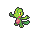{ .icon loading=lazy } [Treecko](../pokemon/252.md) Lv. 5 |
| 002 | **PKMN Trainer Brendan** | 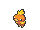{ .icon loading=lazy } [Torchic](../pokemon/255.md) Lv. 5 |
| 003 | **PKMN Trainer Brendan** | 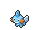{ .icon loading=lazy } [Mudkip](../pokemon/258.md) Lv. 5 |
| 004 | **PKMN Trainer May** | { .icon loading=lazy } [Treecko](../pokemon/252.md) Lv. 5 |
| 005 | **PKMN Trainer May** | { .icon loading=lazy } [Torchic](../pokemon/255.md) Lv. 5 |
| 006 | **PKMN Trainer May** | { .icon loading=lazy } [Mudkip](../pokemon/258.md) Lv. 5 |

## Trainers - East of River

| ID | Trainer | Pokémon |
| --- | --- | --- |
| 011 | **Aroma Lady Daisy** | 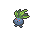{ .icon loading=lazy } [Oddish](../pokemon/043.md) Lv. 19, 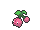{ .icon loading=lazy } [Cherubi](../pokemon/420.md) Lv. 19, 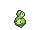{ .icon loading=lazy } [Budew](../pokemon/406.md) Lv. 19 |
| 012 | **Twins Amy & Liv** | 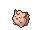{ .icon loading=lazy } [Clefairy](../pokemon/035.md) Lv. 20, 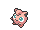{ .icon loading=lazy } [Jigglypuff](../pokemon/039.md) Lv. 20 |
| 644 | **Poké Fan Miguel** | { .icon loading=lazy } [Pikachu](../pokemon/025.md) Lv. 18, { .icon loading=lazy } [Pikachu](../pokemon/025.md) Lv. 18, { .icon loading=lazy } [Pikachu](../pokemon/025.md) Lv. 18, { .icon loading=lazy } [Pikachu](../pokemon/025.md) Lv. 18, { .icon loading=lazy } [Pikachu](../pokemon/025.md) Lv. 18 |
| 013 | **Fisherman Andrew** | 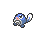{ .icon loading=lazy } [Poliwag](../pokemon/060.md) Lv. 19, 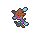{ .icon loading=lazy } [Skrelp](../pokemon/690.md) Lv. 19, 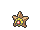{ .icon loading=lazy } [Staryu](../pokemon/120.md) Lv. 19 |

## Rematches

| ID | Trainer | Pokémon |
| --- | --- | --- |
| 055 | **Twins Amy & Liv** 4 | { .icon loading=lazy } [Delcatty](../pokemon/301.md) Lv. 35, 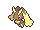{ .icon loading=lazy } [Lopunny](../pokemon/428.md) Lv. 35, 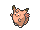{ .icon loading=lazy } [Clefable](../pokemon/036.md) Lv. 35, 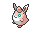{ .icon loading=lazy } [Wigglytuff](../pokemon/040.md) Lv. 35 |
| 368 | **Twins Amy & Liv** 6 | { .icon loading=lazy } [Delcatty](../pokemon/301.md) Lv. 47, { .icon loading=lazy } [Lopunny](../pokemon/428.md) Lv. 47, { .icon loading=lazy } [Clefable](../pokemon/036.md) Lv. 47, { .icon loading=lazy } [Wigglytuff](../pokemon/040.md) Lv. 47 |
| 596 | **Twins Amy & Liv** 7 | { .icon loading=lazy } [Delcatty](../pokemon/301.md) Lv. 59, { .icon loading=lazy } [Lopunny](../pokemon/428.md) Lv. 59, { .icon loading=lazy } [Clefable](../pokemon/036.md) Lv. 59, { .icon loading=lazy } [Wigglytuff](../pokemon/040.md) Lv. 59 |
| 597 | **Twins Amy & Liv** C | { .icon loading=lazy } [Delcatty](../pokemon/301.md) Lv. 75, { .icon loading=lazy } [Lopunny](../pokemon/428.md) Lv. 75, { .icon loading=lazy } [Clefable](../pokemon/036.md) Lv. 75, { .icon loading=lazy } [Wigglytuff](../pokemon/040.md) Lv. 75 |
| 651 | **Poké Fan Miguel** 4 | { .icon loading=lazy } [Pikachu](../pokemon/025.md) Lv. 35, { .icon loading=lazy } [Pikachu](../pokemon/025.md) Lv. 35, { .icon loading=lazy } [Pikachu](../pokemon/025.md) Lv. 35, { .icon loading=lazy } [Pikachu](../pokemon/025.md) Lv. 35, { .icon loading=lazy } [Pikachu](../pokemon/025.md) Lv. 35 |
| 652 | **Poké Fan Miguel** 5 | { .icon loading=lazy } [Pikachu](../pokemon/025.md) Lv. 39, { .icon loading=lazy } [Pikachu](../pokemon/025.md) Lv. 39, { .icon loading=lazy } [Pikachu](../pokemon/025.md) Lv. 39, { .icon loading=lazy } [Pikachu](../pokemon/025.md) Lv. 39, { .icon loading=lazy } [Pikachu](../pokemon/025.md) Lv. 39 |
| 653 | **Poké Fan Miguel** 6 | { .icon loading=lazy } [Pikachu](../pokemon/025.md) Lv. 47, { .icon loading=lazy } [Pikachu](../pokemon/025.md) Lv. 47, { .icon loading=lazy } [Pikachu](../pokemon/025.md) Lv. 47, { .icon loading=lazy } [Pikachu](../pokemon/025.md) Lv. 47, { .icon loading=lazy } [Pikachu](../pokemon/025.md) Lv. 47 |
| 654 | **Poké Fan Miguel** C | { .icon loading=lazy } [Pikachu](../pokemon/025.md) Lv. 75, { .icon loading=lazy } [Pikachu](../pokemon/025.md) Lv. 75, { .icon loading=lazy } [Pikachu](../pokemon/025.md) Lv. 75, { .icon loading=lazy } [Pikachu](../pokemon/025.md) Lv. 75, { .icon loading=lazy } [Pikachu](../pokemon/025.md) Lv. 75 |

---

[All areas](index.md) · [Route 102 :material-arrow-right:](route_102.md)
