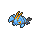
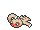
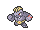

<!-- This file is generated by tools/generate_site.py. Edit the generator, not this file. -->

# Route 106

!!! tip "Wild Pokémon"

    See the [wild Pokémon of Route 106](../wild/route_106.md).

## Trainers

| ID | Trainer | Pokémon |
| --- | --- | --- |
| 033 | **Fisherman Ned** | { .icon loading=lazy } [Krabby](../pokemon/098.md) Lv. 15, { .icon loading=lazy } [Clauncher](../pokemon/692.md) Lv. 15, { .icon loading=lazy } [Goldeen](../pokemon/118.md) Lv. 15 |
| 032 | **Fisherman Elliot** | { .icon loading=lazy } [Magikarp](../pokemon/129.md) Lv. 15, { .icon loading=lazy } [Tentacool](../pokemon/072.md) Lv. 15, { .icon loading=lazy } [Barboach](../pokemon/339.md) Lv. 15 |
| 720 | **Backpacker Graeme** | { .icon loading=lazy } [Slakoth](../pokemon/287.md) Lv. 15, { .icon loading=lazy } [Exeggcute](../pokemon/102.md) Lv. 15, { .icon loading=lazy } [Patrat](../pokemon/504.md) Lv. 15 |
| 031 | **Swimmer Nicole** | { .icon loading=lazy } [Seaking](../pokemon/119.md) Lv. 36, { .icon loading=lazy } [Dewgong](../pokemon/087.md) Lv. 36, { .icon loading=lazy } [Prinplup](../pokemon/394.md) Lv. 36 |
| 163 | **Triathlete Caleb** | { .icon loading=lazy } [Simipour](../pokemon/516.md) Lv. 36, { .icon loading=lazy } [Starmie](../pokemon/121.md) Lv. 36, { .icon loading=lazy } [Seadra](../pokemon/117.md) Lv. 36 |
| 030 | **Swimmer Douglas** | { .icon loading=lazy } [Quagsire](../pokemon/195.md) Lv. 36, { .icon loading=lazy } [Dewott](../pokemon/502.md) Lv. 36, { .icon loading=lazy } [Whiscash](../pokemon/340.md) Lv. 36 |

## Rematches

| ID | Trainer | Pokémon |
| --- | --- | --- |
| 369 | **Fisherman Elliot** 2 | { .icon loading=lazy } [Magikarp](../pokemon/129.md) Lv. 16, { .icon loading=lazy } [Staryu](../pokemon/120.md) Lv. 16, { .icon loading=lazy } [Tentacool](../pokemon/072.md) Lv. 16, { .icon loading=lazy } [Barboach](../pokemon/339.md) Lv. 16 |
| 370 | **Fisherman Elliot** 5 | { .icon loading=lazy } [Gyarados](../pokemon/130.md) Lv. 39, { .icon loading=lazy } [Starmie](../pokemon/121.md) Lv. 39, { .icon loading=lazy } [Tentacruel](../pokemon/073.md) Lv. 39, { .icon loading=lazy } [Whiscash](../pokemon/340.md) Lv. 39 |
| 371 | **Fisherman Elliot** 7 | { .icon loading=lazy } [Gyarados](../pokemon/130.md) Lv. 59, { .icon loading=lazy } [Starmie](../pokemon/121.md) Lv. 59, { .icon loading=lazy } [Tentacruel](../pokemon/073.md) Lv. 59, { .icon loading=lazy } [Whiscash](../pokemon/340.md) Lv. 59 |
| 372 | **Fisherman Elliot** C | { .icon loading=lazy } [Gyarados](../pokemon/130.md) Lv. 75, { .icon loading=lazy } [Starmie](../pokemon/121.md) Lv. 75, { .icon loading=lazy } [Tentacruel](../pokemon/073.md) Lv. 75, { .icon loading=lazy } [Whiscash](../pokemon/340.md) Lv. 75 |
| 725 | **Backpacker Graeme** 3 | { .icon loading=lazy } [Vigoroth](../pokemon/288.md) Lv. 25, { .icon loading=lazy } [Exeggcute](../pokemon/102.md) Lv. 25, { .icon loading=lazy } [Watchog](../pokemon/505.md) Lv. 25 |
| 726 | **Backpacker Graeme** 4 | { .icon loading=lazy } [Vigoroth](../pokemon/288.md) Lv. 35, { .icon loading=lazy } [Exeggcute](../pokemon/102.md) Lv. 35, { .icon loading=lazy } [Watchog](../pokemon/505.md) Lv. 35, { .icon loading=lazy } [Machoke](../pokemon/067.md) Lv. 35 |
| 727 | **Backpacker Graeme** 6 | { .icon loading=lazy } [Slaking](../pokemon/289.md) Lv. 47, { .icon loading=lazy } [Exeggutor](../pokemon/103.md) Lv. 47, { .icon loading=lazy } [Watchog](../pokemon/505.md) Lv. 47, { .icon loading=lazy } [Machamp](../pokemon/068.md) Lv. 47 |
| 728 | **Backpacker Graeme** C | { .icon loading=lazy } [Slaking](../pokemon/289.md) Lv. 75, { .icon loading=lazy } [Exeggutor](../pokemon/103.md) Lv. 75, { .icon loading=lazy } [Watchog](../pokemon/505.md) Lv. 75, { .icon loading=lazy } [Machamp](../pokemon/068.md) Lv. 75 |

---

[:material-arrow-left: Rusturf Tunnel](rusturf_tunnel.md) · [All areas](index.md) · [Dewford Gym :material-arrow-right:](dewford_gym.md)
