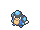

<!-- This file is generated by tools/generate_site.py. Edit the generator, not this file. -->

# Route 108

!!! tip "Wild Pokémon"

    See the [wild Pokémon of Route 108](../wild/route_108.md).

## Trainers

| ID | Trainer | Pokémon |
| --- | --- | --- |
| 040 | **Swimmer Jerome** | { .icon loading=lazy } [Palpitoad](../pokemon/536.md) Lv. 36, { .icon loading=lazy } [Binacle](../pokemon/688.md) Lv. 36, { .icon loading=lazy } [Sharpedo](../pokemon/319.md) Lv. 36 |
| 043 | **Swimmer Missy** | { .icon loading=lazy } [Milotic](../pokemon/350.md) Lv. 38 |
| 042 | **Swimmer Tara** | { .icon loading=lazy } [Vaporeon](../pokemon/134.md) Lv. 38 |
| 841 | **Ace Trainer Constance** | { .icon loading=lazy } [Eelektrik](../pokemon/603.md) Lv. 38, { .icon loading=lazy } [Drifblim](../pokemon/426.md) Lv. 38, { .icon loading=lazy } [Vanillish](../pokemon/583.md) Lv. 38 |
| 806 | **Ace Trainer Neville** | { .icon loading=lazy } [Nuzleaf](../pokemon/274.md) Lv. 38, { .icon loading=lazy } [Galvantula](../pokemon/596.md) Lv. 38, { .icon loading=lazy } [Clawitzer](../pokemon/693.md) Lv. 38 |
| 041 | **Swimmer Matthew** | { .icon loading=lazy } [Slowbro](../pokemon/080.md) Lv. 37, { .icon loading=lazy } [Slowking](../pokemon/199.md) Lv. 37 |

## Rematches

| ID | Trainer | Pokémon |
| --- | --- | --- |
| 810 | **Ace Trainer Neville** 6 | { .icon loading=lazy } [Shiftry](../pokemon/275.md) Lv. 47, { .icon loading=lazy } [Galvantula](../pokemon/596.md) Lv. 47, { .icon loading=lazy } [Clawitzer](../pokemon/693.md) Lv. 47, { .icon loading=lazy } [Braviary](../pokemon/628.md) Lv. 47 |
| 811 | **Ace Trainer Neville** 7 | { .icon loading=lazy } [Shiftry](../pokemon/275.md) Lv. 59, { .icon loading=lazy } [Galvantula](../pokemon/596.md) Lv. 59, { .icon loading=lazy } [Clawitzer](../pokemon/693.md) Lv. 59, { .icon loading=lazy } [Braviary](../pokemon/628.md) Lv. 59 |
| 812 | **Ace Trainer Neville** 8 | { .icon loading=lazy } [Shiftry](../pokemon/275.md) Lv. 64, { .icon loading=lazy } [Galvantula](../pokemon/596.md) Lv. 64, { .icon loading=lazy } [Clawitzer](../pokemon/693.md) Lv. 64, { .icon loading=lazy } [Braviary](../pokemon/628.md) Lv. 64 |
| 813 | **Ace Trainer Neville** C | { .icon loading=lazy } [Shiftry](../pokemon/275.md) Lv. 75, { .icon loading=lazy } [Galvantula](../pokemon/596.md) Lv. 75, { .icon loading=lazy } [Clawitzer](../pokemon/693.md) Lv. 75, { .icon loading=lazy } [Braviary](../pokemon/628.md) Lv. 75, { .icon loading=lazy } [Houndoom](../pokemon/229.md) Lv. 75 |

---

[:material-arrow-left: Route 105](route_105.md) · [All areas](index.md) · [Sea Mauville Outside :material-arrow-right:](sea_mauville_outside.md)
