<!-- This file is generated by tools/generate_site.py. Edit the generator, not this file. -->

# Route 109

!!! tip "Wild Pokémon"

    See the [wild Pokémon of Route 109](../wild/route_109.md).

## Trainers

| ID | Trainer | Pokémon |
| --- | --- | --- |
| 046 | **Sailor Huey** | { .icon loading=lazy } [Wingull](../pokemon/278.md) Lv. 17, 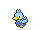{ .icon loading=lazy } [Ducklett](../pokemon/580.md) Lv. 17, 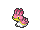{ .icon loading=lazy } [Shellos](../pokemon/422.md) Lv. 17 |
| 047 | **Sailor Edmond** | { .icon loading=lazy } [Shellder](../pokemon/090.md) Lv. 17, 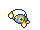{ .icon loading=lazy } [Chinchou](../pokemon/170.md) Lv. 17, { .icon loading=lazy } [Horsea](../pokemon/116.md) Lv. 17 |
| 564 | **Tuber Ricky** | { .icon loading=lazy } [Zigzagoon](../pokemon/263.md) Lv. 17, 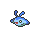{ .icon loading=lazy } [Mantyke](../pokemon/458.md) Lv. 17 |
| 565 | **Tuber Lola** | { .icon loading=lazy } [Psyduck](../pokemon/054.md) Lv. 17, 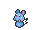{ .icon loading=lazy } [Azurill](../pokemon/298.md) Lv. 17 |
| 209 | **Tuber Simon** | { .icon loading=lazy } [Mudkip](../pokemon/258.md) Lv. 15, { .icon loading=lazy } [Oshawott](../pokemon/501.md) Lv. 15, { .icon loading=lazy } [Squirtle](../pokemon/007.md) Lv. 15, { .icon loading=lazy } [Totodile](../pokemon/158.md) Lv. 15 |
| 798 | **Delinquent Destinee** | 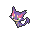{ .icon loading=lazy } [Purrloin](../pokemon/509.md) Lv. 19, { .icon loading=lazy } [Sableye](../pokemon/302.md) Lv. 19 |
| 799 | **Street Thug Blair** | { .icon loading=lazy } [Houndour](../pokemon/228.md) Lv. 19, 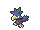{ .icon loading=lazy } [Murkrow](../pokemon/198.md) Lv. 19 |
| 515 | **Beauty Johanna** | { .icon loading=lazy } [Mawile](../pokemon/303.md) Lv. 19 |
| 208 | **Sailor Dwayne** | 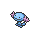{ .icon loading=lazy } [Wooper](../pokemon/194.md) Lv. 17, 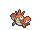{ .icon loading=lazy } [Corphish](../pokemon/341.md) Lv. 17, 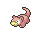{ .icon loading=lazy } [Slowpoke](../pokemon/079.md) Lv. 17 |
| 359 | **Tuber Gwen** | { .icon loading=lazy } [Azumarill](../pokemon/184.md) Lv. 37 |
| 361 | **Tuber Carmen** | { .icon loading=lazy } [Floatzel](../pokemon/419.md) Lv. 37 |
| 045 | **Swimmer Alice** | 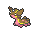{ .icon loading=lazy } [Gastrodon](../pokemon/423.md) Lv. 37, { .icon loading=lazy } [Gastrodon](../pokemon/423.md) Lv. 37 |
| 044 | **Swimmer David** | { .icon loading=lazy } [Octillery](../pokemon/224.md) Lv. 37, { .icon loading=lazy } [Cloyster](../pokemon/091.md) Lv. 37 |
| 633 | **Young Couple Mel & Paul** | 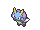{ .icon loading=lazy } [Illumise](../pokemon/314.md) Lv. 38, 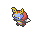{ .icon loading=lazy } [Volbeat](../pokemon/313.md) Lv. 38 |
| 360 | **Fisherman Carter** | { .icon loading=lazy } [Qwilfish](../pokemon/211.md) Lv. 38 |
| 815 | **Ace Trainer Portia** | { .icon loading=lazy } [Snorunt](../pokemon/361.md) Lv. 38, { .icon loading=lazy } [Magcargo](../pokemon/219.md) Lv. 38, 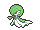{ .icon loading=lazy } [Gardevoir](../pokemon/282.md) Lv. 38 |

## Rematches

| ID | Trainer | Pokémon |
| --- | --- | --- |
| 598 | **Tuber Ricky** 4 | { .icon loading=lazy } [Linoone](../pokemon/264.md) Lv. 35, { .icon loading=lazy } [Mantine](../pokemon/226.md) Lv. 35, { .icon loading=lazy } [Floatzel](../pokemon/419.md) Lv. 35 |
| 599 | **Tuber Ricky** 6 | { .icon loading=lazy } [Linoone](../pokemon/264.md) Lv. 47, { .icon loading=lazy } [Mantine](../pokemon/226.md) Lv. 47, { .icon loading=lazy } [Floatzel](../pokemon/419.md) Lv. 47, { .icon loading=lazy } [Politoed](../pokemon/186.md) Lv. 47 |
| 600 | **Tuber Ricky** 7 | { .icon loading=lazy } [Linoone](../pokemon/264.md) Lv. 59, { .icon loading=lazy } [Mantine](../pokemon/226.md) Lv. 59, { .icon loading=lazy } [Floatzel](../pokemon/419.md) Lv. 59, { .icon loading=lazy } [Politoed](../pokemon/186.md) Lv. 59 |
| 601 | **Tuber Ricky** C | { .icon loading=lazy } [Linoone](../pokemon/264.md) Lv. 75, { .icon loading=lazy } [Mantine](../pokemon/226.md) Lv. 75, { .icon loading=lazy } [Floatzel](../pokemon/419.md) Lv. 75, { .icon loading=lazy } [Politoed](../pokemon/186.md) Lv. 75 |
| 373 | **Tuber Lola** 4 | { .icon loading=lazy } [Golduck](../pokemon/055.md) Lv. 35, { .icon loading=lazy } [Azumarill](../pokemon/184.md) Lv. 35, 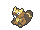{ .icon loading=lazy } [Bibarel](../pokemon/400.md) Lv. 35 |
| 374 | **Tuber Lola** 6 | { .icon loading=lazy } [Golduck](../pokemon/055.md) Lv. 47, { .icon loading=lazy } [Azumarill](../pokemon/184.md) Lv. 47, { .icon loading=lazy } [Bibarel](../pokemon/400.md) Lv. 47, { .icon loading=lazy } [Starmie](../pokemon/121.md) Lv. 47 |
| 375 | **Tuber Lola** 7 | { .icon loading=lazy } [Golduck](../pokemon/055.md) Lv. 59, { .icon loading=lazy } [Azumarill](../pokemon/184.md) Lv. 59, { .icon loading=lazy } [Bibarel](../pokemon/400.md) Lv. 59, { .icon loading=lazy } [Starmie](../pokemon/121.md) Lv. 59 |
| 376 | **Tuber Lola** C | { .icon loading=lazy } [Golduck](../pokemon/055.md) Lv. 75, { .icon loading=lazy } [Azumarill](../pokemon/184.md) Lv. 75, { .icon loading=lazy } [Bibarel](../pokemon/400.md) Lv. 75, { .icon loading=lazy } [Starmie](../pokemon/121.md) Lv. 75 |
| 819 | **Ace Trainer Portia** 6 | { .icon loading=lazy } [Froslass](../pokemon/478.md) Lv. 47, { .icon loading=lazy } [Magcargo](../pokemon/219.md) Lv. 47, { .icon loading=lazy } [Gardevoir](../pokemon/282.md) Lv. 47, { .icon loading=lazy } [Kecleon](../pokemon/352.md) Lv. 47 |
| 820 | **Ace Trainer Portia** 7 | { .icon loading=lazy } [Froslass](../pokemon/478.md) Lv. 59, { .icon loading=lazy } [Magcargo](../pokemon/219.md) Lv. 59, { .icon loading=lazy } [Gardevoir](../pokemon/282.md) Lv. 59, { .icon loading=lazy } [Kecleon](../pokemon/352.md) Lv. 59 |
| 821 | **Ace Trainer Portia** 8 | { .icon loading=lazy } [Froslass](../pokemon/478.md) Lv. 64, { .icon loading=lazy } [Magcargo](../pokemon/219.md) Lv. 64, { .icon loading=lazy } [Gardevoir](../pokemon/282.md) Lv. 64, { .icon loading=lazy } [Kecleon](../pokemon/352.md) Lv. 64 |
| 822 | **Ace Trainer Portia** C | { .icon loading=lazy } [Froslass](../pokemon/478.md) Lv. 75, { .icon loading=lazy } [Magcargo](../pokemon/219.md) Lv. 75, { .icon loading=lazy } [Gardevoir](../pokemon/282.md) Lv. 75, { .icon loading=lazy } [Kecleon](../pokemon/352.md) Lv. 75, { .icon loading=lazy } [Banette](../pokemon/354.md) Lv. 75 |

---

[:material-arrow-left: Route 107](route_107.md) · [All areas](index.md) · [Slateport City :material-arrow-right:](slateport_city.md)
