<!-- This file is generated by tools/generate_site.py. Edit the generator, not this file. -->

# Route 110

!!! tip "Wild Pokémon"

    See the [wild Pokémon of Route 110](../wild/route_110.md).

## Trainers - Main Area

| ID | Trainer | Pokémon |
| --- | --- | --- |
| 650 | **Poké Fan Isabel** | { .icon loading=lazy } [Emolga](../pokemon/587.md) Lv. 20, { .icon loading=lazy } [Pachirisu](../pokemon/417.md) Lv. 20, 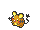{ .icon loading=lazy } [Dedenne](../pokemon/702.md) Lv. 20 |
| 305 | **Youngster Timmy** | { .icon loading=lazy } [Minccino](../pokemon/572.md) Lv. 20, 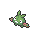{ .icon loading=lazy } [Trubbish](../pokemon/568.md) Lv. 20, 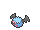{ .icon loading=lazy } [Woobat](../pokemon/527.md) Lv. 20 |
| 289 | **PKMN Trainer Brendan** | { .icon loading=lazy } [Swellow](../pokemon/277.md) Lv. 22, 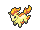{ .icon loading=lazy } [Ponyta](../pokemon/077.md) Lv. 22, { .icon loading=lazy } [Wailmer](../pokemon/320.md) Lv. 22, { .icon loading=lazy } [Grovyle](../pokemon/253.md) Lv. 24 |
| 290 | **PKMN Trainer Brendan** | { .icon loading=lazy } [Swellow](../pokemon/277.md) Lv. 22, { .icon loading=lazy } [Wailmer](../pokemon/320.md) Lv. 22, 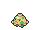{ .icon loading=lazy } [Shroomish](../pokemon/285.md) Lv. 22, { .icon loading=lazy } [Combusken](../pokemon/256.md) Lv. 24 |
| 291 | **PKMN Trainer Brendan** | { .icon loading=lazy } [Swellow](../pokemon/277.md) Lv. 22, { .icon loading=lazy } [Shroomish](../pokemon/285.md) Lv. 22, { .icon loading=lazy } [Ponyta](../pokemon/077.md) Lv. 22, { .icon loading=lazy } [Marshtomp](../pokemon/259.md) Lv. 24 |
| 295 | **PKMN Trainer May** | { .icon loading=lazy } [Swellow](../pokemon/277.md) Lv. 22, { .icon loading=lazy } [Ponyta](../pokemon/077.md) Lv. 22, { .icon loading=lazy } [Wailmer](../pokemon/320.md) Lv. 22, { .icon loading=lazy } [Grovyle](../pokemon/253.md) Lv. 24 |
| 296 | **PKMN Trainer May** | { .icon loading=lazy } [Swellow](../pokemon/277.md) Lv. 22, { .icon loading=lazy } [Wailmer](../pokemon/320.md) Lv. 22, { .icon loading=lazy } [Shroomish](../pokemon/285.md) Lv. 22, { .icon loading=lazy } [Combusken](../pokemon/256.md) Lv. 24 |
| 297 | **PKMN Trainer May** | { .icon loading=lazy } [Swellow](../pokemon/277.md) Lv. 22, { .icon loading=lazy } [Shroomish](../pokemon/285.md) Lv. 22, { .icon loading=lazy } [Ponyta](../pokemon/077.md) Lv. 22, { .icon loading=lazy } [Marshtomp](../pokemon/259.md) Lv. 24 |
| 053 | **Collector Edwin** | { .icon loading=lazy } [Cubone](../pokemon/104.md) Lv. 20, { .icon loading=lazy } [Lombre](../pokemon/271.md) Lv. 20, { .icon loading=lazy } [Nuzleaf](../pokemon/274.md) Lv. 20 |
| 565 | **Psychic Edward** | { .icon loading=lazy } [Abra](../pokemon/063.md) Lv. 20, 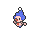{ .icon loading=lazy } [Mime Jr.](../pokemon/439.md) Lv. 20, { .icon loading=lazy } [Kadabra](../pokemon/064.md) Lv. 20 |
| 054 | **Fisherman Dale** | 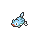{ .icon loading=lazy } [Remoraid](../pokemon/223.md) Lv. 20, { .icon loading=lazy } [Wailmer](../pokemon/320.md) Lv. 20, { .icon loading=lazy } [Clamperl](../pokemon/366.md) Lv. 20 |

## Rematches

| ID | Trainer | Pokémon |
| --- | --- | --- |
| 661 | **Poké Fan Isabel** 4 | { .icon loading=lazy } [Emolga](../pokemon/587.md) Lv. 35, { .icon loading=lazy } [Pachirisu](../pokemon/417.md) Lv. 35, { .icon loading=lazy } [Dedenne](../pokemon/702.md) Lv. 35 |
| 662 | **Poké Fan Isabel** 5 | { .icon loading=lazy } [Emolga](../pokemon/587.md) Lv. 39, { .icon loading=lazy } [Pachirisu](../pokemon/417.md) Lv. 39, { .icon loading=lazy } [Dedenne](../pokemon/702.md) Lv. 39, { .icon loading=lazy } [Pikachu](../pokemon/025.md) Lv. 39 |
| 663 | **Poké Fan Isabel** 6 | { .icon loading=lazy } [Emolga](../pokemon/587.md) Lv. 47, { .icon loading=lazy } [Pachirisu](../pokemon/417.md) Lv. 47, { .icon loading=lazy } [Dedenne](../pokemon/702.md) Lv. 47, { .icon loading=lazy } [Raichu](../pokemon/026.md) Lv. 47 |
| 664 | **Poké Fan Isabel** C | { .icon loading=lazy } [Emolga](../pokemon/587.md) Lv. 75, { .icon loading=lazy } [Pachirisu](../pokemon/417.md) Lv. 75, { .icon loading=lazy } [Dedenne](../pokemon/702.md) Lv. 75, { .icon loading=lazy } [Raichu](../pokemon/026.md) Lv. 75 |
| 385 | **Collector Edwin** 4 | { .icon loading=lazy } [Marowak](../pokemon/105.md) Lv. 35, { .icon loading=lazy } [Lombre](../pokemon/271.md) Lv. 35, { .icon loading=lazy } [Nuzleaf](../pokemon/274.md) Lv. 35, { .icon loading=lazy } [Kangaskhan](../pokemon/115.md) Lv. 35 |
| 386 | **Collector Edwin** 7 | { .icon loading=lazy } [Marowak](../pokemon/105.md) Lv. 59, { .icon loading=lazy } [Ludicolo](../pokemon/272.md) Lv. 59, { .icon loading=lazy } [Shiftry](../pokemon/275.md) Lv. 59, { .icon loading=lazy } [Kangaskhan](../pokemon/115.md) Lv. 59 |
| 387 | **Collector Edwin** 8 | { .icon loading=lazy } [Marowak](../pokemon/105.md) Lv. 64, { .icon loading=lazy } [Ludicolo](../pokemon/272.md) Lv. 64, { .icon loading=lazy } [Shiftry](../pokemon/275.md) Lv. 64, { .icon loading=lazy } [Kangaskhan](../pokemon/115.md) Lv. 64 |
| 388 | **Collector Edwin** C | { .icon loading=lazy } [Marowak](../pokemon/105.md) Lv. 75, { .icon loading=lazy } [Ludicolo](../pokemon/272.md) Lv. 75, { .icon loading=lazy } [Shiftry](../pokemon/275.md) Lv. 75, { .icon loading=lazy } [Kangaskhan](../pokemon/115.md) Lv. 75 |

## Trainers - Cycling Road

| ID | Trainer | Pokémon |
| --- | --- | --- |
| 074 | **Beauty Melissa** | 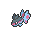{ .icon loading=lazy } [Finneon](../pokemon/456.md) Lv. 22, 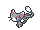{ .icon loading=lazy } [Glameow](../pokemon/431.md) Lv. 22, { .icon loading=lazy } [Snivy](../pokemon/495.md) Lv. 22 |
| 714 | **Triathelete Sloan** | { .icon loading=lazy } [Flaaffy](../pokemon/180.md) Lv. 24 |
| 049 | **Triathlete Jacob** | { .icon loading=lazy } [Pichu](../pokemon/172.md) Lv. 22, { .icon loading=lazy } [Pichu](../pokemon/172.md) Lv. 22, { .icon loading=lazy } [Pikachu](../pokemon/025.md) Lv. 22 |
| 050 | **Triathlete Anthony** | { .icon loading=lazy } [Plusle](../pokemon/311.md) Lv. 24 |
| 377 | **Triathlete Benjamin** | { .icon loading=lazy } [Voltorb](../pokemon/100.md) Lv. 23, { .icon loading=lazy } [Klink](../pokemon/599.md) Lv. 23 |
| 715 | **Triathlete Dolph** | { .icon loading=lazy } [Minun](../pokemon/312.md) Lv. 24 |

## Rematches

| ID | Trainer | Pokémon |
| --- | --- | --- |
| 377 | **Triathlete Benjamin** 4 | { .icon loading=lazy } [Klang](../pokemon/600.md) Lv. 35, { .icon loading=lazy } [Electrode](../pokemon/101.md) Lv. 35, { .icon loading=lazy } [Electabuzz](../pokemon/125.md) Lv. 35 |
| 378 | **Triathlete Benjamin** 6 | { .icon loading=lazy } [Klang](../pokemon/600.md) Lv. 47, { .icon loading=lazy } [Electrode](../pokemon/101.md) Lv. 47, { .icon loading=lazy } [Electivire](../pokemon/466.md) Lv. 47, { .icon loading=lazy } [Ampharos](../pokemon/181.md) Lv. 47 |
| 379 | **Triathlete Benjamin** 8 | { .icon loading=lazy } [Klinklang](../pokemon/601.md) Lv. 64, { .icon loading=lazy } [Electrode](../pokemon/101.md) Lv. 64, { .icon loading=lazy } [Electivire](../pokemon/466.md) Lv. 64, { .icon loading=lazy } [Ampharos](../pokemon/181.md) Lv. 64 |
| 380 | **Triathlete Benjamin** C | { .icon loading=lazy } [Klinklang](../pokemon/601.md) Lv. 75, { .icon loading=lazy } [Electrode](../pokemon/101.md) Lv. 75, { .icon loading=lazy } [Electivire](../pokemon/466.md) Lv. 75, { .icon loading=lazy } [Ampharos](../pokemon/181.md) Lv. 75 |

## Trainers - Trick House (Cut)

| ID | Trainer | Pokémon |
| --- | --- | --- |
| 211 | **Lass Sally** | { .icon loading=lazy } [Froakie](../pokemon/656.md) Lv. 20, { .icon loading=lazy } [Fennekin](../pokemon/653.md) Lv. 20, { .icon loading=lazy } [Chespin](../pokemon/650.md) Lv. 20 |
| 213 | **Battle Girl Cora** | 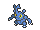{ .icon loading=lazy } [Heracross](../pokemon/214.md) Lv. 23 |
| 210 | **Youngster Eddie** | { .icon loading=lazy } [Turtwig](../pokemon/387.md) Lv. 20, { .icon loading=lazy } [Chimchar](../pokemon/390.md) Lv. 20, { .icon loading=lazy } [Piplup](../pokemon/393.md) Lv. 20 |

## Trainers - Trick House (Rock Smash)

| ID | Trainer | Pokémon |
| --- | --- | --- |
| 221 | **Black Belt Yuji** | 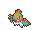{ .icon loading=lazy } [Hawlucha](../pokemon/701.md) Lv. 27 |
| 217 | **Schoolkid Georgie** | { .icon loading=lazy } [Pansear](../pokemon/513.md) Lv. 24, 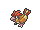{ .icon loading=lazy } [Pidgeotto](../pokemon/017.md) Lv. 24, { .icon loading=lazy } [Charmander](../pokemon/004.md) Lv. 24 |
| 222 | **PKMN Ranger Sebastian** | 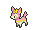{ .icon loading=lazy } [Deerling](../pokemon/585.md) Lv. 25, { .icon loading=lazy } [Weepinbell](../pokemon/070.md) Lv. 25, { .icon loading=lazy } [Ponyta](../pokemon/077.md) Lv. 25 |
| 223 | **PKMN Ranger Sophia** | { .icon loading=lazy } [Skiddo](../pokemon/672.md) Lv. 25, { .icon loading=lazy } [Gloom](../pokemon/044.md) Lv. 25, 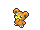{ .icon loading=lazy } [Teddiursa](../pokemon/216.md) Lv. 25 |

## Trainers - Trick House (Dark Room)

| ID | Trainer | Pokémon |
| --- | --- | --- |
| 212 | **Lass Robin** | { .icon loading=lazy } [Paras](../pokemon/046.md) Lv. 24, 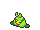{ .icon loading=lazy } [Swadloon](../pokemon/541.md) Lv. 24, { .icon loading=lazy } [Pansage](../pokemon/511.md) Lv. 24 |
| 829 | **Ace Duo Pike & Shiel** | { .icon loading=lazy } [Vaporeon](../pokemon/134.md) Lv. 28, { .icon loading=lazy } [Flareon](../pokemon/136.md) Lv. 28 |
| 215 | **Schoolkid Ted** | { .icon loading=lazy } [Panpour](../pokemon/515.md) Lv. 24, 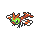{ .icon loading=lazy } [Yanma](../pokemon/193.md) Lv. 24, 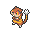{ .icon loading=lazy } [Watchog](../pokemon/505.md) Lv. 24 |

## Special Battle - Rival

=== "Treecko"

    | Pokémon | Lv. | Item | Ability | Moves |
    | --- | --- | --- | --- | --- |
    | { .icon loading=lazy } [Swellow](../pokemon/277.md) | 22 | { .item loading=lazy } Silk Scarf | <abbr title="Increases Attack to 1.5× with a major status ailment.">Guts</abbr> | Brave Bird, Quick Attack, Focus Energy, Double Team |
    | { .icon loading=lazy } [Ponyta](../pokemon/077.md) | 22 | 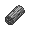{ .item loading=lazy } Charcoal | <abbr title="Has a 30% chance of burning attacking Pokémon on contact.">Flame Body</abbr> | Flame Charge, Double Kick, Stomp, Hypnosis |
    | { .icon loading=lazy } [Wailmer](../pokemon/320.md) | 22 | { .item loading=lazy } Mystic Water | <abbr title="Prevents burns.">Water Veil</abbr> | Water Pulse, Rollout, Fissure, Body Slam |
    | { .icon loading=lazy } [Grovyle](../pokemon/253.md) | 24 | { .item loading=lazy } Sitrus Berry | <abbr title="Strengthens Grass moves to inflict 1.5× damage at 1/3 max HP or less.">Overgrow</abbr> | [Grass Pledge](../changes/moves.md#grass-pledge) changed, Aerial Ace, Dragon Breath, Grass Whistle |

=== "Torchic"

    | Pokémon | Lv. | Item | Ability | Moves |
    | --- | --- | --- | --- | --- |
    | { .icon loading=lazy } [Swellow](../pokemon/277.md) | 22 | { .item loading=lazy } Silk Scarf | <abbr title="Increases Attack to 1.5× with a major status ailment.">Guts</abbr> | Brave Bird, Quick Attack, Focus Energy, Double Team |
    | { .icon loading=lazy } [Wailmer](../pokemon/320.md) | 22 | { .item loading=lazy } Mystic Water | <abbr title="Prevents burns.">Water Veil</abbr> | Water Pulse, Rollout, Fissure, Body Slam |
    | { .icon loading=lazy } [Shroomish](../pokemon/285.md) | 22 | { .item loading=lazy } Miracle Seed | <abbr title="Increases Speed to 1.5× with a major status ailment.">Quick Feet</abbr> | Bullet Seed, Toxic, Headbutt, Leech Seed |
    | { .icon loading=lazy } [Combusken](../pokemon/256.md) | 24 | { .item loading=lazy } Sitrus Berry | <abbr title="Strengthens Fire moves to inflict 1.5× damage at 1/3 max HP or less.">Blaze</abbr> | [Fire Pledge](../changes/moves.md#fire-pledge) changed, Double Kick, Aerial Ace, Feather Dance |

=== "Mudkip"

    | Pokémon | Lv. | Item | Ability | Moves |
    | --- | --- | --- | --- | --- |
    | { .icon loading=lazy } [Swellow](../pokemon/277.md) | 22 | { .item loading=lazy } Silk Scarf | <abbr title="Increases Attack to 1.5× with a major status ailment.">Guts</abbr> | Brave Bird, Quick Attack, Focus Energy, Double Team |
    | { .icon loading=lazy } [Shroomish](../pokemon/285.md) | 22 | { .item loading=lazy } Miracle Seed | <abbr title="Increases Speed to 1.5× with a major status ailment.">Quick Feet</abbr> | Bullet Seed, Toxic, Headbutt, Leech Seed |
    | { .icon loading=lazy } [Ponyta](../pokemon/077.md) | 22 | { .item loading=lazy } Charcoal | <abbr title="Has a 30% chance of burning attacking Pokémon on contact.">Flame Body</abbr> | Flame Charge, Double Kick, Stomp, Hypnosis |
    | { .icon loading=lazy } [Marshtomp](../pokemon/259.md) | 24 | { .item loading=lazy } Sitrus Berry | <abbr title="Strengthens Water moves to inflict 1.5× damage at 1/3 max HP or less.">Torrent</abbr> | [Water Pledge](../changes/moves.md#water-pledge) changed, Dig, Rock Tomb, Curse |

---

[:material-arrow-left: Slateport City](slateport_city.md) · [All areas](index.md) · [Mauville City :material-arrow-right:](mauville_city.md)
