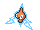
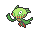

<!-- This file is generated by tools/generate_site.py. Edit the generator, not this file. -->

# Route 111

!!! tip "Wild Pokémon"

    See the [wild Pokémon of Route 111](../wild/route_111.md).

## Trainers

| ID | Trainer | Pokémon |
| --- | --- | --- |
| 641 | **The Winstrates' Victor** | { .icon loading=lazy } [Delcatty](../pokemon/301.md) Lv. 25, { .icon loading=lazy } [Wigglytuff](../pokemon/040.md) Lv. 25 |
| 642 | **The Winstrates' Victoria** | { .icon loading=lazy } [Bellossom](../pokemon/182.md) Lv. 25, { .icon loading=lazy } [Roserade](../pokemon/407.md) Lv. 25 |
| 076 | **The Winstrates' Vivi** | { .icon loading=lazy } [Cloyster](../pokemon/091.md) Lv. 25, { .icon loading=lazy } [Starmie](../pokemon/121.md) Lv. 25 |
| 578 | **The Winstrates' Vicky** | { .icon loading=lazy } [Machamp](../pokemon/068.md) Lv. 28 |
| 173 | **Interviewers Gabby & Ty** | { .icon loading=lazy } [Magnemite](../pokemon/081.md) Lv. 25, { .icon loading=lazy } [Whismur](../pokemon/293.md) Lv. 25, { .icon loading=lazy } [Porygon](../pokemon/137.md) Lv. 25, { .icon loading=lazy } [Rotom](../pokemon/479.md) Lv. 25 |
| 308 | **Picknicker Irene** | { .icon loading=lazy } [Meowth](../pokemon/052.md) Lv. 24, { .icon loading=lazy } [Espurr](../pokemon/677.md) Lv. 24, { .icon loading=lazy } [Hoothoot](../pokemon/163.md) Lv. 24 |
| 309 | **Camper Travis** | { .icon loading=lazy } [Ekans](../pokemon/023.md) Lv. 23, { .icon loading=lazy } [Diglett](../pokemon/050.md) Lv. 23, { .icon loading=lazy } [Slugma](../pokemon/218.md) Lv. 23, { .icon loading=lazy } [Pawniard](../pokemon/624.md) Lv. 23 |
| 721 | **Backpacker Emory** | { .icon loading=lazy } [Heatmor](../pokemon/631.md) Lv. 25, { .icon loading=lazy } [Carnivine](../pokemon/455.md) Lv. 25 |
| 310 | **Ace Trainer Wilton** | { .icon loading=lazy } [Zebstrika](../pokemon/523.md) Lv. 29, { .icon loading=lazy } [Scyther](../pokemon/123.md) Lv. 29, { .icon loading=lazy } [Quagsire](../pokemon/195.md) Lv. 29 |
| 762 | **Fairy Tale Girl Cece** | { .icon loading=lazy } [Snubbull](../pokemon/209.md) Lv. 28, { .icon loading=lazy } [Mr. Mime](../pokemon/122.md) Lv. 28 |
| 722 | **Backpacker Deon** | { .icon loading=lazy } [Linoone](../pokemon/264.md) Lv. 27, { .icon loading=lazy } [Bibarel](../pokemon/400.md) Lv. 27, { .icon loading=lazy } [Diggersby](../pokemon/660.md) Lv. 27 |
| 311 | **Ace Trainer Brooke** | { .icon loading=lazy } [Ninetales](../pokemon/038.md) Lv. 29, { .icon loading=lazy } [Miltank](../pokemon/241.md) Lv. 29, { .icon loading=lazy } [Leavanny](../pokemon/542.md) Lv. 29 |

## Rematches

| ID | Trainer | Pokémon |
| --- | --- | --- |
| 174 | **Interviewers Gabby & Ty** 5 | { .icon loading=lazy } [Magneton](../pokemon/082.md) Lv. 39, { .icon loading=lazy } [Loudred](../pokemon/294.md) Lv. 39, { .icon loading=lazy } [Porygon2](../pokemon/233.md) Lv. 39, { .icon loading=lazy } [Rotom](../pokemon/479.md) Lv. 39 |
| 175 | **Interviewers Gabby & Ty** 6 | { .icon loading=lazy } [Magnezone](../pokemon/462.md) Lv. 47, { .icon loading=lazy } [Exploud](../pokemon/295.md) Lv. 47, { .icon loading=lazy } [Porygon2](../pokemon/233.md) Lv. 47, { .icon loading=lazy } [Rotom](../pokemon/479.md) Lv. 47 |
| 176 | **Interviewers Gabby & Ty** 7 | { .icon loading=lazy } [Magnezone](../pokemon/462.md) Lv. 59, { .icon loading=lazy } [Exploud](../pokemon/295.md) Lv. 59, { .icon loading=lazy } [Porygon-Z](../pokemon/474.md) Lv. 59, { .icon loading=lazy } [Rotom](../pokemon/479.md) Lv. 59 |
| 177 | **Interviewers Gabby & Ty** 8 | { .icon loading=lazy } [Magnezone](../pokemon/462.md) Lv. 64, { .icon loading=lazy } [Exploud](../pokemon/295.md) Lv. 64, { .icon loading=lazy } [Porygon-Z](../pokemon/474.md) Lv. 64, { .icon loading=lazy } [Rotom](../pokemon/479.md) Lv. 64 |
| 582 | **Interviewers Gabby & Ty** C | { .icon loading=lazy } [Magnezone](../pokemon/462.md) Lv. 75, { .icon loading=lazy } [Exploud](../pokemon/295.md) Lv. 75, { .icon loading=lazy } [Porygon-Z](../pokemon/474.md) Lv. 75, { .icon loading=lazy } [Rotom](../pokemon/479.md) Lv. 75 |
| 389 | **Ace Trainer Wilton** 4 | { .icon loading=lazy } [Zebstrika](../pokemon/523.md) Lv. 35, { .icon loading=lazy } [Scyther](../pokemon/123.md) Lv. 35, { .icon loading=lazy } [Quagsire](../pokemon/195.md) Lv. 35, { .icon loading=lazy } [Torkoal](../pokemon/324.md) Lv. 35 |
| 390 | **Ace Trainer Wilton** 6 | { .icon loading=lazy } [Zebstrika](../pokemon/523.md) Lv. 47, { .icon loading=lazy } [Scizor](../pokemon/212.md) Lv. 47, { .icon loading=lazy } [Quagsire](../pokemon/195.md) Lv. 47, { .icon loading=lazy } [Torkoal](../pokemon/324.md) Lv. 47 |
| 391 | **Ace Trainer Wilton** 8 | { .icon loading=lazy } [Zebstrika](../pokemon/523.md) Lv. 64, { .icon loading=lazy } [Scizor](../pokemon/212.md) Lv. 64, { .icon loading=lazy } [Quagsire](../pokemon/195.md) Lv. 64, { .icon loading=lazy } [Torkoal](../pokemon/324.md) Lv. 64 |
| 392 | **Ace Trainer Wilton** C | { .icon loading=lazy } [Zebstrika](../pokemon/523.md) Lv. 75, { .icon loading=lazy } [Scizor](../pokemon/212.md) Lv. 75, { .icon loading=lazy } [Quagsire](../pokemon/195.md) Lv. 75, { .icon loading=lazy } [Torkoal](../pokemon/324.md) Lv. 75, { .icon loading=lazy } [Venusaur](../pokemon/003.md) Lv. 75 |
| 393 | **Ace Trainer Brooke** 4 | { .icon loading=lazy } [Ninetales](../pokemon/038.md) Lv. 35, { .icon loading=lazy } [Miltank](../pokemon/241.md) Lv. 35, { .icon loading=lazy } [Leavanny](../pokemon/542.md) Lv. 35, { .icon loading=lazy } [Lapras](../pokemon/131.md) Lv. 35 |
| 394 | **Ace Trainer Brooke** 6 | { .icon loading=lazy } [Ninetales](../pokemon/038.md) Lv. 47, { .icon loading=lazy } [Miltank](../pokemon/241.md) Lv. 47, { .icon loading=lazy } [Leavanny](../pokemon/542.md) Lv. 47, { .icon loading=lazy } [Lapras](../pokemon/131.md) Lv. 47 |
| 395 | **Ace Trainer Brooke** 8 | { .icon loading=lazy } [Ninetales](../pokemon/038.md) Lv. 64, { .icon loading=lazy } [Miltank](../pokemon/241.md) Lv. 64, { .icon loading=lazy } [Leavanny](../pokemon/542.md) Lv. 64, { .icon loading=lazy } [Lapras](../pokemon/131.md) Lv. 64 |
| 396 | **Ace Trainer Brooke** C | { .icon loading=lazy } [Ninetales](../pokemon/038.md) Lv. 75, { .icon loading=lazy } [Miltank](../pokemon/241.md) Lv. 75, { .icon loading=lazy } [Leavanny](../pokemon/542.md) Lv. 75, { .icon loading=lazy } [Lapras](../pokemon/131.md) Lv. 75, { .icon loading=lazy } [Steelix](../pokemon/208.md) Lv. 75 |

---

[:material-arrow-left: Granite Cave B2F](granite_cave_b2f.md) · [All areas](index.md) · [Route 112 South :material-arrow-right:](route_112_south.md)
