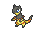

<!-- This file is generated by tools/generate_site.py. Edit the generator, not this file. -->

# Route 111 (Desert)

!!! tip "Wild Pokémon"

    See the [wild Pokémon of Route 111 (Desert)](../wild/route_111_desert.md).

## Trainers

| ID | Trainer | Pokémon |
| --- | --- | --- |
| 575 | **Camper Cliff** | { .icon loading=lazy } [Gabite](../pokemon/444.md) Lv. 35, { .icon loading=lazy } [Sandslash](../pokemon/028.md) Lv. 35, { .icon loading=lazy } [Cacturne](../pokemon/332.md) Lv. 35 |
| 574 | **Picnicker Heidi** | { .icon loading=lazy } [Hippopotas](../pokemon/449.md) Lv. 35, { .icon loading=lazy } [Baltoy](../pokemon/343.md) Lv. 35, { .icon loading=lazy } [Hippowdon](../pokemon/450.md) Lv. 35 |
| 573 | **Camper Drew** | { .icon loading=lazy } [Krokorok](../pokemon/552.md) Lv. 35, { .icon loading=lazy } [Vibrava](../pokemon/329.md) Lv. 35, { .icon loading=lazy } [Heliolisk](../pokemon/695.md) Lv. 35 |
| 576 | **Picnicker Becky** | { .icon loading=lazy } [Crustle](../pokemon/558.md) Lv. 36, { .icon loading=lazy } [Cinccino](../pokemon/573.md) Lv. 36 |
| 312 | **Black Belt Daisuke** | { .icon loading=lazy } [Machoke](../pokemon/067.md) Lv. 37, { .icon loading=lazy } [Medicham](../pokemon/308.md) Lv. 37 |
| 577 | **Ruin Maniac Dusty** | { .icon loading=lazy } [Sigilyph](../pokemon/561.md) Lv. 36, { .icon loading=lazy } [Claydol](../pokemon/344.md) Lv. 36 |

## Rematches

| ID | Trainer | Pokémon |
| --- | --- | --- |
| 602 | **Ruin Maniac Dusty** 5 | { .icon loading=lazy } [Sigilyph](../pokemon/561.md) Lv. 39, { .icon loading=lazy } [Claydol](../pokemon/344.md) Lv. 39, { .icon loading=lazy } [Aerodactyl](../pokemon/142.md) Lv. 39 |
| 603 | **Ruin Maniac Dusty** 6 | { .icon loading=lazy } [Sigilyph](../pokemon/561.md) Lv. 47, { .icon loading=lazy } [Claydol](../pokemon/344.md) Lv. 47, { .icon loading=lazy } [Aerodactyl](../pokemon/142.md) Lv. 47, { .icon loading=lazy } [Omastar](../pokemon/139.md) Lv. 47, { .icon loading=lazy } [Kabutops](../pokemon/141.md) Lv. 47 |
| 604 | **Ruin Maniac Dusty** 7 | { .icon loading=lazy } [Sigilyph](../pokemon/561.md) Lv. 59, { .icon loading=lazy } [Claydol](../pokemon/344.md) Lv. 59, { .icon loading=lazy } [Aerodactyl](../pokemon/142.md) Lv. 59, { .icon loading=lazy } [Omastar](../pokemon/139.md) Lv. 59, { .icon loading=lazy } [Kabutops](../pokemon/141.md) Lv. 59 |
| 605 | **Ruin Maniac Dusty** C | { .icon loading=lazy } [Sigilyph](../pokemon/561.md) Lv. 75, { .icon loading=lazy } [Claydol](../pokemon/344.md) Lv. 75, { .icon loading=lazy } [Aerodactyl](../pokemon/142.md) Lv. 75, { .icon loading=lazy } [Omastar](../pokemon/139.md) Lv. 75, { .icon loading=lazy } [Kabutops](../pokemon/141.md) Lv. 75 |

---

[:material-arrow-left: Lavaridge Gym](lavaridge_gym.md) · [All areas](index.md) · [Petalburg Gym :material-arrow-right:](petalburg_gym.md)
