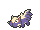

<!-- This file is generated by tools/generate_site.py. Edit the generator, not this file. -->

# Route 113

!!! tip "Wild Pokémon"

    See the [wild Pokémon of Route 113](../wild/route_113.md).

## Trainers

| ID | Trainer | Pokémon |
| --- | --- | --- |
| 086 | **Youngster Neal** | { .icon loading=lazy } [Trapinch](../pokemon/328.md) Lv. 28, { .icon loading=lazy } [Drowzee](../pokemon/096.md) Lv. 28, { .icon loading=lazy } [Ferroseed](../pokemon/597.md) Lv. 28 |
| 591 | **Ninja Boy Lao** | { .icon loading=lazy } [Koffing](../pokemon/109.md) Lv. 28, { .icon loading=lazy } [Shelmet](../pokemon/616.md) Lv. 28, { .icon loading=lazy } [Whirlipede](../pokemon/544.md) Lv. 28 |
| 579 | **Parasol Lady Madeline** | { .icon loading=lazy } [Numel](../pokemon/322.md) Lv. 28, { .icon loading=lazy } [Vanillite](../pokemon/582.md) Lv. 28, { .icon loading=lazy } [Munna](../pokemon/517.md) Lv. 28 |
| 087 | **Youngster Dillion** | { .icon loading=lazy } [Cacnea](../pokemon/331.md) Lv. 28, { .icon loading=lazy } [Spoink](../pokemon/325.md) Lv. 28, { .icon loading=lazy } [Stunky](../pokemon/434.md) Lv. 28 |
| 314 | **Ninja Boy Lung** | { .icon loading=lazy } [Dustox](../pokemon/269.md) Lv. 28, { .icon loading=lazy } [Sneasel](../pokemon/215.md) Lv. 28, { .icon loading=lazy } [Ninjask](../pokemon/291.md) Lv. 28 |
| 767 | **Fairy Tale Girl Franny** | { .icon loading=lazy } [Swirlix](../pokemon/684.md) Lv. 28, { .icon loading=lazy } [Spritzee](../pokemon/682.md) Lv. 28, { .icon loading=lazy } [Togetic](../pokemon/176.md) Lv. 28 |

## Rematches

| ID | Trainer | Pokémon |
| --- | --- | --- |
| 914 | **Ninja Boy Lao** 4 | { .icon loading=lazy } [Weezing](../pokemon/110.md) Lv. 35, { .icon loading=lazy } [Accelgor](../pokemon/617.md) Lv. 35, { .icon loading=lazy } [Scolipede](../pokemon/545.md) Lv. 35, { .icon loading=lazy } [Escavalier](../pokemon/589.md) Lv. 35 |
| 915 | **Ninja Boy Lao** 6 | { .icon loading=lazy } [Weezing](../pokemon/110.md) Lv. 47, { .icon loading=lazy } [Accelgor](../pokemon/617.md) Lv. 47, { .icon loading=lazy } [Scolipede](../pokemon/545.md) Lv. 47, { .icon loading=lazy } [Escavalier](../pokemon/589.md) Lv. 47 |
| 916 | **Ninja Boy Lao** 8 | { .icon loading=lazy } [Weezing](../pokemon/110.md) Lv. 64, { .icon loading=lazy } [Accelgor](../pokemon/617.md) Lv. 64, { .icon loading=lazy } [Scolipede](../pokemon/545.md) Lv. 64, { .icon loading=lazy } [Escavalier](../pokemon/589.md) Lv. 64 |
| 917 | **Ninja Boy Lao** C | { .icon loading=lazy } [Weezing](../pokemon/110.md) Lv. 75, { .icon loading=lazy } [Accelgor](../pokemon/617.md) Lv. 75, { .icon loading=lazy } [Scolipede](../pokemon/545.md) Lv. 75, { .icon loading=lazy } [Escavalier](../pokemon/589.md) Lv. 75 |
| 619 | **Parasol Lady Madeline** 4 | { .icon loading=lazy } [Camerupt](../pokemon/323.md) Lv. 35, { .icon loading=lazy } [Vanillish](../pokemon/583.md) Lv. 35, { .icon loading=lazy } [Musharna](../pokemon/518.md) Lv. 35 |
| 620 | **Parasol Lady Madeline** 6 | { .icon loading=lazy } [Camerupt](../pokemon/323.md) Lv. 47, { .icon loading=lazy } [Vanilluxe](../pokemon/584.md) Lv. 47, { .icon loading=lazy } [Musharna](../pokemon/518.md) Lv. 47, { .icon loading=lazy } [Starmie](../pokemon/121.md) Lv. 47 |
| 621 | **Parasol Lady Madeline** 8 | { .icon loading=lazy } [Camerupt](../pokemon/323.md) Lv. 64, { .icon loading=lazy } [Vanilluxe](../pokemon/584.md) Lv. 64, { .icon loading=lazy } [Musharna](../pokemon/518.md) Lv. 64, { .icon loading=lazy } [Starmie](../pokemon/121.md) Lv. 64 |
| 622 | **Parasol Lady Madeline** C | { .icon loading=lazy } [Camerupt](../pokemon/323.md) Lv. 75, { .icon loading=lazy } [Vanilluxe](../pokemon/584.md) Lv. 75, { .icon loading=lazy } [Musharna](../pokemon/518.md) Lv. 75, { .icon loading=lazy } [Starmie](../pokemon/121.md) Lv. 75 |

---

[:material-arrow-left: Route 112 North](route_112_north.md) · [All areas](index.md) · [Route 114 :material-arrow-right:](route_114.md)
