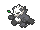
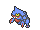

<!-- This file is generated by tools/generate_site.py. Edit the generator, not this file. -->

# Route 115

!!! tip "Wild Pokémon"

    See the [wild Pokémon of Route 115](../wild/route_115.md).

## Trainers

| ID | Trainer | Pokémon |
| --- | --- | --- |
| 098 | **Battle Girl Cyndy** | { .icon loading=lazy } [Throh](../pokemon/538.md) Lv. 33, { .icon loading=lazy } [Breloom](../pokemon/286.md) Lv. 33 |
| 097 | **Black Belt Nob** | { .icon loading=lazy } [Sawk](../pokemon/539.md) Lv. 33, { .icon loading=lazy } [Pangoro](../pokemon/675.md) Lv. 33 |
| 315 | **Collector Hector (Ru)** | { .icon loading=lazy } [Masquerain](../pokemon/284.md) Lv. 31, { .icon loading=lazy } [Zangoose](../pokemon/335.md) Lv. 31, { .icon loading=lazy } [Seviper](../pokemon/336.md) Lv. 31 |
| 099 | **Collector Hector (As)** | { .icon loading=lazy } [Masquerain](../pokemon/284.md) Lv. 31, { .icon loading=lazy } [Zangoose](../pokemon/335.md) Lv. 31, { .icon loading=lazy } [Seviper](../pokemon/336.md) Lv. 31 |
| 096 | **Black Belt Koichi** | { .icon loading=lazy } [Gurdurr](../pokemon/533.md) Lv. 37, { .icon loading=lazy } [Toxicroak](../pokemon/454.md) Lv. 37, { .icon loading=lazy } [Chesnaught](../pokemon/652.md) Lv. 37 |
| 095 | **Expert Timothy** | { .icon loading=lazy } [Hitmonlee](../pokemon/106.md) Lv. 38, { .icon loading=lazy } [Hitmonchan](../pokemon/107.md) Lv. 38, { .icon loading=lazy } [Hitmontop](../pokemon/237.md) Lv. 38 |
| 786 | **Ruin Maniac Hayes** | { .icon loading=lazy } [Archeops](../pokemon/567.md) Lv. 36, { .icon loading=lazy } [Carracosta](../pokemon/565.md) Lv. 36, { .icon loading=lazy } [Aerodactyl](../pokemon/142.md) Lv. 36 |

## Rematches

| ID | Trainer | Pokémon |
| --- | --- | --- |
| 409 | **Battle Girl Cyndy** 5 | { .icon loading=lazy } [Throh](../pokemon/538.md) Lv. 39, { .icon loading=lazy } [Breloom](../pokemon/286.md) Lv. 39, { .icon loading=lazy } [Hitmonchan](../pokemon/107.md) Lv. 39 |
| 410 | **Battle Girl Cyndy** 7 | { .icon loading=lazy } [Throh](../pokemon/538.md) Lv. 59, { .icon loading=lazy } [Breloom](../pokemon/286.md) Lv. 59, { .icon loading=lazy } [Hitmonchan](../pokemon/107.md) Lv. 59, { .icon loading=lazy } [Conkeldurr](../pokemon/534.md) Lv. 59 |
| 411 | **Battle Girl Cyndy** 8 | { .icon loading=lazy } [Throh](../pokemon/538.md) Lv. 64, { .icon loading=lazy } [Breloom](../pokemon/286.md) Lv. 64, { .icon loading=lazy } [Hitmonchan](../pokemon/107.md) Lv. 64, { .icon loading=lazy } [Conkeldurr](../pokemon/534.md) Lv. 64 |
| 412 | **Battle Girl Cyndy** C | { .icon loading=lazy } [Throh](../pokemon/538.md) Lv. 75, { .icon loading=lazy } [Breloom](../pokemon/286.md) Lv. 75, { .icon loading=lazy } [Hitmonlee](../pokemon/106.md) Lv. 75, { .icon loading=lazy } [Conkeldurr](../pokemon/534.md) Lv. 75 |
| 203 | **Black Belt Nob** 5 | { .icon loading=lazy } [Sawk](../pokemon/539.md) Lv. 39, { .icon loading=lazy } [Pangoro](../pokemon/675.md) Lv. 39, { .icon loading=lazy } [Hitmonlee](../pokemon/106.md) Lv. 39 |
| 204 | **Black Belt Nob** 7 | { .icon loading=lazy } [Sawk](../pokemon/539.md) Lv. 59, { .icon loading=lazy } [Pangoro](../pokemon/675.md) Lv. 59, { .icon loading=lazy } [Hitmonlee](../pokemon/106.md) Lv. 59, { .icon loading=lazy } [Machamp](../pokemon/068.md) Lv. 59 |
| 205 | **Black Belt Nob** 8 | { .icon loading=lazy } [Sawk](../pokemon/539.md) Lv. 64, { .icon loading=lazy } [Pangoro](../pokemon/675.md) Lv. 64, { .icon loading=lazy } [Hitmonlee](../pokemon/106.md) Lv. 64, { .icon loading=lazy } [Machamp](../pokemon/068.md) Lv. 64 |
| 643 | **Black Belt Nob** C | { .icon loading=lazy } [Sawk](../pokemon/539.md) Lv. 75, { .icon loading=lazy } [Pangoro](../pokemon/675.md) Lv. 75, { .icon loading=lazy } [Hitmonlee](../pokemon/106.md) Lv. 75, { .icon loading=lazy } [Machamp](../pokemon/068.md) Lv. 75 |
| 606 | **Expert Timothy** 5 | { .icon loading=lazy } [Hitmonlee](../pokemon/106.md) Lv. 40, { .icon loading=lazy } [Hitmonchan](../pokemon/107.md) Lv. 40, { .icon loading=lazy } [Hitmontop](../pokemon/237.md) Lv. 40 |
| 607 | **Expert Timothy** 7 | { .icon loading=lazy } [Hitmonlee](../pokemon/106.md) Lv. 59, { .icon loading=lazy } [Hitmonchan](../pokemon/107.md) Lv. 59, { .icon loading=lazy } [Hitmontop](../pokemon/237.md) Lv. 59, { .icon loading=lazy } [Hariyama](../pokemon/297.md) Lv. 59 |
| 608 | **Expert Timothy** 8 | { .icon loading=lazy } [Hitmonlee](../pokemon/106.md) Lv. 64, { .icon loading=lazy } [Hitmonchan](../pokemon/107.md) Lv. 64, { .icon loading=lazy } [Hitmontop](../pokemon/237.md) Lv. 64, { .icon loading=lazy } [Hariyama](../pokemon/297.md) Lv. 64 |
| 609 | **Expert Timothy** C | { .icon loading=lazy } [Hitmonlee](../pokemon/106.md) Lv. 75, { .icon loading=lazy } [Hitmonchan](../pokemon/107.md) Lv. 75, { .icon loading=lazy } [Hitmontop](../pokemon/237.md) Lv. 75, { .icon loading=lazy } [Hariyama](../pokemon/297.md) Lv. 75, { .icon loading=lazy } [Heracross](../pokemon/214.md) Lv. 75 |

---

[:material-arrow-left: Sea Mauville Inside](sea_mauville_inside.md) · [All areas](index.md) · [Route 118 :material-arrow-right:](route_118.md)
