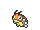

<!-- This file is generated by tools/generate_site.py. Edit the generator, not this file. -->

# Route 116

!!! tip "Wild Pokémon"

    See the [wild Pokémon of Route 116](../wild/route_116.md).

## Trainers

| ID | Trainer | Pokémon |
| --- | --- | --- |
| 023 | **Youngster Joey** | { .icon loading=lazy } [Rattata](../pokemon/019.md) Lv. 12, { .icon loading=lazy } [Shinx](../pokemon/403.md) Lv. 12, { .icon loading=lazy } [Phanpy](../pokemon/231.md) Lv. 12 |
| 024 | **Bug Catcher Jose** | { .icon loading=lazy } [Ledyba](../pokemon/165.md) Lv. 11, { .icon loading=lazy } [Spinarak](../pokemon/167.md) Lv. 11, { .icon loading=lazy } [Combee](../pokemon/415.md) Lv. 11, { .icon loading=lazy } [Burmy](../pokemon/412.md) Lv. 11 |
| 025 | **Lass Janice** | { .icon loading=lazy } [Flabébé](../pokemon/669.md) Lv. 12, { .icon loading=lazy } [Mareep](../pokemon/179.md) Lv. 12, { .icon loading=lazy } [Skitty](../pokemon/300.md) Lv. 12 |
| 273 | **Hiker Clark** | { .icon loading=lazy } [Rhyhorn](../pokemon/111.md) Lv. 12, { .icon loading=lazy } [Larvitar](../pokemon/246.md) Lv. 12, { .icon loading=lazy } [Aron](../pokemon/304.md) Lv. 12 |
| 018 | **Schoolkid Jerry** | { .icon loading=lazy } [Ralts](../pokemon/280.md) Lv. 14 |
| 019 | **Schoolkid Karen** | { .icon loading=lazy } [Togepi](../pokemon/175.md) Lv. 14 |

## Rematches

| ID | Trainer | Pokémon |
| --- | --- | --- |
| 413 | **Schoolkid Jerry** 2 | { .icon loading=lazy } [Ralts](../pokemon/280.md) Lv. 16, { .icon loading=lazy } [Solosis](../pokemon/577.md) Lv. 16 |
| 414 | **Schoolkid Jerry** 4 | { .icon loading=lazy } [Pawniard](../pokemon/624.md) Lv. 35, { .icon loading=lazy } [Duosion](../pokemon/578.md) Lv. 35, { .icon loading=lazy } [Kirlia](../pokemon/281.md) Lv. 35 |
| 415 | **Schoolkid Jerry** 6 | { .icon loading=lazy } [Bisharp](../pokemon/625.md) Lv. 47, { .icon loading=lazy } [Reuniclus](../pokemon/579.md) Lv. 47, { .icon loading=lazy } [Gardevoir](../pokemon/282.md) Lv. 47, { .icon loading=lazy } [Medicham](../pokemon/308.md) Lv. 47 |
| 416 | **Schoolkid Jerry** C | { .icon loading=lazy } [Bisharp](../pokemon/625.md) Lv. 75, { .icon loading=lazy } [Reuniclus](../pokemon/579.md) Lv. 75, { .icon loading=lazy } [Gardevoir](../pokemon/282.md) Lv. 75, { .icon loading=lazy } [Medicham](../pokemon/308.md) Lv. 75 |
| 417 | **Schoolkid Karen** 2 | { .icon loading=lazy } [Togepi](../pokemon/175.md) Lv. 16, { .icon loading=lazy } [Gothita](../pokemon/574.md) Lv. 16 |
| 418 | **Schoolkid Karen** 4 | { .icon loading=lazy } [Loudred](../pokemon/294.md) Lv. 35, { .icon loading=lazy } [Gothorita](../pokemon/575.md) Lv. 35, { .icon loading=lazy } [Togetic](../pokemon/176.md) Lv. 35 |
| 419 | **Schoolkid Karen** 6 | { .icon loading=lazy } [Exploud](../pokemon/295.md) Lv. 47, { .icon loading=lazy } [Gothitelle](../pokemon/576.md) Lv. 47, { .icon loading=lazy } [Togekiss](../pokemon/468.md) Lv. 47, { .icon loading=lazy } [Exeggutor](../pokemon/103.md) Lv. 47 |
| 420 | **Schoolkid Karen** C | { .icon loading=lazy } [Exploud](../pokemon/295.md) Lv. 75, { .icon loading=lazy } [Gothitelle](../pokemon/576.md) Lv. 75, { .icon loading=lazy } [Togekiss](../pokemon/468.md) Lv. 75, { .icon loading=lazy } [Exeggutor](../pokemon/103.md) Lv. 75 |

---

[:material-arrow-left: Rustboro Gym](rustboro_gym.md) · [All areas](index.md) · [Rusturf Tunnel :material-arrow-right:](rusturf_tunnel.md)
