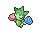
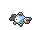
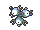
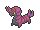
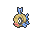
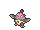
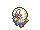
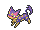

<!-- This file is generated by tools/generate_site.py. Edit the generator, not this file. -->

# Route 118

!!! tip "Wild Pokémon"

    See the [wild Pokémon of Route 118](../wild/route_118.md).

## Trainers - West of Inlet

| ID | Trainer | Pokémon |
| --- | --- | --- |
| 100 | **Aroma Lady Rose** | { .icon loading=lazy } [Sunkern](../pokemon/191.md) Lv. 22, { .icon loading=lazy } [Chikorita](../pokemon/152.md) Lv. 22, { .icon loading=lazy } [Roselia](../pokemon/315.md) Lv. 22 |
| 367 | **Guitarist Dalton** | { .icon loading=lazy } [Magnemite](../pokemon/081.md) Lv. 22, { .icon loading=lazy } [Whismur](../pokemon/293.md) Lv. 22, { .icon loading=lazy } [Chatot](../pokemon/441.md) Lv. 22 |
| 317 | **Fisherman Wade** | { .icon loading=lazy } [Carvanha](../pokemon/318.md) Lv. 23, { .icon loading=lazy } [Qwilfish](../pokemon/211.md) Lv. 23 |

## Rematches

| ID | Trainer | Pokémon |
| --- | --- | --- |
| 421 | **Aroma Lady Rose** 4 | { .icon loading=lazy } [Sunflora](../pokemon/192.md) Lv. 35, { .icon loading=lazy } [Bayleef](../pokemon/153.md) Lv. 35, { .icon loading=lazy } [Roselia](../pokemon/315.md) Lv. 35, { .icon loading=lazy } [Gloom](../pokemon/044.md) Lv. 35 |
| 422 | **Aroma Lady Rose** 6 | { .icon loading=lazy } [Sunflora](../pokemon/192.md) Lv. 47, { .icon loading=lazy } [Meganium](../pokemon/154.md) Lv. 47, { .icon loading=lazy } [Roserade](../pokemon/407.md) Lv. 47, { .icon loading=lazy } [Bellossom](../pokemon/182.md) Lv. 47 |
| 423 | **Aroma Lady Rose** 8 | { .icon loading=lazy } [Sunflora](../pokemon/192.md) Lv. 64, { .icon loading=lazy } [Meganium](../pokemon/154.md) Lv. 64, { .icon loading=lazy } [Roserade](../pokemon/407.md) Lv. 64, { .icon loading=lazy } [Bellossom](../pokemon/182.md) Lv. 64 |
| 424 | **Aroma Lady Rose** C | { .icon loading=lazy } [Sunflora](../pokemon/192.md) Lv. 75, { .icon loading=lazy } [Meganium](../pokemon/154.md) Lv. 75, { .icon loading=lazy } [Roserade](../pokemon/407.md) Lv. 75, { .icon loading=lazy } [Bellossom](../pokemon/182.md) Lv. 75 |
| 425 | **Guitarist Dalton** 4 | { .icon loading=lazy } [Magneton](../pokemon/082.md) Lv. 35, { .icon loading=lazy } [Loudred](../pokemon/294.md) Lv. 35, { .icon loading=lazy } [Chatot](../pokemon/441.md) Lv. 35, { .icon loading=lazy } [Scolipede](../pokemon/545.md) Lv. 35 |
| 426 | **Guitarist Dalton** 6 | { .icon loading=lazy } [Magneton](../pokemon/082.md) Lv. 47, { .icon loading=lazy } [Exploud](../pokemon/295.md) Lv. 47, { .icon loading=lazy } [Chatot](../pokemon/441.md) Lv. 47, { .icon loading=lazy } [Scolipede](../pokemon/545.md) Lv. 47 |
| 427 | **Guitarist Dalton** 8 | { .icon loading=lazy } [Magnezone](../pokemon/462.md) Lv. 64, { .icon loading=lazy } [Exploud](../pokemon/295.md) Lv. 64, { .icon loading=lazy } [Chatot](../pokemon/441.md) Lv. 64, { .icon loading=lazy } [Scolipede](../pokemon/545.md) Lv. 64 |
| 428 | **Guitarist Dalton** C | { .icon loading=lazy } [Magnezone](../pokemon/462.md) Lv. 75, { .icon loading=lazy } [Exploud](../pokemon/295.md) Lv. 75, { .icon loading=lazy } [Chatot](../pokemon/441.md) Lv. 75, { .icon loading=lazy } [Scolipede](../pokemon/545.md) Lv. 75 |

## Trainers - East of Inlet

| ID | Trainer | Pokémon |
| --- | --- | --- |
| xxx | **Interviewers Gabby & Ty** | <em>See Route 111</em> |
| 316 | **Fisherman Barny** | { .icon loading=lazy } [Feebas](../pokemon/349.md) Lv. 38, { .icon loading=lazy } [Feebas](../pokemon/349.md) Lv. 38 |
| 318 | **Bird Keeper Chester** | { .icon loading=lazy } [Staravia](../pokemon/397.md) Lv. 37, { .icon loading=lazy } [Fearow](../pokemon/022.md) Lv. 37, { .icon loading=lazy } [Vullaby](../pokemon/629.md) Lv. 37 |
| 102 | **Bird Keeper Perry** | { .icon loading=lazy } [Tranquill](../pokemon/520.md) Lv. 37, { .icon loading=lazy } [Noctowl](../pokemon/164.md) Lv. 37, { .icon loading=lazy } [Rufflet](../pokemon/627.md) Lv. 37 |
| 799 | **Delinquent Miley** | { .icon loading=lazy } [Mightyena](../pokemon/262.md) Lv. 38, { .icon loading=lazy } [Liepard](../pokemon/510.md) Lv. 38, { .icon loading=lazy } [Zoroark](../pokemon/571.md) Lv. 38 |

---

[:material-arrow-left: Route 115](route_115.md) · [All areas](index.md) · [Southern Island :material-arrow-right:](southern_island.md)
