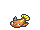

<!-- This file is generated by tools/generate_site.py. Edit the generator, not this file. -->

# Route 119 (Fortree)

!!! tip "Wild Pokémon"

    See the [wild Pokémon of Route 119 (Fortree)](../wild/route_119_fortree.md).

## Trainers

| ID | Trainer | Pokémon |
| --- | --- | --- |
| 292 | **PKMN Trainer Brendan** | { .icon loading=lazy } [Swellow](../pokemon/277.md) Lv. 47, { .icon loading=lazy } [Raichu](../pokemon/026.md) Lv. 47, { .icon loading=lazy } [Rapidash](../pokemon/078.md) Lv. 47, { .icon loading=lazy } [Wailord](../pokemon/321.md) Lv. 47, { .icon loading=lazy } [Sceptile](../pokemon/254.md) Lv. 49 |
| 293 | **PKMN Trainer Brendan** | { .icon loading=lazy } [Swellow](../pokemon/277.md) Lv. 47, { .icon loading=lazy } [Raichu](../pokemon/026.md) Lv. 47, { .icon loading=lazy } [Wailord](../pokemon/321.md) Lv. 47, { .icon loading=lazy } [Breloom](../pokemon/286.md) Lv. 47, { .icon loading=lazy } [Blaziken](../pokemon/257.md) Lv. 49 |
| 294 | **PKMN Trainer Brendan** | { .icon loading=lazy } [Swellow](../pokemon/277.md) Lv. 47, { .icon loading=lazy } [Raichu](../pokemon/026.md) Lv. 47, { .icon loading=lazy } [Breloom](../pokemon/286.md) Lv. 47, { .icon loading=lazy } [Rapidash](../pokemon/078.md) Lv. 47, { .icon loading=lazy } [Swampert](../pokemon/260.md) Lv. 49 |
| 298 | **PKMN Trainer May** | { .icon loading=lazy } [Swellow](../pokemon/277.md) Lv. 47, { .icon loading=lazy } [Raichu](../pokemon/026.md) Lv. 47, { .icon loading=lazy } [Rapidash](../pokemon/078.md) Lv. 47, { .icon loading=lazy } [Wailord](../pokemon/321.md) Lv. 47, { .icon loading=lazy } [Sceptile](../pokemon/254.md) Lv. 49 |
| 299 | **PKMN Trainer May** | { .icon loading=lazy } [Swellow](../pokemon/277.md) Lv. 47, { .icon loading=lazy } [Raichu](../pokemon/026.md) Lv. 47, { .icon loading=lazy } [Wailord](../pokemon/321.md) Lv. 47, { .icon loading=lazy } [Breloom](../pokemon/286.md) Lv. 47, { .icon loading=lazy } [Blaziken](../pokemon/257.md) Lv. 49 |
| 300 | **PKMN Trainer May** | { .icon loading=lazy } [Swellow](../pokemon/277.md) Lv. 47, { .icon loading=lazy } [Raichu](../pokemon/026.md) Lv. 47, { .icon loading=lazy } [Breloom](../pokemon/286.md) Lv. 47, { .icon loading=lazy } [Rapidash](../pokemon/078.md) Lv. 47, { .icon loading=lazy } [Swampert](../pokemon/260.md) Lv. 49 |
| 113 | **Ninja Boy Yasu** | { .icon loading=lazy } [Electrode](../pokemon/101.md) Lv. 43, { .icon loading=lazy } [Weezing](../pokemon/110.md) Lv. 43 |
| 616 | **Ninja Boy Hideo** | { .icon loading=lazy } [Greninja](../pokemon/658.md) Lv. 44 |
| 551 | **Fisherman Eugene** | { .icon loading=lazy } [Stunfisk](../pokemon/618.md) Lv. 44 |

## Special Battle - Rival

=== "Treecko"

    | Pokémon | Lv. | Item | Ability | Moves |
    | --- | --- | --- | --- | --- |
    | { .icon loading=lazy } [Swellow](../pokemon/277.md) | 47 | { .item loading=lazy } Flame Orb | <abbr title="Increases Attack to 1.5× with a major status ailment.">Guts</abbr> | Protect, Facade, Brave Bird, Steel Wing |
    | { .icon loading=lazy } [Raichu](../pokemon/026.md) | 47 | { .item loading=lazy } Expert Belt | <abbr title="Has a 30% chance of paralyzing attacking Pokémon on contact.">Static</abbr> | Thunderbolt, Surf, Focus Blast, Nuzzle |
    | { .icon loading=lazy } [Rapidash](../pokemon/078.md) | 47 | { .item loading=lazy } Wide Lens | <abbr title="Has a 30% chance of burning attacking Pokémon on contact.">Flame Body</abbr> | Flare Blitz, Wild Charge, Hypnosis, Megahorn |
    | { .icon loading=lazy } [Wailord](../pokemon/321.md) | 47 | { .item loading=lazy } Leftovers | <abbr title="Prevents burns.">Water Veil</abbr> | Aqua Ring, Scald, Ice Beam, Earthquake |
    | { .icon loading=lazy } [Sceptile](../pokemon/254.md) | 49 | { .item loading=lazy } Sitrus Berry | <abbr title="Strengthens Grass moves to inflict 1.5× damage at 1/3 max HP or less.">Overgrow</abbr> | Energy Ball, Focus Blast, Dragon Pulse, Grass Whistle |

=== "Torchic"

    | Pokémon | Lv. | Item | Ability | Moves |
    | --- | --- | --- | --- | --- |
    | { .icon loading=lazy } [Swellow](../pokemon/277.md) | 47 | { .item loading=lazy } Flame Orb | <abbr title="Increases Attack to 1.5× with a major status ailment.">Guts</abbr> | Protect, Facade, Brave Bird, Steel Wing |
    | { .icon loading=lazy } [Raichu](../pokemon/026.md) | 47 | { .item loading=lazy } Expert Belt | <abbr title="Has a 30% chance of paralyzing attacking Pokémon on contact.">Static</abbr> | Thunderbolt, Surf, Focus Blast, Nuzzle |
    | { .icon loading=lazy } [Wailord](../pokemon/321.md) | 47 | { .item loading=lazy } Leftovers | <abbr title="Prevents burns.">Water Veil</abbr> | Aqua Ring, Scald, Ice Beam, Earthquake |
    | { .icon loading=lazy } [Breloom](../pokemon/286.md) | 47 | { .item loading=lazy } Bright Powder | <abbr title="Strengthens moves of 60 base power or less to 1.5× their power.">Technician</abbr> | Spore, Bullet Seed, Mach Punch, Rock Tomb |
    | { .icon loading=lazy } [Blaziken](../pokemon/257.md) | 49 | { .item loading=lazy } Sitrus Berry | <abbr title="Strengthens Fire moves to inflict 1.5× damage at 1/3 max HP or less.">Blaze</abbr> | Blaze Kick, Focus Blast, Thunder Punch, Will-O-Wisp |

=== "Mudkip"

    | Pokémon | Lv. | Item | Ability | Moves |
    | --- | --- | --- | --- | --- |
    | { .icon loading=lazy } [Swellow](../pokemon/277.md) | 47 | { .item loading=lazy } Flame Orb | <abbr title="Increases Attack to 1.5× with a major status ailment.">Guts</abbr> | Protect, Facade, Brave Bird, Steel Wing |
    | { .icon loading=lazy } [Raichu](../pokemon/026.md) | 47 | { .item loading=lazy } Expert Belt | <abbr title="Has a 30% chance of paralyzing attacking Pokémon on contact.">Static</abbr> | Thunderbolt, Surf, Focus Blast, Nuzzle |
    | { .icon loading=lazy } [Breloom](../pokemon/286.md) | 47 | { .item loading=lazy } Bright Powder | <abbr title="Strengthens moves of 60 base power or less to 1.5× their power.">Technician</abbr> | Spore, Bullet Seed, Mach Punch, Rock Tomb |
    | { .icon loading=lazy } [Rapidash](../pokemon/078.md) | 47 | { .item loading=lazy } Wide Lens | <abbr title="Has a 30% chance of burning attacking Pokémon on contact.">Flame Body</abbr> | Flare Blitz, Wild Charge, Hypnosis, Megahorn |
    | { .icon loading=lazy } [Swampert](../pokemon/260.md) | 49 | { .item loading=lazy } Sitrus Berry | <abbr title="Strengthens Water moves to inflict 1.5× damage at 1/3 max HP or less.">Torrent</abbr> | Aqua Tail, Earthquake, Sludge Wave, Yawn |

---

[:material-arrow-left: Weather Institute](weather_institute.md) · [All areas](index.md) · [Fortree City :material-arrow-right:](fortree_city.md)
