<!-- This file is generated by tools/generate_site.py. Edit the generator, not this file. -->

# Route 119 (Mauville)

!!! tip "Wild Pokémon"

    See the [wild Pokémon of Route 119 (Mauville)](../wild/route_119_mauville.md).

## Trainers

| ID | Trainer | Pokémon |
| --- | --- | --- |
| 104 | **Bug Maniac Donald** | 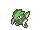{ .icon loading=lazy } [Scyther](../pokemon/123.md) Lv. 40, 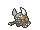{ .icon loading=lazy } [Pinsir](../pokemon/127.md) Lv. 40, { .icon loading=lazy } [Heracross](../pokemon/214.md) Lv. 40 |
| 106 | **Bug Catcher Doug** | { .icon loading=lazy } [Beautifly](../pokemon/267.md) Lv. 39, { .icon loading=lazy } [Parasect](../pokemon/047.md) Lv. 39, { .icon loading=lazy } [Ninjask](../pokemon/291.md) Lv. 39 |
| 108 | **Bug Catcher Kent** | { .icon loading=lazy } [Dustox](../pokemon/269.md) Lv. 39, 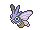{ .icon loading=lazy } [Venomoth](../pokemon/049.md) Lv. 39, { .icon loading=lazy } [Wormadam](../pokemon/413.md) Lv. 39 |
| 107 | **Bug Catcher Greg** | { .icon loading=lazy } [Ariados](../pokemon/168.md) Lv. 39, 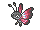{ .icon loading=lazy } [Vivillon](../pokemon/666.md) Lv. 39, { .icon loading=lazy } [Beedrill](../pokemon/015.md) Lv. 39 |
| 105 | **Bug Maniac Taylor** | 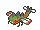{ .icon loading=lazy } [Yanmega](../pokemon/469.md) Lv. 40, { .icon loading=lazy } [Vespiquen](../pokemon/416.md) Lv. 40, { .icon loading=lazy } [Armaldo](../pokemon/348.md) Lv. 40 |
| 103 | **Bug Maniac Brent** | 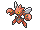{ .icon loading=lazy } [Scizor](../pokemon/212.md) Lv. 40, 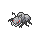{ .icon loading=lazy } [Durant](../pokemon/632.md) Lv. 40, 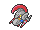{ .icon loading=lazy } [Escavalier](../pokemon/589.md) Lv. 40 |
| 110 | **PKMN Ranger Catherine** | 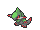{ .icon loading=lazy } [Fraxure](../pokemon/611.md) Lv. 40, { .icon loading=lazy } [Torterra](../pokemon/389.md) Lv. 40, 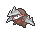{ .icon loading=lazy } [Excadrill](../pokemon/530.md) Lv. 40 |
| 731 | **Brains & Brawn Jael & Kael** | { .icon loading=lazy } [Alakazam](../pokemon/065.md) Lv. 43, 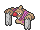{ .icon loading=lazy } [Conkeldurr](../pokemon/534.md) Lv. 43 |
| 109 | **PKMN Ranger Jackson** | 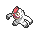{ .icon loading=lazy } [Vigoroth](../pokemon/288.md) Lv. 40, 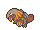{ .icon loading=lazy } [Heatmor](../pokemon/631.md) Lv. 40, 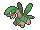{ .icon loading=lazy } [Tropius](../pokemon/357.md) Lv. 40 |
| 111 | **Bird Keeper Hugh** | 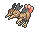{ .icon loading=lazy } [Dodrio](../pokemon/085.md) Lv. 41, { .icon loading=lazy } [Swellow](../pokemon/277.md) Lv. 41 |
| 114 | **Ninja Boy Takashi** | 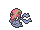{ .icon loading=lazy } [Accelgor](../pokemon/617.md) Lv. 42 |
| 112 | **Bird Keeper Phil** | { .icon loading=lazy } [Natu](../pokemon/177.md) Lv. 40, { .icon loading=lazy } [Natu](../pokemon/177.md) Lv. 40, 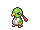{ .icon loading=lazy } [Xatu](../pokemon/178.md) Lv. 40 |

## Rematches

| ID | Trainer | Pokémon |
| --- | --- | --- |
| 433 | **PKMN Ranger Catherine** 6 | { .icon loading=lazy } [Fraxure](../pokemon/611.md) Lv. 47, { .icon loading=lazy } [Torterra](../pokemon/389.md) Lv. 47, { .icon loading=lazy } [Excadrill](../pokemon/530.md) Lv. 47, { .icon loading=lazy } [Beartic](../pokemon/614.md) Lv. 47 |
| 434 | **PKMN Ranger Catherine** 7 | 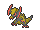{ .icon loading=lazy } [Haxorus](../pokemon/612.md) Lv. 59, { .icon loading=lazy } [Torterra](../pokemon/389.md) Lv. 59, { .icon loading=lazy } [Excadrill](../pokemon/530.md) Lv. 59, { .icon loading=lazy } [Beartic](../pokemon/614.md) Lv. 59 |
| 435 | **PKMN Ranger Catherine** 8 | { .icon loading=lazy } [Haxorus](../pokemon/612.md) Lv. 64, { .icon loading=lazy } [Torterra](../pokemon/389.md) Lv. 64, { .icon loading=lazy } [Excadrill](../pokemon/530.md) Lv. 64, { .icon loading=lazy } [Beartic](../pokemon/614.md) Lv. 64 |
| 436 | **PKMN Ranger Catherine** C | { .icon loading=lazy } [Haxorus](../pokemon/612.md) Lv. 75, { .icon loading=lazy } [Torterra](../pokemon/389.md) Lv. 75, { .icon loading=lazy } [Excadrill](../pokemon/530.md) Lv. 75, { .icon loading=lazy } [Beartic](../pokemon/614.md) Lv. 75 |
| 733 | **Brains & Brawn Jael & Kael** 6 | { .icon loading=lazy } [Alakazam](../pokemon/065.md) Lv. 47, { .icon loading=lazy } [Conkeldurr](../pokemon/534.md) Lv. 47 |
| 734 | **Brains & Brawn Jael & Kael** 7 | { .icon loading=lazy } [Alakazam](../pokemon/065.md) Lv. 59, { .icon loading=lazy } [Conkeldurr](../pokemon/534.md) Lv. 59, 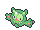{ .icon loading=lazy } [Reuniclus](../pokemon/579.md) Lv. 59, { .icon loading=lazy } [Machamp](../pokemon/068.md) Lv. 59 |
| 735 | **Brains & Brawn Jael & Kael** 8 | { .icon loading=lazy } [Alakazam](../pokemon/065.md) Lv. 64, { .icon loading=lazy } [Conkeldurr](../pokemon/534.md) Lv. 64, { .icon loading=lazy } [Reuniclus](../pokemon/579.md) Lv. 64, { .icon loading=lazy } [Machamp](../pokemon/068.md) Lv. 64 |
| 736 | **Brains & Brawn Jael & Kael** C | { .icon loading=lazy } [Alakazam](../pokemon/065.md) Lv. 75, { .icon loading=lazy } [Conkeldurr](../pokemon/534.md) Lv. 75, { .icon loading=lazy } [Reuniclus](../pokemon/579.md) Lv. 75, { .icon loading=lazy } [Machamp](../pokemon/068.md) Lv. 75 |
| 429 | **PKMN Ranger Jackson** 6 | { .icon loading=lazy } [Vigoroth](../pokemon/288.md) Lv. 47, { .icon loading=lazy } [Heatmor](../pokemon/631.md) Lv. 47, { .icon loading=lazy } [Tropius](../pokemon/357.md) Lv. 47, { .icon loading=lazy } [Kingdra](../pokemon/230.md) Lv. 47 |
| 430 | **PKMN Ranger Jackson** 7 | { .icon loading=lazy } [Slaking](../pokemon/289.md) Lv. 59, { .icon loading=lazy } [Heatmor](../pokemon/631.md) Lv. 59, { .icon loading=lazy } [Tropius](../pokemon/357.md) Lv. 59, { .icon loading=lazy } [Kingdra](../pokemon/230.md) Lv. 59 |
| 431 | **PKMN Ranger Jackson** 8 | { .icon loading=lazy } [Slaking](../pokemon/289.md) Lv. 64, { .icon loading=lazy } [Heatmor](../pokemon/631.md) Lv. 64, { .icon loading=lazy } [Tropius](../pokemon/357.md) Lv. 64, { .icon loading=lazy } [Kingdra](../pokemon/230.md) Lv. 64 |
| 432 | **PKMN Ranger Jackson** C | { .icon loading=lazy } [Slaking](../pokemon/289.md) Lv. 75, { .icon loading=lazy } [Heatmor](../pokemon/631.md) Lv. 75, { .icon loading=lazy } [Tropius](../pokemon/357.md) Lv. 75, { .icon loading=lazy } [Kingdra](../pokemon/230.md) Lv. 75 |

---

[:material-arrow-left: Southern Island](southern_island.md) · [All areas](index.md) · [Weather Institute :material-arrow-right:](weather_institute.md)
