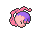
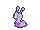
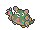
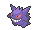

<!-- This file is generated by tools/generate_site.py. Edit the generator, not this file. -->

# Route 123

!!! tip "Wild Pokémon"

    See the [wild Pokémon of Route 123](../wild/route_123.md).

## Trainers

| ID | Trainer | Pokémon |
| --- | --- | --- |
| 319 | **Aroma Lady Violet** | { .icon loading=lazy } [Gloom](../pokemon/044.md) Lv. 39, { .icon loading=lazy } [Vileplume](../pokemon/045.md) Lv. 39, { .icon loading=lazy } [Bellossom](../pokemon/182.md) Lv. 39 |
| 276 | **Twins Miu & Yuki** | { .icon loading=lazy } [Simisear](../pokemon/514.md) Lv. 41, { .icon loading=lazy } [Simisage](../pokemon/512.md) Lv. 41 |
| 321 | **Psychic Cameron** | { .icon loading=lazy } [Malamar](../pokemon/687.md) Lv. 50, { .icon loading=lazy } [Grumpig](../pokemon/326.md) Lv. 50, { .icon loading=lazy } [Musharna](../pokemon/518.md) Lv. 50 |
| 219 | **Picnicker Martha** | { .icon loading=lazy } [Leafeon](../pokemon/470.md) Lv. 49, { .icon loading=lazy } [Piloswine](../pokemon/221.md) Lv. 49, { .icon loading=lazy } [Sliggoo](../pokemon/705.md) Lv. 49 |
| 792 | **Street Thug Hannibal** | { .icon loading=lazy } [Doublade](../pokemon/680.md) Lv. 50, { .icon loading=lazy } [Muk](../pokemon/089.md) Lv. 50, { .icon loading=lazy } [Garbodor](../pokemon/569.md) Lv. 50 |
| 801 | **Delinquent Kylie** | { .icon loading=lazy } [Victreebel](../pokemon/071.md) Lv. 50, { .icon loading=lazy } [Umbreon](../pokemon/197.md) Lv. 50, { .icon loading=lazy } [Bisharp](../pokemon/625.md) Lv. 50 |
| 581 | **Ace Trainer Clyde** | { .icon loading=lazy } [Haxorus](../pokemon/612.md) Lv. 50, { .icon loading=lazy } [Rhyperior](../pokemon/464.md) Lv. 50, { .icon loading=lazy } [Blaziken](../pokemon/257.md) Lv. 50, { .icon loading=lazy } [Gengar](../pokemon/094.md) Lv. 50 |
| 352 | **Ace Trainer Julie** | { .icon loading=lazy } [Stantler](../pokemon/234.md) Lv. 50, { .icon loading=lazy } [Typhlosion](../pokemon/157.md) Lv. 50, { .icon loading=lazy } [Klinklang](../pokemon/601.md) Lv. 50, { .icon loading=lazy } [Lilligant](../pokemon/549.md) Lv. 50 |
| 580 | **Ace Trainer Wendy** | { .icon loading=lazy } [Gothitelle](../pokemon/576.md) Lv. 50, { .icon loading=lazy } [Samurott](../pokemon/503.md) Lv. 50, { .icon loading=lazy } [Volcarona](../pokemon/637.md) Lv. 50, { .icon loading=lazy } [Roserade](../pokemon/407.md) Lv. 50 |
| 774 | **Fisherman Timin** | { .icon loading=lazy } [Seaking](../pokemon/119.md) Lv. 51 |
| 776 | **Fisherman Fisher** | { .icon loading=lazy } [Whiscash](../pokemon/340.md) Lv. 51 |
| 775 | **Fisherman Finley** | { .icon loading=lazy } [Crawdaunt](../pokemon/342.md) Lv. 51 |

## Rematches

| ID | Trainer | Pokémon |
| --- | --- | --- |
| 445 | **Psychic Cameron** 7 | { .icon loading=lazy } [Malamar](../pokemon/687.md) Lv. 59, { .icon loading=lazy } [Grumpig](../pokemon/326.md) Lv. 59, { .icon loading=lazy } [Musharna](../pokemon/518.md) Lv. 59, { .icon loading=lazy } [Solrock](../pokemon/338.md) Lv. 59 |
| 446 | **Psychic Cameron** 8 | { .icon loading=lazy } [Malamar](../pokemon/687.md) Lv. 64, { .icon loading=lazy } [Grumpig](../pokemon/326.md) Lv. 64, { .icon loading=lazy } [Musharna](../pokemon/518.md) Lv. 64, { .icon loading=lazy } [Solrock](../pokemon/338.md) Lv. 64 |
| 447 | **Psychic Cameron** C | { .icon loading=lazy } [Malamar](../pokemon/687.md) Lv. 75, { .icon loading=lazy } [Grumpig](../pokemon/326.md) Lv. 75, { .icon loading=lazy } [Musharna](../pokemon/518.md) Lv. 75, { .icon loading=lazy } [Solrock](../pokemon/338.md) Lv. 75 |

---

[:material-arrow-left: Route 121](route_121.md) · [All areas](index.md) · [Mt. Pyre 1F / 2F :material-arrow-right:](mt_pyre_1f_2f.md)
