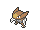

<!-- This file is generated by tools/generate_site.py. Edit the generator, not this file. -->

# Route 124

!!! tip "Wild Pokémon"

    See the [wild Pokémon of Route 124](../wild/route_124.md).

## Trainers

| ID | Trainer | Pokémon |
| --- | --- | --- |
| 143 | **Swimmer Jenny** | { .icon loading=lazy } [Luvdisc](../pokemon/370.md) Lv. 53, { .icon loading=lazy } [Corsola](../pokemon/222.md) Lv. 53, { .icon loading=lazy } [Alomomola](../pokemon/594.md) Lv. 53 |
| 131 | **Swimmer Roland** | { .icon loading=lazy } [Kabutops](../pokemon/141.md) Lv. 53, { .icon loading=lazy } [Poliwrath](../pokemon/062.md) Lv. 53, { .icon loading=lazy } [Octillery](../pokemon/224.md) Lv. 53 |
| 144 | **Swimmer Grace** | { .icon loading=lazy } [Azumarill](../pokemon/184.md) Lv. 54, { .icon loading=lazy } [Politoed](../pokemon/186.md) Lv. 54 |
| 545 | **Sis & Bro Rita & Sam** | { .icon loading=lazy } [Empoleon](../pokemon/395.md) Lv. 55, { .icon loading=lazy } [Samurott](../pokemon/503.md) Lv. 56 |
| 130 | **Swimmer Spencer** | { .icon loading=lazy } [Pelipper](../pokemon/279.md) Lv. 53, { .icon loading=lazy } [Tentacruel](../pokemon/073.md) Lv. 53, { .icon loading=lazy } [Whiscash](../pokemon/340.md) Lv. 53 |
| 193 | **Swimmer Chad** | { .icon loading=lazy } [Golduck](../pokemon/055.md) Lv. 53, { .icon loading=lazy } [Slowking](../pokemon/199.md) Lv. 53, { .icon loading=lazy } [Bibarel](../pokemon/400.md) Lv. 53 |

## Rematches

| ID | Trainer | Pokémon |
| --- | --- | --- |
| 507 | **Swimmer Jenny** 8 | { .icon loading=lazy } [Luvdisc](../pokemon/370.md) Lv. 64, { .icon loading=lazy } [Corsola](../pokemon/222.md) Lv. 64, { .icon loading=lazy } [Alomomola](../pokemon/594.md) Lv. 64, { .icon loading=lazy } [Gorebyss](../pokemon/368.md) Lv. 64 |
| 508 | **Swimmer Jenny** C | { .icon loading=lazy } [Luvdisc](../pokemon/370.md) Lv. 75, { .icon loading=lazy } [Corsola](../pokemon/222.md) Lv. 75, { .icon loading=lazy } [Alomomola](../pokemon/594.md) Lv. 75, { .icon loading=lazy } [Gorebyss](../pokemon/368.md) Lv. 75 |
| 546 | **Sis & Bro Rita & Sam** 7 | { .icon loading=lazy } [Empoleon](../pokemon/395.md) Lv. 59, { .icon loading=lazy } [Samurott](../pokemon/503.md) Lv. 60 |
| 547 | **Sis & Bro Rita & Sam** 8 | { .icon loading=lazy } [Empoleon](../pokemon/395.md) Lv. 65, { .icon loading=lazy } [Samurott](../pokemon/503.md) Lv. 66, { .icon loading=lazy } [Feraligatr](../pokemon/160.md) Lv. 65, { .icon loading=lazy } [Blastoise](../pokemon/009.md) Lv. 66 |
| 548 | **Sis & Bro Rita & Sam** C | { .icon loading=lazy } [Empoleon](../pokemon/395.md) Lv. 75, { .icon loading=lazy } [Samurott](../pokemon/503.md) Lv. 76, { .icon loading=lazy } [Feraligatr](../pokemon/160.md) Lv. 75, { .icon loading=lazy } [Blastoise](../pokemon/009.md) Lv. 76 |

---

[:material-arrow-left: Aqua Hideout](aqua_hideout.md) · [All areas](index.md) · [Route 125 :material-arrow-right:](route_125.md)
