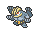
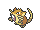
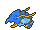
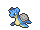

<!-- This file is generated by tools/generate_site.py. Edit the generator, not this file. -->

# Route 125

!!! tip "Wild Pokémon"

    See the [wild Pokémon of Route 125](../wild/route_125.md).

## Trainers

| ID | Trainer | Pokémon |
| --- | --- | --- |
| 194 | **Sailor Ernest** | { .icon loading=lazy } [Gastrodon](../pokemon/423.md) Lv. 54, { .icon loading=lazy } [Machamp](../pokemon/068.md) Lv. 54, { .icon loading=lazy } [Raticate](../pokemon/020.md) Lv. 54 |
| 631 | **Teammates Kim & Iris** | { .icon loading=lazy } [Altaria](../pokemon/334.md) Lv. 56, { .icon loading=lazy } [Charizard](../pokemon/006.md) Lv. 57 |
| 133 | **Swimmer Stan** | { .icon loading=lazy } [Carracosta](../pokemon/565.md) Lv. 55, { .icon loading=lazy } [Clawitzer](../pokemon/693.md) Lv. 55 |
| 145 | **Swimmer Tanya** | { .icon loading=lazy } [Floatzel](../pokemon/419.md) Lv. 55, { .icon loading=lazy } [Mantine](../pokemon/226.md) Lv. 55 |
| 146 | **Swimmer Sharon** | { .icon loading=lazy } [Lapras](../pokemon/131.md) Lv. 56 |
| 132 | **Swimmer Cody** | { .icon loading=lazy } [Feraligatr](../pokemon/160.md) Lv. 55, { .icon loading=lazy } [Ludicolo](../pokemon/272.md) Lv. 55 |

## Rematches

| ID | Trainer | Pokémon |
| --- | --- | --- |
| 453 | **Sailor Ernest** 8 | { .icon loading=lazy } [Gastrodon](../pokemon/423.md) Lv. 64, { .icon loading=lazy } [Machamp](../pokemon/068.md) Lv. 64, { .icon loading=lazy } [Raticate](../pokemon/020.md) Lv. 64, { .icon loading=lazy } [Kingler](../pokemon/099.md) Lv. 64 |
| 454 | **Sailor Ernest** C | { .icon loading=lazy } [Gastrodon](../pokemon/423.md) Lv. 75, { .icon loading=lazy } [Machamp](../pokemon/068.md) Lv. 75, { .icon loading=lazy } [Raticate](../pokemon/020.md) Lv. 75, { .icon loading=lazy } [Kingler](../pokemon/099.md) Lv. 75 |

---

[:material-arrow-left: Route 124](route_124.md) · [All areas](index.md) · [Route 126 :material-arrow-right:](route_126.md)
