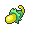

<!-- This file is generated by tools/generate_site.py. Edit the generator, not this file. -->

# Route 131 (Post Game)

Post Game

## Trainers

| ID | Trainer | Pokémon |
| --- | --- | --- |
| 943 | **Sootopolitan Wallace** | { .icon loading=lazy } [Politoed](../pokemon/186.md) Lv. 77, { .icon loading=lazy } [Ludicolo](../pokemon/272.md) Lv. 77, { .icon loading=lazy } [Kingdra](../pokemon/230.md) Lv. 77, { .icon loading=lazy } [Gyarados](../pokemon/130.md) Lv. 77, { .icon loading=lazy } [Milotic](../pokemon/350.md) Lv. 79, { .icon loading=lazy } [Swampert](../pokemon/260.md) Lv. 79 |

## Special Battle - Wallace

| Pokémon | Lv. | Item | Ability | Moves |
| --- | --- | --- | --- | --- |
| { .icon loading=lazy } [Politoed](../pokemon/186.md) | 77 | { .item loading=lazy } Damp Rock | <abbr title="Summons rain that lasts indefinitely upon entering battle.">Drizzle</abbr> | Hydro Pump, Blizzard, Focus Blast, Hypnosis |
| { .icon loading=lazy } [Ludicolo](../pokemon/272.md) | 77 | { .item loading=lazy } Life Orb | <abbr title="Doubles Speed during rain.">Swift Swim</abbr> | Hydro Pump, Ice Beam, Energy Ball, Rain Dance |
| { .icon loading=lazy } [Kingdra](../pokemon/230.md) | 77 | { .item loading=lazy } Mystic Water | <abbr title="Doubles Speed during rain.">Swift Swim</abbr> | Hydro Pump, Ice Beam, Dragon Pulse, Rain Dance |
| { .icon loading=lazy } [Gyarados](../pokemon/130.md) | 77 | { .item loading=lazy } Wacan Berry | <abbr title="Lowers opponents' Attack one stage upon entering battle.">Intimidate</abbr> | Dragon Dance, Waterfall, Earthquake, Bounce |
| { .icon loading=lazy } [Milotic](../pokemon/350.md) | 79 | { .item loading=lazy } Sitrus Berry | <abbr title="Has a 30% chance of infatuating attacking Pokémon on contact.">Cute Charm</abbr> | Hydro Pump, Ice Beam, Recover, Hypnosis |
| { .icon loading=lazy } [Swampert](../pokemon/260.md) | 79 | { .item loading=lazy } Swampertite | <abbr title="Strengthens Water moves to inflict 1.5× damage at 1/3 max HP or less.">Torrent</abbr> | Waterfall, Earthquake, Stone Edge, Ice Punch |

---

[:material-arrow-left: Aqua Hideout (Post Game)](aqua_hideout_post_game.md) · [All areas](index.md) · [Sky Pillar :material-arrow-right:](sky_pillar.md)
