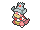

<!-- This file is generated by tools/generate_site.py. Edit the generator, not this file. -->

# Route 133

!!! tip "Wild Pokémon"

    See the [wild Pokémon of Route 133](../wild/route_133.md).

## Trainers

| ID | Trainer | Pokémon |
| --- | --- | --- |
| 153 | **Swimmer Debra** | { .icon loading=lazy } [Corsola](../pokemon/222.md) Lv. 59 |
| 140 | **Swimmer Franklin** | { .icon loading=lazy } [Whiscash](../pokemon/340.md) Lv. 59 |
| 154 | **Swimmer Linda** | { .icon loading=lazy } [Seaking](../pokemon/119.md) Lv. 59 |
| 152 | **Swimmer Sheryl** | { .icon loading=lazy } [Slowking](../pokemon/199.md) Lv. 59 |
| 506 | **Bird Keeper Beck** | { .icon loading=lazy } [Dodrio](../pokemon/085.md) Lv. 57, { .icon loading=lazy } [Altaria](../pokemon/334.md) Lv. 57, { .icon loading=lazy } [Honchkrow](../pokemon/430.md) Lv. 57 |
| 503 | **Ace Trainer Warren** | { .icon loading=lazy } [Scizor](../pokemon/212.md) Lv. 58, { .icon loading=lazy } [Chandelure](../pokemon/609.md) Lv. 58, { .icon loading=lazy } [Dusknoir](../pokemon/477.md) Lv. 58, { .icon loading=lazy } [Alakazam](../pokemon/065.md) Lv. 58 |
| 724 | **Backpacker Grayson** | { .icon loading=lazy } [Ditto](../pokemon/132.md) Lv. 59 |
| 779 | **Fisherman River** | { .icon loading=lazy } [Kingdra](../pokemon/230.md) Lv. 59 |

---

[:material-arrow-left: Route 132](route_132.md) · [All areas](index.md) · [Route 134 :material-arrow-right:](route_134.md)
