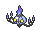
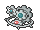
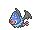
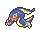

<!-- This file is generated by tools/generate_site.py. Edit the generator, not this file. -->

# Rustboro City

Post Game

## Trainers

| ID | Trainer | Pokémon |
| --- | --- | --- |
| 892 | **Team Magma Grunt** | { .icon loading=lazy } [Chandelure](../pokemon/609.md) Lv. 75, { .icon loading=lazy } [Klinklang](../pokemon/601.md) Lv. 75, { .icon loading=lazy } [Magmortar](../pokemon/467.md) Lv. 75 |
| 893 | **Team Magma Grunt** | { .icon loading=lazy } [Steelix](../pokemon/208.md) Lv. 75, { .icon loading=lazy } [Typhlosion](../pokemon/157.md) Lv. 75, { .icon loading=lazy } [Absol](../pokemon/359.md) Lv. 75 |
| 894 | **Team Magma Grunt** | { .icon loading=lazy } [Houndoom](../pokemon/229.md) Lv. 75, { .icon loading=lazy } [Mightyena](../pokemon/262.md) Lv. 75, { .icon loading=lazy } [Swoobat](../pokemon/528.md) Lv. 75 |
| 895 | **Team Aqua Grunt** | { .icon loading=lazy } [Eelektross](../pokemon/604.md) Lv. 75, { .icon loading=lazy } [Sunflora](../pokemon/192.md) Lv. 75, { .icon loading=lazy } [Starmie](../pokemon/121.md) Lv. 75 |
| 896 | **Team Aqua Grunt** | { .icon loading=lazy } [Tangrowth](../pokemon/465.md) Lv. 75, { .icon loading=lazy } [Empoleon](../pokemon/395.md) Lv. 75, { .icon loading=lazy } [Absol](../pokemon/359.md) Lv. 75 |
| 897 | **Team Aqua Grunt** | { .icon loading=lazy } [Tentacruel](../pokemon/073.md) Lv. 75, { .icon loading=lazy } [Liepard](../pokemon/510.md) Lv. 75, { .icon loading=lazy } [Swoobat](../pokemon/528.md) Lv. 75 |

---

[:material-arrow-left: Granite Cave 1F-2](granite_cave_1f_2.md) · [All areas](index.md) · [Mossdeep City (Post Game) :material-arrow-right:](mossdeep_city_post_game.md)
