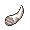
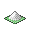

<!-- This file is generated by tools/generate_site.py. Edit the generator, not this file. -->

# Rustboro Gym

## Trainers

| ID | Trainer | Pokémon |
| --- | --- | --- |
| 562 | **Youngster Josh** | { .icon loading=lazy } [Roggenrola](../pokemon/524.md) Lv. 12, { .icon loading=lazy } [Geodude](../pokemon/074.md) Lv. 12, { .icon loading=lazy } [Cranidos](../pokemon/408.md) Lv. 12 |
| 022 | **Youngster Tommy** | { .icon loading=lazy } [Dwebble](../pokemon/557.md) Lv. 12, { .icon loading=lazy } [Shieldon](../pokemon/410.md) Lv. 12, { .icon loading=lazy } [Amaura](../pokemon/698.md) Lv. 12 |
| 667 | **Schoolkid Georgia** | { .icon loading=lazy } [Bonsly](../pokemon/438.md) Lv. 12, { .icon loading=lazy } [Kabuto](../pokemon/140.md) Lv. 12, { .icon loading=lazy } [Tirtouga](../pokemon/564.md) Lv. 12 |
| 561 | **Leader Roxanne** | { .icon loading=lazy } [Archen](../pokemon/566.md) Lv. 14, { .icon loading=lazy } [Omanyte](../pokemon/138.md) Lv. 14, { .icon loading=lazy } [Tyrunt](../pokemon/696.md) Lv. 14, { .icon loading=lazy } [Anorith](../pokemon/347.md) Lv. 14, { .icon loading=lazy } [Lileep](../pokemon/345.md) Lv. 14, { .icon loading=lazy } [Nosepass](../pokemon/299.md) Lv. 16 |

## Special Battle - Leader Roxanne

| Pokémon | Lv. | Item | Ability | Moves |
| --- | --- | --- | --- | --- |
| { .icon loading=lazy } [Archen](../pokemon/566.md) | 14 | { .item loading=lazy } Sharp Beak | <abbr title="Halves Attack and Special Attack at 50% max HP or less.">Defeatist</abbr> | Rock Tomb, Wing Attack, Double Team, Quick Attack |
| { .icon loading=lazy } [Omanyte](../pokemon/138.md) | 14 | { .item loading=lazy } Mystic Water | <abbr title="Raises Speed and lowers Defense by one stage each upon being hit by a physical move.">Weak Armor</abbr> | [Ancient Power](../changes/moves.md#ancient-power) changed, Bubble Beam, Icy Wind, Tickle |
| { .icon loading=lazy } [Tyrunt](../pokemon/696.md) | 14 | { .item loading=lazy } Dragon Fang | <abbr title="Strengthens biting moves to 1.5× their power.">Strong Jaw</abbr> | Rock Tomb, Dragon Pulse, Bite, Stealth Rock |
| { .icon loading=lazy } [Anorith](../pokemon/347.md) | 14 | { .item loading=lazy } Silver Powder | <abbr title="Protects against critical hits.">Battle Armor</abbr> | Rock Tomb, Bug Bite, Aqua Jet, Sandstorm |
| { .icon loading=lazy } [Lileep](../pokemon/345.md) | 14 | { .item loading=lazy } Miracle Seed | <abbr title="Redirects single-target Water moves to this Pokémon where possible.  Absorbs Water moves, raising Special Attack one stage.">Storm Drain</abbr> | Rock Tomb, Bullet Seed, Acid, Sandstorm |
| { .icon loading=lazy } [Nosepass](../pokemon/299.md) | 16 | { .item loading=lazy } Sitrus Berry | <abbr title="Strengthens Rock, Ground, and Steel moves to 1.3× their power during a sandstorm.  Protects against sandstorm damage.">Sand Force</abbr> | Rock Tomb, Magnitude, Zap Cannon, Lock-On |

---

[:material-arrow-left: Route 104 North](route_104_north.md) · [All areas](index.md) · [Route 116 :material-arrow-right:](route_116.md)
