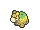
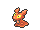
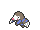

<!-- This file is generated by tools/generate_site.py. Edit the generator, not this file. -->

# Rusturf Tunnel

!!! tip "Wild Pokémon"

    See the [wild Pokémon of Rusturf Tunnel](../wild/rusturf_tunnel.md).

## Trainers

| ID | Trainer | Pokémon |
| --- | --- | --- |
| 254 | **Team Aqua Grunt** | { .icon loading=lazy } [Poochyena](../pokemon/261.md) Lv. 14, { .icon loading=lazy } [Carvanha](../pokemon/318.md) Lv. 14, { .icon loading=lazy } [Wailmer](../pokemon/320.md) Lv. 14 |
| 255 | **Team Magma Grunt** | { .icon loading=lazy } [Poochyena](../pokemon/261.md) Lv. 14, { .icon loading=lazy } [Numel](../pokemon/322.md) Lv. 14, { .icon loading=lazy } [Slugma](../pokemon/218.md) Lv. 14 |
| 307 | **Hiker Mike** | { .icon loading=lazy } [Dwebble](../pokemon/557.md) Lv. 22, { .icon loading=lazy } [Drilbur](../pokemon/529.md) Lv. 22, { .icon loading=lazy } [Larvitar](../pokemon/246.md) Lv. 22 |

---

[:material-arrow-left: Route 116](route_116.md) · [All areas](index.md) · [Route 106 :material-arrow-right:](route_106.md)
