<!-- This file is generated by tools/generate_site.py. Edit the generator, not this file. -->

# Seafloor Cavern Front Rooms

!!! tip "Wild Pokémon"

    See the [wild Pokémon of Seafloor Cavern Front Rooms](../wild/seafloor_cavern_front_rooms.md).

## Trainers

| ID | Trainer | Pokémon |
| --- | --- | --- |
| 242 | **Team Magma Grunt** | 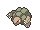{ .icon loading=lazy } [Golem](../pokemon/076.md) Lv. 60, 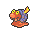{ .icon loading=lazy } [Magcargo](../pokemon/219.md) Lv. 60 |
| 243 | **Team Magma Grunt** | { .icon loading=lazy } [Steelix](../pokemon/208.md) Lv. 60, 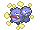{ .icon loading=lazy } [Weezing](../pokemon/110.md) Lv. 60 |
| 858 | **Team Magma Grunt** | 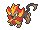{ .icon loading=lazy } [Pyroar](../pokemon/668.md) Lv. 60, 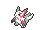{ .icon loading=lazy } [Zangoose](../pokemon/335.md) Lv. 60 |
| 244 | **Team Magma Grunt** | 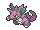{ .icon loading=lazy } [Nidoking](../pokemon/034.md) Lv. 60, { .icon loading=lazy } [Darmanitan](../pokemon/555.md) Lv. 60 |
| 862 | **Team Magma Grunt** | 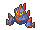{ .icon loading=lazy } [Gigalith](../pokemon/526.md) Lv. 60, { .icon loading=lazy } [Rapidash](../pokemon/078.md) Lv. 60 |
| 185 | **Team Aqua Grunt** | 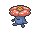{ .icon loading=lazy } [Vileplume](../pokemon/045.md) Lv. 60, 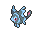{ .icon loading=lazy } [Lumineon](../pokemon/457.md) Lv. 60 |
| 186 | **Team Aqua Grunt** | 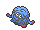{ .icon loading=lazy } [Tangrowth](../pokemon/465.md) Lv. 60, 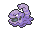{ .icon loading=lazy } [Muk](../pokemon/089.md) Lv. 60 |
| 860 | **Team Aqua Grunt** | { .icon loading=lazy } [Barbaracle](../pokemon/689.md) Lv. 60, 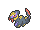{ .icon loading=lazy } [Seviper](../pokemon/336.md) Lv. 60 |
| 187 | **Team Aqua Grunt** | 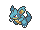{ .icon loading=lazy } [Nidoqueen](../pokemon/031.md) Lv. 60, { .icon loading=lazy } [Jellicent](../pokemon/593.md) Lv. 60 |
| 353 | **Team Aqua Grunt** | { .icon loading=lazy } [Roserade](../pokemon/407.md) Lv. 60, 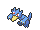{ .icon loading=lazy } [Golduck](../pokemon/055.md) Lv. 60 |

---

[:material-arrow-left: Underwater 130](underwater_130.md) · [All areas](index.md) · [Seafloor Cavern Back Rooms :material-arrow-right:](seafloor_cavern_back_rooms.md)
