<!-- This file is generated by tools/generate_site.py. Edit the generator, not this file. -->

# Sootopolis Gym

## Trainers

| ID | Trainer | Pokémon |
| --- | --- | --- |
| 341 | **Lass Andrea** | 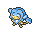{ .icon loading=lazy } [Simipour](../pokemon/516.md) Lv. 62, 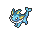{ .icon loading=lazy } [Vaporeon](../pokemon/134.md) Lv. 62, { .icon loading=lazy } [Wailord](../pokemon/321.md) Lv. 62 |
| 340 | **Beauty Tiffany** | 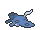{ .icon loading=lazy } [Mantine](../pokemon/226.md) Lv. 62, 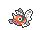{ .icon loading=lazy } [Seaking](../pokemon/119.md) Lv. 62, 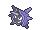{ .icon loading=lazy } [Cloyster](../pokemon/091.md) Lv. 62 |
| 339 | **Beauty Bridget** | 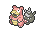{ .icon loading=lazy } [Slowbro](../pokemon/080.md) Lv. 62, 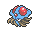{ .icon loading=lazy } [Tentacruel](../pokemon/073.md) Lv. 62, { .icon loading=lazy } [Quagsire](../pokemon/195.md) Lv. 62 |
| 338 | **Beauty Connie** | 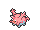{ .icon loading=lazy } [Corsola](../pokemon/222.md) Lv. 62, 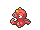{ .icon loading=lazy } [Octillery](../pokemon/224.md) Lv. 62, 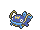{ .icon loading=lazy } [Whiscash](../pokemon/340.md) Lv. 62 |
| 594 | **Beauty Olivia** | 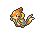{ .icon loading=lazy } [Floatzel](../pokemon/419.md) Lv. 62, { .icon loading=lazy } [Swanna](../pokemon/581.md) Lv. 62, { .icon loading=lazy } [Barbaracle](../pokemon/689.md) Lv. 62 |
| 646 | **Lady Brianna** | 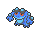{ .icon loading=lazy } [Seismitoad](../pokemon/537.md) Lv. 62, { .icon loading=lazy } [Lumineon](../pokemon/457.md) Lv. 62, { .icon loading=lazy } [Pelipper](../pokemon/279.md) Lv. 62 |
| 647 | **Poké Fan Marissa** | 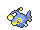{ .icon loading=lazy } [Lanturn](../pokemon/171.md) Lv. 62, 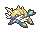{ .icon loading=lazy } [Samurott](../pokemon/503.md) Lv. 62, 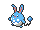{ .icon loading=lazy } [Azumarill](../pokemon/184.md) Lv. 62 |
| 342 | **Lass Crissy** | 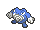{ .icon loading=lazy } [Poliwrath](../pokemon/062.md) Lv. 62, 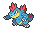{ .icon loading=lazy } [Feraligatr](../pokemon/160.md) Lv. 62, 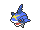{ .icon loading=lazy } [Sharpedo](../pokemon/319.md) Lv. 62 |
| 572 | **Leader Wallace** | { .icon loading=lazy } [Politoed](../pokemon/186.md) Lv. 65, { .icon loading=lazy } [Ludicolo](../pokemon/272.md) Lv. 65, 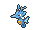{ .icon loading=lazy } [Kingdra](../pokemon/230.md) Lv. 65, 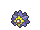{ .icon loading=lazy } [Starmie](../pokemon/121.md) Lv. 65, 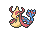{ .icon loading=lazy } [Milotic](../pokemon/350.md) Lv. 65, 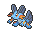{ .icon loading=lazy } [Swampert](../pokemon/260.md) Lv. 67 |

## Special Battle - Wallace

| Pokémon | Lv. | Item | Ability | Moves |
| --- | --- | --- | --- | --- |
| { .icon loading=lazy } [Politoed](../pokemon/186.md) | 65 | 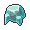{ .item loading=lazy } Damp Rock | <abbr title="Summons rain that lasts indefinitely upon entering battle.">Drizzle</abbr> | Hydro Pump, Ice Beam, Focus Blast, Hypnosis |
| { .icon loading=lazy } [Ludicolo](../pokemon/272.md) | 65 | { .item loading=lazy } Life Orb | <abbr title="Doubles Speed during rain.">Swift Swim</abbr> | Hydro Pump, Giga Drain, Ice Beam, Rain Dance |
| { .icon loading=lazy } [Kingdra](../pokemon/230.md) | 65 | 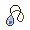{ .item loading=lazy } Mystic Water | <abbr title="Doubles Speed during rain.">Swift Swim</abbr> | Hydro Pump, Ice Beam, Dragon Pulse, Rain Dance |
| { .icon loading=lazy } [Starmie](../pokemon/121.md) | 65 | { .item loading=lazy } Expert Belt | <abbr title="Strengthens moves to 1.3× their power when moving last.">Analytic</abbr> | Hydro Pump, Ice Beam, Thunder, Psychic |
| { .icon loading=lazy } [Milotic](../pokemon/350.md) | 67 | { .item loading=lazy } Leftovers | <abbr title="Has a 30% chance of infatuating attacking Pokémon on contact.">Cute Charm</abbr> | Hydro Pump, Ice Beam, Recover, Protect |
| { .icon loading=lazy } [Swampert](../pokemon/260.md) | 67 | { .item loading=lazy } Swampertite | <abbr title="Strengthens Water moves to inflict 1.5× damage at 1/3 max HP or less.">Torrent</abbr> | Waterfall, Ice Punch, Earthquake, Stone Edge |

---

[:material-arrow-left: Seafloor Cavern Back Rooms](seafloor_cavern_back_rooms.md) · [All areas](index.md) · [Meteor Falls 1F-2 :material-arrow-right:](meteor_falls_1f_2.md)
