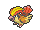
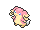

<!-- This file is generated by tools/generate_site.py. Edit the generator, not this file. -->

# Victory Road 1F

!!! tip "Wild Pokémon"

    See the [wild Pokémon of Victory Road 1F](../wild/victory_road_1f.md).

## Trainers

| ID | Trainer | Pokémon |
| --- | --- | --- |
| 344 | **Ace Trainer Albert** | { .icon loading=lazy } [Golem](../pokemon/076.md) Lv. 65, { .icon loading=lazy } [Venusaur](../pokemon/003.md) Lv. 65, { .icon loading=lazy } [Avalugg](../pokemon/713.md) Lv. 65, { .icon loading=lazy } [Jolteon](../pokemon/135.md) Lv. 65, { .icon loading=lazy } [Pidgeot](../pokemon/018.md) Lv. 65 |
| 348 | **Ace Trainer Hope** | { .icon loading=lazy } [Glaceon](../pokemon/471.md) Lv. 65, { .icon loading=lazy } [Gliscor](../pokemon/472.md) Lv. 65, { .icon loading=lazy } [Volcarona](../pokemon/637.md) Lv. 65, { .icon loading=lazy } [Exeggutor](../pokemon/103.md) Lv. 65, { .icon loading=lazy } [Audino](../pokemon/531.md) Lv. 65 |
| 343 | **Ace Trainer Edgar** | { .icon loading=lazy } [Gogoat](../pokemon/673.md) Lv. 65, { .icon loading=lazy } [Lapras](../pokemon/131.md) Lv. 65, { .icon loading=lazy } [Porygon-Z](../pokemon/474.md) Lv. 65, { .icon loading=lazy } [Shedinja](../pokemon/292.md) Lv. 65, { .icon loading=lazy } [Mawile](../pokemon/303.md) Lv. 65 |
| 793 | **Street Thug Regan** | { .icon loading=lazy } [Drapion](../pokemon/452.md) Lv. 65, { .icon loading=lazy } [Weavile](../pokemon/461.md) Lv. 65, { .icon loading=lazy } [Krookodile](../pokemon/553.md) Lv. 65, { .icon loading=lazy } [Toxicroak](../pokemon/454.md) Lv. 65, { .icon loading=lazy } [Beedrill](../pokemon/015.md) Lv. 65 |
| 732 | **Brains & Brawn Aden & Finn** | { .icon loading=lazy } [Musharna](../pokemon/518.md) Lv. 65, { .icon loading=lazy } [Primeape](../pokemon/057.md) Lv. 65, { .icon loading=lazy } [Gardevoir](../pokemon/282.md) Lv. 65, { .icon loading=lazy } [Pangoro](../pokemon/675.md) Lv. 65, { .icon loading=lazy } [Medicham](../pokemon/308.md) Lv. 65 |

---

[:material-arrow-left: Meteor Falls B1F](meteor_falls_b1f.md) · [All areas](index.md) · [Victory Road B1F :material-arrow-right:](victory_road_b1f.md)
