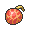
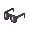

<!-- This file is generated by tools/generate_site.py. Edit the generator, not this file. -->

# Weather Institute

## Trainers

| ID | Trainer | Pokémon |
| --- | --- | --- |
| 261 | **Team Magma Grunt** | { .icon loading=lazy } [Mightyena](../pokemon/262.md) Lv. 43 |
| 262 | **Team Magma Grunt** | { .icon loading=lazy } [Steelix](../pokemon/208.md) Lv. 43 |
| 263 | **Team Magma Grunt** | { .icon loading=lazy } [Camerupt](../pokemon/323.md) Lv. 43 |
| 264 | **Team Magma Grunt** | { .icon loading=lazy } [Golbat](../pokemon/042.md) Lv. 43 |
| 693 | **Magma Admin Tabitha** | { .icon loading=lazy } [Mightyena](../pokemon/262.md) Lv. 46, { .icon loading=lazy } [Weezing](../pokemon/110.md) Lv. 46, { .icon loading=lazy } [Snorlax](../pokemon/143.md) Lv. 46, { .icon loading=lazy } [Gigalith](../pokemon/526.md) Lv. 46, { .icon loading=lazy } [Camerupt](../pokemon/323.md) Lv. 46, { .icon loading=lazy } [Darmanitan](../pokemon/555.md) Lv. 48 |
| 256 | **Team Aqua Grunt** | { .icon loading=lazy } [Liepard](../pokemon/510.md) Lv. 43 |
| 257 | **Team Aqua Grunt** | { .icon loading=lazy } [Tangrowth](../pokemon/465.md) Lv. 43 |
| 258 | **Team Aqua Grunt** | { .icon loading=lazy } [Sharpedo](../pokemon/319.md) Lv. 43 |
| 259 | **Team Aqua Grunt** | { .icon loading=lazy } [Golbat](../pokemon/042.md) Lv. 43 |
| 690 | **Aqua Admin Shelly** | { .icon loading=lazy } [Liepard](../pokemon/510.md) Lv. 46, { .icon loading=lazy } [Muk](../pokemon/089.md) Lv. 46, { .icon loading=lazy } [Lapras](../pokemon/131.md) Lv. 46, { .icon loading=lazy } [Roserade](../pokemon/407.md) Lv. 46, { .icon loading=lazy } [Sharpedo](../pokemon/319.md) Lv. 46, { .icon loading=lazy } [Jellicent](../pokemon/593.md) Lv. 48 |

## Special Battle - Tabitha

| Pokémon | Lv. | Item | Ability | Moves |
| --- | --- | --- | --- | --- |
| { .icon loading=lazy } [Mightyena](../pokemon/262.md) | 46 | { .item loading=lazy } Muscle Band | <abbr title="Lowers opponents' Attack one stage upon entering battle.">Intimidate</abbr> | Sucker Punch, Play Rough, Swagger, Iron Tail |
| { .icon loading=lazy } [Weezing](../pokemon/110.md) | 46 | { .item loading=lazy } Expert Belt | <abbr title="Evades Ground moves.">Levitate</abbr> | Sludge Bomb, Flamethrower, Thunderbolt, Toxic Spikes |
| { .icon loading=lazy } [Snorlax](../pokemon/143.md) | 46 | { .item loading=lazy } Leftovers | <abbr title="Halves damage from Fire and Ice moves.">Thick Fat</abbr> | Body Slam, Crunch, Rest, Sleep Talk |
| { .icon loading=lazy } [Gigalith](../pokemon/526.md) | 46 | { .item loading=lazy } Custap Berry | <abbr title="Prevents being KOed from full HP, leaving 1 HP instead.  Protects against the one-hit KO moves regardless of HP.">Sturdy</abbr> | Stone Edge, Superpower, Earthquake, Heavy Slam |
| { .icon loading=lazy } [Camerupt](../pokemon/323.md) | 46 | { .item loading=lazy } Focus Sash | <abbr title="Decreases damage taken from super-effective moves by 1/4.">Solid Rock</abbr> | Flamethrower, Earth Power, Rock Slide, Flash Cannon |
| { .icon loading=lazy } [Darmanitan](../pokemon/555.md) | 48 | { .item loading=lazy } Life Orb | <abbr title="Strengthens moves with extra effects to 1.3× their power, but prevents their extra effects.">Sheer Force</abbr> | Flare Blitz, Rock Slide, Zen Headbutt, Earthquake |

## Special Battle - Shelly

| Pokémon | Lv. | Item | Ability | Moves |
| --- | --- | --- | --- | --- |
| { .icon loading=lazy } [Liepard](../pokemon/510.md) | 46 | { .item loading=lazy } Black Glasses | <abbr title="Raises non-damaging moves' priority by one stage.">Prankster</abbr> | Dark Pulse, Play Rough, Thunder Wave, Swagger |
| { .icon loading=lazy } [Muk](../pokemon/089.md) | 46 | { .item loading=lazy } Black Sludge | <abbr title="Has a 30% chance of poisoning target Pokémon upon contact.">Poison Touch</abbr> | Gunk Shot, Earthquake, Infestation, Toxic |
| { .icon loading=lazy } [Lapras](../pokemon/131.md) | 46 | { .item loading=lazy } Leftovers | <abbr title="Absorbs Water moves, healing for 1/4 max HP.">Water Absorb</abbr> | Blizzard, Surf, Thunderbolt, Freeze-Dry |
| { .icon loading=lazy } [Roserade](../pokemon/407.md) | 46 | { .item loading=lazy } Expert Belt | <abbr title="Has a 30% chance of poisoning attacking Pokémon on contact.">Poison Point</abbr> | Giga Drain, Sludge Bomb, Dazzling Gleam, Shadow Ball |
| { .icon loading=lazy } [Sharpedo](../pokemon/319.md) | 46 | { .item loading=lazy } Focus Sash | <abbr title="Raises Speed one stage after each turn.">Speed Boost</abbr> | Hydro Pump, Crunch, Destiny Bond, Earthquake |
| { .icon loading=lazy } [Jellicent](../pokemon/593.md) | 48 | { .item loading=lazy } Sitrus Berry | <abbr title="Has a 30% chance of Disabling any move that hits the Pokémon.">Cursed Body</abbr> | Recover, Toxic, Surf, Shadow Ball |

---

[:material-arrow-left: Route 119 (Mauville)](route_119_mauville.md) · [All areas](index.md) · [Route 119 (Fortree) :material-arrow-right:](route_119_fortree.md)
